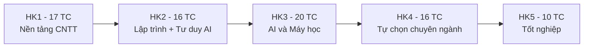
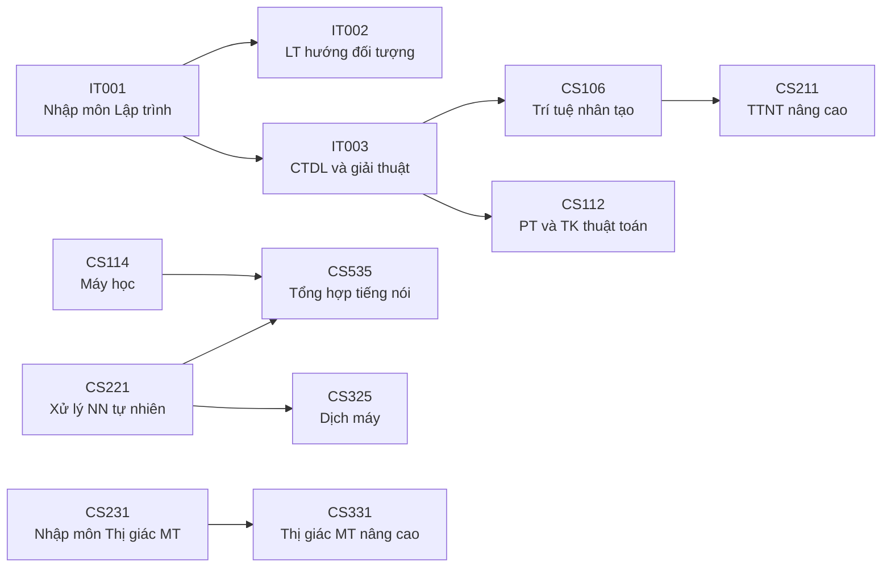

# Buổi 2 - Chương trình đào tạo và các quy định

- **Ngày**: 03/11/2026
- **Môn**: Giới thiệu ngành Trí tuệ nhân tạo (AI001.G11.CN2.TTNT)
- **Giảng viên**: Th.S Đỗ Văn Tiến

## Tài liệu buổi học

- CTĐT Cử nhân ngành TTNT văn bằng 2, hình thức đào tạo từ xa qua mạng (Khóa 2025): https://portal.uit.edu.vn/chuong-trinh-dao-tao/cu-nhan-nganh-tri-tue-nhan-tao-van-bang-dai-hoc-thu-2-hinh-thuc-dao-tao-tu-xa-qua-mang-khoa-2025
- Quy định tạm thời về Khóa luận tốt nghiệp, Đồ án tốt nghiệp hình thức đào tạo từ xa trình độ đại học (QĐ-ĐHCNTT, 29/8/2025): https://portal.uit.edu.vn/media/ums.portal.document/66/file_id?unique=6efbab87ccd9
- Quy định đào tạo ngoại ngữ đối với hình thức đào tạo thường xuyên - phương thức đào tạo từ xa trình độ đại học (QĐ-ĐHCNTT, 17/10/2026): https://portal.uit.edu.vn/media/ums.portal.document/2494/file_id?unique=5ed0b2b8af60

## Thông tin chung về chương trình (VB2)

- **Ngành**: Trí tuệ nhân tạo (Artificial Intelligence), mã ngành **7480107**
- **Loại hình**: Đào tạo từ xa qua mạng, Trường ĐH Công nghệ Thông tin - ĐHQG-HCM
- **Thời gian đào tạo**: 2.5 năm (5 học kỳ chính)
- **Số tín chỉ tối thiểu**: 79
- **Văn bằng tốt nghiệp**: Cử nhân Trí tuệ nhân tạo (Bachelor of Science in Artificial Intelligence)
- **Quy trình đào tạo**: theo học chế tín chỉ, thực hiện theo quy chế đào tạo theo học chế tín chỉ cho hệ đại học chính quy.

## Mục tiêu đào tạo (Programme Objectives)

- **PO1**: Kiến thức nền tảng vững về khoa học máy tính, chuyên sâu về AI.
- **PO2**: Thiết kế giải pháp, phát triển hệ thống ứng dụng công nghệ tiên tiến về KHMT, AI.
- **PO3**: Tự học, phân tích độc lập, nghiên cứu vấn đề chuyên sâu; học tiếp sau đại học.
- **PO4**: Giải quyết vấn đề phức tạp trong thực tế công việc; lập mục tiêu, kế hoạch khả thi.
- **PO5**: Giao tiếp, hợp tác, làm việc nhóm và trong tổ chức.
- **PO6**: Trình độ ngoại ngữ đáp ứng cơ bản yêu cầu công việc.

## Chuẩn đầu ra (PLO)

Tham chiếu Khung trình độ quốc gia, ABET 2021-2022 và Bộ năng lực tốt nghiệp ĐHQG (QĐ 1658/QĐ-ĐHQG 2020). Gồm 8 chuẩn:

- **PLO1**: Kiến thức nền tảng khoa học tự nhiên, khoa học xã hội và vận dụng vào ngành AI.
- **PLO2**: Vận dụng kiến thức toán, khoa học cơ bản, KHMT và AI.
- **PLO3**: Khảo sát tài liệu, lập luận, phân tích, đề ra giải pháp; học tập suốt đời.
- **PLO4**: Thiết kế, hiện thực hóa và đánh giá hệ thống, giải pháp của ngành AI.
- **PLO5**: Giao tiếp, hợp tác, kết nối hiệu quả trong ngữ cảnh chuyên ngành.
- **PLO6**: Giao tiếp, đọc tài liệu, trình bày giải pháp chuyên ngành bằng ngoại ngữ.
- **PLO7**: Hiểu biết về lãnh đạo và quản lý.
- **PLO8**: Trách nhiệm nghề nghiệp, tôn trọng pháp luật và giá trị đạo đức.

## Cấu trúc chương trình VB2: các khối kiến thức

| Khối kiến thức | Tín chỉ |
|---|---|
| Giáo dục đại cương (Toán - Tin học - Khoa học tự nhiên) | 4 |
| Cơ sở ngành | >= 49 |
| Tự chọn ngành | >= 8 |
| Tự chọn liên ngành | >= 8 |
| Tốt nghiệp | >= 10 |
| **Tổng tích lũy tối thiểu** | **>= 79** |

> [!NOTE]
> VB2 được miễn phần lớn khối đại cương (đã học ở văn bằng thứ nhất) - chỉ còn **CS115 Toán cho Khoa học máy tính (4 TC)**.

## Các môn cơ sở ngành của VB2 (>= 49 TC)

| Nhóm môn | TC | Môn bắt buộc | Môn tự chọn |
|---|---|---|---|
| Lập trình và Kỹ thuật phần mềm | 16 | IT001 Nhập môn lập trình, IT002 Lập trình hướng đối tượng | Chọn 1 trong 2: SE104 Nhập môn CNPM hoặc CS111 Nguyên lý và phương pháp lập trình; chọn 1 trong 2: CS311 Kỹ thuật lập trình TTNT hoặc CS116 Lập trình Python cho Máy học |
| Thuật toán và Cấu trúc dữ liệu | 8 | IT003 Cấu trúc dữ liệu và giải thuật, CS112 Phân tích và thiết kế thuật toán | - |
| Mạng máy tính | 4 | IT005 Nhập môn mạng máy tính | - |
| Cơ sở dữ liệu | 4 | IT004 Cơ sở dữ liệu | - |
| Trí tuệ nhân tạo và Máy học | 16 | CS106 Trí tuệ nhân tạo, CS114 Máy học (Machine Learning), AI002 Tư duy TTNT | Chọn 1 trong 4: CS221 Xử lý ngôn ngữ tự nhiên, CS231 Nhập môn Thị giác máy tính, CS214 Biểu diễn tri thức và suy luận, CS232 Tính toán đa phương tiện |
| Giới thiệu ngành | 1 | AI001 Giới thiệu ngành TTNT (môn này) | - |

## Kế hoạch giảng dạy dự kiến (hệ VB2)

| Học kỳ | Môn học | TC |
|---|---|---|
| **HK1** (học kỳ hiện tại) | IT001 Nhập môn lập trình, CS115 Toán cho KHMT, IT004 Cơ sở dữ liệu, IT005 Nhập môn mạng máy tính, AI001 Giới thiệu ngành TTNT | 17 |
| **HK2** | IT002 Lập trình hướng đối tượng, IT003 Cấu trúc dữ liệu và giải thuật, AI002 Tư duy TTNT, tự chọn lập trình (SE104 hoặc CS111) | 16 |
| **HK3** | CS112 Phân tích và thiết kế thuật toán, CS114 Máy học, CS106 Trí tuệ nhân tạo, tự chọn lập trình (CS116 hoặc CS311), tự chọn TTNT & Máy học | 20 |
| **HK4** | 2 môn tự chọn ngành + 2 môn tự chọn liên ngành | 16 |
| **HK5** | Tốt nghiệp: chọn 1 trong 3 hình thức (xem mục Khối tốt nghiệp) | 10 |

## Môn học trước (môn nên học trước)

- Ngoài ra: IT001 là môn trước của CS111, CS112, CS115, CS116, CS313, CS523; IT002 là môn trước của CS111, CS116; IT003 là môn trước của CS111, CS311, CS313, CS523.
- Mối liên hệ giữa các môn học có thể được điều chỉnh trong quá trình áp dụng CTĐT.

## Tự chọn ngành (>= 8 TC)

23 môn, đa số 4 TC (CS431: 3 TC; AI301, AI302: 2 TC). Chia theo hướng:

- **AI / Máy học nâng cao**: CS211 TTNT nâng cao, CS315 Máy học nâng cao, CS410 Mạng Neural và Thuật giải di truyền, CS431 Các kĩ thuật học sâu và ứng dụng (Deep Learning), CS217 Các hệ cơ sở tri thức, CS316 Các hệ giải bài toán thông minh, CS312 Hệ thống đa tác tử.
- **Xử lý ngôn ngữ tự nhiên (NLP)**: CS222 NLP nâng cao, CS229 Ngữ nghĩa học tính toán, CS226 Ngôn ngữ học máy tính, CS321 Ngôn ngữ học ngữ liệu, CS325 Dịch máy, CS323 Các hệ thống hỏi-đáp.
- **Thị giác máy tính (Computer Vision)**: CS331 Thị giác máy tính nâng cao, CS532 Thị giác máy tính trong tương tác người - máy, CS338 Nhận dạng.
- **Âm thanh và tiếng nói (Speech)**: CS337 Xử lý âm thanh và tiếng nói, CS535 Tổng hợp tiếng nói.
- **Dữ liệu**: CS313 Khai thác dữ liệu và ứng dụng, CS336 Truy vấn thông tin đa phương tiện.
- **Vận hành và kỹ năng nghề nghiệp**: CS317 Phát triển và vận hành hệ thống máy học (MLOps), AI301 Khởi nghiệp và sáng tạo, AI302 Kỹ thuật viết báo cáo và trình bày.

### Các môn tự chọn hướng Thị giác máy tính (Computer Vision)

| STT | Mã môn | Tên môn | TC | LT | TH |
|---|---|---|---|---|---|
| 14 | CS331 | Thị giác máy tính nâng cao | 4 | 3 | 1 |
| 15 | CS532 | Thị giác máy tính trong tương tác người - máy | 4 | 3 | 1 |
| 16 | CS338 | Nhận dạng | 4 | 3 | 1 |

Nội dung chính từng môn (tham khảo, chi tiết xem đề cương từng môn):

- **CS331 Thị giác máy tính nâng cao**: đi sâu các bài toán CV hiện đại sau CS231 - phát hiện và theo dõi đối tượng (object detection, tracking), phân đoạn ảnh (segmentation), các mô hình deep learning cho ảnh (CNN, Vision Transformer), ước lượng tư thế, các bài toán 3D.
- **CS532 Thị giác máy tính trong tương tác người - máy**: ứng dụng CV để máy "hiểu" người dùng trong giao tiếp người - máy (HCI) - nhận diện khuôn mặt, cử chỉ tay, tư thế cơ thể, theo dõi ánh nhìn (gaze tracking), giao diện điều khiển bằng chuyển động, thực tế tăng cường.
- **CS338 Nhận dạng**: nền tảng nhận dạng mẫu (Pattern Recognition) - rút trích đặc trưng, các phương pháp phân lớp (Bayes, kNN, SVM), phân cụm, giảm chiều dữ liệu; áp dụng cho ảnh, tiếng nói, văn bản.

> [!NOTE]
> Trong danh sách môn học trước chỉ có cặp **CS231 → CS331**. CS532 và CS338 không yêu cầu môn trước, nhưng nền CS231 + CS114 vẫn gần như chắc chắn cần để theo được.

> [!TIP]
> Muốn đi theo hướng CV trọn vẹn: ở HK3 nên chọn **CS231 Nhập môn Thị giác máy tính** trong nhóm tự chọn TTNT & Máy học, sau đó ở HK4 chọn 2 trong 3 môn trên cho khối tự chọn ngành; nếu học cả 3, môn còn lại có thể tính sang khối tự chọn liên ngành. Hướng CV phục vụ các bài toán như xe tự hành, an ninh giám sát, y tế (phân tích ảnh y khoa), OCR, kiểm tra chất lượng sản phẩm.

## Tự chọn liên ngành (>= 8 TC)

Sinh viên có thể chọn học:

- Các môn liên ngành trong danh sách khuyến nghị (bảng dưới).
- Môn cơ sở ngành và chuyên ngành trong CTĐT đại học của **ngành khác** trong Trường.
- Môn trong các **CTĐT thạc sĩ** của Trường.
- Môn **tự chọn ngành TTNT** chưa được tính trong khối tự chọn ngành.
- Môn **chuyên đề tốt nghiệp ngành TTNT** chưa được tính trong khối tốt nghiệp.
- Môn thuộc khối giáo dục chuyên nghiệp trong CTĐT đại học/sau đại học của ĐHCNTT, của các trường khác trong ĐHQG-HCM, hoặc các trường ngoài ĐHQG có ký kết hợp tác với ĐHCNTT. Các môn tương đương nhau chỉ được **tính 1 lần** vào tổng tín chỉ tích lũy.
- Môn **thực tập quốc tế** khi tham gia chương trình giao lưu, trao đổi sinh viên quốc tế và được khoa Khoa học máy tính công nhận.

Danh sách môn liên ngành khuyến nghị:

| Ngành | Môn khuyến nghị |
|---|---|
| Khoa học dữ liệu | DS103 Thu thập và tiền xử lý dữ liệu, DS200 Phân tích dữ liệu lớn, DS201 Deep Learning trong KHDL |
| Kỹ thuật máy tính | CE340 TTNT cho hệ thống nhúng, CE344 TTNT cho IoT |
| Hệ thống thông tin | IS211 CSDL phân tán, IS403 Phân tích dữ liệu kinh doanh |
| Công nghệ phần mềm | SE113 Kiểm chứng phần mềm, SE357 Kỹ thuật phân tích yêu cầu, SE358 Quản lý dự án phát triển phần mềm |
| Mạng máy tính và TSDL | NT538 Giải thuật xử lý song song và phân bố, NT539 AI ứng dụng trong mạng và truyền thông |
| Khoa học máy tính | CS519 Phương pháp luận NCKH, CS529 Các vấn đề NC và ứng dụng trong KHMT, CS333 Đồ họa game, CS527 Thực tại ảo, CS523 CTDL và giải thuật nâng cao, CS551 Thực tập (2 TC) |

> [!TIP]
> Môn CS551 Thực tập được đánh giá qua báo cáo thực tập doanh nghiệp hoặc kết quả công bố khoa học.

## Khối tốt nghiệp (>= 10 TC) - 3 phương án

| Phương án | Mã môn | TC | Số SV/đề tài |
|---|---|---|---|
| Khóa luận tốt nghiệp (KLTN) - cần đủ điều kiện theo quy chế | AI505 | 10 | Tối đa 2 |
| Đồ án tốt nghiệp (ĐATN) tại doanh nghiệp | AI504 | 10 | Tối đa 2 |
| ĐATN (AI503, 6 TC) + 1 môn chuyên đề tốt nghiệp (4 TC) | AI503 + chuyên đề | 10 | 1 (làm cá nhân) |

Môn chuyên đề tốt nghiệp: CS409 Hệ suy diễn mờ, CS405 Logic mờ và ứng dụng, CS406 Xử lý ảnh và ứng dụng, CS419 Truy xuất thông tin, CS412 Web ngữ nghĩa (hoặc môn chuyên ngành chưa tính).

## Điều kiện tốt nghiệp

1. Hoàn thành các môn học bắt buộc của CTĐT.
2. Tích lũy tối thiểu số tín chỉ theo các khối kiến thức (>= 79 TC).
3. Đáp ứng các điều kiện khác theo quy chế đào tạo hiện hành của Trường (bao gồm chuẩn ngoại ngữ xét tốt nghiệp - xem mục dưới).

## Quy định đào tạo ngoại ngữ hệ từ xa (QĐ ngày 17/10/2026)

- **Áp dụng cho**: SV đào tạo từ xa trình độ đại học, trong đó có hệ VB2; **bắt buộc cho các khóa tuyển sinh từ năm 2027**, tổ chức đào tạo từ năm học 2027-2028.
- **Chương trình tiếng Anh của Trường**: 2 môn theo định hướng thi chứng chỉ Cambridge - B1 Preliminary 1 (PET01, 6 TC) → B1 Preliminary 2 (PET02, 6 TC); trình tự: xét miễn → học theo lộ trình → đáp ứng chuẩn xét tốt nghiệp.

> [!NOTE]
> CTĐT VB2 không có môn ngoại ngữ trong khối đại cương, nên với hệ VB2 phần quan trọng nhất của quy định này là **chuẩn ngoại ngữ xét tốt nghiệp**.

### Xét miễn môn tiếng Anh (áp dụng khi CTĐT có môn ngoại ngữ)

- Chứng chỉ được công nhận để xét miễn và xét chuẩn: IELTS (Academic/General), chứng chỉ theo khung năng lực ngoại ngữ 6 bậc do cơ sở được Bộ GD&ĐT cho phép cấp; văn bằng ĐH/sau ĐH giảng dạy toàn phần bằng tiếng Anh, tiếng Pháp, tiếng Nhật; văn bằng cử nhân/sư phạm ngoại ngữ (Anh, Pháp, Nhật) đào tạo tại VN.
- Xét miễn trong vòng **1 năm kể từ khi nhập học**; chứng chỉ còn hạn **2 năm** tính từ ngày thi đến ngày đăng ký.
- Nộp minh chứng (ảnh hoặc PDF) tại cổng https://portal.uit.edu.vn; xét **3 đợt/năm vào tháng 3, 6, 10** hoặc theo kế hoạch Trung tâm PTCNTT.
- Điểm miễn ký hiệu **M**: không tính vào điểm trung bình nhưng tín chỉ vẫn cộng vào tín chỉ tích lũy; miễn môn cấp cao thì đồng thời miễn các môn cấp thấp hơn chưa đạt.

### Chuẩn ngoại ngữ xét tốt nghiệp

- Phải có văn bằng/chứng chỉ/chứng nhận đạt mức tối thiểu theo **Bảng 5** của Quy định (VB2, LT, CTC):

| Chứng chỉ tiếng Anh | Ngưỡng tối thiểu |
|---|---|
| TOEIC Nghe Đọc | 450 |
| TOEIC Nói Viết | 185 |
| TOEFL iBT (thang điểm mới) | 3 |
| IELTS | 4.5 |
| Cambridge English | Scale từ 145 đến 150 điểm |
| VNU-EPT | 176 |
| VSTEP | Bậc 3 |

- Tiếng Pháp: DELF B1 hoặc TCF Niveau 3; tiếng Nhật: JLPT N4 hoặc NAT-TEST N4.
- Có thể nộp chứng chỉ **bất cứ lúc nào trong khóa học** để được công nhận chuẩn; chứng chỉ còn hạn 2 năm tính đến ngày nộp.

> [!TIP]
> Nếu chỉ cần đạt chuẩn xét tốt nghiệp, **VSTEP là lựa chọn rẻ nhất** - lệ phí thi chỉ khoảng vài trăm nghìn đồng, thấp hơn nhiều so với IELTS/TOEFL vài triệu. Chỉ cần đạt **Bậc 3** (tương đương B1) là đủ chuẩn cho VB2.
>
> Ngược lại, nếu định hướng **học thuật lâu dài** (học thạc sĩ/tiến sĩ, du học, học bổng, giảng dạy), nên thi **IELTS** - được công nhận quốc tế rộng rãi, là đầu vào bắt buộc của hầu hết chương trình sau đại học nước ngoài và nhiều chương trình trong nước. VSTEP chủ yếu chỉ được công nhận trong hệ thống giáo dục Việt Nam.

## Quy định về KLTN và ĐATN hệ từ xa (QĐ ngày 29/8/2025)

### Khóa luận tốt nghiệp (KLTN) - 10 TC

- **Thời gian thực hiện**: 1 học kỳ chính (12 tuần); xét và giao đề tài vào đầu mỗi học kỳ. Hết học kỳ chưa xong có thể xin **gia hạn tối đa 1 học kỳ** (đơn phải được CBHD và Trưởng ĐVCM đồng ý, Hiệu trưởng duyệt; không được duyệt thì nhận **điểm 0**).
- **Đề tài**: do giảng viên hoặc doanh nghiệp đề xuất; mỗi đề tài giao cho **1-2 SV** có phân công rõ trong đề cương. SV viết thuyết minh đề tài (xác nhận của CBHD) → hội đồng đánh giá thuyết minh (tính khoa học, thực tiễn, khả thi, phù hợp mục tiêu và CĐR) → Hiệu trưởng ra quyết định giao đề tài.
- **CBHD**: tối thiểu 1 CBHD học vị **thạc sĩ trở lên**; tối đa 10 đề tài/học kỳ; không được là người ruột thịt với SV; CBHD ngoài Trường phải kèm 1 CBHD trong Trường.
- **Báo cáo giữa kỳ**: sau 6 tuần kể từ quyết định giao đề tài - rà soát tiến độ, có thể điều chỉnh đề tài/phương pháp, thay/bổ sung CBHD hoặc đình chỉ (bị đình chỉ → điểm 0). Tên đề tài và CBHD chỉ được **thay đổi 1 lần** ngay sau báo cáo giữa kỳ.
- **Phản biện**: 1 CBPB học vị thạc sĩ trở lên, khác CBHD, không ruột thịt với SV. Nếu CBPB đánh giá dưới 5 điểm → thảo luận với CBHD, không đồng thuận thì mời CBPB thứ 2 hoặc Trung tâm PTCNTT + ĐVCM quyết định cuối cùng.
- **Hội đồng bảo vệ**: Chủ tịch (tiến sĩ hoặc giảng viên chính), thư ký, ủy viên, CBPB; **CBHD không được là thành viên hội đồng**; thành viên ngoài Trường tối đa 1/3; người ruột thịt với SV bị cấm (vi phạm phát hiện sau → hủy kết quả, bảo vệ lại).
- **Tổ chức**: 3 đợt bảo vệ/năm theo kế hoạch ĐTTX; SV trình bày **không quá 15 phút**, sau đó trả lời câu hỏi của CBPB và hội đồng.
- **Điểm**: thang 10, lẻ đến 0.5. Điểm tổng kết = trung bình cộng của CBHD (hệ số 2), CBPB (hệ số 2) và các TVHĐ (hệ số 1). Ví dụ 3 TVHĐ: `(TV1 + TV2 + TV3 + CBHD*2 + CBPB*2) / 7`. Điểm thành viên nào **sai biệt >= 2 điểm** so với điểm tổng kết thì hội đồng họp lại, có thể không công nhận điểm đó.
- Kết quả công bố trong **1 tuần** sau bảo vệ. Điểm KLTN < 5 hoặc không được bảo vệ → phải đăng ký lại môn KLTN ở học kỳ sau, hoặc học môn chuyên đề tốt nghiệp thay thế cho đủ số tín chỉ.

### Đồ án tốt nghiệp (ĐATN) - 6 TC

- Quy mô, độ phức tạp lớn hơn đồ án môn học; hướng nghiên cứu hoặc ứng dụng; phải đáp ứng mục tiêu đào tạo và CĐR khối tốt nghiệp.
- **Thời gian**: 1 học kỳ chính; hết học kỳ chưa hoàn thành → **điểm 0** (không có cơ chế gia hạn như KLTN).
- Đăng ký như học phần đầu học kỳ; ĐATN tại doanh nghiệp (AI504) mỗi đề tài tối đa 2 SV, còn phương án ĐATN + môn chuyên đề tốt nghiệp (AI503) chỉ làm cá nhân; CBHD tối thiểu thạc sĩ, không ruột thịt.
- **Đánh giá**: trình bày trước Hội đồng (Chủ tịch là tiến sĩ/giảng viên chính + thư ký + ủy viên), cho điểm thang 10 lẻ 0.5. Công thức: `(Chủ tịch + Thư ký + Ủy viên + CBHD*2) / 5`. Báo cáo **tối thiểu 15 trang** (chỉ tính nội dung). Kết quả công bố **trong ngày** hội đồng họp.

### Sau bảo vệ (áp dụng cả KLTN và ĐATN)

- Nếu kết quả **Đạt**: chỉnh sửa báo cáo theo góp ý và nộp lại trong **t+7 ngày** kể từ ngày bảo vệ - gồm file PDF + file Word/LaTeX (không mật khẩu), tóm tắt, từ khóa tiếng Việt và tiếng Anh; xác nhận nộp qua email cho Trung tâm PTCNTT.
- CBHD kiểm tra bản nộp từ t+8 đến trước t+14; không đạt yêu cầu sau t+14 → **điểm 0**.
- Trung tâm PTCNTT nhập điểm và nộp bảng điểm giấy cho P.ĐTĐH trước **t+20**.
- Phúc tra: Hiệu trưởng chỉ định hội đồng chấm phúc tra khi có tranh chấp; **điểm phúc tra là điểm cuối cùng**.
- Hồ sơ bảo vệ lưu trữ tối thiểu **5 năm**.

> [!WARNING]
> Cấm tuyệt đối đạo văn, làm giả số liệu trong KLTN/ĐATN (liêm chính học thuật). Vi phạm quan hệ ruột thịt trong hội đồng bị phát hiện sau bảo vệ → hủy kết quả và bảo vệ lại.

## Tham khảo: phỏng vấn xét tuyển thạc sĩ (nếu học tiếp sau VB2)

- Hình thức tuyển thạc sĩ UIT hiện nay **không thi môn chuyên môn** - các môn Cơ bản và Cơ sở chỉ xét hồ sơ; môn Anh văn thi đầu vào hoặc xét miễn khi có chứng chỉ theo quy định.
- Phần đánh giá chuyên môn gồm 2 nội dung: **bài viết ngắn về định hướng chuyên môn - nghề nghiệp**, sau đó **phỏng vấn chuyên môn** (làm ngay trong buổi xét tuyển).
- Theo chia sẻ trong buổi học, phỏng vấn ngành KHMT **chủ yếu hỏi động cơ - mục đích**, không hỏi sâu về kỹ thuật:
  - Học thạc sĩ để làm gì? Vì sao chọn KHMT?
  - Định hướng nghiên cứu, kế hoạch học tập và làm việc song song.
  - Có thể hỏi **"có bài báo/công bố khoa học nào không"** - không bắt buộc, có thì là điểm cộng.
- Mỗi đợt tuyển sinh Trường đăng kèm **đề cương câu hỏi phỏng vấn** trong thông báo lịch phỏng vấn tại https://sdh.uit.edu.vn - khi đến kỳ tuyển nên tải đề cương đợt đó về tham khảo.

## Ghi chú thêm

- Lớp đang học đúng 5 môn của **Học kỳ 1** trong CTĐT VB2 (17 TC): IT001, CS115, IT004, IT005, AI001.
- Chuỗi môn trước cho thấy IT001 và IT003 là "cổng" của gần như toàn bộ môn sau - nên học chắc lập trình và CTDL ngay từ đầu.
- Hai quyết định cần đọc lại khi đến giai đoạn tương ứng: quy định ngoại ngữ (khi xét chuẩn tốt nghiệp) và quy định KLTN/ĐATN (ở HK5).
