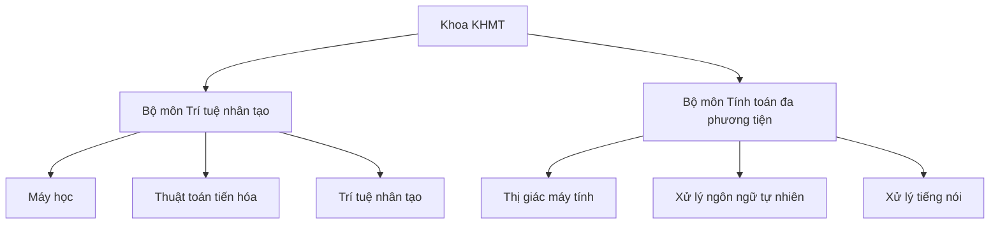
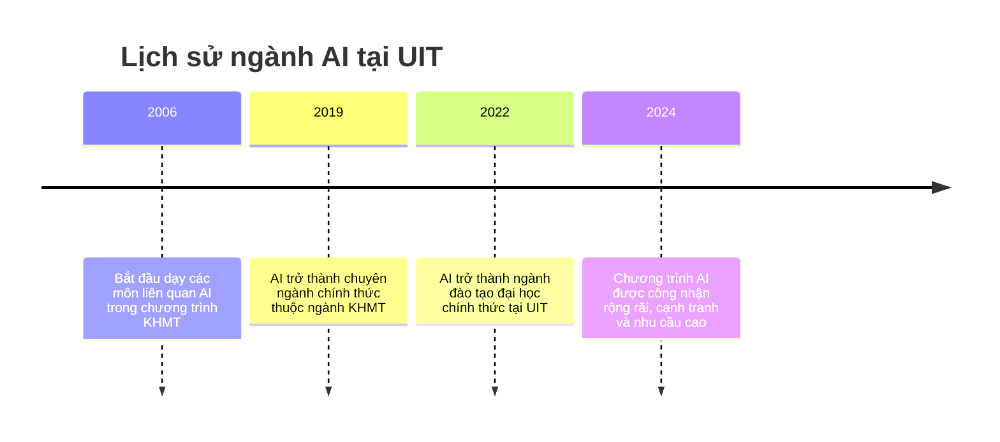
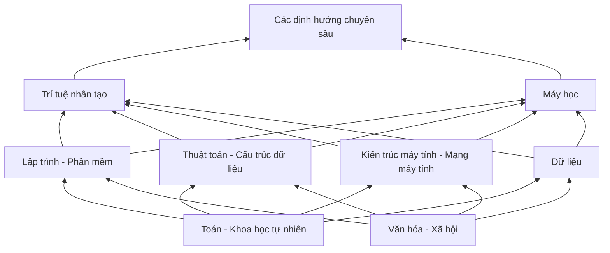
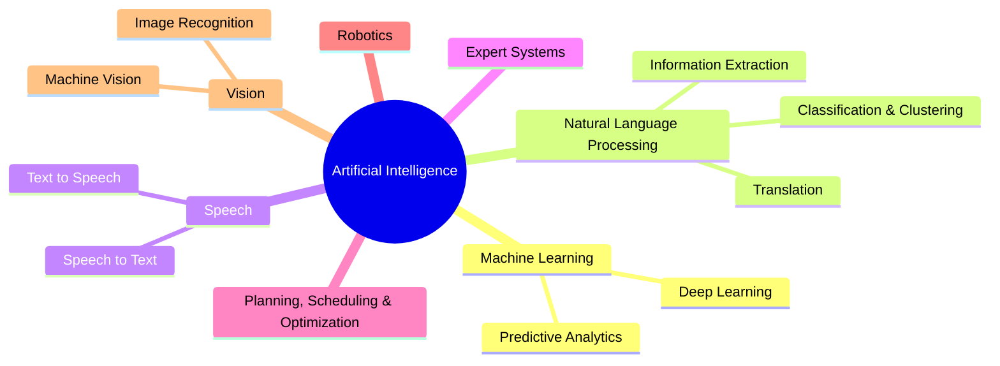
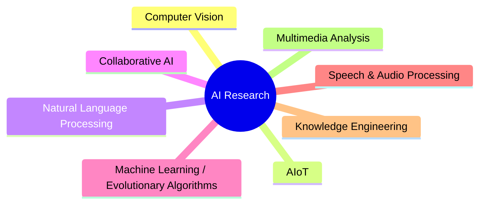

# Buổi 3 - Các chuyên ngành AI và thầy cô hỗ trợ

- **Ngày**: 10/11/2026
- **Môn**: Giới thiệu ngành Trí tuệ nhân tạo (AI001.G11.CN2.TTNT)
- **Giảng viên**: Th.S Đỗ Văn Tiến

## Các khoa/ngành đào tạo tại UIT

UIT đào tạo 9 khoa/ngành thuộc lĩnh vực Công nghệ thông tin:

- **Khoa học máy tính** (Computer Science)
  - **Khoa học máy tính hướng TTNT** (Computer Science - AI orientation)
- **Công nghệ thông tin** (Information Technology)
- **Khoa học dữ liệu** (Data Science)
- **Kỹ thuật phần mềm** (Software Engineering)
- **Kỹ thuật máy tính** (Computer Engineering)
- **Mạng máy tính và Truyền thông dữ liệu** (Computer Networks & Data Communications)
- **An toàn thông tin** (Information Security)
- **Hệ thống thông tin** (Information Systems)
- **Thương mại điện tử** (E-Commerce)

## Cơ cấu Khoa Khoa học máy tính

Khoa KHMT gồm **2 bộ môn**:

| Bộ môn | Các nhóm/lĩnh vực |
|---|---|
| **Trí tuệ nhân tạo** | Máy học (Machine Learning), Thuật toán tiến hóa (Evolutionary Algorithms), Trí tuệ nhân tạo |
| **Tính toán đa phương tiện** | Thị giác máy tính (Computer Vision), Xử lý ngôn ngữ tự nhiên (NLP), Xử lý tiếng nói (Speech Processing) |

## Lịch sử ngành AI tại UIT

- **2006** - Cử nhân Khoa học máy tính: bắt đầu giảng dạy các môn liên quan đến AI trong chương trình KHMT.
- **2019** - Cử nhân Khoa học máy tính (chuyên ngành AI): AI được công nhận là chuyên ngành chính thức thuộc ngành KHMT.
- **2022** - Cử nhân Trí tuệ nhân tạo: AI trở thành ngành đào tạo đại học chính thức tại UIT.
- **2024** - Chương trình AI được công nhận rộng rãi, có tính cạnh tranh cao và nhu cầu lớn tại UIT.

## Cấu trúc chương trình đào tạo

Chương trình xây theo dạng "kim tự tháp" kiến thức, từ nền tảng lên chuyên sâu:

| Tầng | Khối kiến thức |
|---|---|
| Đỉnh | **Các định hướng chuyên sâu** |
| Kiến thức AI | Trí tuệ nhân tạo; Máy học (Machine Learning) |
| Cơ sở ngành | Lập trình - Phần mềm; Thuật toán - Cấu trúc dữ liệu; Kiến trúc máy tính - Mạng máy tính; Dữ liệu |
| Nền tảng | Toán - Khoa học tự nhiên; Văn hóa - Xã hội |

### Cấu trúc chi tiết (Program Structure)

| Tầng | Nội dung |
|---|---|
| **Nền tảng (Foundations)** | Đại số (Algebra), Thống kê (Statistics), Toán rời rạc (Discrete Mathematics), Vật lý (Physics), Khoa học xã hội (Social Sciences) |
| **Cốt lõi KHMT (Computer Science Core)** | Kiến trúc máy tính (Computer Architecture), Lập trình (Programming), Cấu trúc dữ liệu (Data Structures), Thuật toán (Algorithms), Cơ sở dữ liệu (Database), Mạng máy tính (Computer Network), Phần mềm (Software) |
| **Cốt lõi AI (AI Core)** | Nhập môn AI (Introduction to AI), Máy học (Machine Learning), Tư duy và Đạo đức AI (AI Thinking and Ethics) |
| **AI nâng cao (AI Advanced)** | Thị giác máy tính (Computer Vision), Xử lý ngôn ngữ tự nhiên (NLP), Âm thanh và Tiếng nói (Audio and Speech), Thuật toán tiến hóa (Evolutionary Algorithms), AI tạo sinh (Generative AI), Biểu diễn và Khám phá tri thức (Knowledge Representation and Discovery) |
| **AI và Liên ngành (AI and Interdisciplinary)** | AI trong IoT (AIoT), An ninh mạng (Cyber Security), Thương mại điện tử (E-commerce), AI và Khoa học dữ liệu (AI and Data Science), AI và Thiết kế chip (AI and Chip Design), Phần mềm ứng dụng AI (AI-powered Software) |

## Học tập và Nghiên cứu (Study vs. Research)

Ba loại hình nghiên cứu khoa học:

### Nghiên cứu cơ bản (Basic Research)

Tìm tri thức khoa học nền tảng, **không gắn với ứng dụng cụ thể**.

- Bài toán P versus NP?
- Mức độ giãn nở của vũ trụ
- Các môi trường thủy sản của Việt Nam

### Nghiên cứu ứng dụng (Applied Research)

Tìm tri thức khoa học **mới và cần cho nhu cầu thực tiễn**.

- Làm sao giảm thời gian chờ đợi ở bệnh viện?
- Làm sao tính toán được cách xả lũ tối ưu?
- Làm cách nào để phần mềm dạy toán biết vì sao học sinh hiểu/không hiểu?

### Nghiên cứu phát triển (Development Research)

Tìm tri thức mới để **làm ra sản phẩm** (thường của doanh nghiệp).

- Thầy Quảng nghiên cứu làm Bphone B86
- Hãng Microsoft nghiên cứu làm Windows 10
- Thiết bị đo đường huyết có độ nhạy cao

### Tỷ trọng các loại nghiên cứu theo tổ chức - Nhật Bản (Mỹ) (%)

| Tổ chức | Nghiên cứu cơ bản | Nghiên cứu ứng dụng | Nghiên cứu phát triển |
|---|---|---|---|
| Đại học và cao học | 55,1 | 35,8 | 9,1 |
| Viện phi lợi nhuận | 20,3 | 35,8 | 43,9 |
| Viện nghiên cứu công | 24,4 | 29,6 | 46,0 |
| Doanh nghiệp | 6,3 | 19,6 | 74,1 |
| **Tỷ lệ chung** | **14,3** | **22,8** | **62,9** |

> [!NOTE]
> Đại học tập trung chủ yếu vào nghiên cứu cơ bản, còn doanh nghiệp chủ yếu làm nghiên cứu phát triển (sản phẩm).

> [!TIP]
> - Định hướng học lên **Thạc sĩ, Tiến sĩ** sau đại học: nên đi theo hướng **nghiên cứu (research)** ngay từ khi còn ngồi trên ghế nhà trường.
> - Định hướng ra làm **doanh nghiệp**: công việc thường là **nghiên cứu phát triển (development)** - tạo ra sản phẩm cụ thể.

## Quan hệ giữa AI, Machine Learning, Deep Learning và Data Science

- **Trí tuệ nhân tạo (Artificial Intelligence)**: lĩnh vực lớn nhất, bao trùm toàn bộ.
- **Máy học (Machine Learning)**: tập con của AI - máy tính học từ dữ liệu thay vì lập trình luật tường minh.
- **Học sâu (Deep Learning)**: tập con của ML - dùng mạng neural nhiều tầng.
- **Khoa học dữ liệu (Data Science)**: lĩnh vực riêng, **giao nhau (overlap) với AI** nhưng không nằm trọn trong AI.

Quan hệ bao hàm: $DL \subset ML \subset AI$, còn Data Science **cắt ngang** AI chứ không lồng trong AI.

## Các nhánh của AI

| Nhánh | Ứng dụng / lĩnh vực con |
|---|---|
| **Machine Learning** | deep learning, predictive analytics (phân tích dự đoán) |
| **Natural Language Processing (NLP)** | translation (dịch máy), classification & clustering (phân loại & gom cụm), information extraction (trích xuất thông tin) |
| **Speech** | speech to text, text to speech |
| **Expert Systems** | hệ chuyên gia |
| **Planning, Scheduling & Optimization** | lập kế hoạch, lập lịch và tối ưu hóa |
| **Robotics** | robot |
| **Vision** | image recognition (nhận dạng ảnh), machine vision (thị giác máy) |

## Các hướng nghiên cứu (Research Topics)

- **Computer Vision** - Thị giác máy tính
- **AIoT** - AI trong Internet of Things
- **Natural Language Processing (NLP)** - Xử lý ngôn ngữ tự nhiên
- **Collaborative AI** - AI cộng tác
- **Machine Learning / Evolutionary Algorithms** - Máy học / Thuật toán tiến hóa
- **Speech & Audio Processing** - Xử lý tiếng nói và âm thanh
- **Knowledge Engineering** - Kỹ nghệ tri thức
- **Multimedia Analysis** - Phân tích đa phương tiện

## Chi tiết các hướng chuyên sâu

### Xử lý ngôn ngữ tự nhiên (NLP)

Các ứng dụng chính:

- **Machine Translation** - dịch máy
- **Speech Recognition** - nhận dạng tiếng nói
- **Sentiment Analysis** - phân tích cảm xúc/quan điểm
- **Text Classification** - phân loại văn bản
- **Chatbots** - trợ lý hội thoại
- **Automatic Summarization** - tóm tắt văn bản tự động
- **Spell Checking** - kiểm tra chính tả

**Giảng viên hướng NLP**:

- PGS.TS. Nguyễn Lưu Thùy Ngân
- TS. Nguyễn Thị Quý
- TS. Nguyễn Văn Kiệt
- ThS. Nguyễn Thị Bích Vân
- TS. Ngô Quốc Hưng
- **TS. Nguyễn Trọng Chỉnh** - Email: chinhnt@uit.edu.vn, ORCID: [0000-0001-9702-1921](https://orcid.org/0000-0001-9702-1921)
  - Nhóm nghiên cứu: biểu diễn và tính toán ngữ nghĩa, suy luận tự động và lập luận ngôn ngữ tự nhiên, trọng tâm là **tiếng Việt**
  - Lĩnh vực: Ngôn ngữ học tính toán (Computational Linguistics), Suy luận ngôn ngữ tự nhiên (Natural Language Inference), Hỏi đáp (Question Answering), AI tạo sinh trong giáo dục (Generative AI in Education)
- TS. Đặng Văn Thìn
- ThS. Nguyễn Đức Vũ
- **ThS. Huỳnh Tấn Bối** - Email: boiht@uit.edu.vn
  - Lĩnh vực: Mô hình ngôn ngữ lớn (Large Language Models), NLP, Trợ lý AI cá nhân (Personal AI Assistants), Công bằng thuật toán (Algorithmic Fairness)
  - Định hướng: trợ lý AI có khả năng ghi nhớ và hiểu người dùng lâu dài; mục tiêu xây dựng hệ thống AI đáng tin cậy và công bằng

### AI trong Y tế (Medical AI)

- **TS. Lê Thị Kim Ngọc** - Giảng viên Khoa KHMT, Email: ngocltk@uit.edu.vn
- **Hướng nghiên cứu**: AI ứng dụng trong y tế - phát triển phương pháp học máy và học sâu cho các bài toán:
  - Phát hiện bất thường (Anomaly Detection)
  - Phân loại bệnh (Disease Classification)
  - Phân đoạn ảnh y tế (Medical Image Segmentation)
  - Thích nghi miền (Domain Adaptation)
- **Mục tiêu**: hệ thống AI độ chính xác cao, khả năng tổng quát tốt, có tiềm năng ứng dụng thực tế lâm sàng.

### Máy học - Trí tuệ nhân tạo (Machine Learning - AI)

**Giảng viên**:

- **TS. Lương Ngọc Hoàng** - Email: hoangln@uit.edu.vn
  - Trưởng nhóm nghiên cứu **ELO Lab** (Evolutionary Learning & Optimization): tối ưu hóa tiến hóa, học máy và AI. Website: sites.google.com/view/evolve-learn-optimize/
  - Hướng nghiên cứu chính: evolutionary & randomized optimization, quality-diversity optimization, tìm kiếm kiến trúc nơ-ron (neural architecture search), học tăng cường (reinforcement learning), tối ưu đa mục tiêu; độ tin cậy, khả năng giải thích và diễn giải của AI; ứng dụng trong AI đa phương thức và mô hình ngôn ngữ lớn
  - Lĩnh vực: Randomized Optimization Heuristics, Neural Architecture Search, AI Testing and Evaluation, Evolutionary Reinforcement Learning
  - Thông điệp: *"No Pain No Gain"*
- **NCS. CN. Trần Nhật Khoa** - Trợ giảng, thành viên ELO Lab, Email: khoatn@uit.edu.vn, [LinkedIn](https://linkedin.com/in/khoa-tran-255013314)
  - Lĩnh vực: Máy học đối kháng (Adversarial Machine Learning), AI giải thích được (Explainable AI), Học đa phương thức (Multimodal Learning)
- **PGS.TS. Nguyễn Đình Hiển** - Giảng viên cao cấp, Email: hiennd@uit.edu.vn, Website: mathsolve.edu.vn/events
  - Trưởng nhóm nghiên cứu **KEG** (Knowledge Engineering and Machine Learning): phương pháp xây dựng hệ thống thông minh, hệ chuyên gia thực tiễn; hệ thống cần cơ sở tri thức và suy luận tự động để giải bài toán thực tế
  - Lĩnh vực: Kỹ nghệ tri thức (Knowledge Engineering), Biểu diễn tri thức (Knowledge Representation), Hệ thống dựa trên tri thức (Knowledge-based Systems), Suy luận tự động (Automated Reasoning), Máy học (Machine Learning)
- ThS. Phạm Nguyễn Trường An
- **TS. Huỳnh Thị Thanh Thương** - Email: thuonghtt@uit.edu.vn
  - Hướng nghiên cứu chính: Truy xuất thông tin và Tìm kiếm dựa trên ngữ nghĩa (Information Retrieval & Semantic Search), Công nghệ tri thức và Ứng dụng (Knowledge Engineering & Applications), Biểu diễn tri thức và Suy luận tự động (Knowledge Representation & Reasoning)
  - Đặc biệt: hệ thống ứng dụng thông minh có khả năng khai thác thông tin và suy luận trên mô hình tri thức trừu tượng, đáp ứng nhu cầu thực tiễn
  - Thông điệp: *"Keep going. You'll get there."*
- **TS. Võ Nguyễn Lê Duy** - Email: duyvnl@uit.edu.vn, Website: vonguyenleduy.github.io
  - Nhóm nghiên cứu: phát triển phương pháp thống kê và toán học cho bài toán khai phá tri thức từ dữ liệu
  - Lĩnh vực: Máy học thống kê (Statistical Machine Learning), Khai phá dữ liệu (Data Mining), Sinh chữ viết tay (Handwriting Generation), Nhận dạng chữ viết tay (Handwritten Text Recognition)

### Thị giác máy tính và Đa phương tiện (Computer Vision & Multimedia)

- **TS. Ngô Đức Thành** - **Trưởng khoa KHMT**, Email: thanhnd@uit.edu.vn, Website: core.uit.edu.vn
  - Trưởng nhóm nghiên cứu **CORE Lab** (Computer Vision & Retrieval): thị giác máy tính, truy hồi hình ảnh/video, bài toán đa phương tiện
  - Lĩnh vực: Tính toán đa phương tiện, Thị giác máy tính, Truy hồi ảnh và video (Image & Video Retrieval), Nhận dạng chữ trong cảnh (Scene Text Recognition)
- **TS. Dương Việt Hằng** - Email: hangdv@uit.edu.vn
  - Hướng nghiên cứu: Thị giác máy tính (Computer Vision), Điện toán lấy cảm hứng thần kinh (Neural-inspired Computing), Học đa phương thức (Multimodal Learning), Xử lý âm thanh (Sound Processing)
  - Đặc biệt quan tâm: mạng nơ-ron xung (spiking neural networks), phân tích ảnh y khoa, dữ liệu chuỗi thời gian, tín hiệu âm thanh, bài toán kết hợp thị giác - ngôn ngữ
  - Thông điệp: *"A journey of a thousand miles begins with a small step"*
- **TS. Mai Tiến Dũng** - **Phó Khoa KHMT**, Email: dungmt@uit.edu.vn, Website: cs.uit.edu.vn/featured_item/dungmt/
  - Nghiên cứu: Thị giác máy tính, Phát hiện đối tượng (Object Detection), Phân loại hình ảnh (Image Classification), AI cho nông nghiệp (AI in Agriculture)
- **ThS. Cáp Phạm Đình Thắng** - Email: thangcpd@uit.edu.vn, Website: cs.uit.edu.vn/hub/lecturers/80167
  - Nghiên cứu: Thị giác máy tính, Phân loại ảnh (Image Classification), Sinh ngôn ngữ ký hiệu (Sign Language Production)
- **NCS. CN. Trần Gia Bảo** - Nghiên cứu sinh, thành viên CORE Lab, Email: baotg@uit.edu.vn, Website: baotg.cloud, [Google Scholar](https://scholar.google.com/citations?user=BxTDcmQAAAAJ)
  - Nghiên cứu: truy vấn thông tin đa phương tiện, học đa phương thức và AI tương tác; đặc biệt tìm kiếm và hiểu nội dung ảnh/video
  - Lĩnh vực: Truy hồi đa phương tiện (Multimedia Retrieval), Truy hồi hội thoại và tương tác (Conversational & Interactive Retrieval), Học đa phương thức (Multimodal Learning), Mô hình thị giác - ngôn ngữ (Vision-Language Models)
- **ThS. Đỗ Văn Tiến** - Giảng viên môn học, thành viên CORE Lab, Email: tiendv@uit.edu.vn, Website: aiclub.uit.edu.vn
  - Bài toán: truy vấn thông tin đa phương tiện, hỏi đáp trên ảnh (VQA), phát hiện và nhận dạng chữ trong cảnh (scene text detection & recognition), hệ thống giám sát thông minh
  - Lĩnh vực: Information Retrieval, Scene Text Detection & Recognition, Smart Camera / AI Surveillance, VQA
- **CN. Trần Doãn Thuyên** - Trợ giảng, thành viên CORE Lab, Email: thuyentd@uit.edu.vn
  - Chuyên môn: hiểu nội dung video - truy vấn video, hỏi đáp trong video; đọc văn bản trong ảnh ngoại cảnh
  - Lĩnh vực: Hiểu video (Video Understanding), Hỏi đáp trên video (Video QA), Truy hồi video (Video Retrieval), Nhận dạng chữ trong cảnh (Scene Text Recognition)

> [!NOTE]
> **Mô hình thị giác - ngôn ngữ (Vision-Language Model - VLM)**: mô hình AI xử lý đồng thời **hình ảnh và văn bản**, học được mối liên hệ giữa hai phương thức dữ liệu. Ví dụ: CLIP, BLIP, GPT-4V, Gemini.
>
> Ứng dụng tiêu biểu: tìm kiếm ảnh bằng mô tả văn bản (text-to-image retrieval), sinh chú thích ảnh (image captioning), hỏi đáp trên ảnh (visual question answering).

### Môn học tiêu biểu: CS532 - Thị giác máy tính trong tương tác người máy

- **Mã môn**: CS532 - Computer Vision in Human-Computer Interaction, **4 tín chỉ**
- **Giảng viên**: ThS. Nguyễn Ngọc Thừa
- **Nội dung**: nghiên cứu và ứng dụng các bài toán thị giác máy tính trong tương tác người - máy
- **Ứng dụng thực tiễn**: xây dựng và trải nghiệm hệ thống thông minh trên nền tảng robot hiện đại
- **Sinh viên được sử dụng các nền tảng robot thực tế**: Unitree Go2, Cobot 6DOF, robot 4 chân mô phỏng sinh học, robot người Alpha Mini, robot tay máy di động, robot di động 2 bánh

## Tổng hợp đội ngũ

### Ban chủ nhiệm Khoa KHMT

- **Trưởng khoa**: TS. Ngô Đức Thành
- **Phó khoa**: TS. Mai Tiến Dũng

### Các nhóm nghiên cứu

| Nhóm | Trưởng nhóm | Lĩnh vực | Website |
|---|---|---|---|
| **CORE Lab** (Computer Vision & Retrieval) | TS. Ngô Đức Thành | Thị giác máy tính, truy hồi ảnh/video, đa phương tiện | core.uit.edu.vn |
| **ELO Lab** (Evolutionary Learning & Optimization) | TS. Lương Ngọc Hoàng | Tối ưu hóa tiến hóa, NAS, học tăng cường, AI testing | sites.google.com/view/evolve-learn-optimize/ |
| **KEG** (Knowledge Engineering and Machine Learning) | PGS.TS. Nguyễn Đình Hiển | Kỹ nghệ tri thức, hệ chuyên gia, suy luận tự động | - |
| **CS-UIT AI Club** | ThS. Đỗ Văn Tiến (phụ trách) | CLB nghiên cứu khoa học sinh viên | aiclub.uit.edu.vn |

## Tài liệu tham khảo

- Đề thi thử - Tìm hiểu kiến thức về Trí tuệ nhân tạo AI (Phần I & II), ĐH Công nghệ Giao thông Vận tải: https://www.studocu.vn/vn/document/truong-dai-hoc-cong-nghe-giao-thong-van-tai/tri-tue-nhan-tao/de-thi-tim-hieu-kien-thuc-ve-tri-tue-nhan-tao-ai-phan-i-ii/162210425
