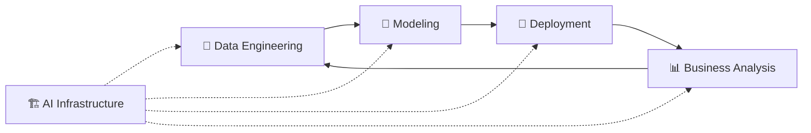
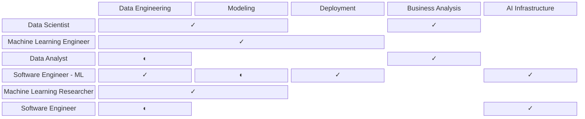

# Buổi 4 - Vòng đời dự án AI và các vai trò

- **Ngày**: 17/11/2026
- **Môn**: Giới thiệu ngành Trí tuệ nhân tạo (AI001.G11.CN2.TTNT)
- **Giảng viên**: Th.S Đỗ Văn Tiến
- **Ghi chú**: Buổi học cuối cùng của môn

## Vòng đời phát triển dự án AI

Phát triển một dự án AI (AI project development life cycle) gồm **5 nhiệm vụ (tasks)** chính:

4 nhiệm vụ đầu tạo thành một **chu trình khép kín** (vòng lặp liên tục cải tiến), còn **AI Infrastructure** là nền tảng hỗ trợ xuyên suốt cả 4.

### 1. Kỹ thuật dữ liệu (Data Engineering)

Người phụ trách data engineering **chuẩn bị dữ liệu** và **biến đổi dữ liệu** thành các định dạng mà các thành viên khác trong nhóm có thể sử dụng.

### 2. Mô hình hóa (Modeling)

Người phụ trách modeling **tìm kiếm các mẫu (patterns) trong dữ liệu** để giúp công ty:

- Dự đoán kết quả của các quyết định khác nhau
- Xác định rủi ro và cơ hội kinh doanh
- Xác định các mối quan hệ nhân - quả (cause-and-effect)

### 3. Triển khai (Deployment)

Người phụ trách deployment nhận một **luồng dữ liệu (stream of data)**, kết hợp nó với mô hình, và **kiểm thử tích hợp** trước khi đưa mô hình vào production.

### 4. Phân tích nghiệp vụ (Business Analysis)

Người phụ trách business analysis **đánh giá hiệu năng và giá trị kinh doanh** của mô hình đã triển khai, điều chỉnh cho phù hợp để:

- Tối đa hóa lợi ích, hoặc
- Loại bỏ các mô hình không hiệu quả

### 5. Hạ tầng AI (AI Infrastructure)

Người làm AI infrastructure **xây dựng và duy trì các hệ thống phần mềm** đáng tin cậy, nhanh, an toàn và có khả năng mở rộng, nhằm hỗ trợ những người làm data engineering, modeling, deployment và business analysis.

## Các vai trò trong đội ngũ AI

Chart dưới thể hiện **phạm vi công việc** của từng vai trò trải dài qua các giai đoạn của vòng đời dự án AI:

> [!NOTE]
> - **✓**: vai trò tham gia chính/trọn vẹn vào giai đoạn đó
> - **◐**: chỉ tham gia một phần (trên slide là thanh ngắn hơn hoặc nét đứt) — Data Analyst và Software Engineer chỉ tham gia một phần Data Engineering; Software Engineer - ML chỉ tham gia gián tiếp Modeling

| Vai trò | Phạm vi chính trong vòng đời |
|---|---|
| **Data Scientist** | Data Engineering → Modeling, và Business Analysis |
| **Machine Learning Engineer** | Phủ dài nhất: Data Engineering → Modeling → Deployment |
| **Data Analyst** | Một phần Data Engineering, và Business Analysis |
| **Software Engineer - ML** | Data Engineering, Deployment, AI Infrastructure; gián tiếp Modeling |
| **Machine Learning Researcher** | Data Engineering → Modeling |
| **Software Engineer** | Một phần Data Engineering, và AI Infrastructure |

## Phân biệt Machine Learning Engineer và Machine Learning Researcher

Hai vai trò này dễ nhầm lẫn vì cùng làm việc với mô hình ML, nhưng khác nhau rõ ở **mục tiêu** và **điểm dừng** trong vòng đời:

| Tiêu chí | ML Engineer | ML Researcher |
|---|---|---|
| **Mục tiêu** | Đưa mô hình vào **sản phẩm thật**, chạy được trong production | Phát triển **thuật toán/kỹ thuật ML mới** (state-of-the-art) |
| **Bản chất công việc** | Kỹ nghệ (engineering): áp dụng các mô hình đã có vào bài toán thực tế | Nghiên cứu (research): đọc paper, đề xuất và thử nghiệm ý tưởng mới |
| **Phạm vi vòng đời** | Data Engineering → Modeling → **Deployment** (trải dài tới khi mô hình chạy thật) | Data Engineering → Modeling (dừng ở mô hình, không lo triển khai) |
| **Sản phẩm đầu ra** | Hệ thống ML chạy ổn định trong production, đáp ứng scale, latency, độ tin cậy | **POC (proof of concept)** — mô hình mới chứng minh được ý tưởng khả thi, chưa phải hệ thống hoàn chỉnh |
| **Kỹ năng nhấn mạnh** | Software engineering, MLOps, tối ưu và vận hành hệ thống | Toán, lý thuyết ML sâu, thiết kế thí nghiệm |
| **Môi trường tiêu biểu** | Đội sản phẩm của công ty | Lab nghiên cứu, viện, trường đại học, R&D |

Nói ngắn gọn: **Researcher tạo ra POC chứng minh ý tưởng mới, Engineer biến mô hình thành hệ thống production chạy được.** Trên chart ở trên, thanh của cả hai đều phủ Data Engineering và Modeling — điểm khác biệt là Engineer tiếp tục trải dài qua Deployment.

## Đề tiểu luận: Vai trò và Ứng dụng AI trong công việc hiện tại

Trong bối cảnh Trí tuệ Nhân tạo (AI) ngày càng phát triển và được ứng dụng rộng rãi ở nhiều lĩnh vực, mỗi cá nhân có thể tiếp cận AI từ những vai trò khác nhau: **nhà nghiên cứu, kỹ sư phát triển, nhà quản lý dự án, doanh nhân khởi nghiệp, người sử dụng trong lĩnh vực chuyên ngành** (y tế, giáo dục, kinh doanh, nghệ thuật, …).

**Yêu cầu**: viết một bài luận với các nội dung sau:

1. **Nhận diện vai trò cá nhân**
   - Trình bày vai trò mà Anh/Chị quan tâm hoặc mong muốn hướng đến trong lĩnh vực AI (ví dụ: nghiên cứu, ứng dụng, triển khai, quản lý, …).
   - Giải thích lý do lựa chọn vai trò này, gắn với nền tảng học tập, kinh nghiệm nghề nghiệp hoặc định hướng phát triển cá nhân.
2. **Phân tích ứng dụng AI trong công việc hiện tại**
   - Mô tả lĩnh vực/ngành nghề mà Anh/Chị đang làm việc.
   - Đưa ra ví dụ cụ thể về cách AI có thể được áp dụng trong công việc (chẳng hạn: tự động hóa quy trình, phân tích dữ liệu, hỗ trợ ra quyết định, cá nhân hóa dịch vụ, …).
3. **Đánh giá cơ hội và thách thức**
   - Cơ hội mà AI mang lại cho công việc hiện tại.
   - Thách thức và rào cản khi triển khai AI.
4. **Định hướng phát triển cá nhân**
   - Kỹ năng và kiến thức cần trang bị để ứng dụng AI hiệu quả.
   - Kế hoạch phát triển cá nhân phù hợp với vai trò đã chọn.

**Hình thức**:

- Bài viết trình bày mạch lạc, có mở đầu, thân bài và kết luận.
- Có dẫn chứng, ví dụ thực tế, hoặc tham khảo từ tài liệu/nguồn tin cậy.

## Đề tham khảo

> [!NOTE]
> Đi thi **được phép mang theo tài liệu** (open book).

### Câu 1 (5.0 điểm)

Một sinh viên ngành Trí tuệ nhân tạo muốn chuẩn bị năng lực để thực hiện một dự án AI hoàn chỉnh. Các nhóm kiến thức/kỹ năng quan trọng gồm:

- Toán học
- Lập trình và cấu trúc dữ liệu
- Machine Learning / Deep Learning
- Kỹ năng phân tích vấn đề, làm việc nhóm và trình bày kết quả

Anh/Chị hãy chọn **một bài toán AI cụ thể** (ví dụ: phân loại hình ảnh, dự đoán giá, nhận diện cảm xúc, chatbot, hệ thống gợi ý) và phân tích vai trò của 4 nhóm kiến thức/kỹ năng trên trong quá trình giải quyết bài toán.

Trình bày rõ:

1. Mỗi nhóm kiến thức/kỹ năng được sử dụng ở **công đoạn nào** của dự án và giúp giải quyết vấn đề gì.
2. Theo Anh/Chị, nhóm nào là **nền tảng cần ưu tiên nhất** đối với sinh viên mới học AI? Giải thích dựa trên mối quan hệ giữa các nhóm kiến thức.
3. Nếu sinh viên chỉ mạnh về lập trình nhưng yếu về toán học và Machine Learning, hãy đề xuất cách bổ sung kiến thức để có thể hoàn thành bài toán đã chọn.
4. Nêu một sản phẩm hoặc kết quả cụ thể mà sinh viên có thể xây dựng để chứng minh rằng mình đã vận dụng được các kiến thức trên.

> [!TIP]
> Ý (1) hỏi về "công đoạn của dự án" chính là các giai đoạn trong **vòng đời dự án AI** ở phần trên: Data Engineering → Modeling → Deployment → Business Analysis. Có thể dùng khung này để sắp xếp vai trò của 4 nhóm kiến thức khi trả lời.

### Câu 2 (5.0 điểm)

Trong một dự án Trí tuệ nhân tạo, nhiều vị trí có thể cùng tham gia nhưng đảm nhận các nhiệm vụ khác nhau. Hãy so sánh và phân biệt ba vị trí sau:

- Data Scientist
- Machine Learning Engineer
- Data Engineer

Anh/Chị hãy trình bày sự khác nhau theo các tiêu chí:

- **Mục tiêu công việc** và phạm vi trách nhiệm
- **Loại dữ liệu** và bài toán thường xử lý
- **Kỹ năng cốt lõi** (toán học, thống kê, lập trình, cơ sở dữ liệu, Machine Learning, hệ thống, v.v.)
- **Công cụ và công nghệ** thường sử dụng (Python, SQL, framework ML, hệ quản trị cơ sở dữ liệu, cloud, pipeline dữ liệu, v.v.)
- **Sản phẩm đầu ra** của từng vị trí
- **Cách ba vị trí phối hợp** trong cùng một dự án

Cuối cùng, hãy minh họa bằng **một dự án cụ thể**, chẳng hạn như:

- Hệ thống gợi ý sản phẩm cho trang thương mại điện tử
- Hệ thống dự đoán khách hàng có khả năng rời bỏ dịch vụ
- Hệ thống phát hiện giao dịch bất thường

Trong ví dụ đó, hãy chỉ rõ Data Engineer, Data Scientist và Machine Learning Engineer lần lượt thực hiện những công việc nào.

> [!TIP]
> Câu này dựa trực tiếp vào **chart các vai trò trong đội ngũ AI** ở phần trên: Data Engineer tương ứng phần Data Engineering, Data Scientist phủ Data Engineering → Modeling + Business Analysis, ML Engineer phủ dài tới Deployment. So sánh theo đúng trình tự pipeline của vòng đời sẽ thấy rõ điểm khác nhau và cách phối hợp.

