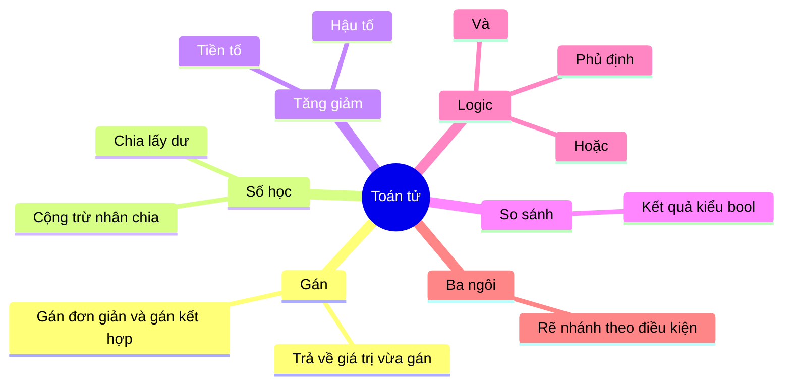
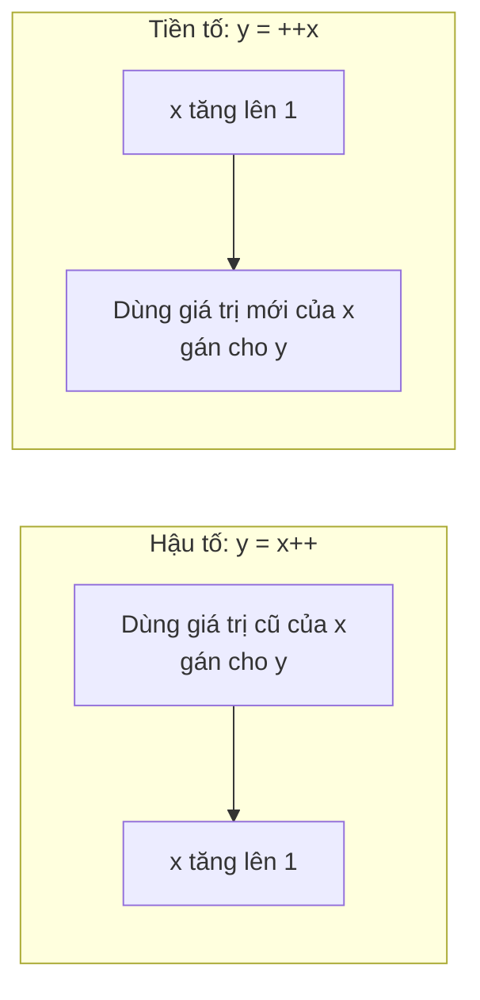
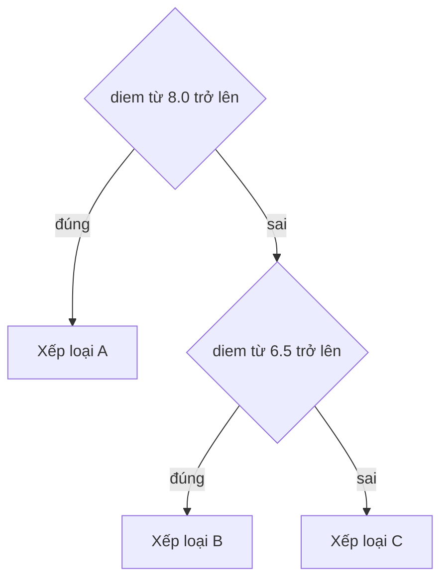

# Buổi 2 - Toán tử (operator)

- **Ngày**: 04/11/2026
- **Môn**: Nhập môn Lập trình (IT001.G13.CN2.TTNT)
- **Giảng viên**: Phạm Thế Sơn

## Sau khi học xong bài này

- Tạo được Project dùng để lập trình
- Biết cách chọn, khai báo các biến có kiểu dữ liệu: `int`, `float`, `char`, `bool`...
- Sử dụng được các toán tử để viết biểu thức
- Nhập và xuất được dữ liệu cho chương trình

## Nội dung buổi học

1. Toán tử gán (assignment operator)
2. Toán tử số học (arithmetic operator)
3. Toán tử tăng giảm 1 đơn vị (increment / decrement)
4. Toán tử so sánh (comparison operator)
5. Toán tử logic (logical operator)
6. Toán tử ba ngôi (ternary operator)
7. Thư viện toán học `math.h` và `cmath`
8. Độ ưu tiên các toán tử (operator precedence)

Sơ đồ tổng quan các nhóm toán tử trong buổi học:



## Toán tử gán (assignment)

- Dùng dấu `=` để gán giá trị cho biến.

```cpp
int a = 5;   // gán 5 cho a khi khai báo
int b;
b = a;       // gán giá trị của a cho b
```

- Toán tử gán kết hợp (compound assignment): vừa tính vừa gán.

| Toán tử | Giải thích | Ví dụ | Tương đương |
|---|---|---|---|
| `+=` | Cộng rồi gán lại | `x += 2` | `x = x + 2` |
| `-=` | Trừ rồi gán lại | `x -= 2` | `x = x - 2` |
| `*=` | Nhân rồi gán lại | `x *= 2` | `x = x * 2` |
| `/=` | Chia rồi gán lại | `x /= 2.0` | `x = x / 2.0` |
| `/=` | Chia lấy phần nguyên rồi gán lại | `x /= 2` | `x = x / 2` |
| `%=` | Chia lấy dư | `x %= 2` | `x = x % 2` |

> [!NOTE]
> `x /= 2.0` chia số **thực** còn `x /= 2` chia lấy **phần nguyên** - kết quả phụ thuộc kiểu của `x` và giá trị bên phải.

**Demo 1** - phép gán là một biểu thức, trả về giá trị vừa gán:

```cpp
#include <iostream>
using namespace std;

int main()
{
    int a, b, c, d;

    cout << (d = 3) << endl;  // in ra 3
    cout << d << endl;        // in ra 3 (d đã được gán)

    a = c = d = 5;            // gán nối tiếp: d = 5 -> c = 5 -> a = 5

    cout << a << endl;        // 5
    cout << b << endl;        // giá trị rác (b chưa được gán)
    cout << c << endl;        // 5

    return 0;
}
```

Kết quả:

```
3
3
5
<giá trị rác - b chưa được gán>
5
```

> [!NOTE]
> **Hành động gán vẫn trả về giá trị** - giá trị được trả về chính là giá trị vừa gán. `(d = 3)` gán `3` cho `d` và trả về `3`, nên `cout` in được `3`.

- Vì phép gán trả về giá trị nên có thể **gán nối tiếp** (chained assignment), thực hiện từ phải sang trái: `a = c = d = 5` tương đương `a = (c = (d = 5))`.

> [!WARNING]
> Biến **chưa được gán** giá trị (như `b`) khi in ra sẽ là **giá trị rác** không xác định.

## Toán tử số học (arithmetic)

| Toán tử | Ý nghĩa | Ví dụ |
|---|---|---|
| `+` | Cộng | `a + b` |
| `-` | Trừ | `a - b` |
| `*` | Nhân | `a * b` |
| `/` | Chia | `a / b` |
| `%` | Chia lấy dư | `a % b` |

> [!WARNING]
> **Chia số nguyên**: `7 / 2` cho kết quả `3` (phần nguyên), không phải `3.5`. Muốn có kết quả thực phải ép kiểu: `7 / 2.0` hoặc `(double)7 / 2`.
>
> Toán tử `%` (chia lấy dư) chỉ dùng được với **số nguyên**.

## Toán tử tăng giảm 1 đơn vị

| Toán tử | Giải thích | Ví dụ | Tương đương |
|---|---|---|---|
| `++` | Tăng 1 đơn vị | `x++` hoặc `++x` | `x = x + 1` |
| `--` | Giảm 1 đơn vị | `x--` hoặc `--x` | `x = x - 1` |

- Có 2 dạng:
  - **Tiền tố** (prefix): `++a`, `--a` - tăng/giảm **trước**, rồi mới dùng giá trị.
  - **Hậu tố** (postfix): `a++`, `a--` - dùng giá trị **hiện tại**, rồi mới tăng/giảm.

**Demo 2** - so sánh `x++` (hậu tố) và `++x` (tiền tố):

```cpp
#include <iostream>
using namespace std;

int main()
{
    int x = 10, y;

    //x = x + 1;
    //x += 1;

    y = x++;   // hậu tố: gán giá trị CŨ của x cho y, rồi x tăng
    //y = ++x; // tiền tố: x tăng trước, rồi gán giá trị MỚI cho y

    cout << x << endl;
    cout << y << endl;

    return 0;
}
```

Kết quả:

| Câu lệnh | `x` | `y` |
|---|---|---|
| `y = x++;` | `11` | `10` (giá trị cũ) |
| `y = ++x;` | `11` | `11` (giá trị mới) |

- Có thể đặt trực tiếp trong `cout`:

```cpp
cout << (x++) << endl;  // in ra 10 (giá trị cũ)
cout << x << endl;      // in ra 11 (x đã tăng)
```

> [!NOTE]
> Cả 2 trường hợp `x` đều thành `11`, chỉ khác nhau ở giá trị **trả về** của biểu thức: `x++` trả về giá trị cũ, `++x` trả về giá trị mới.

So sánh thứ tự thực hiện của 2 dạng:



## Toán tử so sánh (comparison)

- So sánh 2 giá trị, kết quả là `true` hoặc `false` (kiểu `bool`).

| Toán tử | Ý nghĩa | Ví dụ |
|---|---|---|
| `==` | Bằng | `a == b` |
| `!=` | Khác | `a != b` |
| `>` | Lớn hơn | `a > b` |
| `<` | Nhỏ hơn | `a < b` |
| `>=` | Lớn hơn hoặc bằng | `a >= b` |
| `<=` | Nhỏ hơn hoặc bằng | `a <= b` |

> [!CAUTION]
> Đừng nhầm `=` (gán) với `==` (so sánh). Viết `if (a = 5)` là **gán** 5 cho a và biểu thức luôn đúng, không phải so sánh.

## Toán tử logic (logical)

| Toán tử | Giải thích | Ví dụ |
|---|---|---|
| `!` | Phủ định | `!x` |
| `&&` | Và | `x && y` |
| `||` | Hoặc | `x || y` |

**Bảng chân trị** (truth table):

| `x` | `y` | `x && y` | `x \|\| y` | `!x` |
|---|---|---|---|---|
| true | true | true | true | false |
| true | false | false | true | false |
| false | true | false | true | true |
| false | false | false | false | true |

**Demo 3**:

```cpp
#include <iostream>
using namespace std;

int main()
{
    bool x = true;

    cout << !false << endl;   // in ra 1 (phủ định của false là true)

    float nhietDo = 31;
    float doAm = 60;

    // nhiệt độ > 30 và độ ẩm < 50
    cout << (nhietDo > 30 && doAm < 50);  // true && false -> in ra 0

    return 0;
}
```

> [!NOTE]
> `cout` in giá trị `bool` ra dạng số: `true` in ra `1`, `false` in ra `0`.
> `nhietDo > 30` là `true` (31 > 30), `doAm < 50` là `false` (60 không < 50), nên `true && false` = `false` in ra `0`.

> [!TIP]
> **Đánh giá đoản mạch** (short-circuit evaluation): với `&&` nếu vế trái sai thì không xét vế phải; với `||` nếu vế trái đúng thì không xét vế phải.

## Toán tử ba ngôi (ternary operator)

- Cú pháp:

```cpp
condition ? value_if_true : value_if_false;
```

Trong đó:

- `condition` là một biểu thức logic, trả về `true` hoặc `false`.
- `value_if_true` là giá trị được trả về nếu `condition` là `true`.
- `value_if_false` là giá trị được trả về nếu `condition` là `false`.

> [!NOTE]
> Toán tử ba ngôi thực hiện dựa trên một điều kiện và trả về một giá trị tùy thuộc vào kết quả của điều kiện đó.

**Demo 4**:

```cpp
#include <iostream>
using namespace std;

int main()
{
    int siSo = 62;

    // siSo > 30 thì số sv cho 1 nhóm là 3, ngược lại là 1
    siSo > 30 ? 3 : 1;   // biểu thức có giá trị 3

    return 0;
}
```

- Thường dùng để gán giá trị theo điều kiện:

```cpp
int soNhom = siSo > 30 ? 3 : 1;   // soNhom = 3 (vì 62 > 30)
```

- Có thể **lồng nhiều toán tử ba ngôi** để xử lý nhiều điều kiện. Vì `? :` kết hợp từ phải sang trái nên dấu ngoặc chủ yếu để làm rõ ý:

```cpp
double diem = 7.5;

// diem >= 8.0 -> 'A', diem >= 6.5 -> 'B', còn lại -> 'C'
char loai = diem >= 8.0 ? 'A' : (diem >= 6.5 ? 'B' : 'C');
```

- Đoạn trên tương đương với:

```cpp
char loai;
if (diem >= 8.0)
    loai = 'A';
else if (diem >= 6.5)
    loai = 'B';
else
    loai = 'C';
```

Cây quyết định tương ứng:



> [!WARNING]
> Toán tử ba ngôi lồng nhau khó đọc và dễ đặt sai dấu ngoặc (đặc biệt là thiếu nhánh `:`). Chỉ nên dùng cho điều kiện đơn giản; nhiều điều kiện hơn nên dùng `if / else if / else`.

## Thư viện math.h và cmath

- `math.h` và `cmath` là thư viện cung cấp các **hàm và hằng số liên quan đến toán học**.
- `math.h` trong ngôn ngữ **C**, `cmath` trong **C++** - `cmath` là phiên bản chuẩn mở rộng của `math.h`, được thiết kế tương thích với C++.
- Cách sử dụng:

```cpp
#include <math.h>   // hoặc
#include <cmath>
```

- Các hàm thông dụng:

| Hàm | Ý nghĩa |
|---|---|
| `double pow(double base, double exponent)` | Tính lũy thừa |
| `double sqrt(double x)` | Tính căn bậc 2 |
| `double round(double x)` | Làm tròn, lên nếu phần thập phân là 0.5 |

- Ngoài ra còn các hàm khác: `sin`, `cos`, `tan`, `exp`, `log`, `log10`, `ceil`, `floor`, `abs`, `fabs`, ...

### Kỹ thuật làm tròn số

- Dùng hàm `round()` trong thư viện math, theo công thức:

```cpp
round(num * 1eN) / 1eN
```

- `N` là số chữ số sau dấu thập phân muốn làm tròn; `1eN` là ký hiệu khoa học, bằng $10^N$ (vd: `1e2` = 100, `1e3` = 1000).
- Ý tưởng: nhân `num` với $10^N$ để đưa chữ số cần làm tròn lên hàng đơn vị, `round()` làm tròn, rồi chia lại cho $10^N$.

**Demo 5** - làm tròn `0.123456789` lần lượt tới 2, 3, 4 chữ số thập phân:

```cpp
#include <iostream>
#include <cmath>
using namespace std;

int main()
{
    double num = 0.123456789, new_num;

    new_num = round(num * 1e2) / 1e2;
    cout << new_num << endl;   // 0.12

    new_num = round(num * 1e3) / 1e3;
    cout << new_num << endl;   // 0.123

    new_num = round(num * 1e4) / 1e4;
    cout << new_num << endl;   // 0.1235

    return 0;
}
```

## Độ ưu tiên các toán tử (precedence)

- Toán tử có độ ưu tiên khác nhau, giống nhân chia trước cộng trừ sau trong toán học.
- Thứ tự ưu tiên của các toán tử đã học, từ cao xuống thấp:

| Ưu tiên | Nhóm | Toán tử |
|---|---|---|
| 1 (cao nhất) | Ngoặc, tăng giảm hậu tố | `()`, `x++`, `x--` |
| 2 | Một ngôi | `++x`, `--x`, `!`, `+x`, `-x` |
| 3 | Nhân chia | `*`, `/`, `%` |
| 4 | Cộng trừ | `+`, `-` |
| 5 | So sánh | `<`, `<=`, `>`, `>=` |
| 6 | So sánh bằng | `==`, `!=` |
| 7 | Logic AND | `&&` |
| 8 | Logic OR | `\|\|` |
| 9 | Ba ngôi | `? :` |
| 10 (thấp nhất) | Gán | `=`, `+=`, `-=`, `*=`, `/=`, `%=` |

- Toán tử ưu tiên cao được tính **trước**; cùng độ ưu tiên thì tính theo thứ tự kết hợp (đa số từ trái sang phải, riêng gán và `? :` từ **phải sang trái**).

> [!TIP]
> Khi không chắc về độ ưu tiên, dùng **dấu ngoặc `()`** để biểu thức rõ ràng và đúng ý mình.

## Câu hỏi ôn tập

```quiz
{
  "title": "Ôn tập - Toán tử",
  "mode": "practice",
  "questions": [
    {
      "type": "single",
      "question": "Biểu thức `x += 2` tương đương với biểu thức nào?",
      "options": ["`x = x + 2`", "`x = 2`", "`x = x * 2`", "`x == x + 2`"],
      "answer": 0,
      "explanation": "`+=` là toán tử gán kết hợp: cộng vế phải vào biến rồi gán lại, tức `x = x + 2`."
    },
    {
      "type": "single",
      "question": "Trong C++, biểu thức `7 / 2` cho kết quả bao nhiêu?",
      "options": ["`3`", "`3.5`", "`4`", "`3.0`"],
      "answer": 0,
      "explanation": "Cả hai toán hạng đều là số nguyên nên đây là phép chia lấy phần nguyên: `7 / 2 = 3`. Muốn ra `3.5` phải viết `7 / 2.0` hoặc ép kiểu `(double)7 / 2`."
    },
    {
      "type": "single",
      "question": "Cho `int x = 10; int y = x++;`. Sau khi chạy, giá trị của `x` và `y` là?",
      "options": ["`x = 11`, `y = 10`", "`x = 11`, `y = 11`", "`x = 10`, `y = 10`", "`x = 10`, `y = 11`"],
      "answer": 0,
      "explanation": "`x++` là hậu tố: trả về giá trị **cũ** của `x` (10) gán cho `y`, sau đó `x` mới tăng lên 11."
    },
    {
      "type": "single",
      "question": "Với `int x = 10;`, biểu thức `++x` khác `x++` ở điểm nào?",
      "options": ["`++x` tăng `x` trước rồi trả về giá trị mới", "`++x` trả về giá trị cũ rồi mới tăng `x`", "`++x` tăng `x` lên 2 đơn vị", "Không có gì khác nhau"],
      "answer": 0,
      "explanation": "Tiền tố `++x` tăng `x` trước rồi trả về giá trị mới; hậu tố `x++` trả về giá trị cũ rồi mới tăng. Cả hai đều chỉ tăng `x` lên 1."
    },
    {
      "type": "true-false",
      "question": "Viết `if (a = 5)` sẽ **so sánh** `a` với `5`.",
      "answer": false,
      "explanation": "`=` là toán tử **gán**, không phải so sánh. `a = 5` gán 5 cho `a` và trả về 5 (luôn đúng). So sánh phải dùng `==`."
    },
    {
      "type": "single",
      "question": "Cho `float nhietDo = 31; float doAm = 60;`. Biểu thức `nhietDo > 30 && doAm < 50` có giá trị là?",
      "options": ["`false` (in ra `0`)", "`true` (in ra `1`)", "`31`", "Lỗi biên dịch"],
      "answer": 0,
      "explanation": "`nhietDo > 30` là `true` nhưng `doAm < 50` là `false`, nên `true && false` = `false`, `cout` in ra `0`."
    },
    {
      "type": "multiple",
      "question": "Những toán tử nào sau đây là toán tử **gán kết hợp** (compound assignment)?",
      "options": ["`+=`", "`%=`", "`==`", "`++`"],
      "answer": [0, 1],
      "explanation": "`+=` và `%=` vừa tính vừa gán. `==` là toán tử so sánh, `++` là toán tử tăng 1 đơn vị."
    },
    {
      "type": "single",
      "question": "Cho `double diem = 7.5;`. Biểu thức `diem >= 8.0 ? 'A' : (diem >= 6.5 ? 'B' : 'C')` trả về giá trị nào?",
      "options": ["`'B'`", "`'A'`", "`'C'`", "`7.5`"],
      "answer": 0,
      "explanation": "`diem >= 8.0` là `false` nên nhảy sang nhánh `:`, ở đó `diem >= 6.5` là `true` nên trả về `'B'`."
    },
    {
      "type": "true-false",
      "question": "Toán tử `%` (chia lấy dư) có thể dùng với số thực, ví dụ `7.5 % 2`.",
      "answer": false,
      "explanation": "`%` chỉ dùng được với **số nguyên**. Với số thực phải dùng hàm như `fmod()` trong `cmath`."
    },
    {
      "type": "single",
      "question": "Theo thứ tự độ ưu tiên đã học, toán tử nào được tính **trước** trong biểu thức `a + b * c == d`?",
      "options": ["`*`", "`+`", "`==`", "Tính từ trái sang phải theo thứ tự viết"],
      "answer": 0,
      "explanation": "Nhân chia (mức 3) ưu tiên cao hơn cộng trừ (mức 4) và so sánh (mức 6), nên `b * c` được tính trước, rồi đến `a + ...`, cuối cùng mới `== d`."
    },
    {
      "type": "single",
      "question": "Muốn làm tròn `num` tới 3 chữ số thập phân, dùng biểu thức nào?",
      "options": ["`round(num * 1e3) / 1e3`", "`round(num / 1e3) * 1e3`", "`round(num * 3) / 3`", "`round(num, 3)`"],
      "answer": 0,
      "explanation": "Công thức `round(num * 1eN) / 1eN` với `N` là số chữ số cần giữ. `round()` của `cmath` không nhận tham số số chữ số."
    },
    {
      "type": "self-check",
      "question": "Không dùng `if`, hãy viết một biểu thức gán cho `soNhom` giá trị `3` nếu `siSo > 30`, ngược lại gán `1`.",
      "answer": "`int soNhom = siSo > 30 ? 3 : 1;` - dùng toán tử ba ngôi `condition ? value_if_true : value_if_false`.",
      "explanation": "Toán tử ba ngôi phù hợp để gán giá trị theo điều kiện mà không cần viết `if/else`."
    }
  ]
}
```
