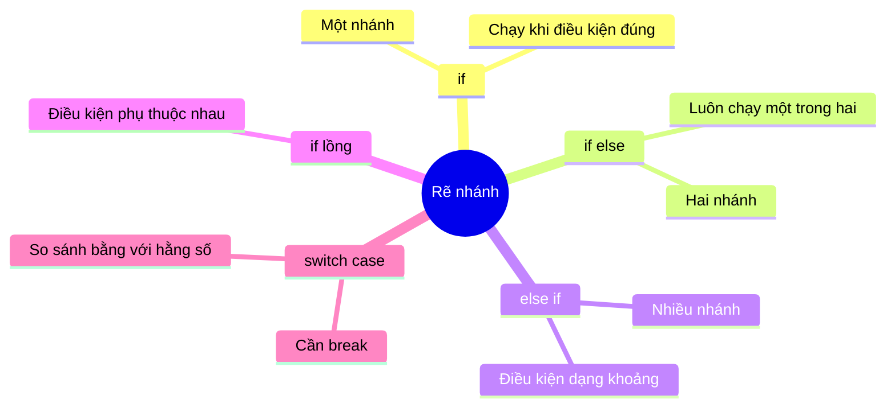
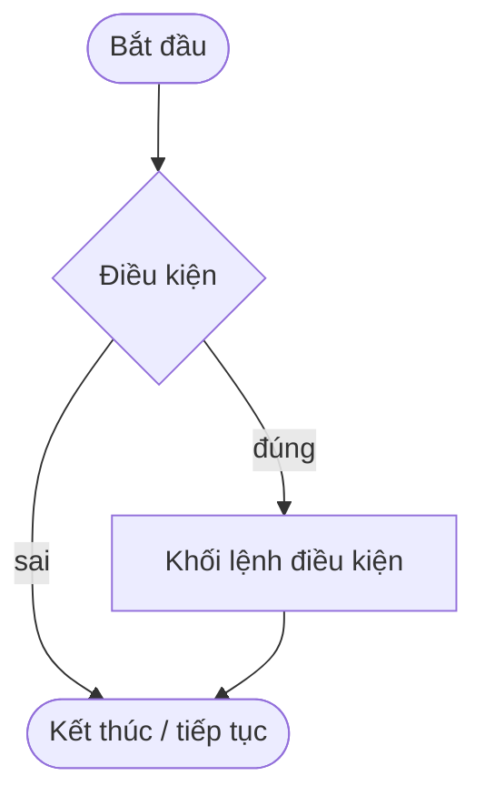
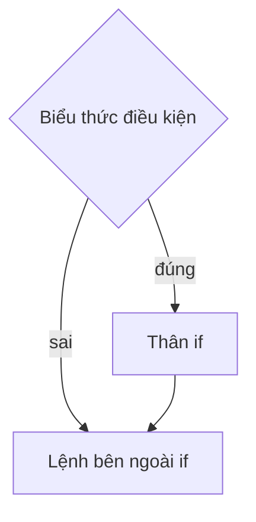
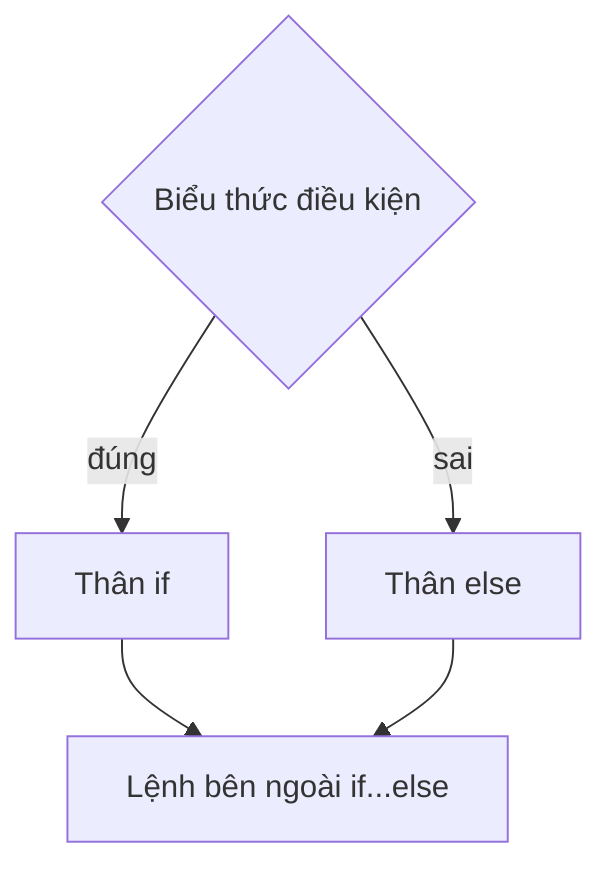
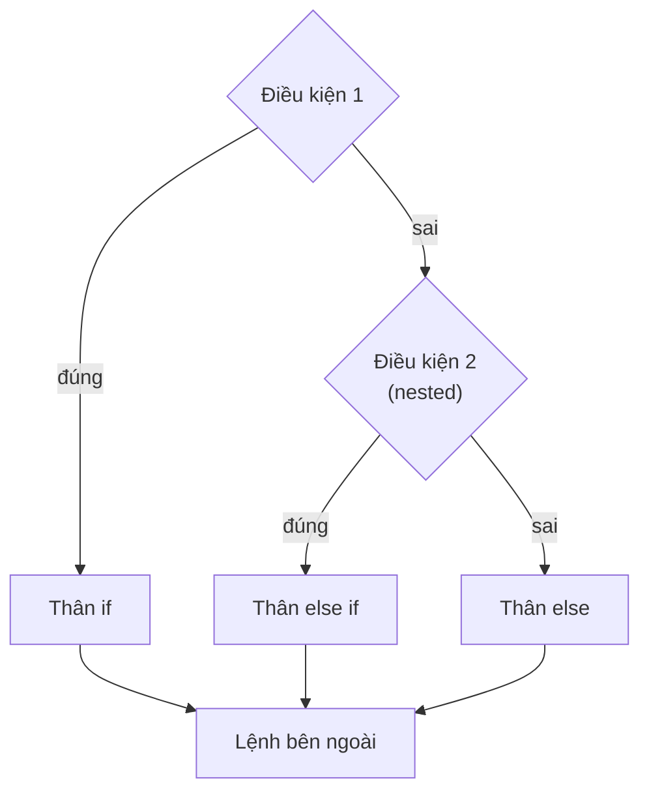
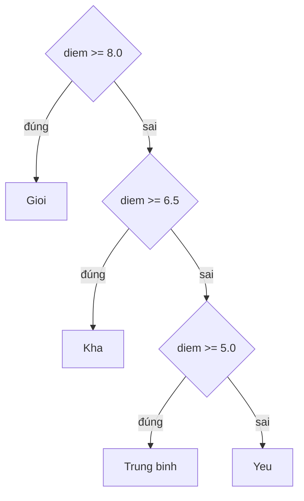
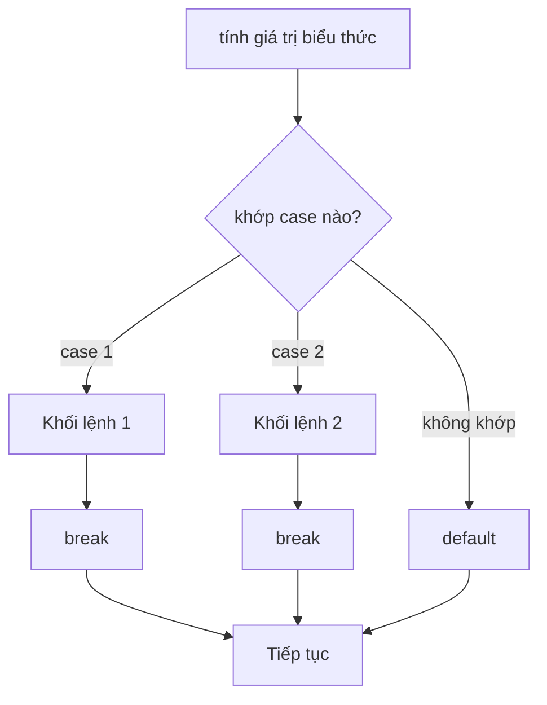

# Buổi 3 - Cấu trúc rẽ nhánh (if / switch-case)

- **Ngày**: 11/11/2026
- **Môn**: Nhập môn Lập trình (IT001.G13.CN2.TTNT)
- **Giảng viên**: Phạm Thế Sơn

## Sau khi học xong bài này

- Hiểu được vai trò của cấu trúc rẽ nhánh (branching) trong chương trình
- Viết được câu lệnh `if`, `if - else`, `if - else if - else`
- Biết dùng `if` lồng nhau (nested if) khi điều kiện phụ thuộc lẫn nhau
- Viết được câu lệnh `switch - case`, biết khi nào dùng `switch` thay `if`
- Tránh được các lỗi phổ biến: nhầm `=` với `==`, dấu `;` thừa sau `if`, thiếu `break` trong `switch`, `else` treo (dangling else)

## Nội dung buổi học

1. Cấu trúc rẽ nhánh là gì - ý tưởng từ vấn đề thực tế
2. Câu lệnh `if` (một nhánh)
3. Câu lệnh `if - else` (hai nhánh)
4. Chuỗi `else if` và `if` lồng nhau (nhiều nhánh)
5. Câu lệnh `switch - case`
6. Chọn `if - else` hay `switch - case`
7. Các lỗi thường gặp
8. Bài tập: xếp hạng GPA, giải $ax + b = 0$, phân loại tam giác, xếp loại ký tự A-E, giờ-phút-giây, số ngày trong tháng



## Cấu trúc rẽ nhánh là gì

- **Cấu trúc rẽ nhánh** (branching / selection) trong lập trình là một cơ chế cho phép chương trình **thực hiện các hành động khác nhau** dựa trên một **điều kiện** được xác định trước.
- Cho phép chương trình **chọn một nhánh thực thi cụ thể** tùy thuộc vào điều kiện.
- Chương trình mặc định chạy **tuần tự** từ trên xuống dưới - rẽ nhánh là cách phá vỡ luồng tuần tự đó.
- Điều kiện là biểu thức logic trả về `true` / `false`:
  - `true` → chạy khối lệnh gắn với điều kiện
  - `false` → bỏ qua (hoặc chạy nhánh khác)



- C++ có 2 cấu trúc rẽ nhánh chính:
  - `if` (kết hợp `else`, `else if`)
  - `switch - case`
- Ngoài ra toán tử ba ngôi `? :` (đã học buổi 2) là dạng rẽ nhánh **trả về giá trị**, dùng cho trường hợp đơn giản.

## Ý tưởng - từ vấn đề thực tế

### Vấn đề giải quyết 1

Để được phép **lái xe** cần đáp ứng các điều kiện sau:

- Có bằng lái
- Nồng độ cồn không có

Cả 2 điều kiện phải **đồng thời đúng** nên nối bằng toán tử `&&`:

```cpp
#include <iostream>
using namespace std;

int main()
{
    // Để được phép lái xe cần đáp ứng các điều kiện sau:
    // Có bằng lái
    // Nồng độ cồn không có

    bool bangLai = true;
    float nongDoCon = 0;

    if (bangLai == true && nongDoCon == 0)
    {
        cout << "Duoc phep lai xe" << endl;
    }

    cout << "1. Lenh ngoai cau truc re nhanh" << endl;
    cout << "2. Lenh ngoai cau truc re nhanh" << endl;
    cout << "3. Lenh ngoai cau truc re nhanh" << endl;

    return 0;
}
```

Kết quả:

```
Duoc phep lai xe
1. Lenh ngoai cau truc re nhanh
2. Lenh ngoai cau truc re nhanh
3. Lenh ngoai cau truc re nhanh
```

- Vì `bangLai == true` và `nongDoCon == 0` đều đúng nên `"Duoc phep lai xe"` được in.
- 3 lệnh `cout` **bên ngoài** `if` luôn chạy, bất kể điều kiện đúng hay sai. Thử đổi `bangLai = false` hoặc `nongDoCon = 0.5` thì chỉ còn 3 dòng `"Lenh ngoai..."` được in.

> [!NOTE]
> `bangLai == true` tương đương viết gọn `bangLai` (vì `bangLai` đã là `bool`). Viết `bangLai == false` tương đương `!bangLai`.

### Vấn đề giải quyết 2

Để được **cấp bằng lái xe** cần đáp ứng các điều kiện sau:

- Độ tuổi tối thiểu 18
- Sức khỏe phải đạt
- Điểm thi tối thiểu 80

```cpp
#include <iostream>
using namespace std;

int main()
{
    int tuoi = 20;
    bool sucKhoeDat = true;
    double diemThi = 85;

    if (tuoi >= 18 && sucKhoeDat && diemThi >= 80)
        cout << "Du dieu kien cap bang lai" << endl;
    else
        cout << "Chua du dieu kien" << endl;

    return 0;
}
```

> [!NOTE]
> Cả 2 vấn đề đều có dạng "**tất cả** điều kiện phải đúng" nên dùng `&&`. Nếu chỉ cần **một trong các** điều kiện đúng thì dùng `||`.

## Câu lệnh `if`

- Chạy khối lệnh **chỉ khi** điều kiện đúng; sai thì bỏ qua.

**Cú pháp 1**:

```cpp
if (biểu_thức_điều_kiện)
{
    // Lệnh trong thân if
}

// Lệnh bên ngoài if
```

Trong đó:

- `biểu_thức_điều_kiện` là biểu thức logic trả về `true` / `false` (vd: `a > 0`, `x % 2 == 0`).
- **Lệnh bên ngoài `if`** luôn được thực hiện, bất kể điều kiện đúng hay sai.
- Nếu khối lệnh chỉ có **1 câu lệnh**, có thể bỏ cặp ngoặc nhọn `{}` - nhưng nên giữ để code rõ ràng, tránh lỗi khi thêm lệnh sau.



**Demo 1** - kiểm tra số nguyên dương:

```cpp
#include <iostream>
using namespace std;

int main()
{
    int n;
    cin >> n;

    if (n > 0)
    {
        cout << "n la so nguyen duong" << endl;
    }

    cout << "Ket thuc chuong trinh" << endl;
    return 0;
}
```

- Nhập `5` → in cả 2 dòng. Nhập `-3` → chỉ in `"Ket thuc chuong trinh"`.

## Câu lệnh `if - else`

- Hai nhánh loại trừ lẫn nhau: điều kiện **đúng** chạy khối `if`, **sai** chạy khối `else` - luôn chạy đúng một nhánh.

**Cú pháp 2**:

```cpp
if (biểu_thức_điều_kiện)
{
    // Lệnh trong thân if
}
else
{
    // Lệnh trong thân else
}

// Lệnh bên ngoài if...else
```



**Demo 2** - hệ thống tưới cây (điều kiện dùng `||` - chỉ cần **1 trong các** điều kiện đúng):

```cpp
#include <iostream>
using namespace std;

int main()
{
    // Mở hệ thống tưới cây khi rơi vào 1 trong các điều kiện sau:
    // Nhiệt độ lớn hơn 40 độ
    // Độ ẩm thấp hơn 30%

    float nhietDo = 50;
    float doAm = 35;

    if (nhietDo > 40 || doAm < 30)
    {
        cout << "Mo he thong tuoi cay" << endl;
    }
    else
    {
        cout << "Khong mo he thong tuoi cay" << endl;
    }

    return 0;
}
```

Kết quả: `Mo he thong tuoi cay` - vì `nhietDo > 40` là `true` (50 > 40) nên `true || false` = `true`, không cần xét vế `doAm < 30`.

> [!NOTE]
> Đối chiếu với Vấn đề 1: lái xe yêu cầu **tất cả** điều kiện đúng → `&&`, còn tưới cây chỉ cần **1 trong các** điều kiện đúng → `||`.

**Demo 3** - kiểm tra chẵn lẻ:

```cpp
#include <iostream>
using namespace std;

int main()
{
    int n;
    cin >> n;

    if (n % 2 == 0)
    {
        cout << n << " la so chan" << endl;
    }
    else
    {
        cout << n << " la so le" << endl;
    }

    return 0;
}
```

> [!NOTE]
> `n % 2 == 0` dùng toán tử chia lấy dư `%` để kiểm tra số dư khi chia 2. Nhớ `==` (so sánh) chứ không phải `=` (gán).

**Demo 4** - tìm số lớn hơn trong 2 số:

```cpp
#include <iostream>
using namespace std;

int main()
{
    int a, b;
    cin >> a >> b;

    int max;
    if (a > b)
        max = a;
    else
        max = b;

    cout << "So lon hon: " << max << endl;
    return 0;
}
```

- Đoạn gán `max` ở trên tương đương toán tử ba ngôi đã học: `int max = a > b ? a : b;`

## Chuỗi `else if` và `if` lồng nhau

### Cấu trúc `if...else` lồng ghép (nhiều nhánh)

- Khi có **nhiều điều kiện loại trừ lẫn nhau**, nối các nhánh bằng `else if`. Chương trình kiểm tra **từ trên xuống**, gặp điều kiện đúng đầu tiên thì chạy và **bỏ qua toàn bộ phía dưới**. `else` cuối (nếu có) là nhánh "còn lại".

**Cú pháp 3**:

```cpp
if (điều_kiện_1)
{
    // Lệnh
}
else if (điều_kiện_2)
{
    // Lệnh
}
else if (điều_kiện_3)
{
    // Lệnh
}
// ...
else
{
    // Lệnh trong thân else
}

// Lệnh bên ngoài
```

- `else if` sai thì mới xét tiếp điều kiện bên dưới - tương đương `if` **lồng trong** `else` (nested test expression).
- Chỉ **một nhánh duy nhất** được chạy; sau đó chương trình tiếp tục ở lệnh bên ngoài.



**Demo 5** - xếp loại học lực theo điểm:

```cpp
#include <iostream>
using namespace std;

int main()
{
    double diem;
    cin >> diem;

    if (diem >= 8.0)
        cout << "Gioi" << endl;
    else if (diem >= 6.5)
        cout << "Kha" << endl;
    else if (diem >= 5.0)
        cout << "Trung binh" << endl;
    else
        cout << "Yeu" << endl;

    return 0;
}
```



> [!WARNING]
> **Thứ tự kiểm tra quan trọng**: phải xét từ điều kiện **cao xuống thấp**. Nếu viết `if (diem >= 5.0)` trước thì điểm `9.0` cũng rơi vào nhánh "Trung binh" vì `9.0 >= 5.0` đúng ngay điều kiện đầu tiên.

### `if` lồng nhau (nested if)

- Đặt câu lệnh `if` **bên trong** một `if` / `else` khác khi điều kiện sau **phụ thuộc** vào điều kiện trước.

**Demo 6** - kiểm tra `n` có phải số chẵn dương không:

```cpp
#include <iostream>
using namespace std;

int main()
{
    int n;
    cin >> n;

    if (n > 0)
    {
        if (n % 2 == 0)
            cout << "So chan duong" << endl;
        else
            cout << "So le duong" << endl;
    }
    else
    {
        cout << "Khong phai so duong" << endl;
    }

    return 0;
}
```

- Điều kiện `n % 2 == 0` chỉ được xét **sau khi** `n > 0` đã đúng.
- Trường hợp này có thể viết gọn bằng toán tử `&&`: `if (n > 0 && n % 2 == 0)`.

> [!TIP]
> Khi các điều kiện **độc lập** và cần đúng đồng thời, ưu tiên nối bằng `&&` thay vì lồng nhiều `if` - code ngắn và dễ đọc hơn. Chỉ lồng `if` khi mỗi tầng cần xử lý khác nhau (như có `else` riêng ở từng tầng).

## Câu lệnh `switch - case`

- Dùng khi cần **so sánh bằng** một biểu thức nguyên với nhiều **giá trị hằng số** khác nhau - thay cho chuỗi `else if` dài.

Cú pháp:

```cpp
switch (expression)
{
    case x:
        // code block - chạy khi expression == x
        break;

    case y:
        // code block - chạy khi expression == y
        break;

    // ...

    default:
        // code block - chạy khi không khớp case nào
}
```

Trong đó:

- `expression` phải trả về kiểu **nguyên** (`int`, `char`, `bool`...) - **không** dùng được với `float`, `double`, chuỗi.
- `x`, `y`... là **hằng số** (literal hoặc hằng: `case 1:`, `case 'a':`...) - không được là biến hay khoảng giá trị.
- `break` thoát khỏi `switch`; thiếu `break` thì chương trình **chạy tràn xuống** các `case` phía dưới (fall-through).
- `default` không bắt buộc, đóng vai trò như `else` cuối chuỗi.

**Demo 7** - đọc ngày trong tuần (quy ước: `2`-`7` = Thứ hai đến Thứ bảy, `8` = Chủ nhật):

```cpp
#include <iostream>
using namespace std;

int main()
{
    int day = 6;

    switch (day)
    {
        case 8:
            printf("Sunday");
            break;
        case 2:
            printf("Monday");
            break;
        case 3:
            printf("Tuesday");
            break;
        case 4:
            printf("Wednesday");
            break;
        case 5:
            printf("Thursday");
            break;
        case 6:
            printf("Friday");
            break;
        case 7:
            printf("Saturday");
            break;
        default:
            printf("Khong co thong tin");
    }

    return 0;
}
```

Kết quả: `Friday` (vì `day = 6` khớp `case 6`).

- Thứ tự các `case` **không quan trọng** - `case 8` đặt đầu tiên vẫn chạy đúng.
- Đổi `day` thành giá trị không có trong các `case` (vd: `9`) → in `"Khong co thong tin"` từ `default`.

### Gom nhiều `case` chung xử lý (fall-through có chủ đích)

- Các `case` liền nhau không có `break` sẽ **dùng chung** khối lệnh - tiện khi nhiều giá trị có cùng kết quả:

```cpp
switch (thu)
{
    case 2:
    case 3:
    case 4:
    case 5:
    case 6:
        cout << "Ngay trong tuan" << endl;
        break;
    case 7:
    case 8:
        cout << "Cuoi tuan" << endl;
        break;
    default:
        cout << "Ngay khong hop le" << endl;
}
```



> [!CAUTION]
> **Fall-through** (thiếu `break`) là lỗi rất phổ biến: ở Demo 7 nếu `day = 2` mà `case 2` không có `break`, chương trình in luôn `Monday`, `Tuesday`... cho tới khi gặp `break` hoặc hết `switch`.

## Chọn `if - else` hay `switch - case`

| Tiêu chí | `if / else if / else` | `switch - case` |
|---|---|---|
| Điều kiện | Mọi biểu thức logic: `>`, `<`, `&&`, khoảng giá trị... | Chỉ **so sánh bằng** với hằng số nguyên |
| Kiểu dữ liệu | Bất kỳ (`int`, `double`, `bool`...) | Nguyên: `int`, `char`, `bool` - không dùng được `float`/`double` |
| Số nhánh | Ít hoặc nhiều đều được | Rõ ràng khi có nhiều giá trị rời rạc |
| Ví dụ | `diem >= 8.0`, `x > 0 && y < 10` | `thu == 2`, `ch == 'a'` |

> [!TIP]
> Kinh nghiệm: điều kiện dạng **khoảng** hoặc **phức tạp** dùng `if`; điều kiện **liệt kê giá trị** của một biến nguyên dùng `switch` cho gọn.

## Các lỗi thường gặp

### Nhầm `=` với `==`

```cpp
int a = 0;

if (a = 5)   // GÁN 5 cho a, biểu thức trả về 5 -> luôn đúng
    cout << "dung";
```

- `if (a = 5)` **không báo lỗi** nhưng sai logic: muốn so sánh phải viết `a == 5`.

### Dấu `;` thừa sau `if`

```cpp
if (a > 0);            // ; kết thúc câu lệnh if ngay đây!
{
    cout << "duong";   // khối này luôn chạy, không thuộc if
}
```

### `else` treo (dangling else)

- `else` luôn **gắn với `if` gần nhất chưa có `else`**:

```cpp
if (a > 0)
    if (b > 0)
        cout << "ca hai duong";
else                    // thuộc về if (b > 0), không phải if (a > 0)!
    cout << "a khong duong";
```

- Dùng `{}` để tránh hiểu nhầm:

```cpp
if (a > 0)
{
    if (b > 0)
        cout << "ca hai duong";
}
else
{
    cout << "a khong duong";
}
```

### So sánh `float` / `double` bằng `==`

- Số thực có sai số biểu diễn, tránh so sánh trực tiếp:

```cpp
double x = 0.1 + 0.2;

if (x == 0.3)   // thường sai! (x xấp xỉ 0.30000000000000004)
```

- Cách an toàn: so sánh chênh lệch nhỏ hơn ngưỡng epsilon, `fabs(x - 0.3) < 1e-9` (cần `#include <cmath>`).

## Bài tập

### Bài tập 1: xếp hạng học lực theo GPA

**Đề bài**: nhập điểm trung bình (GPA) từ bàn phím, thông báo kết quả xếp hạng học lực:

| Khoảng điểm | Xếp hạng |
|---|---|
| $0 \le GPA < 3.5$ | Học lực Kém |
| $3.5 \le GPA < 5.0$ | Học lực Yếu |
| $5.0 \le GPA < 7.0$ | Học lực Trung bình |
| $7.0 \le GPA < 8.0$ | Học lực Khá |
| $8.0 \le GPA < 9.0$ | Học lực Giỏi |
| $9.0 \le GPA \le 10$ | Học lực Xuất sắc |

**Lời giải** - dùng chuỗi `else if` xét các **mốc trên** từ thấp lên cao:

```cpp
#include <iostream>
using namespace std;

int main()
{
    float gpa;
    cout << "Nhap diem trung binh (GPA): ";
    cin >> gpa;

    if (gpa < 0 || gpa > 10)
        cout << "Diem khong hop le" << endl;
    else if (gpa < 3.5)
        cout << "Hoc luc Kem" << endl;
    else if (gpa < 5.0)
        cout << "Hoc luc Yeu" << endl;
    else if (gpa < 7.0)
        cout << "Hoc luc Trung binh" << endl;
    else if (gpa < 8.0)
        cout << "Hoc luc Kha" << endl;
    else if (gpa < 9.0)
        cout << "Hoc luc Gioi" << endl;
    else
        cout << "Hoc luc Xuat sac" << endl;

    return 0;
}
```

Kết quả chạy thử:

| `gpa` | Kết quả |
|---|---|
| 2.0 | Học lực Kém |
| 3.5 | Học lực Yếu |
| 6.5 | Học lực Trung bình |
| 7.5 | Học lực Khá |
| 8.2 | Học lực Giỏi |
| 9.0 | Học lực Xuất sắc |
| 10 | Học lực Xuất sắc |
| 11, -1 | Điểm không hợp lệ |

> [!NOTE]
> Không cần viết 2 phía như `gpa >= 3.5 && gpa < 5.0` - vì đến được nhánh `else if (gpa < 5.0)` tức là `gpa < 3.5` đã **sai**, nên `gpa >= 3.5` mặc nhiên đúng.
> `else` cuối cùng xử lý luôn trường hợp `9.0 <= gpa <= 10` (vì `gpa > 10` đã bị chặn ở điều kiện đầu).

> [!TIP]
> Cách xét mốc **tăng dần** bằng `<` (hoặc **giảm dần** bằng `>=` từ 9.0 trở xuống) đều được - quan trọng là thứ tự phải nhất quán để các mốc không chồng lấn.

### Bài tập 2: giải phương trình $ax + b = 0$

**Đề bài**: nhập 2 hệ số $a$, $b$ từ bàn phím, giải và biện luận phương trình bậc nhất $ax + b = 0$.

Phân tích các trường hợp:

- $a = 0$: phương trình trở thành $0x + b = 0$
  - $b = 0$ → **vô số nghiệm** (đúng với mọi $x$)
  - $b \ne 0$ → **vô nghiệm**
- $a \ne 0$ → nghiệm duy nhất $x = \dfrac{-b}{a}$

Đây là dạng điều kiện **phụ thuộc tầng nhau** (xét `b` chỉ khi `a == 0`) nên dùng **`if` lồng nhau**:

```cpp
#include <iostream>
using namespace std;

int main()
{
    double a, b;
    cout << "Nhap a, b: ";
    cin >> a >> b;

    if (a == 0)
    {
        if (b == 0)
            cout << "Phuong trinh vo so nghiem" << endl;
        else
            cout << "Phuong trinh vo nghiem" << endl;
    }
    else
    {
        cout << "Nghiem x = " << -b / a << endl;
    }

    return 0;
}
```

Kết quả chạy thử:

| `a` | `b` | Kết quả |
|---|---|---|
| 0 | 0 | Phương trình vô số nghiệm |
| 0 | 5 | Phương trình vô nghiệm |
| 2 | -6 | Nghiệm x = 3 |
| 1 | 0 | Nghiệm x = -0 |

> [!CAUTION]
> Với `double`, so sánh `a == 0` chỉ đúng khi nhập đúng số 0. Bài toán thực tế nên so sánh theo ngưỡng: `fabs(a) < 1e-9` (xem thêm mục lỗi so sánh số thực ở trên).

### Bài tập 3: kiểm tra và phân loại tam giác

**Đề bài**:

1. Nhập vào 3 số `a`, `b`, `c`. Kiểm tra xem `a`, `b`, `c` có phải là 3 cạnh của tam giác.
2. Biết `a`, `b`, `c` là 3 cạnh tam giác. Kiểm tra xem là tam giác gì (vuông, cân, đều, thường)?

Phân tích:

- **Điều kiện tam giác**: 3 cạnh đều dương và tổng 2 cạnh bất kỳ **lớn hơn** cạnh còn lại:

$$a > 0,\ b > 0,\ c > 0,\quad a + b > c,\ a + c > b,\ b + c > a$$

- **Phân loại** (chỉ xét khi đã là tam giác):
  - **Đều**: $a = b = c$
  - **Cân**: có ít nhất 2 cạnh bằng nhau
  - **Vuông**: định lý Pythagoras - bình phương một cạnh bằng tổng bình phương 2 cạnh kia ($a^2 + b^2 = c^2$ hoặc hoán vị)
  - **Thường**: không thuộc các loại trên

Phần phân loại **phụ thuộc** vào kết quả kiểm tra tam giác nên lồng `if` bên trong:

```cpp
#include <iostream>
using namespace std;

int main()
{
    double a, b, c;
    cout << "Nhap 3 canh a, b, c: ";
    cin >> a >> b >> c;

    // Câu 1: kiểm tra có phải 3 cạnh tam giác không
    if (a > 0 && b > 0 && c > 0 &&
        a + b > c && a + c > b && b + c > a)
    {
        cout << "a, b, c la 3 canh tam giac" << endl;

        // Câu 2: kiểm tra loại tam giác
        bool deu = (a == b && b == c);
        bool can = (a == b || b == c || a == c);
        bool vuong = (a * a + b * b == c * c) ||
                     (a * a + c * c == b * b) ||
                     (b * b + c * c == a * a);

        if (deu)
            cout << "Tam giac deu" << endl;
        else if (vuong && can)
            cout << "Tam giac vuong can" << endl;
        else if (can)
            cout << "Tam giac can" << endl;
        else if (vuong)
            cout << "Tam giac vuong" << endl;
        else
            cout << "Tam giac thuong" << endl;
    }
    else
    {
        cout << "a, b, c KHONG phai 3 canh tam giac" << endl;
    }

    return 0;
}
```

Kết quả chạy thử:

| `a, b, c` | Kết quả |
|---|---|
| 3, 4, 5 | Tam giác vuông |
| 6, 8, 10 | Tam giác vuông |
| 5, 5, 5 | Tam giác đều |
| 4, 4, 6 | Tam giác cân |
| 4, 5, 6 | Tam giác thường |
| 1, 2, 5 | Không phải 3 cạnh tam giác |
| 1, 2, 3 | Không phải (tam giác suy biến, $1+2=3$ không thỏa $>$ ) |
| 0, 4, 5 | Không phải (cạnh bằng 0) |

> [!WARNING]
> Phải xét `deu` **trước** `can` - vì tam giác đều cũng thỏa điều kiện cân (3 cạnh bằng nhau thì có ít nhất 2 cạnh bằng nhau). Nếu kiểm tra `can` trước, tam giác đều sẽ bị báo nhầm thành cân.

> [!NOTE]
> Tam giác **vuông cân** vừa vuông vừa cân (vd: cạnh $1, 1, \sqrt{2}$) nên tách thành nhánh riêng `vuong && can`. Với số thực nhập từ bàn phím khó khớp `==` chính xác - thực tế nên dùng epsilon như đã lưu ý.

### Bài tập 4: xếp loại theo ký tự A - E (`switch`)

**Đề bài**: viết chương trình yêu cầu người dùng nhập điểm số là ký tự từ `A` đến `E`, sau đó xếp loại theo điều kiện:

| Ký tự | Xếp loại |
|---|---|
| `A` | Xuất sắc |
| `B` | Giỏi |
| `C` | Khá |
| `D` | Trung bình |
| `E` | Yếu |

Đây là dạng **so sánh bằng với hằng số** (`char` là kiểu nguyên) → dùng `switch - case`:

```cpp
#include <iostream>
using namespace std;

int main()
{
    char diem;
    cout << "Nhap diem (A - E): ";
    cin >> diem;

    switch (diem)
    {
        case 'A':
        case 'a':
            cout << "Xuat sac" << endl;
            break;
        case 'B':
        case 'b':
            cout << "Gioi" << endl;
            break;
        case 'C':
        case 'c':
            cout << "Kha" << endl;
            break;
        case 'D':
        case 'd':
            cout << "Trung binh" << endl;
            break;
        case 'E':
        case 'e':
            cout << "Yeu" << endl;
            break;
        default:
            cout << "Diem khong hop le" << endl;
    }

    return 0;
}
```

Kết quả chạy thử:

| Nhập | Kết quả |
|---|---|
| `A` | Xuất sắc |
| `c` | Khá |
| `E` | Yếu |
| `F` | Điểm không hợp lệ |

> [!NOTE]
> - `case 'A':` so sánh với **ký tự** - phải viết trong nháy đơn, không viết `case A:` (thiếu nháy sẽ bị hiểu là biến tên `A`).
> - Gom `case 'A'` và `case 'a'` chung một khối là ứng dụng **fall-through có chủ đích**: nhập chữ thường vẫn đúng.
> - `default` bắt mọi ký tự ngoài `A`-`E` (chữ khác, số, ký tự đặc biệt).

### Bài tập 5: kiểm tra giờ-phút-giây hợp lệ

**Đề bài**: nhập vào thời gian theo định dạng `gio phut giay` (các giá trị cách nhau bởi 1 khoảng trống). Sau đó kiểm tra tính hợp lệ của thời gian nhập vào.

Miền hợp lệ:

| Thành phần | Miền giá trị |
|---|---|
| `gio` | 0 - 23 |
| `phut` | 0 - 59 |
| `giay` | 0 - 59 |

**Cách 1** - chỉ báo hợp lệ / không hợp lệ:

```cpp
#include <iostream>
using namespace std;

int main()
{
    int gio, phut, giay;
    cout << "Nhap gio phut giay: ";
    cin >> gio >> phut >> giay;

    if (gio >= 0 && gio <= 23 &&
        phut >= 0 && phut <= 59 &&
        giay >= 0 && giay <= 59)
        cout << "Hop le" << endl;
    else
        cout << "Khong hop le" << endl;

    return 0;
}
```

| Nhập vào | Kết quả |
|---|---|
| `10 20 50` | Hop le |
| `24 59 60` | Khong hop le |

**Cách 2** - báo cụ thể thành phần nào sai (dùng 3 biến `bool` + các `if` **độc lập**):

```cpp
#include <iostream>
using namespace std;

int main()
{
    int gio, phut, giay;
    cout << "Nhap gio phut giay: ";
    cin >> gio >> phut >> giay;

    bool gioSai  = (gio < 0 || gio > 23);
    bool phutSai = (phut < 0 || phut > 59);
    bool giaySai = (giay < 0 || giay > 59);

    if (!gioSai && !phutSai && !giaySai)
    {
        cout << "Hop le" << endl;
    }
    else
    {
        cout << "Khong hop le:";
        if (gioSai)  cout << " Gio";
        if (phutSai) cout << " Phut";
        if (giaySai) cout << " Giay";
        cout << endl;
    }

    return 0;
}
```

Kết quả chạy thử:

| Nhập vào | Kết quả |
|---|---|
| `10 20 50` | Hop le |
| `24 59 60` | Khong hop le: Gio Giay |
| `23 59 59` | Hop le |
| `12 60 30` | Khong hop le: Phut |
| `-1 61 70` | Khong hop le: Gio Phut Giay |
| `0 0 0` | Hop le |

> [!TIP]
> Cách 2 phải dùng 3 `if` **riêng** (không `else if`) vì nhiều thành phần có thể **đồng thời sai** - `else if` chỉ in được lỗi đầu tiên. Đây là điểm khác với các bài phân loại chỉ có 1 kết quả.

### Bài tập 6: tính số ngày trong tháng

**Đề bài**: viết chương trình nhập vào `thang nam` (cách nhau 1 khoảng trắng), thông báo tháng đó có mấy ngày.

**Hướng dẫn**: điều kiện một năm được coi là **năm nhuận** (leap year) là:

- Năm chia hết cho 4 nhưng không chia hết cho 100, **hoặc**
- Năm chia hết cho 400

Ví dụ: tháng 2 có 29 ngày trong các năm nhuận như 2000, 2004, 2008, 2012, 2016, 2020.

| Tháng | Số ngày |
|---|---|
| 1, 3, 5, 7, 8, 10, 12 | 31 |
| 4, 6, 9, 11 | 30 |
| 2 | 28 (năm thường), 29 (năm nhuận) |

Biểu thức năm nhuận:

$$(nam \bmod 400 = 0) \;\lor\; (nam \bmod 4 = 0 \;\land\; nam \bmod 100 \ne 0)$$

```cpp
#include <iostream>
using namespace std;

int main()
{
    int thang, nam;
    cout << "Nhap thang nam: ";
    cin >> thang >> nam;

    bool nhuan = (nam % 400 == 0) || (nam % 4 == 0 && nam % 100 != 0);

    switch (thang)
    {
        case 1:
        case 3:
        case 5:
        case 7:
        case 8:
        case 10:
        case 12:
            cout << "Thang " << thang << " co 31 ngay" << endl;
            break;
        case 4:
        case 6:
        case 9:
        case 11:
            cout << "Thang " << thang << " co 30 ngay" << endl;
            break;
        case 2:
            if (nhuan)
                cout << "Thang 2 nam " << nam << " co 29 ngay" << endl;
            else
                cout << "Thang 2 nam " << nam << " co 28 ngay" << endl;
            break;
        default:
            cout << "Thang khong hop le" << endl;
    }

    return 0;
}
```

Kết quả chạy thử:

| Nhập vào | Kết quả |
|---|---|
| `2 2000` | Tháng 2 có 29 ngày (2000 chia hết 400 → nhuận) |
| `2 1900` | Tháng 2 có 28 ngày (1900 chia hết 100 nhưng không chia hết 400 → không nhuận) |
| `2 2020` | Tháng 2 có 29 ngày |
| `4 2025` | Tháng 4 có 30 ngày |
| `7 2025` | Tháng 7 có 31 ngày |
| `13 2025` | Tháng không hợp lệ |

> [!NOTE]
> - Bài này **kết hợp `switch` và `if`**: `switch` gom nhóm tháng 31/30 ngày bằng fall-through, còn `if (nhuan)` lồng trong `case 2` xử lý riêng tháng 2.
> - Bẫy kinh điển của năm nhuận: 1900 **không** nhuận (chia hết 100 nhưng không chia hết 400), còn 2000 **nhuận** (chia hết 400).

## Tổng kết

- `if`: chạy khối lệnh khi điều kiện đúng; `if - else`: chọn 1 trong 2 nhánh.
- `else if`: xét nhiều điều kiện từ trên xuống, chạy nhánh đúng đầu tiên - thứ tự điều kiện quyết định kết quả.
- `if` lồng nhau: khi điều kiện phụ thuộc tầng nhau; điều kiện độc lập nên nối bằng `&&` / `||`.
- `switch - case`: so sánh **bằng** với hằng số nguyên, nhớ `break` để tránh fall-through.
- Viết `{}` cho mọi khối `if` / `else` giúp tránh lỗi `;` thừa và `else` treo.
