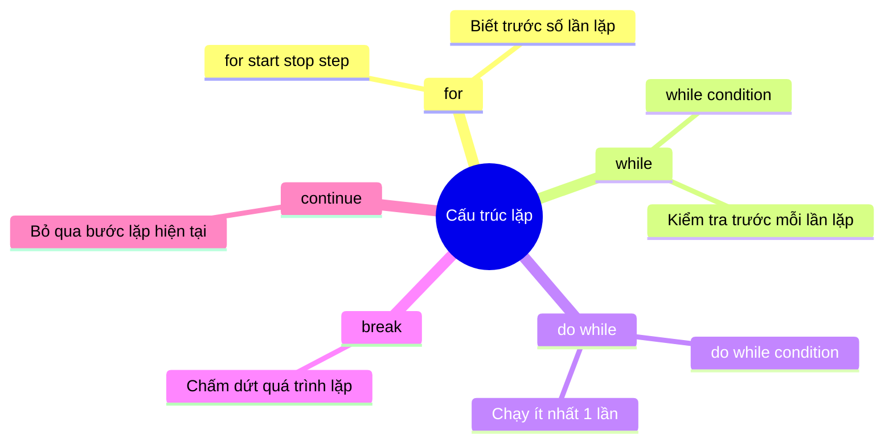
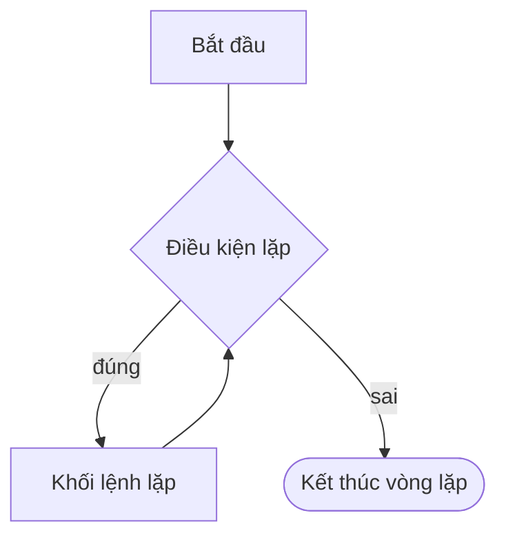
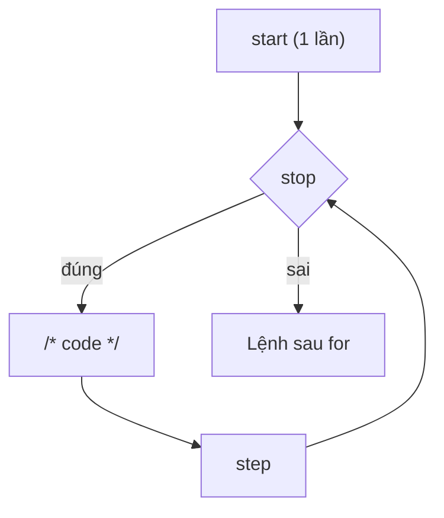
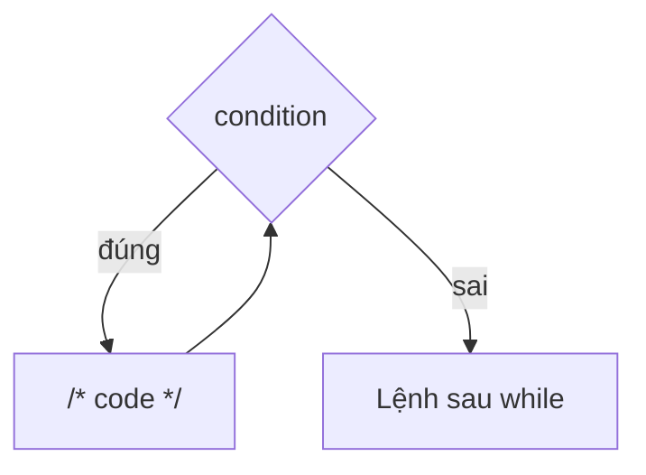
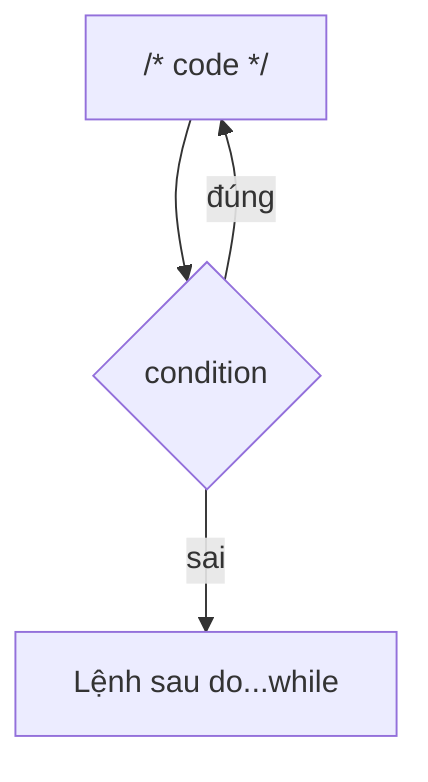

# Buổi 4 - Cấu trúc lặp (for / while / do-while)

- **Ngày**: 18/11/2026
- **Môn**: Nhập môn Lập trình (IT001.G13.CN2.TTNT)
- **Giảng viên**: Phạm Thế Sơn

## Sau khi học xong bài này

- Hiểu được ý tưởng và định nghĩa cấu trúc lặp (loop)
- Viết được vòng lặp `for`, `while`, `do - while` theo đúng cú pháp
- Biết dùng `for` / `while` / `do-while` để giải bài toán nhập liệu lặp lại
- Dùng được `break` để kết thúc vòng lặp và `continue` để bỏ qua bước lặp hiện tại
- Áp dụng vòng lặp và vòng lặp lồng nhau để giải các bài tập tính tổng, tích, kiểm tra số, liệt kê nghiệm

## Nội dung buổi học

1. Ý tưởng
2. Định nghĩa cấu trúc lặp
3. Cấu trúc lặp `for`
4. Cấu trúc lặp `while`
5. Cấu trúc lặp `do-while`
6. Lệnh `break` và `continue` trong cấu trúc lặp
7. Bài tập



## Ý tưởng

- **Vấn đề 1**: làm sao viết ra 6 lần câu `"Phai hoc ngon ngu C/C++ that tot."` nhanh nhất có thể?
- **Vấn đề 2**: làm sao viết ra 50 số từ 1 đến 50?
- **Vấn đề 3**: làm sao nhập vào số `n` không âm - nếu `n` âm thì phải nhập lại?

Kết quả mong muốn của 3 vấn đề:

```
Phai hoc ngon ngu C/C++ that tot.
Phai hoc ngon ngu C/C++ that tot.
Phai hoc ngon ngu C/C++ that tot.
Phai hoc ngon ngu C/C++ that tot.
Phai hoc ngon ngu C/C++ that tot.
Phai hoc ngon ngu C/C++ that tot.
```

```
1 2 3 4 5 6 7 8 9 10 11 12 13 14 15
16 17 18 19 20 21 22 23 24 25 26 27
28 29 30 31 32 33 34 35 36 37 38 39
40 41 42 43 44 45 46 47 48 49 50
```

```
Nhap n = -3
Nhap lai n = -6
Nhap lai n = 9
Gia tri da thoa. Ket qua n = 9
```

### Giải pháp cho vấn đề 1

Cách đơn giản nhất là viết 6 lệnh `cout` giống hệt nhau:

```cpp
#include <iostream>
using namespace std;

int main()
{
    cout << "Phai hoc ngon ngu C/C++ that tot." << endl;
    cout << "Phai hoc ngon ngu C/C++ that tot." << endl;
    cout << "Phai hoc ngon ngu C/C++ that tot." << endl;
    cout << "Phai hoc ngon ngu C/C++ that tot." << endl;
    cout << "Phai hoc ngon ngu C/C++ that tot." << endl;
    cout << "Phai hoc ngon ngu C/C++ that tot." << endl;

    return 0;
}
```

Còn giải pháp nào hay hơn nữa không?

### Giải pháp cho vấn đề 2

```cpp
#include <iostream>
using namespace std;

int main()
{
    cout << "1" << endl;
    cout << "2" << endl;
    cout << "3" << endl;
    // ...
    // ...
    cout << "50" << endl;

    return 0;
}
```

- Phải viết 50 lệnh → **không khả thi**. Nếu đề yêu cầu in tới 1000, hoặc in tới `n` do người dùng nhập thì càng không thể viết tay.
- Cả 3 vấn đề đều có chung đặc điểm: **một khối lệnh cần được thực hiện lặp đi lặp lại** - đây chính là lúc dùng cấu trúc lặp.

## Định nghĩa cấu trúc lặp

- **Cấu trúc lặp** (loop / repetition) được sử dụng để **thực hiện lại một khối lệnh lặp đi lặp lại** khi một điều kiện đã cho được thỏa mãn.
- Khi xây dựng cấu trúc lặp phải **xác định kỹ điều kiện lặp** để tránh tình trạng cấu trúc lặp **chạy vô hạn** (infinite loop).
- Có 3 loại cấu trúc lặp:

1. `for`
2. `while`
3. `do-while`



## Cấu trúc lặp `for`

Cú pháp:

```cpp
for (start; stop; step)
{
    /* code */
}
```

Trong đó:

| Thành phần | Vai trò |
|---|---|
| `start` | Khởi tạo giá trị ban đầu cho **biến điều khiển** quá trình lặp |
| `stop` | **Biểu thức điều kiện** để kiểm tra sau mỗi lần lặp - nếu điều kiện đúng thì khối lệnh trong `for` được thực thi, nếu sai thì vòng lặp kết thúc |
| `step` | Phần **cập nhật** lại giá trị biến điều khiển lặp sau mỗi lần lặp |



### Ví dụ 1 - giải quyết vấn đề 1 bằng `for`

```cpp
#include <iostream>
using namespace std;

int main()
{
    for (int i = 1; i <= 6; i++)
    {
        cout << "Phai hoc ngon ngu C/C++ that tot." << endl;
    }

    return 0;
}
```

- Chỉ cần **1 lệnh `cout`** thay vì 6 - vòng lặp tự chạy lại đúng 6 lần nhờ biến điều khiển `i` đi từ 1 đến 6.

### Ví dụ 2 - giải quyết vấn đề 2 bằng `for`

```cpp
#include <iostream>
using namespace std;

int main()
{
    for (int i = 1; i <= 50; i++)
    {
        cout << i << " ";
    }

    return 0;
}
```

Kết quả: `1 2 3 4 ... 50`

- Biến `i` vừa là biến điều khiển vừa là giá trị cần in - nên mỗi lần lặp in ra một số khác nhau.

> [!TIP]
> - Hai cách đếm phổ biến: `for (int i = 1; i <= 50; i++)` (đếm từ 1, dễ đọc) hoặc `for (int i = 0; i < 50; i++)` (đếm từ 0 - chuẩn khi duyệt mảng, chuỗi sau này). Cả hai đều lặp đúng 50 lần.
> - `step` không bắt buộc là `i++`: `i += 2` duyệt số chẵn, `i--` đếm ngược - miễn sao biến điều khiển tiến tới chỗ `stop` sai.
> - Cẩn thận `i <= 50` với `i < 50`: lệch nhau đúng 1 vòng (lỗi off-by-one). Khi không chắc, thử bằng `n` nhỏ (vd `n = 2`) và đếm số lần lặp bằng tay.

### Ví dụ 3 - giải quyết vấn đề 3 bằng `for`

`start` và `step` của `for` **có thể bỏ trống** nếu không cần - khi đó `for` hoạt động giống như chỉ kiểm tra điều kiện:

```cpp
#include <iostream>
using namespace std;

int main()
{
    int n;
    cout << "Nhap n = ";
    cin >> n;

    for (; n < 0;)
    {
        cout << "Nhap lai n = ";
        cin >> n;
    }

    cout << "Gia tri da thoa. Ket qua n = " << n << endl;
    return 0;
}
```

Kết quả chạy thử:

```
Nhap n = -3
Nhap lai n = -6
Nhap lai n = 9
Gia tri da thoa. Ket qua n = 9
```

> [!NOTE]
> `for (; n < 0;)` không có `start` vì `n` đã được nhập trước đó, không có `step` vì việc "cập nhật" là nhập lại `n` trong thân vòng lặp. Hai dấu `;` vẫn bắt buộc phải có.

## Cấu trúc lặp `while`

Cú pháp:

```cpp
while (condition)
{
    /* code */
}
```

Trong đó:

- `condition`: **biểu thức điều kiện** để kiểm tra **trước** mỗi lần lặp. Nếu điều kiện đúng, khối lệnh trong `while` sẽ được thực hiện; nếu sai, vòng lặp sẽ kết thúc.

Nhận xét: `while` tương đương `for` **không có `start` và `step`**:

```cpp
for (; condition;)
{
    /* code */
}
```



### Ví dụ - giải quyết vấn đề 3 bằng `while`

```cpp
#include <iostream>
using namespace std;

int main()
{
    int n;
    cout << "Nhap n = ";
    cin >> n;

    while (n < 0)
    {
        cout << "Nhap lai n = ";
        cin >> n;
    }

    cout << "Gia tri da thoa. Ket qua n = " << n << endl;
    return 0;
}
```

- Điều kiện `n < 0` được kiểm tra **trước** mỗi lần lặp: nhập đúng ngay từ đầu thì thân `while` **không chạy lần nào**.
- Phải viết `cin >> n` hai lần: một lần trước `while` để có giá trị kiểm tra, một lần trong thân để nhập lại.

> [!CAUTION]
> `while` không gom sẵn `step` như `for` nên rất dễ quên cập nhật biến điều khiển → **lặp vô hạn**. Sau khi viết `while`, tự hỏi ngay: "lệnh nào trong thân làm `condition` tiến tới `false`?". Không có câu trả lời thì vòng lặp chạy mãi không dừng.

## Cấu trúc lặp `do-while`

Cú pháp:

```cpp
do
{
    /* code */
} while (condition);
```

Trong đó:

- `condition`: biểu thức điều kiện để kiểm tra **sau** mỗi lần lặp.
- Nếu điều kiện đúng, khối lệnh trong `do-while` được thực hiện và vòng lặp tiếp tục; nếu sai, vòng lặp kết thúc.

Khác với `while`: khối lệnh trong `do-while` **chạy trước rồi mới kiểm tra**, nên luôn được thực hiện **ít nhất 1 lần**.



> [!WARNING]
> Đừng quên dấu `;` sau `while (condition)` ở cuối `do-while` - đây là lỗi biên dịch phổ biến khi quen viết `while` thường.

### Ví dụ - giải quyết vấn đề 3 bằng `do-while`

```cpp
#include <iostream>
using namespace std;

int main()
{
    int n;
    do
    {
        cout << "Nhap n = ";
        cin >> n;
    } while (n < 0);

    cout << "Gia tri da thoa. Ket qua n = " << n << endl;
    return 0;
}
```

- Gọn hơn bản `while`: lệnh nhập chỉ viết **1 lần** vì `do-while` luôn chạy thân trước - `n` luôn được nhập ít nhất 1 lần trước khi kiểm tra.
- Đây là lý do `do-while` rất hợp cho bài toán **nhập liệu lặp lại cho tới khi hợp lệ**.

> [!TIP]
> `do-while` cũng là chọn lựa kinh điển cho **menu** chương trình: `do { in menu; đọc lựa chọn; xử lý } while (chon != 0);` - menu phải in ít nhất 1 lần trước khi biết người dùng có muốn thoát không.

| `while` | `do-while` |
|---|---|
| Kiểm tra điều kiện **trước** mỗi lần lặp | Kiểm tra điều kiện **sau** mỗi lần lặp |
| Thân vòng lặp có thể chạy **0 lần** | Thân vòng lặp luôn chạy **ít nhất 1 lần** |
| Phải nhập trước rồi mới kiểm tra | Nhập trong thân vòng lặp luôn |

## Lệnh `break` và `continue` trong cấu trúc lặp

- Lệnh `break` và `continue` được sử dụng để **điều khiển luồng thực thi** trong cấu trúc lặp.

### Lệnh `break`

- Khi lệnh `break` được gọi trong cấu trúc lặp (`for`, `while`, `do-while`) thì **chấm dứt quá trình lặp** và kết thúc cấu trúc lặp.
- Sau khi `break`, chương trình tiếp tục ở **các câu lệnh nằm sau cấu trúc lặp**.

Phương pháp - `break` thường đặt trong một `if` điều kiện:

```cpp
for (start; stop; step)
{
    /* code */
    if (break_condition)
        break;
    /* code */
}
```

```cpp
while (condition)
{
    /* code */
    if (break_condition)
        break;
    /* code */
}
```

```cpp
do
{
    /* code */
    if (break_condition)
        break;
    /* code */
} while (condition);
```

**Ví dụ** - trong các số từ 1 đến 50, in ra **số đầu tiên** chia hết cho 3, 6 và 9:

```cpp
#include <iostream>
using namespace std;

int main()
{
    for (int i = 1; i <= 50; i++)
    {
        if (i % 3 == 0 && i % 6 == 0 && i % 9 == 0)
        {
            cout << i << endl;
            break;
        }
    }

    return 0;
}
```

Kết quả: `18`

- `i` chạy `1, 2, 3...` đến `18` thì `18 % 3 == 0`, `18 % 6 == 0`, `18 % 9 == 0` cùng đúng → in `18` rồi `break`.
- Nếu không `break`, vòng lặp sẽ duyệt nốt tới 50 và in tiếp `36` - sai yêu cầu "số đầu tiên".

### Lệnh `continue`

- Khi lệnh `continue` được gọi trong cấu trúc lặp (`for`, `while`, `do-while`) thì sẽ **bỏ qua các câu lệnh còn lại trong bước lặp** và chuyển đến bước lặp tiếp theo.
- Vòng lặp **không kết thúc** - chỉ bỏ qua phần còn lại của lần lặp hiện tại.

Phương pháp - `continue` cũng thường đặt trong `if`:

```cpp
for (start; stop; step)
{
    /* code */
    if (continue_condition)
        continue;
    /* code */
}
```

```cpp
while (condition)
{
    /* code */
    if (continue_condition)
        continue;
    /* code */
}
```

```cpp
do
{
    /* code */
    if (continue_condition)
        continue;
    /* code */
} while (condition);
```

**Ví dụ** - in ra các số `1, 2, 4, 5, 7, 8, 10` - tương đương in các số từ 1 đến 10 nhưng **phớt lờ** các số 3, 6, 9:

```cpp
#include <iostream>
using namespace std;

int main()
{
    for (int i = 1; i <= 10; i++)
    {
        if (i == 3 || i == 6 || i == 9)
        {
            continue;
        }
        cout << i << " ";
    }

    return 0;
}
```

Kết quả: `1 2 4 5 7 8 10`

- Khi `i` là 3, 6 hoặc 9, `continue` bỏ qua lệnh `cout` bên dưới và nhảy sang `step` (`i++`) của lần lặp kế tiếp.

> [!CAUTION]
> Trong `while` / `do-while`, `continue` nhảy thẳng về chỗ kiểm tra `condition` - nếu lệnh cập nhật biến điều khiển nằm **sau** `continue`, biến không bao giờ đổi → lặp vô hạn. Với `for` thì an toàn hơn vì `continue` vẫn chạy `step` trước khi kiểm tra lại.

| `break` | `continue` |
|---|---|
| **Chấm dứt** toàn bộ cấu trúc lặp | Chỉ **bỏ qua** phần còn lại của bước lặp hiện tại |
| Nhảy ra lệnh **sau** vòng lặp | Nhảy tới **bước lặp kế tiếp** |
| "Tìm thấy rồi, dừng luôn" | "Phần tử này bỏ qua, xét cái tiếp" |

> [!TIP]
> **Mẹo debug vòng lặp**: khi kết quả sai, thêm tạm `cout` in giá trị biến điều khiển và biến tích lũy ở cuối thân vòng lặp để soi từng vòng - ví dụ `cout << "i = " << i << ", S = " << S << endl;`. Sai lệch thường lộ ra ngay ở vòng đầu hoặc vòng cuối.

## Bài tập

### Bài tập 1: in hình dấu `*` và bảng cửu chương

a) Viết chương trình in ra các dấu `*` theo hình sau:

```
*********
*********
*********
```

b) Viết chương trình in ra bảng cửu chương 2 đến bảng cửu chương 9. Các bảng cửu chương cách nhau 2 dòng.

> [!TIP]
> Hai câu này cần **vòng lặp lồng nhau** (nested loop): vòng ngoài duyệt dòng / bảng, vòng trong duyệt từng phần tử trên dòng / từng phép nhân.

### Bài tập 2: tính tổng và giai thừa

a) Viết chương trình tính tổng các số từ 1 đến `n`, với `n` là một số nguyên dương nhập từ bàn phím:

$$S = 1 + 2 + 3 + \dots + n$$

b) Viết chương trình tính giai thừa của một số cho trước `n` (nguyên dương) được nhập từ bàn phím:

$$T = n! = 1 \cdot 2 \cdot 3 \dots n$$

### Bài tập 3: kiểm tra giá trị nhập vào

a) Viết lệnh kiểm tra giá trị nhập vào từ bàn phím thỏa điều kiện thuộc $[-99; 99]$. Nếu không thỏa, bắt người dùng nhập lại đến khi nào thỏa điều kiện.

b) Viết lệnh kiểm tra giá trị nhập vào (phải là số thực) từ bàn phím thỏa điều kiện thuộc $[-89.9; 88.8]$. Nếu không thỏa, bắt người dùng nhập lại đến khi nào thỏa điều kiện.

### Bài tập 4: in các số chẵn trong khoảng

a) Viết chương trình in ra các số chẵn nguyên từ 2020 đến 3838.

b) Viết chương trình in ra các số chẵn nguyên chia hết cho 3, 6 và 9 từ 2020 đến 3838.

### Bài tập 5: kiểm tra số nguyên tố

Viết chương trình kiểm tra số `n` có phải là số nguyên tố?

Hướng dẫn:

- **Số nguyên tố** (prime number) là một số tự nhiên **lớn hơn 1** và chỉ có hai ước số dương là 1 và chính nó. Nghĩa là số nguyên tố không chia hết cho bất kỳ số nguyên dương nào khác ngoài 1 và chính nó.
- Các số nguyên tố: `2, 3, 5, 7, 11, 13, 17, 19, 23...`
- Việc kiểm tra số `n` là số nguyên tố hay không có nhiều phương pháp khác nhau. Trong đó, **phương pháp chia hết** là một trong những phương pháp đơn giản nhất.

### Bài tập 6: ước chung lớn nhất và in các chữ số

a) Viết chương trình tìm ước chung lớn nhất hai số nguyên `a` và `b`.

b) Viết chương trình in ra các chữ số của số `n` nguyên dương. Ví dụ: nhập `n = 6789` thì in ra `6 7 8 9`.

### Bài tập 7: nhập `n` trong $[5; 10]$ và tính $S(n)$

a) Viết chương trình kiểm tra giá trị `n` nhập vào từ bàn phím phải thuộc đoạn $[5; 10]$. Nếu nhập sai thì bắt nhập lại.

b) Từ giá trị `n` được nhập vào, tính biểu thức sau:

$$S(n) = 1 \cdot (1 + 2) \cdot (1 + 2 + 3) \dots (1 + 2 + 3 + \dots + n)$$

### Bài tập 8: tính $S(n)$ dạng tổng nghịch đảo

Tính giá trị biểu thức sau:

$$S(n) = \frac{1}{2} + \frac{1}{2 \cdot 3} + \frac{1}{2 \cdot 3 \cdot 4} + \dots + \frac{1}{2 \cdot 3 \cdot 4 \dots n}$$

### Bài tập 9: liệt kê bộ nghiệm nguyên

a) Viết chương trình liệt kê tất cả bộ nghiệm nguyên của phương trình sau:

$$2x + 7y + 9z = 979 \quad (x, y, z > 0)$$

b) Viết chương trình liệt kê tất cả bộ nghiệm nguyên của phương trình trên với $x, y, z > 0$ và $x + y + z$ **lớn nhất**.

### Bài tập 10: trò chơi Kéo - Giếng - Bao

Viết chương trình mô phỏng trò chơi **Kéo (K) - Giếng (G) - Bao (B)** giữa người và máy.

Quy ước:

- Kéo > Bao
- Giếng > Kéo
- Bao > Giếng
- Nếu ai thắng thì cộng 1 điểm. Khi Máy và Người hòa nhau thì cùng cộng 0.5 điểm.
- Trò chơi dừng lại khi tỉ số lệch nhau 2 điểm.

Ví dụ chạy:

```
Lan 1:
 Nguoi ra: K
 May: B
 => Ket qua: Nguoi thang May
 Diem nguoi 1.0 Diem may 0
Lan 2:
 Nguoi ra: K
 May: K
 => Ket qua: Nguoi hoa May
 Diem nguoi 1.5 Diem may 0.5
```

## Câu hỏi ôn tập

```quiz
{
  "title": "Ôn tập - Cấu trúc lặp",
  "mode": "practice",
  "questions": [
    {
      "type": "single",
      "question": "Vòng lặp nào **luôn thực hiện thân ít nhất 1 lần**, kể cả khi điều kiện sai ngay từ đầu?",
      "options": ["`do - while`", "`for`", "`while`", "Không vòng lặp nào"],
      "answer": 0,
      "explanation": "`do-while` kiểm tra điều kiện **sau** khi chạy thân nên thân luôn chạy trước ít nhất 1 lần. `for` và `while` kiểm tra trước nên thân có thể không chạy lần nào."
    },
    {
      "type": "single",
      "question": "Cho đoạn code `for (int i = 1; i <= 5; i++) { cout << i; }`, kết quả in ra là?",
      "options": ["`12345`", "`1234`", "`01234`", "`012345`"],
      "answer": 0,
      "explanation": "`i` bắt đầu từ 1, điều kiện `i <= 5` cho phép lặp khi `i` là 1, 2, 3, 4, 5 - đúng 5 lần, in liền nhau `12345`."
    },
    {
      "type": "single",
      "question": "Cho `for (int i = 1; i <= 10; i++) { if (i % 3 == 0) continue; cout << i << ' '; }`, kết quả in ra là?",
      "options": ["`1 2 4 5 7 8 10`", "`1 2 3 4 5 6 7 8 9 10`", "`3 6 9`", "`1 2 4 5 7 8`"],
      "answer": 0,
      "explanation": "`continue` bỏ qua `cout` khi `i` chia hết cho 3 (tức `i` là 3, 6, 9), các số còn lại được in bình thường."
    },
    {
      "type": "true-false",
      "question": "`while (condition) { /* code */ }` tương đương `for (; condition;) { /* code */ }`.",
      "answer": true,
      "explanation": "`while` chỉ kiểm tra điều kiện trước mỗi lần lặp - đúng y hệt `for` bỏ trống `start` và `step`. Cập nhật (nếu cần) đều nằm trong thân."
    },
    {
      "type": "single",
      "question": "Lệnh `break` đặt trong vòng lặp có tác dụng gì?",
      "options": ["Chấm dứt quá trình lặp, nhảy ra lệnh sau vòng lặp", "Bỏ qua phần còn lại của bước lặp hiện tại", "Tạm dừng chương trình chờ nhấn phím", "Quay lại dòng đầu tiên của vòng lặp"],
      "answer": 0,
      "explanation": "`break` chấm dứt hoàn toàn cấu trúc lặp và chương trình chạy tiếp các lệnh sau vòng lặp. Bỏ qua bước lặp hiện tại là tác dụng của `continue`."
    },
    {
      "type": "single",
      "question": "Đoạn code `int i = 1; while (i < 5) { cout << i; }` có vấn đề gì?",
      "options": ["Lặp vô hạn vì thiếu `i++`", "In ra `1234` rồi dừng", "Lỗi biên dịch", "Chỉ in `1` rồi dừng"],
      "answer": 0,
      "explanation": "Không có lệnh nào làm `i` tăng nên `i < 5` luôn đúng - vòng lặp in `1` mãi mãi. Với `while` phải tự viết bước cập nhật trong thân."
    },
    {
      "type": "single",
      "question": "Bắt người dùng nhập `n` thuộc đoạn `[5; 10]`, nhập sai thì nhập lại. Điều kiện lặp đúng của `do-while` là?",
      "options": ["`n < 5 || n > 10`", "`n >= 5 && n <= 10`", "`n < 5 && n > 10`", "`n == 5 || n == 10`"],
      "answer": 0,
      "explanation": "Điều kiện **lặp lại** là phủ định của điều kiện hợp lệ `5 <= n <= 10`. `n < 5 && n > 10` không bao giờ đúng (lặp 0 lần), còn `n >= 5 && n <= 10` là điều kiện hợp lệ - dùng nó thì nhập đúng lại bị bắt nhập tiếp."
    },
    {
      "type": "multiple",
      "question": "Phát biểu nào đúng về cú pháp `for (start; stop; step)`?",
      "options": ["`start` chỉ chạy đúng 1 lần trước khi lặp", "`stop` được kiểm tra sau mỗi lần lặp", "`start` và `step` có thể bỏ trống", "`step` luôn chạy trước `stop` trong mọi lần lặp"],
      "answer": [0, 1, 2],
      "explanation": "Thứ tự thực tế: `start` (1 lần) → kiểm tra `stop` → thân → `step` → lặp lại từ `stop`. Nên ở lần lặp đầu tiên, `stop` được kiểm tra **trước cả** `step` - phát biểu cuối sai."
    },
    {
      "type": "true-false",
      "question": "Lệnh `continue` sẽ kết thúc hoàn toàn vòng lặp, giống `break`.",
      "answer": false,
      "explanation": "`continue` chỉ bỏ qua phần còn lại của **bước lặp hiện tại** rồi chuyển sang bước lặp kế tiếp - vòng lặp vẫn tiếp tục. Chỉ `break` mới kết thúc vòng lặp."
    },
    {
      "type": "single",
      "question": "Vòng lặp lồng nhau `for (int i = 1; i <= 3; i++) { for (int j = 1; j <= 4; j++) { cout << '*'; } }` in ra tổng cộng bao nhiêu dấu `*`?",
      "options": ["`12`", "`7`", "`3`", "`4`"],
      "answer": 0,
      "explanation": "Mỗi lần vòng ngoài (`i`) chạy, vòng trong (`j`) chạy hết 4 lần. Tổng: `3 x 4 = 12` dấu `*`."
    },
    {
      "type": "single",
      "question": "Trong bài `S(n) = 1/2 + 1/(2.3) + 1/(2.3.4) + ...`, vì sao phải viết `S += 1.0 / mau;` mà không phải `S += 1 / mau;`?",
      "options": ["`1 / mau` là phép chia nguyên, luôn cho kết quả `0`", "`1 / mau` gây lỗi biên dịch", "`1.0 / mau` chạy nhanh hơn", "Hai cách viết hoàn toàn giống nhau"],
      "answer": 0,
      "explanation": "`1` và `mau` đều là số nguyên nên `1 / mau` là **chia lấy phần nguyên** - luôn bằng `0` khi `mau > 1`. Viết `1.0` ép phép chia thành chia số thực."
    },
    {
      "type": "self-check",
      "question": "Viết vòng lặp `for` tính `S = 1 + 2 + ... + n` với `n` nguyên dương nhập từ bàn phím (khai báo biến đầy đủ).",
      "answer": "`int S = 0;` rồi `for (int i = 1; i <= n; i++) { S += i; }` - khởi tạo `S = 0` trước vòng lặp, mỗi lần lặp cộng dồn `i` vào `S`.",
      "explanation": "Đây là kỹ thuật tích lũy: biến kết quả khởi tạo `0` (trung hòa phép cộng), thân vòng lặp chỉ chứa phép cộng dồn."
    }
  ]
}
```

## Tổng kết

- Cấu trúc lặp dùng để thực hiện lặp lại một khối lệnh khi điều kiện thỏa mãn - phải xác định kỹ điều kiện để tránh lặp vô hạn.
- `for (start; stop; step)`: `start` khởi tạo biến điều khiển, `stop` kiểm tra sau mỗi lần lặp, `step` cập nhật biến điều khiển - `start`/`step` có thể bỏ trống.
- `while (condition)`: kiểm tra **trước** mỗi lần lặp, thân có thể chạy 0 lần - tương đương `for (; condition;)`.
- `do { } while (condition)`: kiểm tra **sau** mỗi lần lặp, thân luôn chạy ít nhất 1 lần - hợp bài toán nhập lại cho tới khi hợp lệ; nhớ `;` cuối `while`.
- `break` chấm dứt hoàn toàn cấu trúc lặp; `continue` bỏ qua phần còn lại của bước lặp hiện tại và sang bước tiếp theo.
- Kỹ thuật hay dùng: **tích lũy** (`S += i`, `T *= i`), **cờ** (`bool nguyenTo`), **vét cạn** bằng vòng lặp lồng nhau, chú ý `long long` khi tích lũy lớn và `1.0 / mau` để chia thực.
