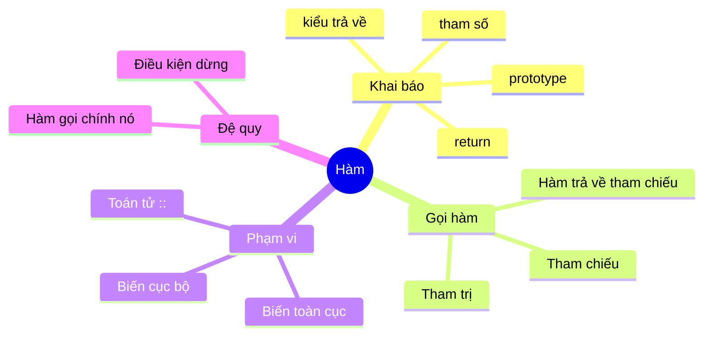
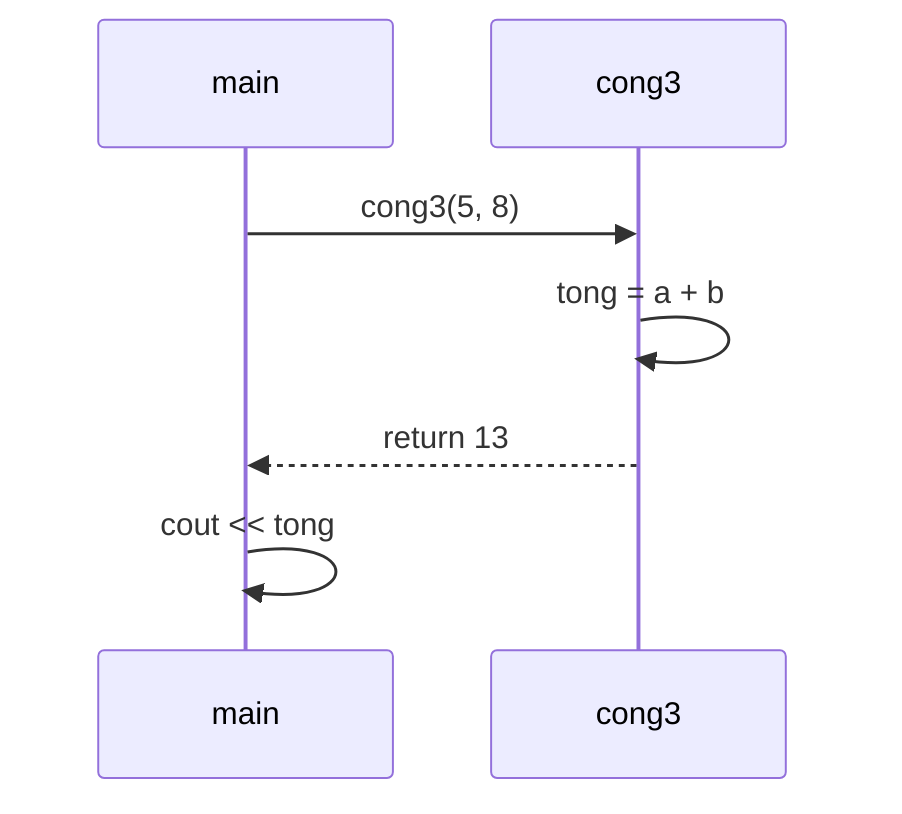

# Buổi 5 - Hàm (Function)

- **Ngày**: 25/11/2026
- **Môn**: Nhập môn Lập trình (IT001.G13.CN2.TTNT)
- **Giảng viên**: Phạm Thế Sơn

## Sau khi học xong bài này

- Hiểu được ý tưởng và lợi ích khi chia chương trình thành các hàm
- Viết được định nghĩa hàm theo đúng cú pháp và đặt hàm ở vị trí hợp lệ
- Phân tích bài toán thành input / output để thiết kế hàm đúng cách
- Gọi hàm với đối số, phân biệt được truyền tham trị và truyền tham chiếu
- Dùng được tham chiếu để hàm trả về nhiều kết quả, hiểu hàm trả về tham chiếu
- Viết được hàm đệ quy với điều kiện dừng
- Phân biệt biến toàn cục / cục bộ và dùng được toán tử phạm vi `::`
- Khai báo prototype khi định nghĩa hàm nằm sau chỗ gọi

## Nội dung buổi học

1. Ý tưởng
2. Định nghĩa hàm và cú pháp
3. Nguyên tắc cơ bản thiết kế hàm
4. Phạm vi biến và hàm
5. Các phương pháp gọi hàm
6. Tham trị, tham chiếu và hàm trả về tham chiếu
7. Đệ quy
8. Bài tập



## Ý tưởng

### Quan sát các hàm có sẵn

Thư viện chuẩn đã cung cấp nhiều hàm, ví dụ:

- `double abs(double)` - giá trị tuyệt đối
- `double sqrt(double)` - căn bậc hai
- `double pow(double base, double exponent)` - lũy thừa

Điểm chung: mỗi hàm nhận dữ liệu đầu vào qua tham số, xử lý rồi trả về kết quả - dùng đi dùng lại mà không cần viết lại code.

### Vấn đề 1: nhập 5 số nguyên dương

Bài toán đã làm ở buổi trước: nhập một số nguyên dương, nếu sai thì bắt nhập lại đến khi đúng. Bây giờ áp dụng cho **5 số** `a, b, c, d, e`.

Nhận xét: nếu viết thẳng trong `main` thì đoạn code nhập - kiểm tra giống hệt nhau phải lặp lại 5 lần. Giải pháp tốt: gom đoạn code đó thành một **hàm**, rồi gọi 5 lần.

### Vấn đề 2: chương trình quản lý nhân viên

Công việc lớn nên chia nhỏ thành nhiều công việc nhỏ:

- Nhập nhân viên
- Xuất / in nhân viên
- Tìm nhân viên
- Tính lương
- Xét thưởng
- ...

Mỗi công việc nhỏ cài đặt thành một hàm riêng.

### Lợi ích của hàm

- **Tái sử dụng mã**: viết 1 lần, gọi nhiều lần.
- **Mô-đun hóa**: chia chương trình thành các phần nhỏ, độc lập nhau.
- **Đơn giản**: chia công việc phức tạp thành nhiều phần nhỏ hơn, dễ phân tích, thiết kế, cài đặt.
- **Tái cấu trúc**: dễ thay đổi cách gọi hàm.
- **Quản lý lỗi**: kiểm tra từng hàm riêng để phát hiện lỗi.
- **Tăng hiệu suất**: dùng các hàm có sẵn trong thư viện.

## Định nghĩa hàm và cú pháp

- **Hàm** là một khối lệnh thực hiện một nhiệm vụ, công việc hoặc chức năng cụ thể.
- Hàm được thiết kế để **tái sử dụng** khi có nhu cầu, giúp sửa lỗi, cập nhật và bảo trì dễ dàng.
- Một chương trình lớn có thể chia thành nhiều chức năng nhỏ để dễ kiểm soát và nâng cấp.

Cú pháp:

```cpp
kiểu_dữ_liệu ten_ham(khai_báo_các_tham_số)
{
    //Code
    return giá_trị_trả_về;
}
```

Trong đó:

| Thành phần | Vai trò |
|---|---|
| `kiểu_dữ_liệu` | Kiểu dữ liệu của giá trị trả về sau khi hàm chạy xong - gọi tắt là **kiểu trả về**: `int`, `float`, `double`, `void`... hoặc kiểu đối tượng (`class`, `struct`) |
| `ten_ham` | Tên hàm, dùng khi gọi |
| `khai_báo_các_tham_số` | Các khai báo biến (nếu có) - đại diện cho **dữ liệu đầu vào** cần xử lý |
| `return giá_trị_trả_về` | Kết thúc hàm và trả kết quả về chỗ gọi |

### Vị trí đặt hàm

Có thể đặt hàm ở nhiều vị trí:

- **Trên hàm `main()`**: định nghĩa xong là gọi được ngay.
- **Dưới hàm `main()`**: phải khai báo **prototype** trước (xem phần cuối bài).

### Ví dụ: giải quyết vấn đề nhập 5 số

Định nghĩa hàm `nhap` đặt **trên** `main`, rồi gọi 5 lần:

```cpp
int nhap()
{
    int n;
    do
    {
        cout << "Nhap gia tri = ";
        cin >> n;
    } while (n < 0);
    return n;
}

int main()
{
    int a, b, c, d, e;
    a = nhap();
    b = nhap();
    c = nhap();
    d = nhap();
    e = nhap();
    cout << "Cac gia tri da nhap:" << endl;
    cout << a << endl;
    cout << b << endl;
    cout << c << endl;
    cout << d << endl;
    cout << e << endl;
    return 0;
}
```

- Đoạn `do - while` bắt nhập lại chỉ viết **1 lần** trong hàm `nhap`, `main` gọi 5 lần - thay vì copy 5 đoạn code giống nhau.

Nếu đặt hàm **dưới** `main` thì phải khai báo prototype trước:

```cpp
int nhap(); // Khai báo prototype

int main()
{
    int a, b, c, d, e;
    a = nhap();
    b = nhap();
    c = nhap();
    d = nhap();
    e = nhap();
    cout << "Cac gia tri da nhap:" << endl;
    cout << a << endl;
    cout << b << endl;
    cout << c << endl;
    cout << d << endl;
    cout << e << endl;
    return 0;
}

int nhap()
{
    int n;
    do
    {
        cout << "Nhap gia tri = ";
        cin >> n;
    } while (n < 0);
    return n;
}
```

## Nguyên tắc cơ bản thiết kế hàm

> [!WARNING]
> Trước khi giải quyết vấn đề, **PHẢI phân tích input và output thật kỹ**. Ví dụ `double pow(double base, double exponent)`: input là 2 số `base`, `exponent`; output là một `double` trả về.

Với bài toán lớn như quản lý nhân viên, mỗi chức năng (nhập, xuất, tìm, tính lương, xét thưởng...) tách thành một hàm độc lập.

### Áp dụng: viết hàm cộng 2 số nguyên `a` và `b`

Có nhiều cách thiết kế - viết theo 3 cách rồi nhận xét.

**Cách 1**: nhập và in luôn bên trong hàm.

```cpp
void cong1()
{
    int a, b, tong;
    cout << "Nhap a = ";
    cin >> a;
    cout << "Nhap b = ";
    cin >> b;
    tong = a + b;
    cout << "Tong = " << tong << endl;
}
```

**Cách 2**: nhập bên trong hàm, trả kết quả về chỗ gọi.

```cpp
int cong2()
{
    int a, b, tong;
    cout << "Nhap a = ";
    cin >> a;
    cout << "Nhap b = ";
    cin >> b;
    tong = a + b;
    return tong;
}
```

**Cách 3**: nhận input qua tham số, trả output qua `return`.

```cpp
int cong3(int a, int b)
{
    int tong;
    tong = a + b;
    return tong; // hoặc return a + b;
}
```

> [!TIP]
> **Khuyến nghị thiết kế theo cách 3**: hàm nhận các giá trị để xử lý rồi trả về kết quả. Input đến từ đâu (`cin`, file, tính toán trung gian...) không phải việc của hàm - hàm chỉ lo tính toán nên tái sử dụng được ở mọi ngữ cảnh. Cách 1 gộp cả nhập, xử lý, in vào một chỗ nên khó dùng lại; cách 2 tách được output nhưng vẫn ép người dùng nhập từ bàn phím.

## Các phương pháp gọi hàm

- **Gọi hàm** là quá trình sử dụng **tên của hàm** để thực thi code bên trong hàm đó.
- Khi một hàm được gọi:
  - Chương trình **chuyển quyền kiểm soát** từ vị trí gọi hàm sang vị trí định nghĩa hàm.
  - Thực hiện các câu lệnh trong thân hàm.
- Sau khi thực thi xong, quyền kiểm soát **trả về vị trí tiếp theo** sau lời gọi hàm.

Cú pháp:

```cpp
ten_ham(đối_số_1, đối_số_2, …, đối_số_n);
```

- `đối_số_` (argument): các giá trị hoặc biểu thức được truyền vào hàm thông qua các tham số.
- Có **2 cách truyền đối số**:
  1. **Tham trị** - truyền giá trị (Pass by value)
  2. **Tham chiếu** - truyền tham chiếu / tham biến (Pass by reference)



### Áp dụng gọi hàm `cong1` và `cong2`

```cpp
int main()
{
    cong1();
    int t = cong2();
    cout << "Tong = " << t << endl;
    return 0;
}
```

- `cong1()` không trả giá trị (`void`) nên chỉ gọi, không gán được.
- `cong2()` trả `int` nên gán kết quả vào biến `t` để dùng tiếp.

## Tham trị (Pass by value)

- Đối số truyền vào được **sao chép** thành tham số của hàm - hàm làm việc trên bản sao.
- Có thể truyền trực tiếp giá trị (`5`, `8`) hoặc truyền biến (`x`, `y`).
- Thay đổi tham số bên trong hàm **không ảnh hưởng** đến biến gốc bên ngoài.

```cpp
int main()
{
    int tong;
    tong = cong3(5, 8); // Cách 1: truyền giá trị trực tiếp
    cout << "Tong = " << tong << endl;

    int x = 3, y = 6;
    tong = cong3(x, y); // Cách 2: truyền biến
    cout << "Tong = " << tong << endl;
    return 0;
}
```

## Tham chiếu (Pass by reference)

### Giới thiệu tham chiếu (Reference)

- **Tham chiếu** là một biến khác được **liên kết với một biến đã tồn tại**.
- Cho phép tạo một biến khác tham chiếu đến một đối tượng trong bộ nhớ.
- Thường dùng để **thay đổi giá trị biến gốc**, hoặc truyền tham số vào hàm **mà không cần sao chép dữ liệu**.
- Cú pháp khai báo tham chiếu: dùng dấu `&` sau kiểu dữ liệu.

```cpp
kiểu_dữ_liệu ten_bien = giá_trị;
kiểu_dữ_liệu& ten_bien_khac = ten_bien;
```

Ví dụ:

```cpp
#include <iostream>
using namespace std;

int main()
{
    int x = 36;
    int& ref = x; // Khai báo một tham chiếu tới biến x
    ref = 369;    // Thay đổi giá trị của x thông qua biến tham chiếu
    cout << "Gia tri x = " << x << endl;
    return 0;
}
```

Kết quả: `Gia tri x = 369`

- `ref` và `x` trỏ vào **cùng một vùng nhớ** - sửa qua `ref` thì đọc `x` thấy giá trị mới và **ngược lại** (sửa `x` thì `ref` cũng đổi), vì tham chiếu chỉ là **tên gọi khác** của cùng một biến, không phải bản sao riêng.

### Áp dụng tham chiếu vào hàm

Bài toán: viết hàm thực hiện **cộng và trừ** hai số `a` và `b`.

- Đầu vào: hai số `a` và `b`.
- Đầu ra: **2 kết quả** - tổng `a + b` và hiệu `a - b`.

`return` chỉ trả về được 1 giá trị, nên kết quả còn lại đưa ra ngoài qua **tham số tham chiếu**:

```cpp
int tinh(int a, int b, int& hieu)
{
    hieu = a - b;
    int tong = a + b;
    return tong;
}

int main()
{
    int x = 6, y = 9;
    int tong, h;
    tong = tinh(x, y, h);
    cout << "Tong = " << tong << endl;
    cout << "Hieu = " << h << endl;
    return 0;
}
```

Kết quả:

```
Tong = 15
Hieu = -3
```

- `h` truyền vào dạng tham chiếu nên khi hàm gán `hieu = a - b`, biến `h` bên ngoài cũng đổi theo.
- Tên tham số (`hieu`) và tên biến ở chỗ gọi (`h`) **không bắt buộc khác nhau** - mỗi hàm có scope riêng nên trùng tên vẫn chạy đúng; đặt khác tên chỉ để dễ đọc.

> [!TIP]
> Khi hàm có **nhiều output**: chọn 1 kết quả chính cho `return`, các kết quả phụ truyền qua tham số dạng `kiểu&`.

## Hàm trả về tham chiếu

- **Hàm trả về tham chiếu** là hàm mà kết quả trả về là một **tham chiếu đến đối tượng**, thay vì một giá trị mới hay một con trỏ.
- Cho phép **truy cập trực tiếp đối tượng gốc** mà không tạo ra bản sao.
- Cú pháp: dùng `&` sau kiểu dữ liệu của hàm.

```cpp
#include <iostream>
using namespace std;

int& func(int& x)
{
    x = 69;
    return x;
}

int main()
{
    int value = 369;
    cout << "Value ban dau: " << value << endl;
    int& result = func(value);
    cout << "Ket qua goi ham: " << result << endl;
    cout << "Value sau goi ham: " << value << endl;
    return 0;
}
```

Kết quả:

```
Value ban dau: 369
Ket qua goi ham: 69
Value sau goi ham: 69
```

- `value`, `x` và `result` cùng tham chiếu đến **một vùng nhớ duy nhất** (slide minh họa cùng địa chỉ `0xf123`) - nên sửa qua biến nào thì đọc qua biến kia cũng thấy giá trị mới.

> [!CAUTION]
> Tuyệt đối không trả về tham chiếu tới **biến cục bộ** của hàm - biến bị hủy khi hàm kết thúc, tham chiếu trỏ vào vùng nhớ không còn hợp lệ.

## Đệ quy (Recursion)

- **Đệ quy** là kỹ thuật cho phép một hàm **gọi lại chính nó**.
- Cho phép giải quyết vấn đề bằng cách chia nhỏ thành các bài toán nhỏ hơn, **cùng cấu trúc** với vấn đề gốc.
- Khi xây dựng hàm đệ quy phải định nghĩa **điều kiện dừng**: khi đó hàm không gọi chính nó nữa mà trả về một kết quả cụ thể.
- Nếu không có điều kiện dừng, hàm gọi chính nó tạo thành chuỗi gọi đệ quy **không dừng**.

Ví dụ - dùng đệ quy in dãy số từ 1 đến 10:

```cpp
#include <iostream>
using namespace std;

void inSo(int n)
{
    if (n > 10)
    {
        return; // Điều kiện DỪNG: khi n > 10
    }
    cout << n << " "; // In ra giá trị hiện tại
    inSo(n + 1);      // Gọi lại hàm với giá trị tăng 1
}

int main()
{
    inSo(1);
    return 0;
}
```

Kết quả: `1 2 3 4 5 6 7 8 9 10`

- `inSo(1)` in `1` rồi gọi `inSo(2)`, hàm này in `2` rồi gọi `inSo(3)`... đến `inSo(11)` gặp điều kiện `n > 10` nên `return`, chuỗi gọi kết thúc.

> [!CAUTION]
> Thiếu điều kiện dừng thì đệ quy chạy vô hạn - mỗi lần gọi hàm chiếm thêm bộ nhớ stack nên nhanh chóng **tràn stack** (stack overflow). Nguyên tắc giống vòng lặp: phải có lệnh làm điều kiện tiến tới chỗ dừng, ở đây là `n + 1` tiến dần tới `10`.

## Phạm vi biến và hàm

- **Biến toàn cục** (Global variable):
  - Khai báo **bên ngoài tất cả các hàm**.
  - Truy cập được ở **mọi nơi** trong chương trình.
- **Biến cục bộ** (Local variable):
  - Khai báo **trong một khối** (hàm, khối lệnh `{…}`, cấu trúc rẽ nhánh hoặc lặp).
  - Chỉ truy cập được **bên trong khối** đó.

### Minh họa biến toàn cục

```cpp
// Khai báo biến toàn cục
int x = 36;

void funcA()
{
    x = 369;
    cout << "funcA x = " << x << endl;
}

void funcB()
{
    // Hoặc dùng từ khóa 'extern' để chỉ ra
    // biến x là biến toàn cục
    extern int x;
    x = 123;
    cout << "funcB x = " << x << endl;
}

int main()
{
    cout << "1. Bien x = " << x << endl; // x = 36
    funcA();                             // x = 369
    cout << "2. Bien x = " << x << endl; // x = 369
    funcB();                             // x = 123
    cout << "3. Bien x = " << x << endl; // x = 123
    return 0;
}
```

- `funcA` và `funcB` đều sửa trực tiếp biến `x` toàn cục nên thay đổi còn giữ lại sau khi hàm kết thúc.
- `extern int x` chỉ là cách **tường minh** chỉ ra `x` là biến toàn cục đã khai báo ở chỗ khác.

### Minh họa biến cục bộ

```cpp
void funcA()
{
    int x = 369; // Biến x cục bộ bên trong hàm funcA
    cout << "funcA x = " << x << endl;
}

int main()
{
    int x = 36;
    cout << "1. Bien x = " << x << endl; // x = 36
    funcA();                           // x = 369
    cout << "2. Bien x = " << x << endl; // x = 36
    return 0;
}
```

- `x` trong `funcA` là biến **cục bộ riêng**, chỉ sống trong lúc `funcA` chạy - không đụng tới `x` của `main` dù trùng tên.

### Toán tử `::` - toán tử phạm vi

- Toán tử `::` trong C++ là **toán tử phạm vi** (scope resolution operator).
- Dùng để truy cập các thành phần (biến, hàm, lớp, hằng số...) của một phạm vi (scope), bao gồm **biến toàn cục** và thành phần của lớp.
- Khi biến toàn cục **trùng tên** với biến cục bộ trong một hàm → dùng `::ten_bien` để truy cập biến toàn cục.

```cpp
int x = 36;

int main()
{
    int x = 369;
    cout << "1. x = " << x << endl;   // 369
    {
        cout << "2. x = " << x << endl;   // 369
        int x = 123;
        cout << "3. x = " << x << endl;   // 123
        cout << "4. x = " << ::x << endl; // 36
    }
    cout << "5. x = " << x << endl;   // 369
    cout << "6. x = " << ::x << endl; // 36
    return 0;
}
```

- Trong khối `{…}`, `x` trần luôn chỉ **biến cục bộ gần nhất**; `::x` luôn chỉ biến toàn cục `36`.

## Prototype - Nguyên mẫu hàm

- **Prototype** định nghĩa "giao diện" của hàm: gồm **tên hàm**, **số lượng và kiểu các tham số**, và **kiểu trả về**.
- Khi prototype đã được khai báo:
  - Có thể sử dụng hàm ở **bất kỳ đâu** trong chương trình, kể cả trước khi hàm được định nghĩa.
  - Thể hiện sự tách biệt giữa **khai báo hàm** và **định nghĩa hàm** ở những vị trí khác nhau.

Gọi hàm trước khi định nghĩa mà không có prototype → lỗi:

```cpp
#include <iostream>
using namespace std;

int main()
{
    cout << tinh(1, 9) << endl; // LỖI: chưa biết hàm tinh
    return 0;
}

int tinh(int a, int b)
{
    return a + b;
}
```

Thêm prototype thì chạy được:

```cpp
#include <iostream>
using namespace std;

int tinh(int, int); // Khai báo prototype

int main()
{
    cout << tinh(1, 9) << endl;
    return 0;
}

int tinh(int a, int b)
{
    return a + b;
}
```

- Trong prototype chỉ cần kiểu tham số (`int, int`), tên tham số có thể bỏ - vì trình biên dịch chỉ cần biết "giao diện" để kiểm tra lời gọi.

## Các lưu ý khi viết hàm

- Luôn **phân tích trước khi code**:
  - **Input**: đại diện cho dữ liệu đưa vào.
  - **Output**: đại diện cho kết quả mong đợi.

Mỗi vai trò trong phân tích tương ứng một cách cài đặt:

| Phân tích | Cài đặt trong hàm |
|---|---|
| Input | Dùng `cin` trong thân hàm, hoặc đặt tại `(…)` làm **tham số** |
| Output | Dùng `cout` (in ra màn hình), `return`, hoặc tham số **tham chiếu** `&` ref |

### Chọn `cin`/`cout` hay tham số/`return`

- **Input**: nếu đề bài **yêu cầu cụ thể** phải nhập từ bàn phím → dùng `cin`; không thì mặc định nhận input qua **tham số hàm**.
- **Output**: tương tự - nếu đề bài **yêu cầu** in kết quả ra màn hình → dùng `cout`; không thì mặc định trả kết quả bằng `return`.

> [!TIP]
> Thiết kế mặc định nên là "input qua tham số, output qua `return`" - hàm như vậy dễ tái sử dụng, gọi được từ hàm khác và dễ kiểm thử. Chỉ đưa `cin`/`cout` vào thân hàm khi đề bài yêu cầu rõ.

Một signature tổng quát có thể trông như sau:

```cpp
float ten_ham(int a, int b, float& ref, int arr[])
{
    // Code xử lý để đạt kết quả mong đợi
    float kq;
    ref = 12;
    return kq;
}
```

- `a`, `b`: input qua tham số (tham trị).
- `ref`: output phụ qua tham chiếu.
- `arr[]`: input dạng mảng - mảng truyền vào hàm vốn đã là tham chiếu ngầm.
- `kq`: output chính qua `return`.

## Bài tập

### Bài 1: kiểm tra số chính phương và số nguyên tố

a) Viết hàm kiểm tra số `n` có phải là **số chính phương**.

b) Viết hàm kiểm tra số `n` có phải là **số nguyên tố**.

Phân tích chung:

- Input: `int n` - đặt tại `(…)`
- Output: `return bool`

Hướng dẫn a) - số chính phương:

- **Số chính phương** là số bằng bình phương của một số nguyên. Ví dụ: `0` ($0^2$), `1` ($1^2$), `4` ($2^2$), `9` ($3^2$)...
- Cách 1: nếu `n < 0` thì không chính phương; ngược lại lấy `sqrt_n` là phần nguyên của `sqrt(n)`, nếu `sqrt_n * sqrt_n == n` thì chính phương.
- Cách 2: cho `i` chạy từ `0` đến `(int)sqrt(n) + 1`, nếu `i * i == n` thì `n` chính phương.

Hướng dẫn b) - số nguyên tố:

- **Số nguyên tố** là số chỉ có 2 ước số dương là `1` và chính nó. Ví dụ: `2, 3, 5, 7`...
- Nếu `n < 2`: không là số nguyên tố.
- Nếu `n == 2`: là số nguyên tố.
- Cho `i` chạy từ `2` đến `n - 1`, nếu `n % i == 0` thì không là số nguyên tố.

### Bài 2: tổng các số thỏa tính chất

a) Viết hàm tính tổng các **số nguyên tố** nhỏ hơn `n`.

b) Viết hàm tính tổng các **số chính phương** nhỏ hơn `n`.

c) Mở rộng: viết hàm tính **đồng thời** tổng các số nguyên tố nhỏ hơn `n` và tổng các số chính phương nhỏ hơn `n`.

> [!TIP]
> Tái sử dụng 2 hàm `bool` của Bài 1 để kiểm tra từng số trong vòng lặp - đây chính là lợi ích của việc tách hàm. Câu c) có 2 output nên một kết quả đi qua `return`, kết quả còn lại qua tham chiếu.

### Bài 3: tổng và tích các ước số dương

Viết hàm tính tổng, tích các ước số dương của `n`.

- Input: `int n`
- Output: `return tong`, `int& tich`

### Bài 4: hình chữ nhật

a) Viết hàm tính **chu vi** và **diện tích** hình chữ nhật khi biết độ dài 2 cạnh.

- Input: `dai`, `rong` - kiểu `float`
- Output: `chuVi` - `return float`; `dienTich` - `float&`

b) Viết hàm **vẽ (in)** hình chữ nhật ra màn hình bằng các dấu `*`.

- Input: `dai`, `rong` - kiểu `float`; khi in thì lấy phần nguyên (`9.5` lấy `9`, `5.7` lấy `5`)
- Output: dùng `cout` để in dấu `*`

### Bài 5: xét tính chất tam giác

Viết hàm xét tính chất (**vuông, vuông cân, cân, đều, thường**) của tam giác khi biết độ dài 3 cạnh.

- Input: cạnh `a`, `b`, `c` - đặt tại `(…)`
- Output: `return int` (`-1, 1, 2, 3, 0`) hoặc `return char` (`v, g, c, d, t`)

> [!NOTE]
> Tự quy ước mã trả về cho rõ nghĩa, ví dụ: `-1` = không phải tam giác; `v` = vuông, `g` = vuông cân, `c` = cân, `d` = đều, `t` = thường. Nhớ kiểm tra **điều kiện tồn tại tam giác** (tổng 2 cạnh lớn hơn cạnh còn lại) trước khi xét tính chất.

### Bài 6: tính tổng các số lẻ

a) Viết hàm tính giá trị biểu thức sau với `n` là số lẻ:

$$S(n) = 1 + 3 + 5 + \dots + n$$

b) Viết lại hàm trên nhưng dùng **đệ quy**.

### Bài 7: giải phương trình bậc hai

Viết hàm giải phương trình bậc hai:

$$ax^2 + bx + c = 0$$

- Input: `float a`, `float b`, `float c`
- Output: **vô số nghiệm** / **vô nghiệm** / **có nghiệm**

> [!TIP]
> Bài này có nhiều output (trạng thái nghiệm + giá trị nghiệm): dùng `return` cho trạng thái (ví dụ `int` hoặc `bool`) và đưa nghiệm ra ngoài qua tham số tham chiếu. Nhớ xét riêng trường hợp `a == 0` suy biến về bậc nhất.

### Bài 8: tính các biểu thức dạng tổng

a) Viết hàm tính giá trị biểu thức sau:

$$S(n) = \frac{1}{2} + \frac{2}{3} + \dots + \frac{n}{n+1}$$

b) Viết hàm tính giá trị biểu thức sau:

$$S(n) = 1 + \frac{1}{3} + \frac{1}{5} + \dots + \frac{1}{2n+1}$$

### Bài 9: số đảo

Viết hàm trả về **số đảo** của số `n`.

Ví dụ: `n = 12345` thì số đảo là `54321`.

### Bài 10: hoán vị và tính tổng - tích

a) Viết hàm **hoán vị** hai số. Ví dụ: `a = 3, b = 6` thì kết quả `a = 6, b = 3`.

b) Viết hàm tính **tổng và tích** của 2 số - **không dùng `return`** và chỉ được khai báo **tối đa 2 tham số**.

> [!TIP]
> Cả hai câu đều cần thay đổi biến bên ngoài nên phải dùng **tham chiếu**. Ở câu b), trick là truyền 2 tham số tham chiếu rồi ghi đè kết quả lên chính 2 tham số đó - nhớ lưu giá trị gốc vào biến tạm trước khi ghi đè.
