# Buổi 1 - Giới thiệu môn học

- **Ngày**: 05/11/2026
- **Môn**: Cơ sở dữ liệu (IT004.G13.CN2.TTNT)
- **Giảng viên**: Ths. Trần Anh Dũng
- **Email**: dungta@uit.edu.vn
- **Lịch học**: Thứ 5, 18h15 – 22h00
- **Môn học trước**: Nhập môn lập trình (IT001), Cấu trúc dữ liệu và giải thuật (IT003)
- **Website môn học**: https://elearning.citd.edu.vn/login/index.php

## Thông tin môn học

| Số tín chỉ | Số tiết theo CTĐT (LT-TH) | Số buổi đồng bộ với GV | Đồng bộ LT (tiết) | Đồng bộ TH (tiết) | Bất đồng bộ LT (tiết) | Bất đồng bộ TH (tiết) |
|---|---|---|---|---|---|---|
| 4 | 45-30 | 10 buổi: 50 tiết (5 tiết/buổi: 3 LT + 2 TH) | 30 | 20 | 15 | 10 |

> [!NOTE]
> **Đồng bộ** = học trực tiếp realtime với giảng viên. **Bất đồng bộ** = tự học, không realtime - có thắc mắc thì gửi **email** cho thầy.

> [!WARNING]
> Với chương trình từ xa, **2 tiết TH/buổi là không đủ** - phải tự làm việc thêm ở nhà (luyện thực hành, làm bài tập).

## Nội dung buổi học

### Mục tiêu môn học

- Tìm hiểu các kiến thức **nền tảng về CSDL quan hệ**:
  - Mô hình thực thể mối kết hợp (Entity-Relationship model)
  - Mô hình dữ liệu quan hệ (Relational Data Model)
  - Các ngôn ngữ truy vấn
- Trang bị kiến thức cơ bản để **thiết kế CSDL**; các kỹ năng **khai báo, truy vấn** một CSDL quan hệ trên một hệ quản trị CSDL cụ thể là **MS SQL Server** - sử dụng và khai thác CSDL quan hệ thành thạo, phục vụ cho các môn học nâng cao về CSDL ở những học kỳ kế tiếp.

### Nội dung môn học

| Chương | Tên | Nội dung chính |
|---|---|---|
| 1 | Tổng quan về CSDL | Các khái niệm nền tảng: CSDL (Database) là gì, hệ quản trị CSDL (DBMS) là gì, vì sao cần DBMS thay vì lưu file thường. Giới thiệu các mô hình dữ liệu (phân cấp, mạng, quan hệ), kiến trúc 3 tầng của hệ CSDL, các đối tượng sử dụng (người dùng cuối, DBA, lập trình viên). |
| 2 | Mô hình dữ liệu quan hệ | Mô hình do Codd đề xuất - nền tảng của mọi CSDL quan hệ hiện nay: quan hệ (relation/table), bộ (tuple/row), thuộc tính (attribute/column), lược đồ quan hệ, khóa chính (primary key), khóa ngoại (foreign key), siêu khóa. Đây là chương định nghĩa "bảng" một cách chặt chẽ về mặt toán học. |
| 3 | Đại số quan hệ | Ngôn ngữ truy vấn **thủ tục** trên quan hệ - nền tảng lý thuyết của SQL: phép chọn $\sigma$ (selection), phép chiếu $\pi$ (projection), hợp $\cup$, giao $\cap$, trừ $-$, tích Descartes $\times$, kết nối $\bowtie$ (join), phép chia $\div$. Hiểu đại số quan hệ giúp hiểu bản chất câu SQL và cách DBMS tối ưu truy vấn. |
| 4 | Ngôn ngữ SQL | Ngôn ngữ truy vấn **khai báo** dùng trong thực tế: DDL (khai báo cấu trúc - `CREATE`, `ALTER`, `DROP`), DML (thao tác dữ liệu - `SELECT`, `INSERT`, `UPDATE`, `DELETE`), truy vấn lồng, hàm tổng hợp (`COUNT`, `SUM`, `AVG`...), `GROUP BY`/`HAVING`, các loại `JOIN`. Đây là phần thực hành chính của môn học trên MS SQL Server. |
| 5 | Ràng buộc toàn vẹn | Các quy tắc đảm bảo dữ liệu **đúng và nhất quán**: ràng buộc miền giá trị (`NOT NULL`, `CHECK`, kiểu dữ liệu), ràng buộc khóa (`PRIMARY KEY`, `UNIQUE`), ràng buộc tham chiếu (`FOREIGN KEY` - toàn vẹn tham chiếu), và ràng buộc nghiệp vụ phức tạp (trigger, assertion). |
| 6 | Phụ thuộc hàm, dạng chuẩn | Công cụ **thiết kế CSDL tốt**: phụ thuộc hàm (functional dependency - thuộc tính này xác định thuộc tính kia), bao đóng, khóa suy ra từ phụ thuộc hàm; các dạng chuẩn 1NF → 2NF → 3NF → BCNF để loại bỏ dư thừa dữ liệu và dị thường (anomaly) khi thêm/xóa/sửa. |

> [!NOTE]
> Mạch học hợp lý: Chương 1-2 đặt nền (CSDL là gì, mô hình quan hệ là gì) → Chương 3-4 là truy vấn (lý thuyết đại số quan hệ rồi thực hành SQL) → Chương 5-6 là thiết kế (ràng buộc để dữ liệu đúng, chuẩn hóa để dữ liệu không dư thừa).

### Đánh giá môn học

| Thành phần đánh giá | Hình thức | Tỷ lệ |
|---|---|---|
| A1. Quá trình | Bài tập + Kiểm tra tại lớp | 20% |
| A2. Giữa kỳ | Không thi | 0% |
| A3. Thực hành | Bài tập về nhà nộp trên trang elearning hàng tuần | 20% |
| A4. Cuối kỳ | Tự luận trên giấy | 60% |

> [!NOTE]
> **Không thi giữa kỳ** - điểm dồn vào bài tập quá trình (20%), bài tập thực hành hàng tuần trên elearning (20%) và thi cuối kỳ tự luận **trên giấy** (60%).

> [!TIP]
> Đề thi tham khảo năm trước: https://www.facebook.com/share/p/19quK9TJmS/

> [!WARNING]
> Trọng tâm đề thi: **Chương 4 - Ngôn ngữ SQL** ra nhiều nhất. Chương 6 (Phụ thuộc hàm, dạng chuẩn) hơi khó - thầy có thể không cho vào đề, hoặc chỉ ở mức cơ bản.

### Yêu cầu môn học

- Tham gia **đầy đủ** các buổi học.
- Làm bài tập theo yêu cầu của giảng viên.
- Nghiên cứu các vấn đề giảng viên đặt ra.
- Trình bày và thảo luận.

### Tổ chức buổi học

| STT | Nội dung | Công cụ hỗ trợ | Ghi chú |
|---|---|---|---|
| 1 | GV: Giảng dạy những nội dung chính + Giải đáp thắc mắc cho sinh viên | Sinh viên nộp bài qua trang web elearning | Trên lớp - 5 tiết (gồm phần 1 + 2) |
| 2 | GV: Hướng dẫn thực hành trên lớp + Giải đáp thắc mắc, sinh viên làm bài tập thực hành tại lớp | Sinh viên nộp bài qua trang web elearning | Trên lớp - 5 tiết (gồm phần 1 + 2) |
| 3 | Bài tập về nhà | Sinh viên nộp bài tập qua trang elearning | Về nhà |

### Giáo trình & tài liệu tham khảo

- Slides môn Cơ sở dữ liệu, Khoa Hệ thống thông tin, ĐH Công nghệ Thông tin (ĐHQG) - trên trang elearning.
- Ramez Elmasri, Shamkant B. Navathe, *Fundamentals of Database Systems*, 7th Edition, 2016.
- Hector Garcia-Molina, Jeffrey D. Ullman, Jennifer Widom, *Database Systems - The Complete Book*, 2nd Edition, Prentice Hall, 2008.
- Raghu Ramakrishnan, Johannes Gehrke, *Database Management Systems*, 3rd Edition, McGraw Hill, 2003.
- Elvis C. Foster, Shripad Godbole, *Database Systems: A Pragmatic Approach*, 2nd Edition, 2016.

### Cài MS SQL Server trên macOS

MS SQL Server **không có bản native cho macOS** (chỉ hỗ trợ Windows và Linux) → chạy qua **Docker**:

- Image chính thức `mcr.microsoft.com/mssql/server` chỉ có bản **amd64** → trên Mac Apple Silicon chạy qua **Rosetta 2 emulation** (bật trong Docker Desktop: Settings → Features in development → *Use Rosetta for x86_64/amd64 emulation*).
- Nên dùng tag **2022** - image SQL Server 2025 RTM hiện chưa tương thích ARM.
- **Azure SQL Edge** (`mcr.microsoft.com/azure-sql-edge`) là bản ARM64 native nhưng Microsoft đã khai tử - vẫn chạy được cho mục đích học.
- **SSMS không có trên Mac** - dùng Azure Data Studio hoặc extension `SQL Server (mssql)` trong VS Code để kết nối.

```bash
docker run --platform linux/amd64 -e "ACCEPT_EULA=Y" \
  -e "MSSQL_SA_PASSWORD=YourStrong@Passw0rd" \
  -p 1433:1433 -d --name sqlserver \
  mcr.microsoft.com/mssql/server:2022-latest
```

> [!NOTE]
> `MSSQL_SA_PASSWORD` bắt buộc phải đủ mạnh (≥ 8 ký tự, gồm chữ hoa, chữ thường, số và ký tự đặc biệt) - nếu không container sẽ thoát ngay sau khi khởi động.

## Chương 1: Tổng quan về CSDL

### Mục tiêu chương

1. Hiểu được vai trò và tầm quan trọng của CSDL.
2. Nắm rõ khái niệm, đối tượng sử dụng CSDL, hệ quản trị CSDL.
3. Xác định được các dữ kiện, thiết kế mô hình thực thể mối kết hợp (ERD).

### Đề cương chương

1. Giới thiệu
2. Quá trình phát triển
3. Khái niệm CSDL
4. Các đối tượng sử dụng CSDL
5. Hệ quản trị CSDL
6. Các mức biểu diễn một CSDL
7. Các mô hình dữ liệu

### Giới thiệu - Dữ liệu

**Dữ liệu (Data)**: là một **mô tả hình thức** về những sự kiện, khái niệm.

Ví dụ:

- Tên, địa chỉ, số điện thoại của khách hàng
- Báo cáo doanh thu
- Đăng ký học phần

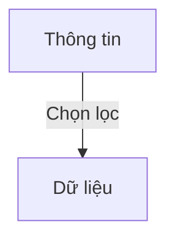

> [!NOTE]
> Thông tin sau khi được **chọn lọc** và mô tả dưới dạng hình thức (ghi lại được, máy tính xử lý được) thì trở thành **dữ liệu**.

Trước đây dữ liệu được lưu trên **giấy** - gặp 4 vấn đề lớn:

- **Lưu trữ**: tốn không gian, khối lượng lớn thì cồng kềnh
- **Tra cứu**: tìm kiếm thủ công, chậm và dễ sót
- **Bảo quản**: giấy dễ hư hỏng, rách, mối mọt, cháy, mất
- **Bảo mật**: khó kiểm soát ai được xem/động vào dữ liệu

### Quá trình phát triển

#### Hệ thống tập tin (File system)

Là tập hợp các tập tin **riêng lẻ** phục vụ cho một mục đích sử dụng nhất định.

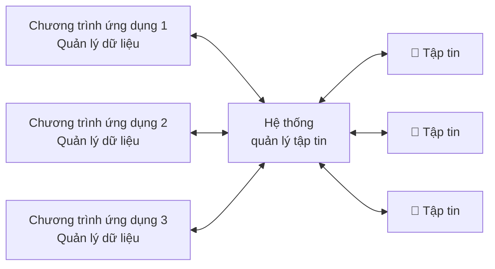

> [!NOTE]
> Mỗi chương trình ứng dụng tự **quản lý dữ liệu riêng** qua hệ thống quản lý tập tin của hệ điều hành - dữ liệu nằm rải rác trong các tập tin độc lập.

**Ưu điểm:**

- Triển khai ứng dụng **nhanh**
- Khả năng đáp ứng nhanh chóng, kịp thời (vì chỉ phục vụ cho mục đích hạn hẹp)

**Khuyết điểm:**

- Dữ liệu **trùng lặp và dư thừa** → lãng phí
- Thiếu tính **nhất quán** giữa các dữ liệu
- Khó khăn trong việc **truy xuất**
- **Chia sẻ** dữ liệu bị hạn chế
- Khó **khôi phục**
- Không đáp ứng nhu cầu **khai thác thông tin đồng thời** (nhiều người dùng cùng lúc)

#### Tiếp cận CSDL (Database approach)

Các chương trình ứng dụng **dùng chung một CSDL** thông qua Hệ quản trị CSDL (DBMS) - thay vì mỗi chương trình tự quản lý tập tin riêng.

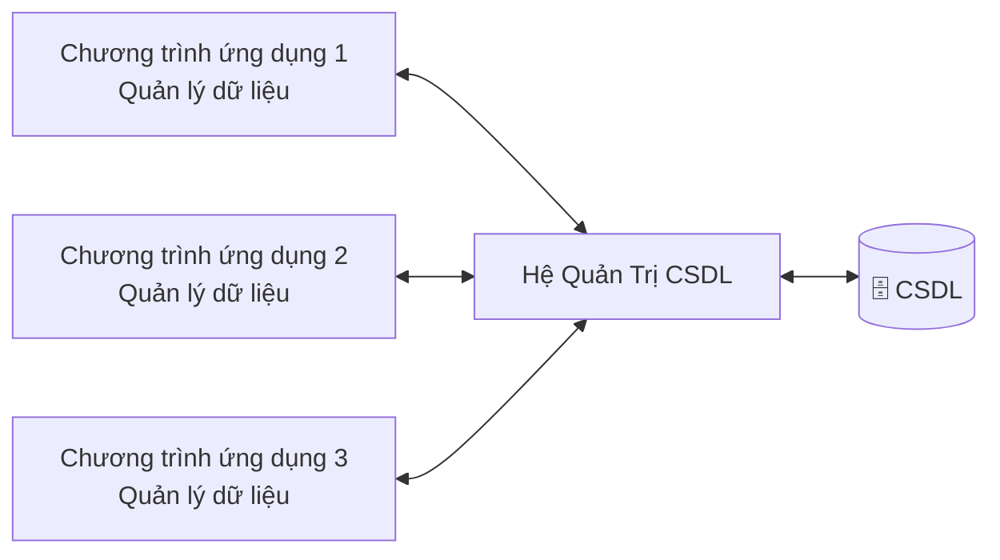

> [!NOTE]
> Khác biệt cốt lõi so với hệ thống tập tin: dữ liệu được **tập trung hóa** trong một CSDL duy nhất, DBMS đóng vai trò trung gian quản lý toàn bộ việc truy xuất - các ứng dụng không đụng trực tiếp vào dữ liệu.

### Khái niệm CSDL

**Cơ sở dữ liệu (Database)**: là một **hệ thống các thông tin có cấu trúc**, được **lưu trữ** trên các thiết bị lưu trữ nhằm thỏa mãn yêu cầu khai thác thông tin **đồng thời** của nhiều người sử dụng hay nhiều chương trình ứng dụng với **những mục đích khác nhau**.

- Một CSDL biểu diễn **một phần của thế giới thực** (mini-world) - vd: danh sách sinh viên, danh mục môn học...
- Một tập dữ liệu **ngẫu nhiên** (không có cấu trúc, không liên quan nhau) **không** được xem là một CSDL.

> [!NOTE]
> 3 ý then chốt trong định nghĩa: **có cấu trúc** (tổ chức theo mô hình nhất định, không phải đống dữ liệu lộn xộn), **lưu trữ lâu dài** trên thiết bị lưu trữ, và **khai thác đồng thời** cho nhiều người dùng/ứng dụng với mục đích khác nhau.

**Ưu điểm của tiếp cận CSDL:**

- Giảm **trùng lặp** thông tin xuống mức thấp nhất → đảm bảo tính **nhất quán** và **toàn vẹn** dữ liệu.
- Đảm bảo dữ liệu được **truy xuất theo nhiều cách** khác nhau.
- Khả năng **chia sẻ** thông tin cho **nhiều người, nhiều ứng dụng** khác nhau.

**Những vấn đề cần giải quyết:**

- Tính **chủ quyền** dữ liệu (data ownership).
- Tính **bảo mật** và **quyền khai thác** thông tin của người sử dụng.
- **Đảm bảo dữ liệu khi có sự cố** (khôi phục sau lỗi).

### Các đối tượng sử dụng CSDL

#### Người dùng cuối (End user)

| Loại | Đặc điểm | Ví dụ |
|---|---|---|
| Người dùng thỉnh thoảng | **Ít khi** truy cập CSDL, nhưng cần thông tin **khác nhau** trong mỗi lần truy cập, dùng các câu truy vấn **phức tạp** | Người quản lý |
| Người dùng thông thường | **Thường xuyên** truy vấn và cập nhật CSDL nhờ các **chức năng xây dựng sẵn** | Nhân viên |
| Người dùng chuyên sâu | **Thông thạo HQT CSDL**, tự xây dựng những truy vấn phức tạp cho công việc | Nhà khoa học, người phân tích tư vấn kinh doanh |

#### Chuyên viên tin học

- **Chịu trách nhiệm xây dựng các ứng dụng** phục vụ cho quản lý:
  - Lựa chọn cấu trúc phù hợp để lưu trữ dữ liệu
  - Quyết định những dữ liệu nào cần được lưu trữ
- **Liên hệ với người dùng** để nắm bắt yêu cầu → đưa ra thiết kế CSDL thỏa yêu cầu đó.
- **Quản trị viên (DBA)** sẽ quản lý các CSDL sau khi việc thiết kế hoàn tất.

#### Quản trị viên (Database Administrator - DBA)

- **Am hiểu** về CSDL và hệ quản trị CSDL.
- Nhiệm vụ:
  - Tổ chức CSDL
  - Xử lý **an toàn, bảo mật, cấp quyền**
  - **Sao lưu, phục hồi** dữ liệu
  - Giải quyết các **tranh chấp dữ liệu**

### Hệ quản trị CSDL (DBMS)

**Hệ quản trị CSDL (Database Management System - DBMS)**: là tập hợp các chương trình cho phép người sử dụng **tạo ra và duy trì** CSDL - một phần mềm hệ thống cho phép **định nghĩa, xây dựng và xử lý** dữ liệu.

| Chức năng | Nội dung |
|---|---|
| **Định nghĩa** (define) | Khai báo bộ khung dữ liệu cùng với các mô tả chi tiết về dữ liệu (cấu trúc, kiểu dữ liệu, ràng buộc) |
| **Xây dựng** (construct) | Lưu trữ dữ liệu lên bộ nhớ phụ (đĩa) |
| **Xử lý** (manipulate) | Truy vấn, cập nhật và phát sinh báo cáo |

> [!NOTE]
> **Bộ nhớ phụ** (secondary storage): là các thiết bị lưu trữ **lâu dài, không mất dữ liệu khi mất điện** - ổ cứng HDD, SSD, đĩa quang... Đối lập với **bộ nhớ chính** (primary storage - RAM): nhanh nhưng *volatile*, tắt máy là mất.
>
> CSDL phải lưu trên bộ nhớ phụ vì dữ liệu cần **tồn tại lâu dài** (persistent), còn RAM chỉ giữ dữ liệu tạm thời khi chương trình đang chạy. Đây cũng là lý do DBMS có các kỹ thuật tối ưu đọc/ghi đĩa (buffer, index) - vì truy xuất bộ nhớ phụ chậm hơn RAM rất nhiều.

**Các DBMS thông dụng:** Visual FoxPro, Microsoft Access, SQL Server, DB2, Oracle...

> [!NOTE]
> Hầu hết các DBMS hiện nay đều dựa trên **mô hình quan hệ** (relational model).

**Các tính năng của DBMS:**

- **Kiểm soát tính dư thừa** của dữ liệu - tích hợp các nhu cầu dữ liệu của người dùng để xây dựng một CSDL **thống nhất**.
- **Chia sẻ dữ liệu** - trong môi trường đa người dùng, HQT phải cho phép **truy xuất dữ liệu đồng thời**.
- **Cấp quyền, hạn chế truy cập** không cho phép - từng người dùng và nhóm người dùng có **tài khoản và mật mã** riêng để truy xuất dữ liệu.
- **Đảm bảo các ràng buộc toàn vẹn** (Integrity Constraints - RBTV):
  - RBTV là những quy định cần được thỏa mãn để đảm bảo dữ liệu luôn **phản ánh đúng ngữ nghĩa** của thế giới thực hoặc yêu cầu thiết kế.
  - Một số ràng buộc được **khai báo với HQT** → HQT sẽ **tự động kiểm tra**.
- **Sao lưu dự phòng khi gặp sự cố** - có khả năng **khôi phục dữ liệu** khi hư hỏng phần cứng hoặc phần mềm.
- **Đảm bảo tính độc lập giữa dữ liệu và chương trình** - thay đổi cấu trúc/lưu trữ dữ liệu không làm ảnh hưởng chương trình ứng dụng và ngược lại.
- **Ngôn ngữ giao tiếp giữa người sử dụng và CSDL** - gồm 4 nhóm:

| Nhóm ngôn ngữ | Vai trò | Ví dụ lệnh |
|---|---|---|
| **DDL** - Data Definition Language<br/>(định nghĩa dữ liệu) | Khai báo cấu trúc CSDL, mối liên hệ của dữ liệu; định nghĩa các lược đồ mức quan niệm và lược đồ trong | `CREATE`, `ALTER`, `DROP` |
| **DML** - Data Manipulation Language<br/>(thao tác dữ liệu) | Thêm, xóa, sửa dữ liệu | `INSERT`, `UPDATE`, `DELETE` |
| **SQL** - Structured Query Language<br/>(truy vấn có cấu trúc) | Cho phép người khai thác truy vấn thông tin cần thiết | `SELECT` |
| **DCL** - Data Control Language<br/>(quản lý/kiểm soát dữ liệu) | Khai báo bảo mật, cấp quyền cho người sử dụng | `GRANT`, `REVOKE` |

> [!NOTE]
> 4 nhóm ngôn ngữ này sẽ được học kỹ ở **Chương 4 - Ngôn ngữ SQL** (chương trọng tâm ra nhiều trong đề thi).

### Các mức biểu diễn một CSDL

**Kiến trúc 3 lược đồ** (three-schema architecture):

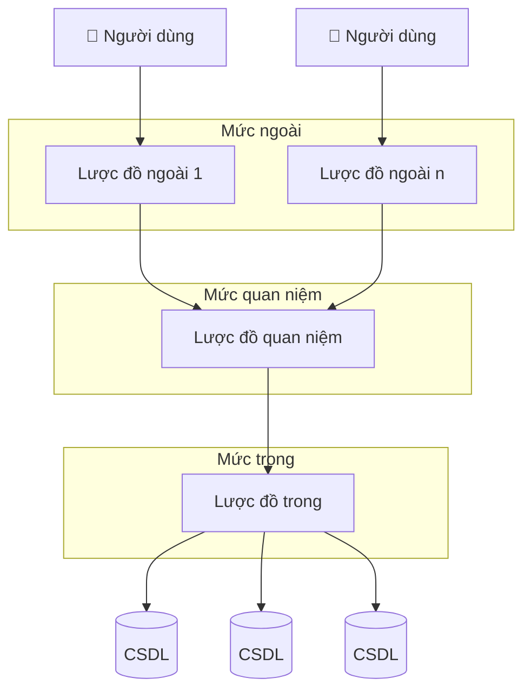

| Mức | Tên khác | Mô tả | Đối tượng |
|---|---|---|---|
| **Mức ngoài** | Mức khung nhìn (view) | Mô tả **một phần** của CSDL mà một nhóm người dùng quan tâm, **che dấu phần còn lại** của CSDL đối với nhóm đó. Có nhiều lược đồ ngoài, mỗi nhóm người dùng thấy một "khung nhìn" riêng. | Người dùng cuối |
| **Mức quan niệm** | Conception / Logical | Nhìn **tổng thể** về CSDL - mô tả cấu trúc của **toàn thể** CSDL: thực thể, kiểu dữ liệu, mối liên hệ và ràng buộc. | Người thiết kế CSDL |
| **Mức trong** | Mức vật lý (Physical) | Mô tả **cấu trúc lưu trữ vật lý**: dữ liệu gì? lưu trữ thế nào? ở đâu?... | Người phát triển CSDL, người quản trị (DBA) |

> [!TIP]
> Kiến trúc 3 mức chính là cơ chế thực hiện **tính độc lập giữa dữ liệu và chương trình**: thay đổi lược đồ trong (đổi cách lưu trữ, thêm index) không làm ảnh hưởng lược đồ quan niệm; thay đổi lược đồ quan niệm cũng hạn chế ảnh hưởng tới các lược đồ ngoài - nên chương trình ứng dụng gần như không phải sửa.

### Các mô hình dữ liệu

**Mô hình dữ liệu (Data model)**: là sự **trừu tượng hóa** của môi trường thực để biểu diễn dữ liệu.

5 mô hình tiêu biểu:

1. Mô hình dữ liệu **phân cấp** (Hierarchical Data Model)
2. Mô hình dữ liệu **mạng** (Network Data Model)
3. Mô hình dữ liệu **thực thể mối kết hợp** (Entity-Relationship Model - ER)
4. Mô hình dữ liệu **quan hệ** (Relational Data Model)
5. Mô hình dữ liệu **hướng đối tượng** (Object-oriented Data Model)

#### Mô hình dữ liệu phân cấp (Hierarchical Data Model)

Dữ liệu tổ chức thành **cây** (tree) - mỗi nút con chỉ có **một nút cha**; mối liên hệ cha - con theo tỷ lệ 1:n.

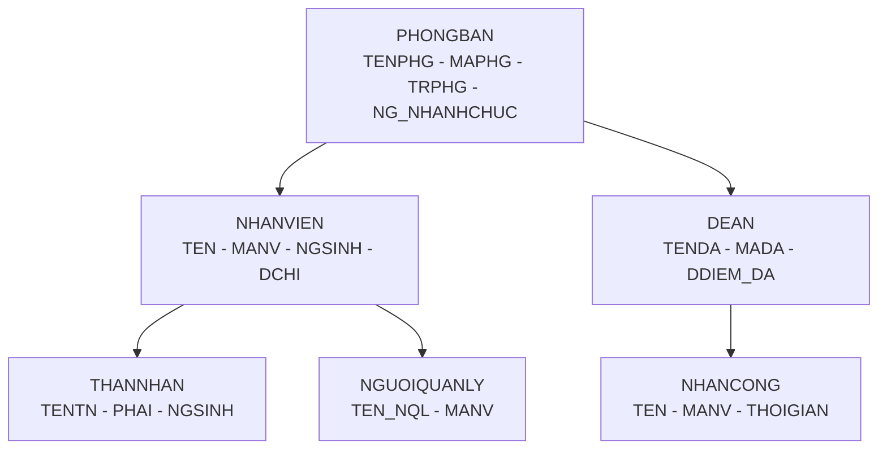

- **Hạn chế** (bổ sung): chỉ biểu diễn tự nhiên quan hệ **cha - con (1:n)**, khó biểu diễn quan hệ **nhiều - nhiều**; muốn truy xuất phải **đi theo đường cây** từ gốc → chương trình phụ thuộc chặt vào cấu trúc lưu trữ. Ví dụ DBMS theo mô hình này: **IBM IMS**.

#### Mô hình dữ liệu mạng (Network Data Model)

Còn gọi **mô hình mạng** hoặc **mô hình lưới** - biểu diễn bởi một **đồ thị có hướng** (một nút con có thể có **nhiều nút cha** → tổng quát hơn mô hình phân cấp).

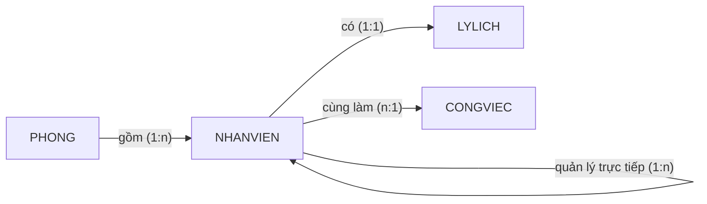

- **Ưu điểm**: tương đối đơn giản, dễ sử dụng.
- **Khuyết điểm**: không thích hợp biểu diễn CSDL **quy mô lớn**; khả năng diễn đạt **ngữ nghĩa kém** (không nói rõ ý nghĩa các liên kết). Ví dụ: mô hình **CODASYL/DBTG**.

#### Mô hình dữ liệu thực thể mối kết hợp (Entity-Relationship Model - ER)

Mô hình dùng để **thiết kế CSDL ở mức quan niệm** - gồm 3 thành phần:

- **Thực thể** (entity - hình chữ nhật): đối tượng của thế giới thực (SVien, HPhan, MHoc).
- **Thuộc tính** (attribute - hình oval; chấm đen = thuộc tính **khóa**): đặc tính mô tả thực thể.
- **Mối kết hợp** (relationship - hình thoi): liên kết giữa các thực thể, kèm **số lượng min - max** $(min, max)$ và có thể có thuộc tính riêng (hoc có Diem, mo có Nam + Gvien).

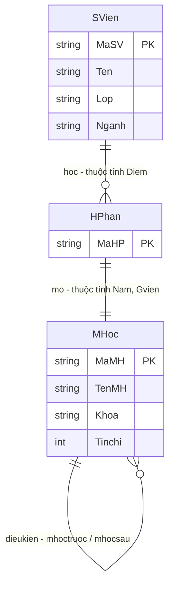

> [!NOTE]
> Ký pháp $(min, max)$ trên slide: `SVien (1,n)` nghĩa là mỗi sinh viên **phải** học ít nhất 1 học phần và có thể học nhiều; `HPhan (0,n)` nghĩa là mỗi học phần **có thể không** có sinh viên nào. Quan hệ `dieukien` là **mối kết hợp đệ quy** (recursive - MHoc tự liên hệ với chính nó qua vai trò môn học trước/môn học sau).
>
> Mô hình ER chỉ là công cụ **thiết kế** - sau đó sẽ được **chuyển sang mô hình quan hệ** để cài đặt. Học kỹ trong phần thiết kế CSDL của môn học.

#### Mô hình dữ liệu quan hệ (Relational Data Model)

Dữ liệu tổ chức thành các **quan hệ** (bảng/table): mỗi quan hệ gồm các **bộ** (dòng/tuple) và **thuộc tính** (cột/attribute); mối liên hệ giữa các bảng thể hiện qua **khóa ngoại** (foreign key - mũi tên tham chiếu).

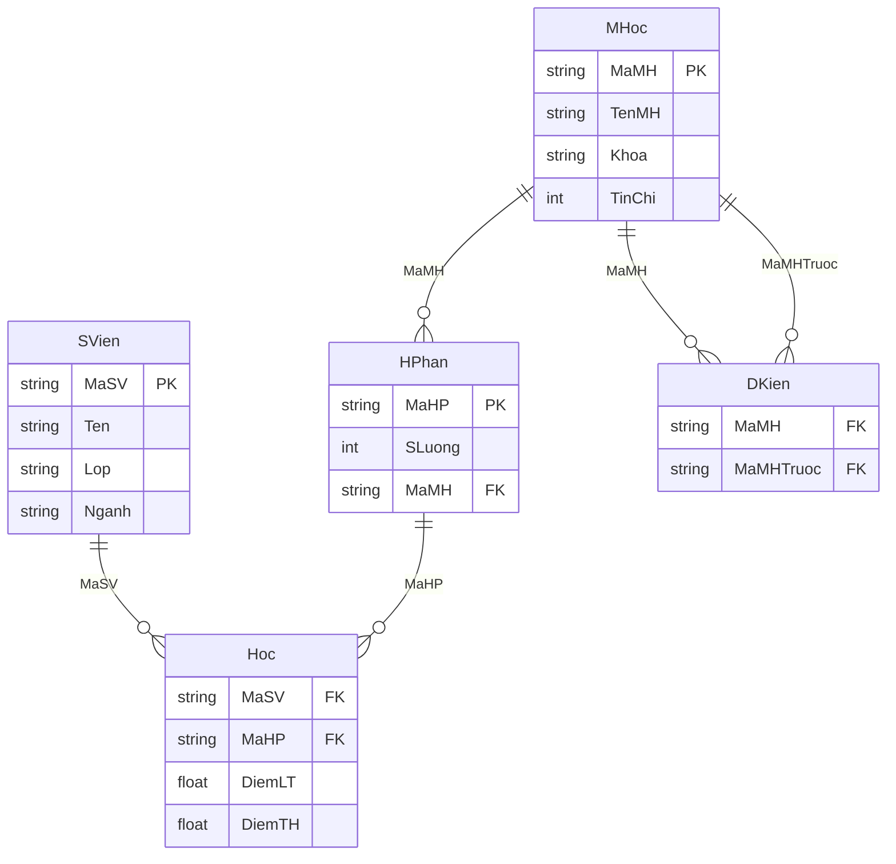

> [!NOTE]
> Đây là mô hình được dùng **phổ biến nhất hiện nay** (SQL Server, Oracle, DB2, MySQL, PostgreSQL...) - sẽ học kỹ ở **Chương 2**.

#### Mô hình dữ liệu hướng đối tượng (Object-oriented Data Model)

Biểu diễn dữ liệu thành các **lớp đối tượng** (class) gồm **thuộc tính** (attribute) và **phương thức** (method) - gần với cách nhìn của lập trình hướng đối tượng/UML.

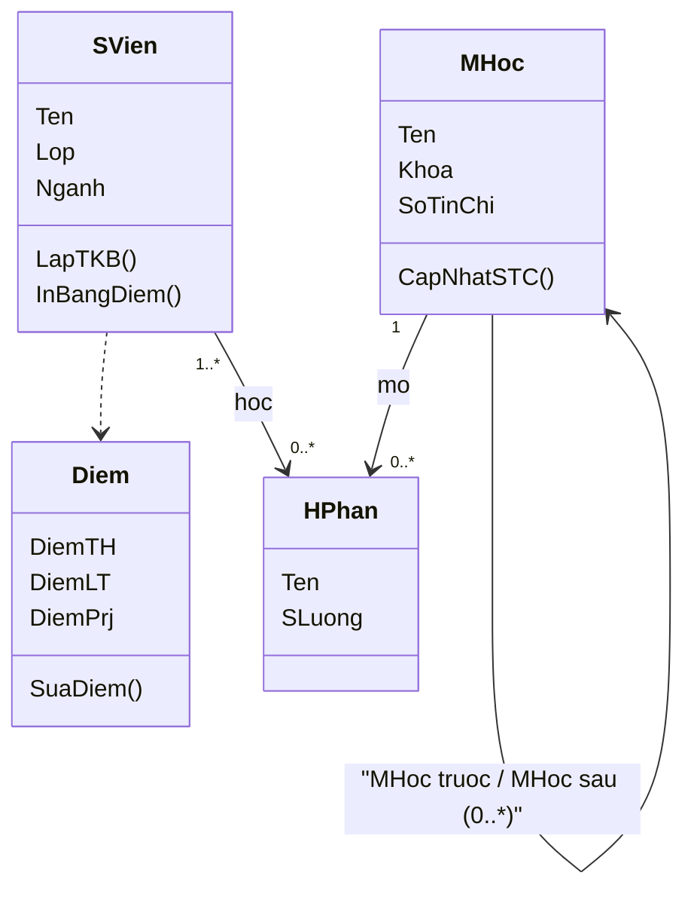

> [!NOTE]
> Khác với mô hình quan hệ: đối tượng có **định danh riêng** (OID), dữ liệu + hành vi **đóng gói chung** trong class, hỗ trợ **kế thừa** (inheritance). Ví dụ DBMS hướng đối tượng: ObjectDB, ObjectStore.

**So sánh nhanh các mô hình:**

| Mô hình | Cấu trúc | Điểm mạnh | Điểm yếu |
|---|---|---|---|
| Phân cấp (Hierarchical) | Cây, con chỉ 1 cha | Đơn giản, truy xuất nhanh theo nhánh | Khó biểu diễn n-n, phụ thuộc đường cây |
| Mạng (Network) | Đồ thị có hướng, con nhiều cha | Linh hoạt hơn phân cấp | Ngữ nghĩa kém, không hợp CSDL lớn |
| Thực thể - mối kết hợp (ER) | Thực thể + thuộc tính + mối kết hợp | Ngữ nghĩa giàu, trực quan → dùng để **thiết kế** | Không cài đặt trực tiếp, phải chuyển sang quan hệ |
| Quan hệ (Relational) | Bảng + khóa ngoại | Chuẩn toán học chặt, dễ dùng, phổ biến nhất | Kém tự nhiên với dữ liệu phức tạp |
| Hướng đối tượng (OO) | Class (thuộc tính + phương thức) | Ngữ nghĩa giàu, hỗ trợ kế thừa, đóng gói | Ít phổ biến hơn quan hệ, thiếu chuẩn thống nhất |

### Lược đồ thực thể kết hợp (Entity-Relationship Diagram - ERD)

- Được dùng để **thiết kế CSDL ở mức quan niệm** - biểu diễn trừu tượng **cấu trúc** của CSDL.
- Gồm 3 thành phần:
  - **Tập thực thể** (Entity Sets) / **Thực thể** (Entity)
  - **Thuộc tính** (Attributes)
  - **Mối quan hệ** (Relationship)

#### Loại thực thể / Tập thực thể (Entity Type / Entity Set)

**Định nghĩa**: loại thực thể (Entity Type, còn gọi Tập thực thể) là những loại **đối tượng hay sự vật** của thế giới thực tồn tại cụ thể cần được quản lý.

- Một **thực thể** là một đối tượng của thế giới thực.
- Tập hợp các thực thể **giống nhau** tạo thành một **loại thực thể**.
- Ví dụ: HOCVIEN, LOP, MONHOC...
- **Ký hiệu**: hình chữ nhật `E`.

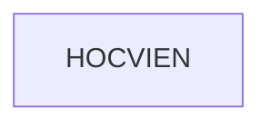

Ví dụ: loại thực thể HOCVIEN có các thực thể (mỗi thực thể là một bộ giá trị cụ thể):

- `('HV001', 'Nguyen Nam', '1/2/1987', 'Nam')`
- `('HV002', 'Trần Nam', '13/2/1987', 'Nam')`

> [!NOTE]
> Có thể hình dung: **loại thực thể ≈ bảng** (table), **thực thể ≈ dòng** (row) trong mô hình quan hệ.

#### Thuộc tính (Attribute)

**Định nghĩa**: thuộc tính là những **đặc tính riêng biệt** của tập thực thể hoặc mối kết hợp.

- **Ký hiệu**: hình **oval** nối với thực thể; thuộc tính **khóa** được đánh dấu bằng **chấm đen**.
- Ví dụ loại thực thể SINHVIEN có các thuộc tính: MSSV (khóa), HoTen, NgaySinh, GioiTinh...

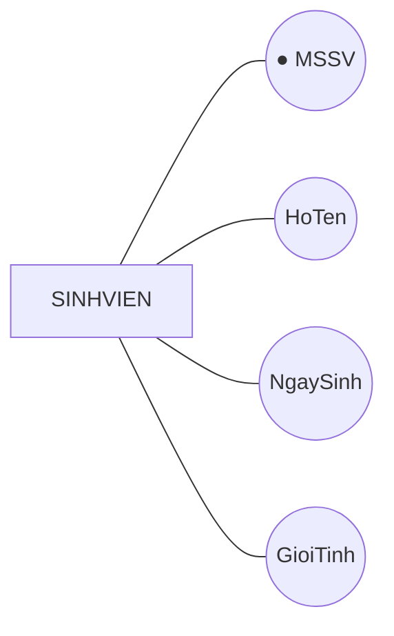

#### Các loại thuộc tính

| Loại | English | Định nghĩa | Ví dụ |
|---|---|---|---|
| **Đơn** | Simple / Atomic | Không thể chia thành các thành phần nhỏ hơn | LUONG, HO_TEN, GIOI_TINH của NHAN_VIEN |
| **Kết hợp** | Composite | Gồm nhiều thành phần nhỏ hơn | DIA_CHI = SO_NHA + DUONG + QUAN + THANH_PHO |
| **Đơn trị** | Single-valued | Nhận **một** giá trị đối với một thực thể cụ thể | HO_TEN - mỗi nhân viên chỉ có một họ tên |
| **Đa trị** | Multi-valued | Nhận **nhiều** giá trị đối với một thực thể cụ thể | DIEN_THOAI - mỗi nhân viên có thể có nhiều số điện thoại |
| **Suy diễn** | Derived | Giá trị được **tính từ** giá trị của thuộc tính khác | Tuoi - tính từ NgaySinh |

> [!WARNING]
> Đừng nhầm 2 cặp khái niệm - chúng xét trên **2 khía cạnh khác nhau**:
>
> - **Đơn vs Kết hợp** - xét về **cấu trúc**: thuộc tính có chia nhỏ được không? DIA_CHI là *kết hợp* vì tách ra được SO_NHA, DUONG, QUAN, THANH_PHO.
> - **Đơn trị vs Đa trị** - xét về **số lượng giá trị**: một thực thể có mấy giá trị cho thuộc tính đó? DIEN_THOAI là *đa trị* vì một nhân viên có nhiều SĐT.
>
> Hai khía cạnh **độc lập** nhau: DIA_CHI vừa là *kết hợp* vừa là *đơn trị* (mỗi NV 1 địa chỉ gồm nhiều phần); DIEN_THOAI vừa là *đơn* vừa là *đa trị* (mỗi SĐT không chia nhỏ, nhưng có nhiều cái).

**Ký hiệu kèm theo:**

- Thuộc tính **kết hợp**: oval có các oval con gắn vào.
- Thuộc tính **đa trị**: **oval kép** (2 vòng).
- Thuộc tính **suy diễn**: **oval nét đứt**.

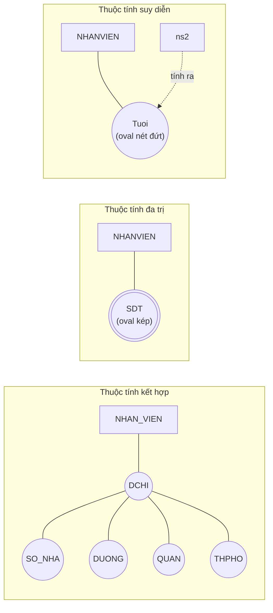

#### Khóa của loại thực thể (Key)

Các thực thể trong tập thực thể cần phải **được phân biệt** với nhau.

**Khóa $K$** của tập thực thể $E$ là **một hay nhiều thuộc tính** sao cho: lấy ra 2 thực thể bất kỳ $e_1$, $e_2$ trong $E$ thì $e_1$ và $e_2$ **không thể có các giá trị giống nhau** tại các thuộc tính trong $K$.

**Lưu ý:**

- Mỗi loại thực thể phải có **ít nhất 1 khóa**.
- Có thể có **nhiều khóa** trong 1 loại thực thể → chọn ra 1 khóa làm **khóa chính** (primary key) cho tập thực thể đó.
- Một khóa có thể gồm **1 hay nhiều thuộc tính** - tức khóa đôi khi là **một tập thuộc tính** (khóa kết hợp / composite key), vd khóa của quan hệ HOC là $\{MaSV, MaHP\}$.

> [!TIP]
> Phân biệt nhanh: **khóa** là tập thuộc tính đủ sức **phân biệt** các thực thể; một loại thực thể có thể có nhiều khóa nhưng chỉ chọn **1 khóa chính** (primary key) - các khóa còn lại là khóa phụ. Vd PHONGBAN có 2 khóa `MAPHG` và `TENPB` (duy nhất), chọn `MAPHG` làm khóa chính.

#### Mối quan hệ / Mối kết hợp (Relationship)

**Định nghĩa**: diễn tả mối **quan hệ ngữ nghĩa** giữa **ít nhất 2 tập thực thể** khác nhau.

- Ví dụ: giữa tập thực thể NHAN_VIEN và PHONG_BAN có các mối quan hệ:
  - Một nhân viên **thuộc** một phòng ban nào đó.
  - Một phòng ban có một nhân viên **làm trưởng phòng**.
- **Ký hiệu**: hình **thoi** chứa tên quan hệ.

Giữa hai loại thực thể có thể tồn tại **nhiều hơn một quan hệ**:

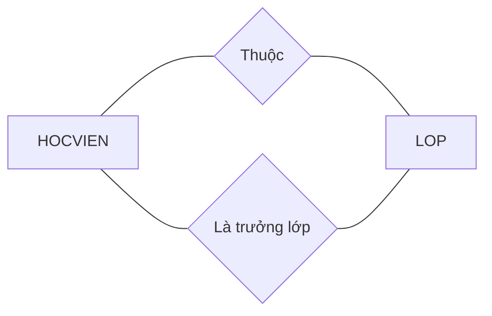

**Vai trò** (role): một loại thực thể có thể **tham gia nhiều lần** vào một quan hệ với **nhiều vai trò khác nhau** - vd quan hệ đệ quy `Quan_ly` trên chính NHAN_VIEN:

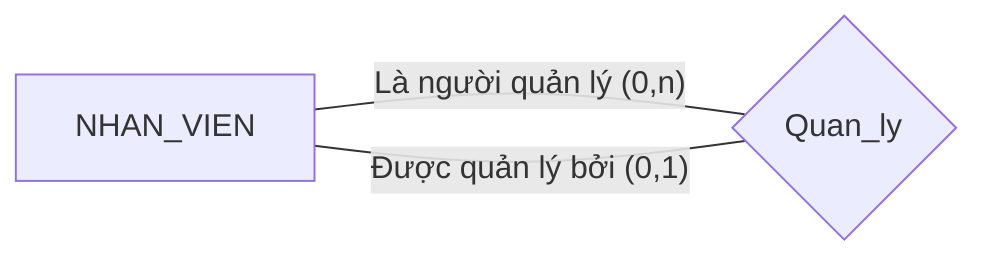

> [!NOTE]
> Quan hệ **đệ quy** (recursive): một loại thực thể tự liên kết với chính nó - mỗi phía cần ghi rõ **vai trò** (role) vì cùng một tập thực thể đóng 2 vai trò khác nhau (người quản lý vs người bị quản lý).

**Thể hiện CSDL** (database instance): một CSDL được mô tả bởi lược đồ ER sẽ chứa đựng những **dữ liệu cụ thể** gọi là thể hiện CSDL - bao gồm cả các mối quan hệ cụ thể.

- Cho mối quan hệ $R$ kết nối $n$ tập thực thể $E_1, E_2, \ldots, E_n$.
- **Thể hiện của $R$** là tập hữu hạn các danh sách $(e_1, e_2, \ldots, e_n)$, trong đó $e_i$ là các giá trị được chọn từ tập thực thể $E_i$.

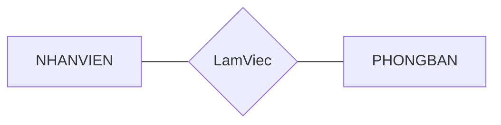

| NHAN_VIEN | PHONG_BAN | → Thể hiện của LamViec |
|---|---|---|
| Tung | Nghien cuu | (Tung, Nghien cuu) |
| Hang | Dieu hanh | (Hang, Dieu hanh) |
| Vinh | Quan ly | (Vinh, Quan ly) |

#### Số ngôi (Degree)

**Định nghĩa**: số ngôi của loại mối kết hợp là **số loại thực thể** tham gia vào loại mối kết hợp đó.

- Ví dụ 1 - **số ngôi 2** (nhị ngôi): `Thuộc` kết hợp 2 loại thực thể HOCVIEN và LOP.

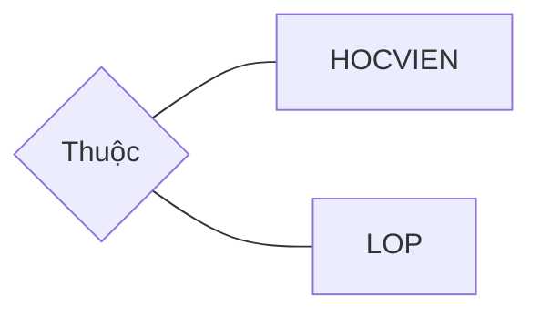

- Ví dụ 2 - **số ngôi 3** (tam ngôi): `Thi` kết hợp 3 loại thực thể LANTHI, HOCVIEN và MONHOC.

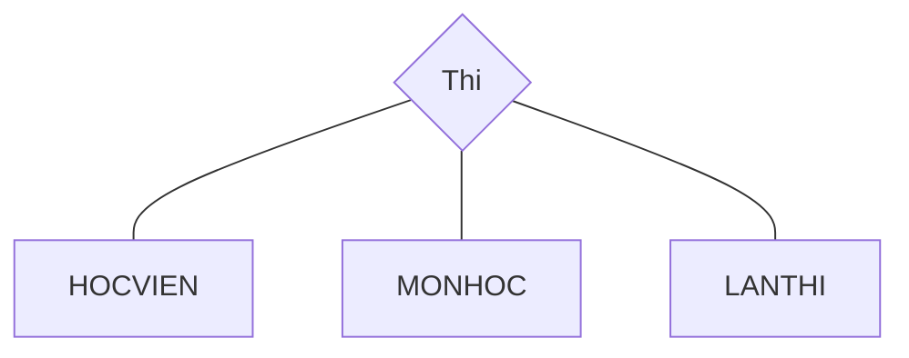

> [!TIP]
> Thực tế đa số mối kết hợp là **ngôi 2**. Chỉ cần ngôi ≥ 3 khi thông tin **chỉ có nghĩa trên cả cụm** thực thể - vd `Thi` phải biết đồng thời *ai thi - môn gì - lần mấy*. Nếu tách được thành các quan hệ ngôi 2 độc lập mà không mất ngữ nghĩa thì nên tách.

#### Thuộc tính của mối quan hệ

- Thuộc tính trên mối quan hệ **mô tả tính chất cho mối quan hệ** đó.
- Thuộc tính này **không thể gắn liền** với những thực thể tham gia vào mối quan hệ - vì nó chỉ có nghĩa khi **cả hai** thực thể liên kết với nhau.

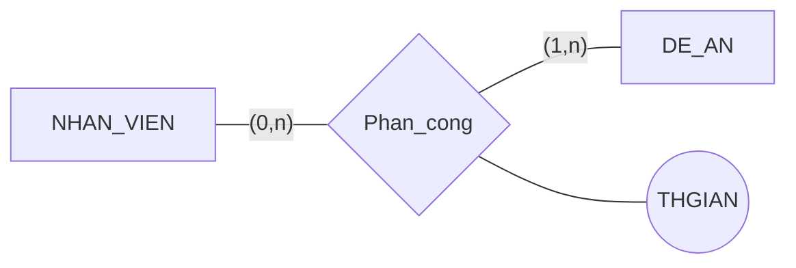

> [!NOTE]
> `THGIAN` (số giờ phân công) không thể là thuộc tính của riêng NHAN_VIEN hay riêng DE_AN - vì một nhân viên làm **nhiều** đề án, một đề án có **nhiều** nhân viên; số giờ chỉ xác định được trên **từng cặp** (nhân viên, đề án). Đây chính là lý do tồn tại "thuộc tính trên mối quan hệ".

#### Bản số (Relationship Cardinality)

**Bản số** quy định mỗi thực thể tham gia vào mối quan hệ **tối thiểu và tối đa bao nhiêu lần** - ghi dưới dạng $(min, max)$ trên nhánh nối với tập thực thể.

- $min = 0$ → tham gia **tùy chọn** (partial participation) - thực thể có thể không tham gia quan hệ nào.
- $min \geq 1$ → tham gia **bắt buộc** (total participation) - thực thể phải tham gia ít nhất 1 quan hệ.
- $max = n$ → không giới hạn trên (nhiều).

**Các ví dụ đọc bản số:**

| Diễn giải ngữ nghĩa | Ký hiệu trên hình |
|---|---|
| Một phòng ban có nhiều nhân viên | PHONGBAN $(1,n)$ - `LamViec` - NHANVIEN |
| Một nhân viên chỉ thuộc một phòng ban | NHANVIEN $(1,1)$ - `LamViec` - PHONGBAN |
| Một đề án có thể có nhiều nhân viên tham gia hoặc không có ai | DEAN $(0,n)$ - `ThamGia` - NHANVIEN |
| Một nhân viên có thể là trưởng phòng hoặc không | NHANVIEN $(0,1)$ - `LaTruongPhong` - PHONGBAN |

> [!WARNING]
> $(min, max)$ ghi trên nhánh của **chính tập thực thể đó** - đọc là "mỗi thực thể thuộc tập này tham gia vào quan hệ **từ min đến max lần**". Vd NHANVIEN $(1,1)$ = mỗi nhân viên **phải** thuộc đúng 1 phòng ban.

**Phân loại mối kết hợp nhị ngôi theo bản số** (nhìn max của 2 phía):

| Loại | Bản số 2 phía | Ý nghĩa | Ví dụ |
|---|---|---|---|
| **1 : 1** | $(..,1)$ - $(..,1)$ | 1 thực thể bên A kết hợp với **tối đa 1** thực thể bên B và ngược lại | NHAN_VIEN - `LaTruongPhong` - PHONG_BAN |
| **1 : n** | $(..,1)$ - $(..,n)$ | 1 thực thể bên A kết hợp với **nhiều** thực thể bên B | PHONG_BAN - `LamViec` - NHAN_VIEN |
| **m : n** | $(..,n)$ - $(..,n)$ | Nhiều thực thể ở cả 2 phía | NHAN_VIEN - `PhanCong` - DE_AN |

**Ví dụ đầy đủ**: một hóa đơn mua nhiều sản phẩm với số lượng khác nhau; một sản phẩm có thể được mua bởi nhiều hóa đơn.

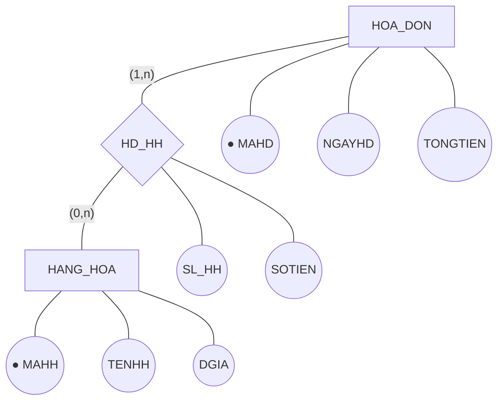

- `HD_HH` là mối kết hợp **nhiều - nhiều** giữa HOA_DON và HANG_HOA - có thuộc tính riêng `SL_HH` (số lượng hàng) và `SOTIEN` (số tiền).
- Thuộc tính khóa tô chấm đen: `MAHD` của HOA_DON, `MAHH` của HANG_HOA.

#### Loại thực thể yếu (Weak Entity Type)

**Định nghĩa**: là loại thực thể mà **khóa có được từ những thuộc tính của tập thực thể khác** - nghĩa là nó **không tự có khóa đủ mạnh** để phân biệt các thực thể của mình.

- Phải **tham gia bắt buộc** $(1,1)$ vào một **mối quan hệ xác định** (identifying relationship), trong đó có một tập thực thể chủ gọi là **thực thể mạnh** (strong/owner entity).
- **Ký hiệu**: tập thực thể yếu = **hình chữ nhật đôi**; mối quan hệ xác định = **hình thoi đôi**.

**Ví dụ: THAN_NHAN là thực thể yếu của NHAN_VIEN**

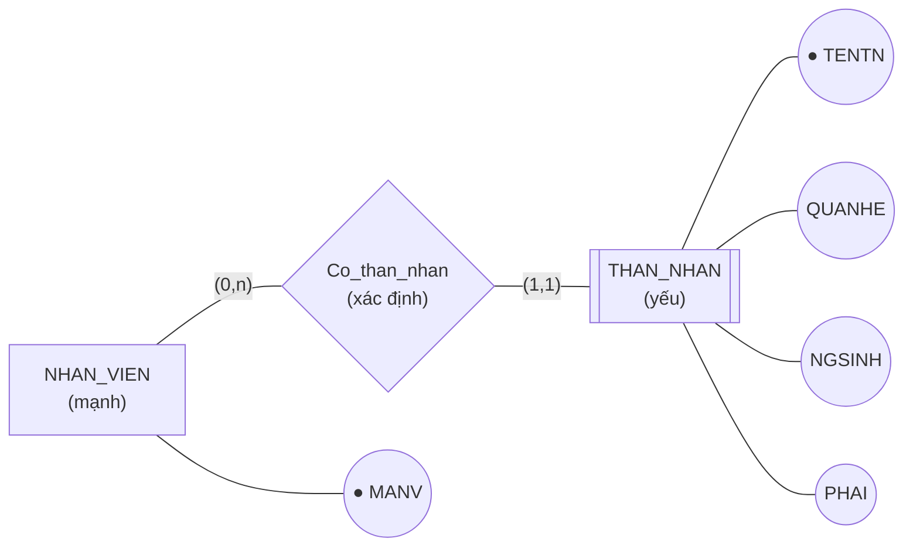

- Thân nhân **không tồn tại độc lập** - phải gắn với một nhân viên cụ thể; xóa nhân viên thì các thân nhân cũng mất ý nghĩa.
- `TENTN` không đủ làm khóa (2 nhân viên khác nhau có thể có thân nhân trùng tên "An") → `TENTN` chỉ là **khóa riêng phần** (partial key / discriminator).
- Khóa đầy đủ của THAN_NHAN = $\{MANV, TENTN\}$ - **vay mượn** `MANV` từ thực thể mạnh + khóa riêng phần của chính nó.

> [!NOTE]
> Cách nhận biết thực thể yếu: tự nó **không định danh được** mà phải nhờ "mượn" khóa của thực thể mạnh. Trên ERD: chữ nhật đôi + hình thoi đôi + bản số $(1,1)$ phía thực thể yếu.

**Ví dụ khác: CHI_TIET hóa đơn là thực thể yếu của cả HOA_DON và HANG_HOA**

```mermaid
flowchart TD
    hd["HOA_DON"] ---|"(1,n)"| hdct{"HD_CT<br/>(xác định)"}
    hdct ---|"(1,1)"| ct[["CHI_TIET<br/>(yếu)"]]
    ct ---|"(1,1)"| hhct{"HH_CT<br/>(xác định)"}
    hhct ---|"(1,n)"| hh["HANG_HOA"]
    ct --- sl(("SL_HH"))
    ct --- st(("SOTIEN"))
    hd --- mahd(("● MAHD"))
    hh --- mahh(("● MAHH"))
```

- Một dòng chi tiết hóa đơn **không có ý nghĩa** nếu không biết nó thuộc hóa đơn nào và bán mặt hàng nào.
- Khóa của CHI_TIET = $\{MAHD, MAHH\}$ - vay mượn khóa từ **cả hai** thực thể mạnh.

#### Quy ước vẽ lược đồ ER

Lược đồ ER là **đồ thị** biểu diễn các tập thực thể (loại thực thể), thuộc tính và mối kết hợp:

- **Đỉnh** (node):
  - Hình **chữ nhật** chứa tên tập thực thể → tập thực thể (chữ nhật **đôi** = thực thể yếu)
  - Hình **oval** chứa tên thuộc tính → thuộc tính (chấm đen = khóa, oval kép = đa trị, oval đứt = suy diễn)
  - Hình **thoi** chứa tên quan hệ → mối kết hợp (thoi **đôi** = quan hệ xác định của thực thể yếu)
- **Cạnh** (edge) - đường nối giữa:
  - Tập thực thể và thuộc tính
  - Mối quan hệ và tập thực thể (kèm bản số $(min, max)$)
  - Mối quan hệ và thuộc tính (thuộc tính của quan hệ)

#### Các bước thiết kế lược đồ ER

1. Xác định **tập thực thể**.
2. Xác định **mối quan hệ**.
3. Xác định **thuộc tính** và gắn thuộc tính cho tập thực thể và mối quan hệ.
4. Quyết định **thuộc tính khóa**.
5. Quyết định **(min, max)** cho mối quan hệ.

> [!TIP]
> Mẹo phân tích đề: gạch các **danh từ** trong đề → ứng viên cho tập thực thể; gạch các **động từ** nối danh từ → ứng viên cho mối kết hợp. Cụm "mỗi X có **nhiều** Y" gợi ý bản số max = n; cụm "**duy nhất**" gợi ý thuộc tính khóa.

#### Bài tập ví dụ: CSDL đề án công ty

CSDL theo dõi các thông tin liên quan đến **nhân viên, phòng ban và đề án**:

- Công ty có nhiều **phòng ban**, mỗi phòng ban có **tên duy nhất**, **mã phòng duy nhất**, một trưởng phòng và ngày nhận chức. Mỗi phòng ban có thể ở **nhiều địa điểm** khác nhau.
- **Đề án** có **tên duy nhất**, **mã duy nhất**, do **1 phòng ban chủ trì** và được triển khai ở 1 địa điểm.
- **Nhân viên** có mã số, tên, địa chỉ, ngày sinh, phái và lương. Mỗi nhân viên **làm việc ở 1 phòng ban**, tham gia vào các đề án với **số giờ làm việc khác nhau**. Mỗi nhân viên đều có **một người quản lý trực tiếp**.
- Một nhân viên có thể có **nhiều thân nhân**. Mỗi thân nhân có tên, phái, ngày sinh và **mối quan hệ** với nhân viên đó.

**Phân tích theo 5 bước:**

| Bước | Kết quả |
|---|---|
| 1. Tập thực thể | PHONGBAN, DEAN, NHANVIEN - **mạnh**; THAN_NHAN - **yếu** (không tồn tại nếu không có nhân viên) |
| 2. Mối quan hệ | `LamViec` (NV-PB), `LaTruongPhong` (NV-PB), `ChuTri` (PB-DA), `PhanCong` (NV-DA), `QuanLyTrucTiep` (NV-NV **đệ quy**), `Co_than_nhan` (NV-TN, **xác định**) |
| 3. Thuộc tính | PHONGBAN: MAPHG, TENPB, DDIEM (**đa trị**); DEAN: MADA, TENDA, DDIEM_DA; NHANVIEN: MANV, HONV, TENNV, NGSINH, DCHI, PHAI, LUONG; THAN_NHAN: TENTN, PHAI, NGSINH, QUANHE; `THGIAN` gắn trên `PhanCong`; `NG_NHANHCHUC` gắn trên `LaTruongPhong` |
| 4. Khóa | MAPHG, MADA, MANV - khóa chính; TENPB, TENDA - khóa phụ (duy nhất); THAN_NHAN khóa = $\{MANV, TENTN\}$ |
| 5. (min, max) | NV `LamViec` $(1,1)$ - PB $(1,n)$; NV `LaTruongPhong` $(0,1)$ - PB $(1,1)$; PB `ChuTri` $(0,n)$ - DA $(1,1)$; NV `PhanCong` $(0,n)$ - DA $(1,n)$; `QuanLyTrucTiep`: *được quản lý bởi* $(1,1)$ / *là người quản lý* $(0,n)$; TN `Co_than_nhan` $(1,1)$ - NV $(0,n)$ |

**Lược đồ ER kết quả:**

```mermaid
flowchart TB
    pb["PHONGBAN<br/>●MAPHG | TENPB(duy nhất) | DDIEM(đa trị)"]
    da["DEAN<br/>●MADA | TENDA(duy nhất) | DDIEM_DA"]
    nv["NHANVIEN<br/>●MANV | HONV | TENNV | NGSINH | DCHI | PHAI | LUONG"]
    tn[["THAN_NHAN (yếu)<br/>◐TENTN | PHAI | NGSINH | QUANHE"]]

    lv{"LamViec"}
    tph{"LaTruongPhong<br/>(NG_NHANHCHUC)"}
    ctr{"ChuTri"}
    pc{"PhanCong<br/>(THGIAN)"}
    qltt{"QuanLyTrucTiep"}
    ctn{"Co_than_nhan"}

    nv ---|"(1,1)"| lv
    lv ---|"(1,n)"| pb
    nv ---|"(0,1)"| tph
    tph ---|"(1,1)"| pb
    pb ---|"(0,n)"| ctr
    ctr ---|"(1,1)"| da
    nv ---|"(0,n)"| pc
    pc ---|"(1,n)"| da
    nv ---|"được quản lý bởi (1,1)"| qltt
    qltt ---|"là người quản lý (0,n)"| nv
    tn ---|"(1,1)"| ctn
    ctn ---|"(0,n)"| nv
```

> [!NOTE]
> - `LaTruongPhong` và `LamViec` là **2 quan hệ khác nhau** giữa cùng cặp NHANVIEN-PHONGBAN (trưởng phòng cũng là một nhân viên).
> - `NG_NHANHCHUC` đặt trên `LaTruongPhong` - vì "ngày nhận chức" chỉ có nghĩa khi biết **ai làm trưởng phòng nào**.
> - `QuanLyTrucTiep` là quan hệ **đệ quy** trên NHANVIEN với 2 vai trò: *là người quản lý* $(0,n)$ và *được quản lý bởi* $(1,1)$.
> - `TENTN` chỉ là khóa riêng phần của THAN_NHAN (◐) - phân biệt các thân nhân **của cùng một** nhân viên.

## Bài tập chương 1

**Nộp BT Chương 1 - Xây dựng mô hình ERD** (nộp trên elearning):

- **Hạn nộp**: 22h00 tối mai - 06/11/2026 (nộp trên elearning)
- **Yêu cầu**: xây dựng mô hình ERD cho **2 bài tập cuối chương 1** trong giáo trình:
  - **Bài tập 1**: vẽ lại và **sửa cho đúng** lược đồ ERD có sẵn trong giáo trình
  - **Bài tập 2**: **vẽ ERD mới** từ đề bài (đề xem bên dưới)
- **Quy định nộp bài**:
  - Dùng **bất kỳ công cụ nào** để vẽ sơ đồ ERD cho 2 bài tập
  - Nộp file **.docx** chứa sơ đồ ERD, tên file theo quy tắc: `MSSV_HoVaTen_BTChuong1.docx`
  - Đầu file .docx phải chứa các dòng thông tin:

```
MSSV:.....
Họ và tên:.....
Lớp:.....
```

> [!CAUTION]
> Hạn nộp **22h00 tối mai - 06/11/2026**. Kiểm tra kỹ **tên file** (`MSSV_HoVaTen_BTChuong1.docx`) và **thông tin đầu file** (MSSV, họ tên, lớp) trước khi nộp lên elearning.

### Đề Bài tập 2 - CSDL quản lý giáo vụ

Xây dựng mô hình ERD cho CSDL **quản lý giáo vụ** gồm các chức năng:

- **Lưu trữ thông tin**:
  - **Học viên**: mã học viên duy nhất, họ tên, giới tính, NTNS (ngày tháng năm sinh)
  - **Giáo viên**: mã giáo viên duy nhất, họ tên, giới tính
  - **Môn học**: mã môn học duy nhất, tên môn học, số tín chỉ lý thuyết, số tín chỉ thực hành
  - **Lớp học**: mã lớp duy nhất, tên lớp, sĩ số dự kiến
- **Xếp lớp** cho học viên, **chọn lớp trưởng** cho lớp.
- **Phân công giảng dạy**: giáo viên dạy lớp nào với môn học gì, ở **học kỳ**, **năm học** nào.
- **Lưu trữ kết quả thi**: học viên thi môn học nào, **lần thi thứ mấy**, **điểm thi** bao nhiêu.

**Phân tích gợi ý:**

| Bước | Kết quả |
|---|---|
| Tập thực thể | HOCVIEN (●MAHV), GIAOVIEN (●MAGV), MONHOC (●MAMH), LOPHOC (●MALOP) - đều là thực thể **mạnh**; LANTHI (●LANTHI) - tập thực thể nhỏ để phân biệt các lần thi |
| Mối quan hệ | `XepLop` (HV-LOP), `LopTruong` (HV-LOP - quan hệ **thứ 2** giữa cùng cặp thực thể), `PhanCong` (**ngôi 3**: GV-LOP-MH), `Thi` (**ngôi 3**: HV-MH-LANTHI) |
| Thuộc tính quan hệ | `HOCKY`, `NAMHOC` trên `PhanCong`; `DIEMTHI` trên `Thi` |
| Bản số | HV `XepLop` $(1,1)$, LOP $(0,n)$; LOP `LopTruong` $(1,1)$, HV $(0,1)$; `PhanCong` và `Thi` các phía $(0,n)$ |

```mermaid
flowchart TB
    hv["HOCVIEN<br/>●MAHV | HOTEN | GIOITINH | NTNS"]
    gv["GIAOVIEN<br/>●MAGV | HOTEN | GIOITINH"]
    mh["MONHOC<br/>●MAMH | TENMH | TCLT | TCTH"]
    lop["LOPHOC<br/>●MALOP | TENLOP | SISO"]
    lt["LANTHI<br/>●LANTHI"]

    xl{"XepLop"}
    ltr{"LopTruong"}
    pc{"PhanCong<br/>(HOCKY, NAMHOC)"}
    thi{"Thi<br/>(DIEMTHI)"}

    hv ---|"(1,1)"| xl
    xl ---|"(0,n)"| lop
    hv ---|"(0,1)"| ltr
    ltr ---|"(1,1)"| lop
    gv ---|"(0,n)"| pc
    lop ---|"(0,n)"| pc
    mh ---|"(0,n)"| pc
    hv ---|"(0,n)"| thi
    mh ---|"(0,n)"| thi
    lt ---|"(0,n)"| thi
```

> [!NOTE]
> - `XepLop` và `LopTruong` là **2 quan hệ riêng** giữa HOCVIEN-LOPHOC: lớp trưởng bản chất cũng là một học viên của lớp đó.
> - `PhanCong` là mối kết hợp **ngôi 3** vì phải biết đồng thời **giáo viên nào - dạy lớp nào - môn học gì**; `HOCKY`, `NAMHOC` chỉ có nghĩa trên cả bộ ba.
> - `Thi` cũng là ngôi 3 vì một học viên có thể thi **cùng một môn nhiều lần** (lần 1, lần 2...) - `LANTHI` chính là chiều phân biệt các lần thi; `DIEMTHI` gắn trên cả bộ ba (HV, MH, LANTHI).

## Tự kiểm tra Chương 1

```quiz
{
  "title": "Tự kiểm tra Chương 1 - Tổng quan về CSDL",
  "mode": "practice",
  "questions": [
    {
      "type": "single",
      "question": "Đâu **không** phải một ý then chốt trong định nghĩa CSDL?",
      "options": [
        "Thông tin được tổ chức **có cấu trúc**",
        "**Lưu trữ** trên các thiết bị lưu trữ",
        "Chỉ phục vụ **một** người dùng tại một thời điểm",
        "Đáp ứng khai thác **đồng thời** của nhiều người dùng, nhiều ứng dụng"
      ],
      "answer": 2,
      "explanation": "CSDL phải đáp ứng nhu cầu khai thác **đồng thời** của nhiều người dùng/ứng dụng với mục đích khác nhau - đây là ưu thế cốt lõi so với hệ thống tập tin."
    },
    {
      "type": "multiple",
      "question": "Chọn các **khuyết điểm** của hệ thống tập tin (file system).",
      "options": [
        "Dữ liệu trùng lặp và dư thừa",
        "Thiếu tính nhất quán giữa các dữ liệu",
        "Khó khôi phục, chia sẻ dữ liệu bị hạn chế",
        "Triển khai ứng dụng chậm, đáp ứng không kịp thời"
      ],
      "answer": [0, 1, 2],
      "explanation": "Triển khai **nhanh** và đáp ứng kịp thời là **ưu điểm** của hệ thống tập tin - vì mỗi ứng dụng tự quản lý tập tin riêng cho mục đích hạn hẹp, không phải khuyết điểm."
    },
    {
      "type": "single",
      "question": "Chức năng *lưu trữ dữ liệu lên bộ nhớ phụ* của DBMS thuộc nhóm nào?",
      "options": [
        "Định nghĩa (define)",
        "Xây dựng (construct)",
        "Xử lý (manipulate)"
      ],
      "answer": 1,
      "explanation": "3 chức năng của DBMS: **định nghĩa** = khai báo bộ khung + ràng buộc dữ liệu; **xây dựng** = nạp, lưu trữ dữ liệu lên đĩa; **xử lý** = truy vấn, cập nhật, phát sinh báo cáo."
    },
    {
      "type": "single",
      "question": "`GRANT` và `REVOKE` thuộc nhóm ngôn ngữ nào?",
      "options": ["DDL", "DML", "SQL", "DCL"],
      "answer": 3,
      "explanation": "DCL (Data Control Language) lo việc **bảo mật, cấp quyền**. Đừng nhầm với DDL (`CREATE`/`ALTER`/`DROP` - định nghĩa cấu trúc) hay DML (`INSERT`/`UPDATE`/`DELETE` - thao tác dữ liệu)."
    },
    {
      "type": "single",
      "question": "Trong kiến trúc 3 lược đồ, mức nào mô tả **cấu trúc lưu trữ vật lý** của CSDL?",
      "options": [
        "Mức ngoài (view)",
        "Mức quan niệm (logical)",
        "Mức trong (physical)"
      ],
      "answer": 2,
      "explanation": "Mức trong = mức vật lý: dữ liệu gì, lưu thế nào, ở đâu - dành cho người phát triển CSDL và DBA. Mức ngoài là khung nhìn riêng của từng nhóm người dùng; mức quan niệm mô tả cấu trúc tổng thể CSDL."
    },
    {
      "type": "single",
      "question": "Mô hình dữ liệu nào được dùng để **thiết kế** CSDL ở mức quan niệm?",
      "options": [
        "Mô hình phân cấp",
        "Mô hình mạng",
        "Mô hình thực thể - mối kết hợp (ER)",
        "Mô hình quan hệ"
      ],
      "answer": 2,
      "explanation": "Mô hình ER là công cụ **thiết kế** ở mức quan niệm gồm 3 thành phần: thực thể, thuộc tính, mối kết hợp. Thiết kế xong sẽ **chuyển sang mô hình quan hệ** để cài đặt trên DBMS."
    },
    {
      "type": "true-false",
      "question": "Thuộc tính **đa trị** (multi-valued) là thuộc tính gồm nhiều thành phần nhỏ hơn.",
      "answer": false,
      "explanation": "Đó là thuộc tính **kết hợp** (composite - xét cấu trúc, chia nhỏ được không). Đa trị xét **số lượng giá trị**: một thực thể nhận nhiều giá trị cho thuộc tính đó, vd `DIEN_THOAI` - một nhân viên có nhiều SĐT."
    },
    {
      "type": "single",
      "question": "Nhánh nối NHAN_VIEN với mối kết hợp `LamViec` ghi bản số (1,1) nghĩa là gì?",
      "options": [
        "Mỗi nhân viên có thể thuộc nhiều phòng ban",
        "Mỗi nhân viên phải thuộc đúng một phòng ban",
        "Mỗi phòng ban có đúng một nhân viên",
        "Mỗi nhân viên có thể không thuộc phòng ban nào"
      ],
      "answer": 1,
      "explanation": "(min, max) ghi trên nhánh của **chính** tập thực thể đó: min = 1 → tham gia **bắt buộc**, max = 1 → tối đa một lần. Vậy mỗi nhân viên **phải** thuộc đúng 1 phòng ban."
    },
    {
      "type": "true-false",
      "question": "Thực thể **yếu** là thực thể có đầy đủ khóa riêng, chỉ khác là ít thuộc tính hơn thực thể mạnh.",
      "answer": false,
      "explanation": "Thực thể yếu **không tự có khóa đủ mạnh** - phải 'vay mượn' khóa của thực thể mạnh qua mối quan hệ xác định (tham gia bắt buộc (1,1)). Khóa đầy đủ = khóa thực thể mạnh + khóa riêng phần, vd THAN_NHAN có khóa {MANV, TENTN}."
    },
    {
      "type": "single",
      "question": "Mối kết hợp `Quan_ly` nối NHAN_VIEN với **chính nó** (nhân viên quản lý nhân viên khác) là loại quan hệ gì?",
      "options": [
        "Quan hệ tam ngôi",
        "Quan hệ đệ quy (recursive)",
        "Quan hệ xác định (identifying)",
        "Quan hệ nhiều - nhiều"
      ],
      "answer": 1,
      "explanation": "Một tập thực thể **tự liên kết với chính nó** qua 2 vai trò khác nhau (là người quản lý vs được quản lý bởi) → quan hệ đệ quy. Trên ERD phải ghi rõ vai trò từng phía."
    },
    {
      "type": "single",
      "question": "Mối kết hợp `Thi` nối HOCVIEN, MONHOC và LANTHI có số ngôi bao nhiêu?",
      "options": [
        "Ngôi 2 (nhị ngôi)",
        "Ngôi 3 (tam ngôi)",
        "Ngôi 4"
      ],
      "answer": 1,
      "explanation": "Số ngôi = **số loại thực thể** tham gia. `Thi` có 3 loại (HOCVIEN, MONHOC, LANTHI) → tam ngôi, vì điểm thi chỉ xác định được khi biết đồng thời *ai - thi môn gì - lần thứ mấy*."
    },
    {
      "type": "self-check",
      "question": "Giải thích vì sao `THGIAN` (số giờ làm việc) được đặt **trên mối kết hợp** `PhanCong` giữa NHAN_VIEN và DE_AN, chứ không đặt trên một trong hai thực thể.",
      "answer": "Vì quan hệ là **nhiều - nhiều**: một nhân viên làm nhiều đề án, một đề án có nhiều nhân viên - số giờ chỉ xác định được trên **từng cặp** (nhân viên, đề án). Đặt vào riêng NHAN_VIEN hay DE_AN đều không xác định được giá trị."
    }
  ]
}
```
