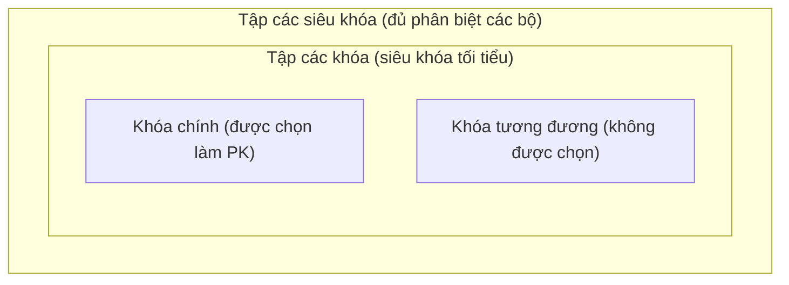
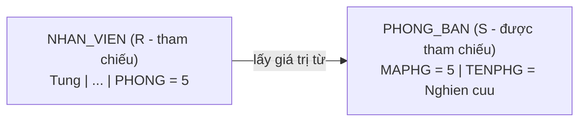
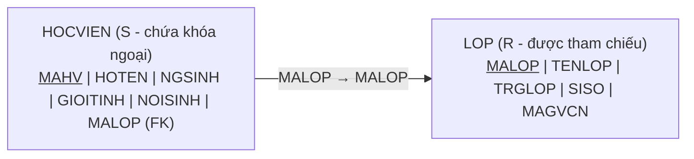
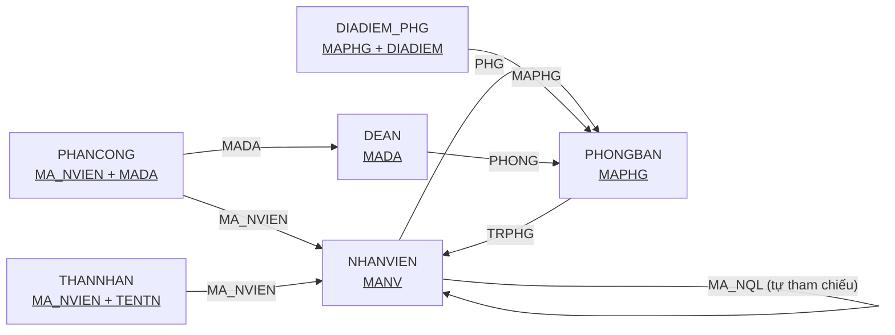

# Buổi 2 - Mô hình dữ liệu quan hệ

- **Ngày**: 12/11/2026
- **Môn**: Cơ sở dữ liệu (IT004.G13.CN2.TTNT)
- **Giảng viên**: Ths. Trần Anh Dũng
- **Nội dung**: Chương 2 - Mô hình dữ liệu quan hệ (Relational Data Model)

## Nội dung buổi học

1. Giới thiệu
2. Mô hình dữ liệu quan hệ (quan hệ, thuộc tính, bộ, lược đồ)
3. Ràng buộc toàn vẹn (khóa)
4. Các đặc trưng của quan hệ
5. Chuyển đổi lược đồ ERD sang mô hình dữ liệu quan hệ

## Chương 2: Mô hình dữ liệu quan hệ

### Giới thiệu

- Mô hình dữ liệu quan hệ (Relational Data Model) cung cấp một **cấu trúc dữ liệu đơn giản và đồng bộ**: **khái niệm quan hệ**.
- **Quan hệ** là khái niệm toán học dựa trên nền tảng hình thức về **lý thuyết tập hợp**.
- Mô hình do **TS. E. F. Codd** đưa ra năm **1970**: *"A Relational Model of Data for Large Shared Data Banks"*, Communications of ACM, 6/1970.
- Là **cơ sở của các HQT CSDL thương mại** hiện nay: Oracle, IBM DB2, MS SQL Server, MySQL...

> [!NOTE]
> **Vì sao mô hình quan hệ thắng** các mô hình phân cấp/mạng ở buổi 1: chỉ có **1 cấu trúc duy nhất là bảng** (đơn giản), có **nền tảng toán học chặt chẽ** (lý thuyết tập hợp - set theory + logic vị từ - predicate logic nên chứng minh được tính đúng đắn), và **độc lập dữ liệu cao** (data independence) - người dùng nói "cần dữ liệu gì" (khai báo - declarative) thay vì phải tự đi theo con trỏ/đường cây để lấy dữ liệu (thủ tục - procedural).

### Các khái niệm

- Quan hệ (Relation)
- Thuộc tính (Attribute)
- Miền giá trị (Domain)
- Bộ (Tuple)
- Lược đồ (Schema)

**Bảng đối chiếu thuật ngữ** (hay gặp trong đề và trong thực tế):

| Thuật ngữ hình thức | Tên gọi thông thường | Trong SQL |
|---|---|---|
| Quan hệ (Relation) | Bảng | `TABLE` |
| Thuộc tính (Attribute) | Cột | `COLUMN` |
| Bộ (Tuple) | Dòng | `ROW` |
| Miền giá trị (Domain) | Kiểu dữ liệu | `INT`, `VARCHAR`, `DATE`... |
| Lược đồ quan hệ (Relation schema) | Cấu trúc bảng | `CREATE TABLE` |
| Thể hiện quan hệ r(R) | Dữ liệu trong bảng | các dòng `INSERT` vào |

#### Quan hệ (Relation)

Các thông tin lưu trữ trong CSDL được tổ chức thành **bảng (table) 2 chiều** gọi là quan hệ.

Ví dụ: quan hệ NHANVIEN

| TENNV | HONV | NGSINH | DCHI | PHAI | LUONG | PHONG |
|---|---|---|---|---|---|---|
| Tung | Nguyen | 12/08/1955 | 638 NVC Q5 | Nam | 40000 | 5 |
| Hang | Bui | 07/19/1968 | 332 NTH Q1 | Nu | 25000 | 4 |
| Nhu | Le | 06/20/1951 | 291 HVH QPN | Nu | 43000 | 4 |
| Hung | Nguyen | 09/15/1962 | Ba Ria VT | Nam | 38000 | 5 |

- **1 cột** là 1 **thuộc tính** (attribute) của nhân viên.
- **1 dòng** là 1 nhân viên cụ thể (1 bộ - tuple).

Quan hệ gồm có:

- **Tên quan hệ** (relation name).
- **Tập hợp các cột**: cố định (fixed), được đặt tên (named), có kiểu dữ liệu (typed).
- **Tập hợp các dòng**: thay đổi theo thời gian (varies over time).

> [!NOTE]
> Tương ứng với mô hình ER đã học ở buổi 1: **một dòng ~ một thực thể** (entity), **quan hệ ~ tập thực thể** (entity set). Cấu trúc bảng (tên + cột) cố định, còn dữ liệu trong bảng (các dòng) biến động liên tục khi thêm/xóa/sửa (INSERT/DELETE/UPDATE).

#### Thuộc tính (Attribute)

- Là **tên các cột** của quan hệ.
- Thuộc tính dùng để **mô tả ý nghĩa** cho các giá trị tại cột đó.
- Tất cả các giá trị trong **cùng một cột** đều có **cùng kiểu dữ liệu**.

Ví dụ trong quan hệ NHANVIEN: `TENNV`, `HONV`, `NGSINH`, `DCHI`, `PHAI`, `LUONG`, `PHONG` là các thuộc tính.

> [!TIP]
> Thuộc tính mang **ngữ nghĩa** cho giá trị: cùng con số `40000` thì ở cột `LUONG` nghĩa là tiền lương, ở cột `PHONG` nghĩa là mã phòng ban - giá trị giống nhau nhưng ý nghĩa khác hẳn vì thuộc tính khác nhau. Đây cũng là lý do 2 thuộc tính trong một quan hệ không được trùng tên: không định danh được ngữ nghĩa của cột.

#### Miền giá trị - Kiểu dữ liệu (Domain)

**Miền giá trị (Domain)**: là tập các giá trị **nguyên tố** gắn liền với một thuộc tính.

- **Kiểu dữ liệu cơ sở** (primitive data types - được chấp nhận):
  - Chuỗi ký tự (string)
  - Số (integer)
- **Các kiểu dữ liệu phức tạp** (complex data types) → **không được chấp nhận**:
  - Tập hợp (set)
  - Danh sách (list)
  - Mảng (array)
  - Bản ghi (record)

Ví dụ: `TENNV`: string, `LUONG`: integer.

> [!WARNING]
> "Giá trị **nguyên tố**" (atomic) nghĩa là **không chia nhỏ được nữa**. Một ô trong bảng chỉ chứa 1 giá trị đơn - không được chứa cả danh sách, mảng hay bản ghi con. Đây chính là lý do mô hình quan hệ "phẳng" (flat) - mọi bảng đều là bảng 2 chiều đơn giản.
>
> Ví dụ vi phạm: muốn lưu nhiều SĐT của 1 nhân viên thì **không được** nhồi `'090..., 091...'` vào 1 ô `DTHOAI` - phải tách thành quan hệ riêng (xem phần chuyển đổi ERD, thuộc tính đa trị).

#### Bộ (Tuple)

- **Bộ (Tuple)**: là **1 dòng** (row) của quan hệ - mô tả dữ liệu của **1 thực thể cụ thể** (entity instance).
- Mỗi bộ là một **danh sách có thứ tự** (ordered list) gồm $n$ giá trị: $t = \langle v_1, v_2, \ldots, v_n \rangle$, với $v_j \in DOM(A_j)$ hoặc `null`.
- **Bậc** (degree/arity) của quan hệ = số thuộc tính (độ dài mỗi bộ); **kích thước** (cardinality) của quan hệ = số bộ (số dòng).

> [!TIP]
> Phân biệt 2 cặp thường quên: **bậc** (degree) đếm theo **chiều ngang** - bao nhiêu cột; **kích thước** (cardinality) đếm theo **chiều dọc** - bao nhiêu dòng. Quan hệ NHANVIEN trên có bậc 7-8 và kích thước 4.

#### Lược đồ (Schema) - Lược đồ quan hệ

Mô tả **cấu trúc** của một quan hệ và các **mối liên hệ** giữa các thuộc tính trong quan hệ đó:

- Tên của quan hệ.
- Tên của tập thuộc tính.
- Mô tả để xác định ý nghĩa và mối liên hệ giữa các thuộc tính (tân từ - predicate).

> [!NOTE]
> **Tân từ** (predicate) là câu phát biểu mô tả **ngữ nghĩa** của quan hệ - vd tân từ của `NHAN_VIEN`: *"nhân viên có mã MANV, tên TENNV, họ HONV, sinh ngày NGSINH, ở DCHI, phái PHAI, lương LUONG, làm việc tại phòng PHONG"*. Mỗi bộ được đọc thành một câu đúng theo tân từ đó: *"nhân viên Tung Nguyen sinh 12/08/1955 ở 638 NVC Q5..."*. Tân từ chính là cầu nối giữa cấu trúc bảng (toán học) và ý nghĩa dữ liệu (thế giới thực).

**Cách viết lược đồ quan hệ**: `TÊN_QUAN_HỆ` + tập hợp các thuộc tính đặt trong ngoặc tròn.

```
NHAN_VIEN(MANV, TENNV, HONV, NGSINH, DCHI, PHAI, LUONG, PHONG)
└──┬───┘ └────────────────────────────┬──────────────────────────┘
Lược đồ quan hệ                  Là tập hợp các thuộc tính
```

#### Lược đồ CSDL (Database schema)

Là **tập hợp các lược đồ quan hệ** (relation schemas) và các mối liên hệ giữa chúng trong cùng một hệ thống quản lý.

```
NHAN_VIEN(MANV, TENNV, HONV, NGSINH, DCHI, PHAI, LUONG, PHONG)
PHONG_BAN(MAPHG, TENPHG, TRPHG, NG_NHANCHUC)
DIADIEM_PHG(MAPHG, DIADIEM)
THANNHAN(MA_NVIEN, TENTN, PHAI, NGSINH, QUANHE)
DEAN(TENDA, MADA, DDIEM_DA, PHONG)
```

> [!TIP]
> Mẹo đọc lược đồ CSDL: tìm các **thuộc tính có cùng ngữ nghĩa xuất hiện ở nhiều quan hệ** - `MAPHG` có ở PHONG_BAN (khóa chính), DIADIEM_PHG và DEAN; `MANV`/`MA_NVIEN` có ở NHAN_VIEN, THANNHAN. Đó chính là dấu hiệu của các **tham chiếu/khóa ngoại** nối các bảng với nhau - phần tiếp theo sẽ định nghĩa chặt chẽ.

#### Định nghĩa hình thức của lược đồ quan hệ

- Cho $A_1, A_2, \ldots, A_n$ là các thuộc tính.
- Có các miền giá trị $D_1, D_2, \ldots, D_n$ tương ứng.
- Ký hiệu $R(A_1:D_1, A_2:D_2, \ldots, A_n:D_n)$ là một **lược đồ quan hệ** (relation schema).
- **Bậc** (degree) của lược đồ quan hệ là **số lượng thuộc tính** trong lược đồ.

Ví dụ:

```
NHAN_VIEN(MANV:integer, TENNV:string, HONV:string, NGSINH:date,
          DCHI:string, PHAI:string, LUONG:integer, PHONG:integer)
```

- `NHAN_VIEN` là một lược đồ **bậc 8**, mô tả đối tượng nhân viên.
- `MANV` là một thuộc tính có miền giá trị là **số nguyên**.
- `TENNV` là một thuộc tính có miền giá trị là **chuỗi ký tự**.

> [!NOTE]
> **Xem thêm - vì sao gọi là "quan hệ" trong lý thuyết tập hợp:**
>
> - Về mặt toán học, nếu $D_1, D_2, \ldots, D_n$ là các miền giá trị thì **quan hệ** $r$ trên lược đồ $R$ là một **tập con của tích Descartes** (subset of Cartesian product): $r(R) \subseteq D_1 \times D_2 \times \ldots \times D_n$.
> - Mỗi **bộ** (tuple) $t = \langle v_1, v_2, \ldots, v_n \rangle \in r$ với $v_i \in D_i$ - tức mỗi dòng trong bảng là một phần tử của tích Descartes các miền giá trị.
> - Trong lý thuyết tập hợp, "quan hệ $n$ ngôi" được định nghĩa đúng như vậy: tập con của tích Descartes $n$ tập hợp. Mô hình quan hệ chỉ là **đặt tên cho các tập hợp** (miền giá trị gắn vào thuộc tính) để dùng trong CSDL.
>
> Nói cách khác: **lược đồ** $R$ (schema) là "khuôn mẫu" mô tả cấu trúc (tên + các thuộc tính + miền giá trị), còn **thể hiện** $r(R)$ (relation instance/state) là tập các bộ cụ thể tại một thời điểm. Lược đồ ít thay đổi, thể hiện thay đổi liên tục - đúng với nhận xét "tập hợp các dòng thay đổi theo thời gian" ở trên.

#### Quan hệ (thể hiện của quan hệ)

- Một quan hệ $r$ của lược đồ quan hệ $R(A_1, A_2, \ldots, A_n)$, ký hiệu $r(R)$, là một **tập các bộ** (set of tuples) $r = \{t_1, t_2, \ldots, t_k\}$.
- Trong đó mỗi $t_i$ là 1 danh sách **có thứ tự** (ordered list) của $n$ giá trị: $t_i = \langle v_1, v_2, \ldots, v_n \rangle$.
- Mỗi $v_j$ là một phần tử của miền giá trị $DOM(A_j)$ **hoặc giá trị rỗng** (null).

| | TENNV | HONV | NGSINH | DCHI | PHAI | LUONG | PHONG |
|---|---|---|---|---|---|---|---|
| $t_1$ | Tung | Nguyen | 12/08/1955 | 638 NVC Q5 | Nam | 40000 | 5 |
| $t_2$ | Hang | Bui | 07/19/1968 | 332 NTH Q1 | Nu | 25000 | 4 |
| $t_3$ | Nhu | Le | 06/20/1951 | 291 HVH QPN | Nu | 43000 | 4 |
| $t_4$ | Hung | Nguyen | 09/15/1962 | **null** | Nam | 38000 | 5 |

> [!NOTE]
> `null` là giá trị đặc biệt biểu diễn "không biết / không có / không áp dụng" - vd $t_4$ chưa biết địa chỉ nên `DCHI = null`. `null` không phải chuỗi rỗng, cũng không phải số 0 - nó nằm **ngoài** miền giá trị thông thường của thuộc tính.

### Ràng buộc toàn vẹn (Integrity Constraint - RBTV)

#### Khái niệm

- **Ràng buộc toàn vẹn (RBTV)**: là những **qui tắc, điều kiện, ràng buộc** cần được thỏa mãn cho **mọi thể hiện** của CSDL quan hệ.
- RBTV được **mô tả khi định nghĩa** lược đồ quan hệ.
- RBTV được **kiểm tra khi các quan hệ có thay đổi** (thêm/xóa/sửa dữ liệu - INSERT/DELETE/UPDATE).

> [!NOTE]
> RBTV đảm bảo dữ liệu luôn **phản ánh đúng ngữ nghĩa** của thế giới thực: mọi thể hiện hợp lệ của CSDL đều phải thỏa các ràng buộc. HQT CSDL tự động kiểm tra mỗi khi dữ liệu biến động - thao tác nào vi phạm ràng buộc sẽ bị từ chối.

#### Siêu khóa (Super key)

**RBTV**: các bộ trong quan hệ phải **khác nhau từng đôi một**.

- Gọi $SK$ là một **tập con khác rỗng** (non-empty subset) các thuộc tính của $R$.
- $SK$ là siêu khóa khi:

$$\forall r, \forall t_1, t_2 \in r,\ t_1 \neq t_2 \Rightarrow t_1[SK] \neq t_2[SK]$$

**Cách đọc**: *"với **mọi** thể hiện $r$, với **mọi** cặp bộ $t_1, t_2$ thuộc $r$, **nếu** $t_1$ khác $t_2$ **thì** giá trị của $t_1$ trên $SK$ khác giá trị của $t_2$ trên $SK$"* - tức hai bộ khác nhau bất kỳ luôn phân biệt được khi nhìn vào các thuộc tính của $SK$.

| Ký hiệu | Đọc là | Ý nghĩa |
|---|---|---|
| $\forall$ | "với mọi" | lượng từ phổ quát - đúng cho tất cả trường hợp |
| $\exists$ | "tồn tại" | có ít nhất một trường hợp |
| $\in$ | "thuộc" | $t_1 \in r$ = bộ $t_1$ nằm trong quan hệ $r$ |
| $\Rightarrow$ | "kéo theo / thì" | nếu vế trái đúng thì vế phải đúng |
| $t_1[SK]$ | "$t_1$ chiếu trên $SK$" | giá trị của bộ $t_1$ tại các thuộc tính trong $SK$ |

- Siêu khóa là tập các thuộc tính dùng để xác định **tính duy nhất** (uniqueness) của mỗi bộ trong quan hệ.
- Một lược đồ quan hệ có **tối thiểu một** siêu khóa ($R^+$).

> [!NOTE]
> Vì quan hệ là một **tập hợp** các bộ nên theo định nghĩa tập hợp, không có 2 phần tử trùng nhau - hai bộ bất kỳ luôn phải khác nhau ở ít nhất một thuộc tính. Do đó **toàn bộ tập thuộc tính** $R^+$ luôn là một siêu khóa - đó là lý do mọi lược đồ quan hệ luôn có ít nhất 1 siêu khóa.

**Ví dụ** - xét quan hệ NHANVIEN ở trên (giả sử thêm cột `MANV`):

| | MANV | TENNV | HONV | NGSINH | PHAI | LUONG | PHONG |
|---|---|---|---|---|---|---|---|
| $t_1$ | NV01 | Tung | Nguyen | 12/08/1955 | Nam | 40000 | 5 |
| $t_2$ | NV02 | Hang | Bui | 07/19/1968 | Nu | 25000 | 4 |
| $t_3$ | NV03 | Nhu | Le | 06/20/1951 | Nu | 43000 | 4 |
| $t_4$ | NV04 | Hung | **Nguyen** | 09/15/1962 | Nam | 38000 | 5 |

- $\{MANV\}$ **là siêu khóa**: 4 bộ có `MANV` khác nhau đôi một (NV01, NV02, NV03, NV04) → nhìn `MANV` là phân biệt được từng bộ.
- $\{HONV\}$ **không phải** siêu khóa: $t_1$ và $t_4$ cùng có `HONV = "Nguyen"` → $t_1[HONV] = t_4[HONV]$, vi phạm điều kiện.
- $\{MANV, TENNV\}$, $\{MANV, PHAI\}$, $\{MANV, TENNV, LUONG, PHONG\}$... **đều là siêu khóa**: đã chứa $MANV$ nên vẫn đủ sức phân biệt.
- Toàn bộ thuộc tính $R^+ = \{MANV, TENNV, HONV, NGSINH, PHAI, LUONG, PHONG\}$ cũng là siêu khóa.

> [!WARNING]
> 2 bẫy cần nhớ:
>
> - **Siêu khóa không cần tối tiểu** - thêm thuộc tính vào siêu khóa vẫn là siêu khóa. Nên một quan hệ có thể có **rất nhiều** siêu khóa (mọi tập chứa MANV đều được).
> - **Phải đúng với mọi thể hiện** $r$, không chỉ dữ liệu hiện tại. `TENNV` trong bảng trên đang khác nhau đôi một (Tung, Hang, Nhu, Hung) nhưng **không ai đảm bảo** công ty không tuyển thêm người cùng tên → `TENNV` vẫn **không phải** siêu khóa. Ngược lại `MANV` do doanh nghiệp cấp duy nhất → luôn thỏa.

#### Khóa (Key / Candidate key)

- Gọi $K$ là một **tập con khác rỗng** (non-empty subset) các thuộc tính của $R$.
- $K$ là khóa của $R$ nếu thỏa mãn **đồng thời 2 điều kiện**:
  - $K$ là một **siêu khóa** của $R$.
  - $\neg \exists K_1 \subset K,\ K_1 \neq \varnothing,\ K_1$ là siêu khóa.

**Cách đọc điều kiện 2**: *"**không tồn tại** tập $K_1$ là tập con **thực sự** (proper subset) của $K$, $K_1$ khác rỗng, mà $K_1$ là siêu khóa"* - tức bỏ đi **bất kỳ** thuộc tính nào khỏi $K$ thì phần còn lại đều **không còn đủ sức** phân biệt các bộ.

| Ký hiệu | Đọc là | Ý nghĩa |
|---|---|---|
| $\neg$ | "phủ định / không" | đảo ngược mệnh đề phía sau |
| $\neg \exists$ | "không tồn tại" | không có trường hợp nào |
| $\subset$ | "tập con thực sự" (proper subset) | $K_1 \subset K$ = $K_1$ nằm trong $K$ và nhỏ hơn $K$ hẳn |
| $\varnothing$ | "tập rỗng" | tập không chứa phần tử nào |

**Nhận xét:**

- $K$ là siêu khóa **"nhỏ nhất"** (không thể bỏ bớt thuộc tính và khác rỗng).
- Giá trị của khóa dùng để **nhận biết một bộ** trong quan hệ.
- Khóa là một **đặc trưng của lược đồ quan hệ**, không phụ thuộc vào thể hiện quan hệ.
- Lược đồ quan hệ có thể có **nhiều khóa**.

> [!NOTE]
> Theo ví dụ siêu khóa ở trên: $\{MANV\}$ vừa là siêu khóa vừa **không thể bỏ bớt thuộc tính nào** (chỉ còn 1 thuộc tính) → là **khóa**. Ngược lại $\{MANV, TENNV\}$ dù là siêu khóa nhưng chứa tập con $\{MANV\}$ cũng là siêu khóa → **không phải khóa**. Nói gọn: **siêu khóa = đủ phân biệt, khóa = siêu khóa tối tiểu**.

#### Khóa chính (Primary Key - PK)

Xét quan hệ `HOCVIEN(MAHV, HOTEN, NGSINH, GIOITINH, NOISINH, MALOP)` có **2 khóa**:

- `MAHV`
- `HOTEN, NGSINH`

Khi **cài đặt quan hệ thành bảng** (table), nếu quan hệ có nhiều hơn một khóa:

- Chọn một khóa làm cơ sở nhận biết các bộ → chọn **khóa có ít thuộc tính hơn**.
- Khóa được chọn gọi là **khóa chính** (PK - Primary Key):
  - Các thuộc tính khóa chính **phải có giá trị khác null**.
  - Các thuộc tính khóa chính thường được **gạch dưới**.
- Các khóa còn lại gọi là **khóa tương đương** (alternate key).

> [!WARNING]
> Quy ước gạch dưới khi khóa chính có **nhiều thuộc tính**:
>
> - <u>MAPHG, DIADIEM</u> - gạch **liên tục** → **1 khóa chính kết hợp** gồm 2 thuộc tính (chỉ cả cặp mới phân biệt được bộ).
> - <u>MAPHG</u>, <u>DIADIEM</u> - gạch **rời từng thuộc tính** → **2 khóa riêng biệt** (mỗi thuộc tính tự nó đã phân biệt được bộ).
> - Thuộc tính **khóa ngoại** (FK) được gạch dưới **nét đứt** - vd `NHANVIEN(..., MAPHG)` thì `MAPHG` gạch đứt vì là FK trỏ `PHONGBAN.MAPHG`.
>
> Nhìn nét gạch trên slide để đọc đúng khóa - sai chỗ này là sai cả phần khóa ngoại tham chiếu.

Ví dụ:

- HOCVIEN(<u>MAHV</u>, HOTEN, NGSINH, GIOITINH, NOISINH, MALOP) - chọn `MAHV` làm khóa chính vì ít thuộc tính hơn; `{HOTEN, NGSINH}` là khóa tương đương.
- GIANGDAY(<u>MaGV, MaMH, MaLop</u>, Hocky, Nam) - khóa chính là **khóa kết hợp** (composite key) 3 thuộc tính: cùng 1 giáo viên có thể dạy nhiều môn/nhiều lớp nên chỉ cả bộ 3 (GV, MH, Lop) mới phân biệt được từng dòng.

> [!TIP]
> Thực tế khi thiết kế, người ta hay tạo **khóa nhân tạo** (surrogate key) - mã số, ID tự tăng - làm khóa chính thay vì dùng **khóa tự nhiên** (natural key) nhiều thuộc tính như `{HOTEN, NGSINH}`: ngắn gọn (1 cột), không đổi theo thời gian (họ tên có thể đổi), và khỏi lo trùng. Đó là lý do mọi bảng đều có cột `MA...`.
>
> Lưu ý: "thuộc tính khóa chính phải khác `null`" là tiền thân của **ràng buộc toàn vẹn thực thể** (entity integrity) - nếu khóa chính được `null` thì có thể tồn tại 2 bộ "không rõ danh tính" không phân biệt được.

#### Tóm tắt các loại khóa

| Loại | Định nghĩa | Điều kiện | Ví dụ (HOCVIEN) |
|---|---|---|---|
| **Siêu khóa** (super key) | Tập thuộc tính đủ phân biệt các bộ | Đúng với **mọi** thể hiện | `{MAHV}`, `{MAHV, HOTEN}`, `{HOTEN, NGSINH}`, `{HOTEN, NGSINH, GIOITINH}`... |
| **Khóa** (candidate key) | Siêu khóa **tối tiểu** | Bỏ bất kỳ thuộc tính nào đều mất tính siêu khóa | `{MAHV}`, `{HOTEN, NGSINH}` |
| **Khóa chính** (primary key) | Khóa **được chọn** khi cài đặt bảng | Khác `null`, gạch dưới, thường ít thuộc tính nhất | <u>MAHV</u> |
| **Khóa tương đương** (alternate key) | Các khóa không được chọn làm PK | Vẫn là khóa đầy đủ | `{HOTEN, NGSINH}` |



> [!TIP]
> Mẹo làm bài: để kiểm tra $K$ là **khóa**, làm 2 bước - (1) chứng minh $K$ phân biệt được các bộ (siêu khóa), (2) thử **bỏ từng thuộc tính** ra khỏi $K$: nếu bỏ được cái nào mà vẫn phân biệt được thì $K$ chỉ là siêu khóa, không phải khóa.

#### Tham chiếu (Reference)

- Một bộ trong quan hệ $R$, tại thuộc tính $A$ nếu nhận một giá trị từ một thuộc tính $B$ của quan hệ $S$, ta gọi **$R$ tham chiếu $S$** ($R$ references $S$).
  - $R$: quan hệ **tham chiếu** (referencing relation).
  - $S$: quan hệ **được tham chiếu** (referenced relation).
- **Bộ được tham chiếu phải tồn tại trước.**

Ví dụ: bộ `Tung` trong $R$ = NHAN_VIEN có `PHONG = 5` - giá trị này lấy từ `MAPHG` của $S$ = PHONG_BAN (phòng "Nghien cuu" có `MAPHG = 5`).

| $S$ - PHONG_BAN | TENPHG | MAPHG |
|---|---|---|
| | Nghien cuu | **5** |
| | Dieu hanh | 4 |
| | Quan ly | 1 |



> [!NOTE]
> Tham chiếu chính là **cách mô hình quan hệ nối các bảng với nhau** - thay vì dùng con trỏ vật lý như mô hình phân cấp/mạng, quan hệ quan hệ dùng **giá trị dữ liệu** (`PHONG = 5` khớp `MAPHG = 5`). Thuộc tính `PHONG` bên $R$ chính là **khóa ngoại** (foreign key - FK) sẽ học ở mục sau; điều kiện "bộ được tham chiếu phải tồn tại trước" là nền của **ràng buộc toàn vẹn tham chiếu** (referential integrity): không được nhập `PHONG = 9` khi PHONG_BAN chưa có phòng mã 9.

#### Khóa ngoại (Foreign Key - FK)

- Cho $R(U)$, $S(V)$, $K_1 \subseteq U$ là **khóa chính** của $R$, $K_2 \subseteq V$.
- Ta nói $K_2$ là **khóa ngoại** (FK - Foreign Key) của $S$ **tham chiếu** đến khóa chính $K_1$ của $R$ nếu thỏa các điều kiện sau:
  - $K_1$ và $K_2$ có **cùng số lượng thuộc tính** và **ngữ nghĩa**, **kiểu dữ liệu** của các thuộc tính trong $K_1$ và $K_2$ cũng giống nhau.
  - Giá trị tại FK (mọi bộ $t \in S$):
    - Hoặc bằng giá trị `null`
    - Hoặc $\exists u \in R$ sao cho $t.K_2 = u.K_1$

**Cách đọc điều kiện 2**: *"mỗi bộ $t$ trong $S$ thì giá trị khóa ngoại $t.K_2$ hoặc để trống (`null`), hoặc **phải khớp** với khóa chính của **một bộ tồn tại sẵn** $u$ trong $R$"* - không được trỏ vào bộ không có thật.

Ví dụ: `MALOP` trong HOCVIEN là khóa ngoại tham chiếu khóa chính `MALOP` của LOP:



- Học viên có `MALOP = 'L01'` nghĩa là xếp vào lớp có mã L01 trong LOP - phải tồn tại sẵn.
- Học viên chưa xếp lớp → `MALOP = null` (được phép).

> [!WARNING]
> Vài điểm hay nhầm:
>
> - **Tên thuộc tính 2 đầu không bắt buộc giống nhau** - chỉ cần cùng số lượng, ngữ nghĩa và kiểu dữ liệu (vd `PHONG` ↔ `MAPHG` vẫn là tham chiếu hợp lệ dù tên khác).
> - Khóa ngoại có thể tham chiếu **chính quan hệ chứa nó** (tự tham chiếu - self-referencing) - vd `NHAN_VIEN.MA_NQL → NHAN_VIEN.MANV` (nhân viên có người quản lý cũng là nhân viên).
> - `null` ở khóa ngoại = tham gia **tùy chọn** (học viên chưa xếp lớp); nếu yêu cầu bắt buộc thì khai báo `NOT NULL`.
> - Phân biệt vai trò: quan hệ **chứa khóa ngoại** là bên tham chiếu ($S$), quan hệ **chứa khóa chính được trỏ** là bên được tham chiếu ($R$).

**Nhận xét:**

- Trong một lược đồ quan hệ, một thuộc tính vừa có thể **tham gia vào khóa chính**, vừa **tham gia vào khóa ngoại**.
- Khóa ngoại có thể tham chiếu đến khóa chính **trên cùng 1 lược đồ quan hệ**.
- Có thể có **nhiều khóa ngoại** tham chiếu đến **cùng một khóa chính**.

> [!NOTE]
> Minh họa trên lược đồ CSDL công ty ở trên:
>
> - *Vừa PK vừa FK*: `THANNHAN(MA_NVIEN, TENTN, ...)` - `MA_NVIEN` là **1 phần khóa chính** (khóa kết hợp với `TENTN`) đồng thời là **khóa ngoại** trỏ `NHAN_VIEN.MANV`. Đây chính là "vay mượn khóa" của thực thể yếu ở buổi 1.
> - *FK trên cùng lược đồ*: `NHAN_VIEN.MA_NQL → NHAN_VIEN.MANV`.
> - *Nhiều FK → cùng PK*: `NHAN_VIEN.MA_NQL` và `PHONG_BAN.TRPHG` (trưởng phòng) đều trỏ `NHAN_VIEN.MANV`.

#### Ví dụ: lược đồ CSDL công ty

Cho lược đồ CSDL gồm các quan hệ sau (thuộc tính <u>gạch dưới</u> là khóa chính; đoạn mô tả dưới mỗi quan hệ chính là **tân từ** - predicate - của lược đồ đó):

- `PHONGBAN(TENPHG, MAPHG, TRPHG, NGAY_NHANCHUC)` - PK: <u>MAPHG</u>
  - Mỗi phòng ban có một mã phòng ban duy nhất để phân biệt với phòng ban khác, có tên phòng ban, do một nhân viên làm trưởng phòng và có ngày nhận chức của người trưởng phòng đó.
- `NHANVIEN(HONV, TENLOT, TENNV, MANV, NGSINH, DCHI, PHAI, LUONG, MA_NQL, PHG)` - PK: <u>MANV</u>
  - Mỗi nhân viên của công ty có một họ, tên lót, tên, lương, địa chỉ, điện thoại, phái và có một mã nhân viên duy nhất để phân biệt với các nhân viên khác. Một nhân viên có một người quản lý trực tiếp và làm việc cho một phòng ban nào đó.
- `DIADIEM_PHG(MAPHG, DIADIEM)` - PK: <u>MAPHG, DIADIEM</u>
  - Một phòng ban có thể ở nhiều địa điểm và một địa điểm có thể có nhiều phòng ban.
- `THANNHAN(MA_NVIEN, TENTN, PHAI, NGSINH, QUANHE)` - PK: <u>MA_NVIEN, TENTN</u>
  - Mỗi thân nhân là một người thân của một nhân viên nào đó. Một nhân viên có thể có nhiều thân nhân. Thân nhân có tên, phái, ngày sinh và mô tả mối quan hệ với nhân viên.
- `DEAN(TENDA, MADA, DDIEM_DA, PHONG)` - PK: <u>MADA</u>
  - Một đề án có tên và một mã đề án duy nhất để phân biệt với đề án khác. Đề án do một phòng ban chịu trách nhiệm chủ trì và diễn ra ở một địa điểm nào đó.
- `PHANCONG(MA_NVIEN, MADA, THOIGIAN)` - PK: <u>MA_NVIEN, MADA</u>
  - Một nhân viên được phân công làm nhiều đề án và một đề án có thể có nhiều nhân viên tham gia. Nhân viên tham gia đề án trong một khoảng thời gian xác định.

**Tổng hợp khóa chính / khóa ngoại:**

| Quan hệ | Khóa chính | Khóa ngoại |
|---|---|---|
| PHONGBAN | `MAPHG` | `TRPHG → NHANVIEN.MANV` |
| NHANVIEN | `MANV` | `PHG → PHONGBAN.MAPHG`<br/>`MA_NQL → NHANVIEN.MANV` (tự tham chiếu) |
| DIADIEM_PHG | `{MAPHG, DIADIEM}` | `MAPHG → PHONGBAN.MAPHG` |
| THANNHAN | `{MA_NVIEN, TENTN}` | `MA_NVIEN → NHANVIEN.MANV` |
| DEAN | `MADA` | `PHONG → PHONGBAN.MAPHG` |
| PHANCONG | `{MA_NVIEN, MADA}` | `MA_NVIEN → NHANVIEN.MANV`<br/>`MADA → DEAN.MADA` |



> [!NOTE]
> - Mũi tên đọc là "thuộc tính khóa ngoại → khóa chính được tham chiếu" (FK → PK).
> - Slide trên hình dùng tên `SODA` ở PHANCONG thay `MADA` - cùng vai trò (mã/số đề án tham chiếu `DEAN.MADA`), khác tên vẫn là khóa ngoại hợp lệ vì cùng ngữ nghĩa + kiểu.
> - `DIADIEM_PHG` và `PHANCONG` là 2 bảng **khóa chính kết hợp toàn khóa ngoại** - dấu hiệu điển hình của quan hệ nhiều - nhiều (m:n) và thực thể yếu, sẽ gặp lại ở phần chuyển đổi ERD.

### Các đặc trưng của quan hệ (Characteristics of Relations)

- Mỗi quan hệ có một **tên duy nhất**.
- Mỗi thuộc tính của một quan hệ đều có **tên khác nhau**.
- Mỗi bộ là **duy nhất** - không có 2 bộ nào trùng nhau.
- Mỗi giá trị trong một bộ:
  - Hoặc là một **giá trị nguyên tố** (atomic value)
  - Hoặc là một **giá trị rỗng** (null)

| Mahv | HoTen | Gioitinh | Noisinh | Malop |
|---|---|---|---|---|
| K1103 | Ha Duy Lap | Nam | Nghe An | K11 |
| K1102 | Tran Ngoc Han | Nu | Kien Giang | K11 |
| K1104 | Tran Ngoc Linh | Nu | **null** | K11 |

> [!NOTE]
> Bản chất toán học giải thích cả 4 đặc trưng: quan hệ là **tập hợp** nên không có phần tử trùng (đặc trưng 3) và tên lược đồ/thuộc tính phải phân biệt để định danh (đặc trưng 1-2); giá trị nguyên tố chính là điều kiện "miền giá trị nguyên tố" đã học (đặc trưng 4) - về sau đây là **dạng chuẩn 1** (1NF - First Normal Form) ở chương 6.

**Đặc trưng về thứ tự:**

- **Thứ tự của các bộ không quan trọng** - dòng nào trước, dòng nào sau đều là cùng một quan hệ.
- **Thứ tự của thuộc tính không thực sự quan trọng**:
  - Tên các thuộc tính đại diện cho một miền giá trị và có thể được **sắp xếp lại**.
- **Thứ tự giữa các giá trị trong một bộ là quan trọng**:

$$\langle K1103, Nguyen\ Van\ Lam, Nam, Dong\ Nai, K11 \rangle \neq \langle K1103, Nguyen\ Van\ Lam, Nam, K11, Dong\ Nai \rangle$$

> [!WARNING]
> Nghe có vẻ mâu thuẫn "thuộc tính đổi chỗ được mà giá trị thì không" - thực ra **giá trị phải đi theo đúng vị trí thuộc tính** của nó: nếu đổi thứ tự cột `Noisinh` và `Malop` trong lược đồ thì giá trị `Dong Nai` và `K11` phải đổi chỗ **cùng nhau**. Bộ là **danh sách có thứ tự** (ordered) nên từng giá trị $v_j$ gắn cứng với thuộc tính $A_j$ ở vị trí $j$ - đảo giá trị giữa các vị trí như trên cho ra một bộ **khác hẳn** (và sai ngữ nghĩa: lớp "Dong Nai", quê "K11").

### Chuyển đổi lược đồ ERD sang mô hình quan hệ (ER-to-Relational Mapping)

> [!NOTE]
> Ký hiệu dùng bên dưới: `{...}` = khóa chính (trên slide gạch **nét liền**); `(FK→...)` = khóa ngoại (trên slide gạch **nét đứt**).

#### (1) Tập thực thể

Các tập thực thể (**trừ tập thực thể yếu**) chuyển thành các quan hệ có **cùng tên** và **cùng tập thuộc tính**; khóa của tập thực thể → khóa chính của quan hệ.

```
NHANVIEN({MANV}, TENNV, HONV, NGSINH, DCHI, PHAI, LUONG)
PHONGBAN({MAPHG}, TENPHG)
```

`{MANV}` = trên slide `MANV` được gạch chân → khóa chính.

#### (2) Mối kết hợp

**(2a) Nhiều - Nhiều (n-n - many-to-many)**

Tạo một **quan hệ mới** có:

- Tên quan hệ là **tên của mối kết hợp**.
- Thuộc tính gồm **khóa chính của các tập thực thể liên quan** + **thuộc tính riêng của mối kết hợp** (nếu có); khóa chính của quan hệ mới tạo thành từ các khóa chính đó.

```
PHANCONG({MANV, MADA}, THOIGIAN)
          │      │       └─ thuộc tính riêng của mối kết hợp
          │      └─ FK → DEAN.MADA
          └─ FK → NHANVIEN.MANV
```

- `{MANV, MADA}` = trên slide gạch chân **liên tục** dưới cả 2 → **1 khóa chính kết hợp**, đồng thời là 2 khóa ngoại (`MANV → NHANVIEN.MANV`, `MADA → DEAN.MADA`).
- `THOIGIAN`: thuộc tính riêng của mối kết hợp.

> [!TIP]
> vì sao n-n **bắt buộc tách bảng mới**: mỗi dòng phải lưu một **cặp** (nhân viên, đề án) - nhét vào đâu cũng vi phạm atomic/khóa. Khóa chính = cả 2 khóa ngoại ghép lại.

**(2b) Một - Nhiều (1-n - one-to-many)**

Quan hệ **phía nhiều** (many side) **nhận thêm khóa chính của phía một** làm khóa ngoại (không cần tạo quan hệ mới).

```
NHANVIEN({MANV}, TENNV, HONV, NGSINH, DCHI, PHAI, LUONG, MAPHG(FK))
          │                                               └─ FK → PHONGBAN.MAPHG
          └─ PK (slide: gạch liền)
```

`MAPHG` = trên slide gạch chân **nét đứt** → khóa ngoại trỏ `PHONGBAN.MAPHG`, không nằm trong khóa chính.

> [!TIP]
> Mẹo nhớ chiều: **"khóa trôi về phía nhiều"** - mỗi dòng NHANVIEN chỉ cần 1 ô `PHG` để biết thuộc phòng nào; ngược lại nhét `MANV` vào PHONGBAN sẽ không biết nhét nhân viên nào trong cả chục người. Câu hỏi tự kiểm: "1 dòng của bảng này trỏ được tới **mấy** dòng bảng kia?" - trỏ đúng 1 thì nhét FK được.

**(2c) Một - Một (1-1 - one-to-one)**

- Hoặc thêm vào **quan hệ này** thuộc tính khóa của **quan hệ kia**, hoặc thêm thuộc tính khóa vào **cả 2 quan hệ**.
- Trường hợp quan hệ **tham gia toàn phần** (total participation - bản số 1:1): thêm khóa chính của **quan hệ còn lại** vào làm **khóa ngoại** + thêm thuộc tính của mối kết hợp (nếu có).

```
PHONGBAN({MAPHG}, TENPHG, TRPHG(FK), NG_NHANCHUC)
          │                │            └─ thuộc tính của mối kết hợp
          │                └─ FK → NHANVIEN.MANV
          └─ PK
```

- `TRPHG` = gạch chân **nét đứt** → khóa ngoại trỏ `NHANVIEN.MANV` (trưởng phòng là một nhân viên).
- `NG_NHANCHUC`: thuộc tính của mối kết hợp `La_truong_phong` được mang xuống.

> [!NOTE]
> PHONGBAN tham gia `La_truong_phong` với $(1,1)$ - mọi phòng **bắt buộc** có trưởng phòng → đặt `TRPHG` + `NG_NHANCHUC` (thuộc tính của mối kết hợp) vào PHONGBAN thì không bao giờ bị `null`. Đặt ngược vào NHANVIEN cũng được nhưng phí ô trống vì không phải nhân viên nào cũng làm trưởng phòng ($(0,1)$ - tham gia tùy chọn). **Nguyên tắc: đặt FK ở phía tham gia toàn phần để tránh null.**

**(2d) Mối kết hợp 3 ngôi (ternary relationship)**

Tạo một **quan hệ mới** có:

- Tên quan hệ là **tên của mối kết hợp**.
- Thuộc tính gồm **khóa chính tạo thành từ 3 khóa chính** của 3 thực thể tham gia + thuộc tính mối kết hợp (nếu có).

```
NHACUNGCAP({MANCC}, ...)
THIETBI({MATB}, ...)
DEAN({MADA}, ...)
CUNGCAP({MANCC, MATB, MADA}, SOLUONG)
         │       │     │        └─ thuộc tính của mối kết hợp
         │       │     └─ FK → DEAN
         │       └─ FK → THIETBI
         └─ FK → NHACUNGCAP
```

- `{MANCC, MATB, MADA}` = gạch chân liên tục dưới cả 3 → khóa chính kết hợp từ **3 khóa ngoại** trỏ 3 thực thể.
- `SOLUONG`: thuộc tính của mối kết hợp.

#### (3) Thực thể yếu (Weak entity)

Chuyển thành một quan hệ:

- Có **cùng tên** với thực thể yếu.
- **Khóa chính** = thuộc tính khóa của **quan hệ liên quan** (thực thể mạnh) + **khóa riêng phần** (partial key/discriminator) của thực thể yếu.

```
THANNHAN({MANV, TENTN}, PHAI, NGSINH, QUANHE)
          │      └─ khóa riêng phần (partial key)
          └─ FK → NHANVIEN.MANV (khóa vay mượn - vừa PK vừa FK)
```

- `{MANV, TENTN}` = gạch chân liên tục dưới cả 2 → khóa chính kết hợp; trong đó `MANV` còn là khóa ngoại → `NHANVIEN` (khóa vay mượn - vừa PK vừa FK), `TENTN` là khóa riêng phần.

> [!NOTE]
> Đúng với "vay mượn khóa" ở buổi 1: `TENTN` chỉ phân biệt được thân nhân **của cùng một** nhân viên → khóa đầy đủ = `{MANV (vay mượn), TENTN (riêng phần)}`. Mối kết hợp xác định `Co_than_nhan` **không** tạo quan hệ riêng - nó được "gấp" vào chính khóa ngoại này.

#### (4) Thuộc tính đa trị (Multi-valued attribute)

Chuyển thành một **quan hệ mới** có:

- Tên **kết hợp giữa quan hệ liên quan và thuộc tính** (vd `NV_BANGCAP` = NHANVIEN + BANGCAP).
- **Khóa chính** = khóa chính của quan hệ liên quan + **bản thân thuộc tính đa trị**.

```
NHANVIEN({MANV}, TENNV, HONV, NS, GT, LUONG)   -- bảng gốc bỏ thuộc tính đa trị BANGCAP
NV_BANGCAP({MANV, BANGCAP})
            │       └─ chính thuộc tính đa trị
            └─ FK → NHANVIEN.MANV
```

`{MANV, BANGCAP}` = gạch chân liên tục dưới cả 2 → khóa chính kết hợp; `MANV` là khóa ngoại → `NHANVIEN`.

**Vì sao phải tách bảng** - giả sử nhân viên NV01 có 2 bằng cấp:

| MANV | TENNV | BANGCAP |
|---|---|---|
| NV01 | Tung | **'Cử nhân, Kỹ sư'** ← vi phạm atomic: 1 ô chứa 2 giá trị |
| NV02 | Hang | 'Cử nhân' |

Mô hình quan hệ yêu cầu mọi giá trị đều **nguyên tố** (atomic) → không được nhồi nhiều giá trị vào một ô. Nên tách `BANGCAP` ra bảng riêng, **mỗi giá trị đa trị = 1 dòng**:

| MANV | BANGCAP |
|---|---|
| NV01 | Cử nhân |
| NV01 | Kỹ sư |
| NV02 | Cử nhân |

**Vì sao khóa chính phải là `{MANV, BANGCAP}`** chứ không riêng `MANV`:

- `MANV` lặp lại nhiều lần (NV01 xuất hiện 2 dòng) → **không thể làm khóa** một mình.
- Cặp `(MANV, BANGCAP)` thì duy nhất: một nhân viên không có cùng 1 bằng cấp 2 lần → đủ sức phân biệt từng dòng.
- `MANV` trong bảng mới vừa là 1 phần khóa chính vừa là khóa ngoại trỏ về `NHANVIEN`.

> [!TIP]
> Nhìn từ góc độ ER: thuộc tính đa trị khi tách bảng hóa ra chính là một **quan hệ 1-n** (`NHANVIEN (1,n) - NV_BANGCAP`) - bản chất "một nhân viên có nhiều bằng cấp" cũng là một mối kết hợp một - nhiều. Và đây chính là nguồn gốc của **dạng chuẩn 1NF**: mọi thuộc tính phải nguyên tố, không đa trị, không lặp nhóm.

**Tóm tắt các qui tắc:**

| # | Loại ER | Cách chuyển | Khóa chính quan hệ mới |
|---|---|---|---|
| 1 | Tập thực thể mạnh | → quan hệ cùng tên + thuộc tính | Khóa của tập thực thể |
| 2a | Mối kết hợp n-n | → quan hệ mới | Hợp các khóa 2 phía |
| 2b | Mối kết hợp 1-n | Nhét FK vào phía **nhiều** | - |
| 2c | Mối kết hợp 1-1 | Nhét FK vào phía tham gia **toàn phần** | - |
| 2d | Mối kết hợp ≥3 ngôi | → quan hệ mới | Hợp các khóa tất cả các phía |
| 3 | Thực thể yếu | → quan hệ cùng tên | Khóa thực thể mạnh + khóa riêng phần |
| 4 | Thuộc tính đa trị | → quan hệ mới | Khóa quan hệ cha + chính thuộc tính đa trị |

#### Bài tập: chuyển đổi ERD công ty sang mô hình quan hệ

**Đề**: chuyển đổi mô hình ERD công ty (slide) thành mô hình dữ liệu quan hệ.

**Đọc ERD:**

- Tập thực thể **mạnh**: NHANVIEN (khóa `MANV`), PHONGBAN (khóa `MAPHG`), DEAN (khóa `MADA`).
- Tập thực thể **yếu**: THANNHAN (khóa riêng phần `TENTN`).
- Thuộc tính **đa trị**: `DDIEM` của PHONGBAN.
- Mối kết hợp:
  - `Lam_viec`: NHANVIEN $(1,1)$ - PHONGBAN $(1,n)$ → **1-n**
  - `La_truong_phong`: NHANVIEN $(0,1)$ - PHONGBAN $(1,1)$ → **1-1** (PHONGBAN tham gia toàn phần, có thuộc tính `NG_NHANCHUC`)
  - `Quan_ly`: **đệ quy** trên NHANVIEN - *là người quản lý* $(0,n)$ / *được quản lý bởi* $(0,1)$ → **1-n**
  - `Phan_cong`: NHANVIEN $(1,n)$ - DEAN $(1,n)$ → **n-n** (thuộc tính `THOIGIAN`)
  - `Phu_trach`: PHONGBAN $(1,n)$ - DEAN $(1,1)$ → **1-n**
  - `Co_than_nhan`: NHANVIEN $(1,n)$ - THANNHAN $(1,1)$ → mối kết hợp **xác định** của thực thể yếu

**Áp dụng các qui tắc:**

| Thành phần ERD | Qui tắc | Kết quả |
|---|---|---|
| NHANVIEN | (1) tập thực thể | `NHANVIEN` |
| PHONGBAN | (1) tập thực thể | `PHONGBAN` |
| DEAN | (1) tập thực thể | `DEAN` |
| `Lam_viec` (1-n) | (2b) nhét khóa vào phía nhiều | `NHANVIEN.PHG → PHONGBAN.MAPHG` |
| `La_truong_phong` (1-1) | (2c) FK phía toàn phần + thuộc tính mối kết hợp | `PHONGBAN.TRPHG → NHANVIEN.MANV`, `NG_NHANCHUC` |
| `Quan_ly` (đệ quy 1-n) | (2b) | `NHANVIEN.MA_NQL → NHANVIEN.MANV` |
| `Phan_cong` (n-n) | (2a) quan hệ mới | `PHANCONG` |
| `Phu_trach` (1-n) | (2b) | `DEAN.PHONG → PHONGBAN.MAPHG` |
| THANNHAN (yếu) | (3) | `THANNHAN` (PK mượn `MANV` + `TENTN`) |
| `DDIEM` (đa trị) | (4) quan hệ mới | `DIADIEM_PHG` |

**Lược đồ CSDL kết quả:**

```
NHANVIEN({MANV}, HONV, TENNV, NGSINH, LUONG, DCHI, PHAI, MA_NQL(FK), PHG(FK))
          │                                              │           └─ FK → PHONGBAN.MAPHG
          │                                              └─ FK → NHANVIEN.MANV (tự tham chiếu)
          └─ PK

PHONGBAN({MAPHG}, TENPB, TRPHG(FK), NG_NHANCHUC)
          │               │            └─ thuộc tính của mối kết hợp La_truong_phong
          │               └─ FK → NHANVIEN.MANV
          └─ PK

DIADIEM_PHG({MAPHG, DIADIEM})
             │       └─ thuộc tính đa trị
             └─ FK → PHONGBAN.MAPHG

DEAN({MADA}, TENDA, DDIEM_DA, PHONG(FK))
      │                      └─ FK → PHONGBAN.MAPHG
      └─ PK

PHANCONG({MANV, MADA}, THOIGIAN)
          │      │       └─ thuộc tính của mối kết hợp
          │      └─ FK → DEAN.MADA
          └─ FK → NHANVIEN.MANV

THANNHAN({MANV, TENTN}, PHAI, NGSINH, QUANHE)
          │      └─ khóa riêng phần
          └─ FK → NHANVIEN.MANV (vừa PK vừa FK)
```

> [!NOTE]
> Kết quả trùng khớp với **lược đồ CSDL công ty** ở ví dụ phần khóa ngoại phía trên - đó chính là ERD này sau khi chuyển đổi. Quan hệ `Quan_ly` đệ quy xử lý y như mối kết hợp 1-n thường: phía nhiều ("được quản lý bởi") nhận FK trỏ về chính quan hệ (`MA_NQL → MANV`).

## Tự kiểm tra Chương 2

```quiz
{
  "title": "Tự kiểm tra Chương 2 - Mô hình dữ liệu quan hệ",
  "mode": "practice",
  "questions": [
    {
      "type": "single",
      "question": "Trong mô hình dữ liệu quan hệ, **bộ** (tuple) tương ứng với thành phần nào của bảng?",
      "options": [
        "Một cột",
        "Một dòng",
        "Một ô giá trị",
        "Cả bảng"
      ],
      "answer": 1,
      "explanation": "Bộ = 1 dòng = dữ liệu của 1 thực thể cụ thể. Cột là **thuộc tính**, còn cả bảng là **quan hệ**."
    },
    {
      "type": "single",
      "question": "Tập các bộ cụ thể của một quan hệ tại một thời điểm được gọi là gì?",
      "options": [
        "Lược đồ quan hệ (relation schema)",
        "Thể hiện quan hệ (relation instance/state)",
        "Lược đồ CSDL (database schema)",
        "Miền giá trị (domain)"
      ],
      "answer": 1,
      "explanation": "Lược đồ là *khuôn mẫu* (tên + thuộc tính, ít đổi); thể hiện $r(R)$ là *dữ liệu thật* tại một thời điểm, thay đổi liên tục khi INSERT/DELETE/UPDATE."
    },
    {
      "type": "single",
      "question": "Kiểu dữ liệu nào **không** được chấp nhận làm miền giá trị của một thuộc tính?",
      "options": [
        "Chuỗi ký tự (string)",
        "Số nguyên (integer)",
        "Mảng (array)",
        "Ngày (date)"
      ],
      "answer": 2,
      "explanation": "Miền giá trị chỉ chứa giá trị **nguyên tố** (atomic) - kiểu cơ sở như string, số. Mảng, tập hợp, danh sách, bản ghi là kiểu phức tạp → bị cấm."
    },
    {
      "type": "true-false",
      "question": "Trong một quan hệ, cho phép tồn tại 2 bộ giống hệt nhau trên mọi thuộc tính.",
      "answer": false,
      "explanation": "Quan hệ là **tập hợp** các bộ nên mỗi bộ phải duy nhất - không có 2 phần tử trùng nhau. Đây là một trong 4 đặc trưng của quan hệ."
    },
    {
      "type": "single",
      "question": "Tập thuộc tính $SK \\neq \\varnothing$ của $R$ là **siêu khóa** khi thỏa điều kiện nào?",
      "options": [
        "$SK$ chứa đúng một thuộc tính",
        "Với mọi thể hiện $r$, hai bộ khác nhau bất kỳ luôn khác nhau trên $SK$",
        "$SK$ không chứa thuộc tính nào được gạch dưới",
        "Hai bộ khác nhau ở dữ liệu hiện tại là đủ"
      ],
      "answer": 1,
      "explanation": "$\\forall r, \\forall t_1, t_2 \\in r, t_1 \\neq t_2 \\Rightarrow t_1[SK] \\neq t_2[SK]$ - phải đúng với **mọi** thể hiện, không chỉ dữ liệu hiện tại. Siêu khóa cũng không giới hạn số thuộc tính."
    },
    {
      "type": "single",
      "question": "Điểm khác biệt giữa **khóa** (candidate key) và **siêu khóa** là gì?",
      "options": [
        "Khóa phải có đúng 1 thuộc tính, siêu khóa thì không",
        "Khóa là siêu khóa **tối tiểu** - bỏ bất kỳ thuộc tính nào đều mất tính siêu khóa",
        "Khóa chỉ tồn tại 1 cái trên mỗi quan hệ",
        "Khóa được gạch dưới còn siêu khóa thì không"
      ],
      "answer": 1,
      "explanation": "Khóa = siêu khóa mà không có tập con thực sự khác rỗng nào cũng là siêu khóa. Một quan hệ có thể có **nhiều khóa** và khóa có thể gồm nhiều thuộc tính (khóa kết hợp)."
    },
    {
      "type": "single",
      "question": "Quan hệ `HOCVIEN` có 2 khóa `{MAHV}` và `{HOTEN, NGSINH}`; chọn `MAHV` làm khóa chính thì `{HOTEN, NGSINH}` là gì?",
      "options": [
        "Khóa ngoại (foreign key)",
        "Khóa tương đương (alternate key)",
        "Khóa riêng phần (partial key)",
        "Siêu khóa nhưng không phải khóa"
      ],
      "answer": 1,
      "explanation": "Các khóa không được chọn làm khóa chính gọi là **khóa tương đương** - vẫn là khóa đầy đủ, chỉ là không dùng làm định danh chính."
    },
    {
      "type": "true-false",
      "question": "Thuộc tính thuộc khóa chính được phép nhận giá trị `null`.",
      "answer": false,
      "explanation": "Thuộc tính khóa chính **bắt buộc khác `null`** - nếu được `null` thì có thể tồn tại 2 bộ 'không rõ danh tính' không phân biệt được (tiền thân của ràng buộc toàn vẹn thực thể - entity integrity)."
    },
    {
      "type": "single",
      "question": "Giá trị tại khóa ngoại $K_2$ của quan hệ $S$ (tham chiếu khóa chính $K_1$ của $R$) được phép là?",
      "options": [
        "Chỉ giá trị khớp một bộ $u \\in R$, không được `null`",
        "Chỉ được `null`",
        "`null` **hoặc** bằng giá trị $K_1$ của một bộ tồn tại trong $R$",
        "Bất kỳ giá trị nào cùng kiểu dữ liệu"
      ],
      "answer": 2,
      "explanation": "FK = `null` (tham gia tùy chọn, vd học viên chưa xếp lớp) hoặc phải khớp khóa chính của một bộ **có thật** trong quan hệ được tham chiếu - không được trỏ vào bộ không tồn tại."
    },
    {
      "type": "multiple",
      "question": "Chọn các phát biểu **đúng** về khóa ngoại (chọn tất cả):",
      "options": [
        "Một thuộc tính vừa tham gia khóa chính vừa là khóa ngoại được",
        "Khóa ngoại có thể tham chiếu chính quan hệ chứa nó (tự tham chiếu)",
        "Nhiều khóa ngoại khác nhau có thể cùng trỏ tới một khóa chính",
        "Tên thuộc tính khóa ngoại bắt buộc trùng tên khóa chính được trỏ"
      ],
      "answer": [0, 1, 2],
      "explanation": "Cả 3 nhận xét đều đúng - vd `THANNHAN.MA_NVIEN` vừa là 1 phần PK vừa là FK; `NHANVIEN.MA_NQL → NHANVIEN.MANV` tự tham chiếu; `MA_NQL` và `PHONGBAN.TRPHG` cùng trỏ `MANV`. Tên 2 đầu **không** bắt buộc giống - chỉ cần cùng số lượng, ngữ nghĩa, kiểu (`PHONG ↔ MAPHG`)."
    },
    {
      "type": "single",
      "question": "Phát biểu nào **đúng** về thứ tự trong quan hệ?",
      "options": [
        "Thứ tự các bộ là quan trọng",
        "Thứ tự các thuộc tính bắt buộc cố định không đổi",
        "Thứ tự các giá trị **trong một bộ** là quan trọng",
        "Mọi thứ tự trong quan hệ đều không quan trọng"
      ],
      "answer": 2,
      "explanation": "Bộ và thuộc tính đổi chỗ được, nhưng **giá trị phải đi theo đúng vị trí thuộc tính** của nó - đảo `Noisinh` và `Malop` cho ra bộ khác hẳn và sai ngữ nghĩa (lớp 'Dong Nai', quê 'K11')."
    },
    {
      "type": "single",
      "question": "Chuyển đổi ERD: mối kết hợp **nhiều - nhiều** (n-n) được xử lý thế nào?",
      "options": [
        "Nhét khóa của một phía vào quan hệ phía kia làm khóa ngoại",
        "Tạo quan hệ mới, khóa chính = hợp các khóa chính hai phía + thuộc tính mối kết hợp",
        "Nhét khóa vào cả hai quan hệ",
        "Gộp hai thực thể thành một quan hệ"
      ],
      "answer": 1,
      "explanation": "Vd `Phan_cong` n-n → `PHANCONG({MANV, MADA}, THOIGIAN)`. Mỗi dòng phải lưu một **cặp** (nhân viên, đề án) nên nhét vào đâu cũng vi phạm - bắt buộc tách bảng."
    },
    {
      "type": "single",
      "question": "Chuyển đổi mối kết hợp **một - nhiều** (1-n): khóa ngoại được đặt ở đâu?",
      "options": [
        "Quan hệ phía **một**",
        "Quan hệ phía **nhiều**",
        "Luôn tạo quan hệ mới",
        "Cả hai quan hệ"
      ],
      "answer": 1,
      "explanation": "Mẹo: **'khóa trôi về phía nhiều'** - mỗi dòng NHANVIEN chỉ cần 1 ô `PHG` để biết thuộc phòng nào. Nhét ngược vào PHONGBAN sẽ không biết nhét nhân viên nào trong cả chục người."
    },
    {
      "type": "single",
      "question": "Với mối kết hợp **1-1**, nên đặt khóa ngoại ở phía nào để tránh `null`?",
      "options": [
        "Phía tham gia **toàn phần** (total participation)",
        "Phía tham gia **tùy chọn**",
        "Bên nào cũng giống nhau hoàn toàn",
        "Luôn tạo quan hệ riêng"
      ],
      "answer": 0,
      "explanation": "Vd PHONGBAN $(1,1)$ bắt buộc có trưởng phòng → đặt `TRPHG` + `NG_NHANCHUC` vào PHONGBAN sẽ không bị `null`; đặt vào NHANVIEN $(0,1)$ thì phần lớn dòng bị trống."
    },
    {
      "type": "single",
      "question": "Thuộc tính **đa trị** `BANGCAP` của NHANVIEN chuyển sang mô hình quan hệ bằng cách nào?",
      "options": [
        "Lưu nhiều giá trị trong một ô cách nhau bởi dấu phẩy",
        "Tách thành quan hệ mới `NV_BANGCAP({MANV, BANGCAP})`, mỗi giá trị một dòng",
        "Chỉ giữ giá trị đầu tiên, bỏ các giá trị còn lại",
        "Tạo nhiều cột `BANGCAP1`, `BANGCAP2`... trong NHANVIEN"
      ],
      "answer": 1,
      "explanation": "Nhồi `'Cử nhân, Kỹ sư'` vào 1 ô vi phạm atomic (1NF). Tách bảng, mỗi giá trị 1 dòng; `MANV` lặp lại nên khóa chính phải là cặp `{MANV, BANGCAP}`, và `MANV` là FK trỏ `NHANVIEN`."
    },
    {
      "type": "self-check",
      "question": "Giải thích vì sao `THANNHAN` (thực thể yếu) có khóa chính là `{MANV, TENTN}`, trong đó `MANV` vừa là một phần khóa chính vừa là khóa ngoại.",
      "answer": "Thực thể yếu **vay mượn khóa** của thực thể mạnh: `TENTN` (khóa riêng phần) chỉ phân biệt thân nhân *của cùng một* nhân viên → khóa đầy đủ = khóa vay mượn `MANV` + `TENTN`. `MANV` đồng thời là FK trỏ `NHANVIEN.MANV` vì thân nhân phải gắn với một nhân viên có thật - mối kết hợp xác định 'gấp' vào chính khóa ngoại này."
    },
    {
      "type": "self-check",
      "question": "Trên lược đồ, thuộc tính `MAPHG` được **gạch chân liền** trong `PHONGBAN` và **gạch chân nét đứt** trong `NHANVIEN`. Hai ký hiệu này khác nhau thế nào?",
      "answer": "Gạch **liền** = **khóa chính**: `MAPHG` là PK của PHONGBAN. Gạch **nét đứt** = **khóa ngoại**: `NHANVIEN.MAPHG` là FK tham chiếu `PHONGBAN.MAPHG`. Cùng một giá trị mã phòng nhưng đóng 2 vai trò khác nhau ở 2 quan hệ - đây chính là mối tham chiếu giữa 2 bảng."
    }
  ]
}
```
