# Buổi 3 - Đại số quan hệ

- **Ngày**: 19/11/2026
- **Môn**: Cơ sở dữ liệu (IT004.G13.CN2.TTNT)
- **Giảng viên**: Ths. Trần Anh Dũng
- **Nội dung**: Chương 3 - Đại số quan hệ (Relational Algebra)

## Nội dung buổi học

1. Giới thiệu ngôn ngữ đại số quan hệ
2. Phép chọn (selection)
3. Phép chiếu (projection)
4. Phép tích Descartes (cartesian product), phép kết (join)
5. Phép trừ (difference), phép hợp (union), phép giao (intersection)
6. Phép chia (division)
7. Gom nhóm dữ liệu và tính toán (group by + hàm tính toán)

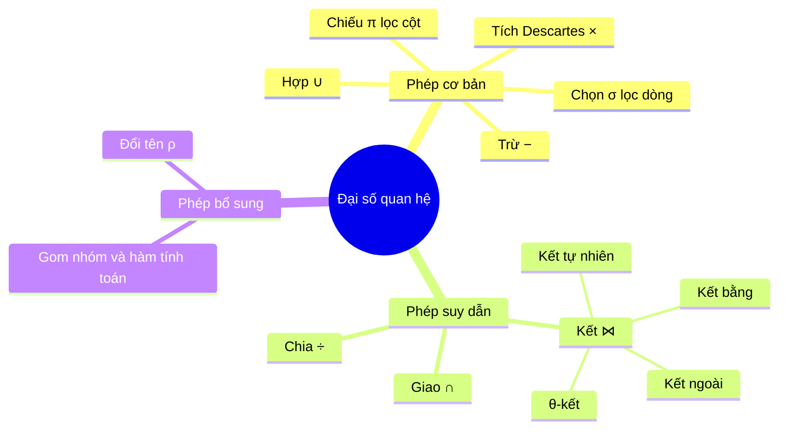

## Chương 3: Đại số quan hệ

### Giới thiệu đại số quan hệ

**Mục tiêu** của chương:

- Sử dụng ngôn ngữ ĐSQH làm **ngôn ngữ hình thức** biểu diễn truy vấn dữ liệu trong mô hình quan hệ.
- Lập luận các **giải pháp thực hiện một truy vấn** dựa trên các phép toán ĐSQH.

**Đại số quan hệ** (Relational Algebra - ĐSQH):

- Là một **mô hình toán học** dựa trên **lý thuyết tập hợp** (set theory).
- **Đối tượng xử lý** là các **quan hệ** (relation).
- Cho phép dùng các **phép toán để rút trích dữ liệu** từ các quan hệ.
- Là cơ sở để **tối ưu hóa** quá trình rút trích dữ liệu.
- Gồm 2 thành phần: **các phép toán ĐSQH** và **biểu thức ĐSQH**.

> [!NOTE]
> **ĐSQH liên quan gì tới SQL?** SQL là ngôn ngữ **khai báo** (declarative) - người dùng nói "cần dữ liệu gì" chứ không chỉ "lấy bằng cách nào". Khi gửi một câu `SELECT`, HQTCSDL sẽ dịch nó thành một **biểu thức ĐSQH**, rồi bộ tối ưu (query optimizer) biến đổi biểu thức đó thành dạng chạy nhanh nhất (dùng các luật như giao hoán của phép chọn). Nói cách khác: **ĐSQH là "ngôn ngữ bên trong" của mọi câu truy vấn** - học ĐSQH là học cách HQTCSDL "suy nghĩ".

#### Năm phép toán cơ bản

Mọi phép toán khác trong ĐSQH đều **suy ra được** từ 5 phép này:

| Phép toán | Ký hiệu | Ý nghĩa |
|---|---|---|
| Chọn (selection) | $\sigma$ | Chọn ra các **dòng** (bộ) thỏa điều kiện chọn |
| Chiếu (projection) | $\pi$ | Chọn ra một số **cột** |
| Tích Descartes (cartesian product) | $\times$ | Nhân hai quan hệ với nhau |
| Trừ (difference) | $-$ | Các bộ của quan hệ 1 nhưng **không** nằm trong quan hệ 2 |
| Hợp (union) | $\cup$ | Các bộ của quan hệ 1 **và** các bộ của quan hệ 2 |

**Các phép toán khác** (không cơ bản - được suy từ 5 phép trên, trừ phép đổi tên): giao $\cap$, kết $\bowtie$, chia $\div$, đổi tên $\rho$.

> [!TIP]
> Vì mọi phép đều suy từ 5 phép cơ bản nên khi ôn thi chỉ cần nhớ thật chắc **$\sigma$, $\pi$, $\times$, $-$, $\cup$**. Các phép "xịn" thực ra chỉ là viết tắt: kết $= \sigma(R \times S)$, giao $= R - (R - S)$, chia $=$ tổ hợp của $\pi$, $\times$, $-$.

> [!NOTE]
> Vì sao gọi là "**đại số**": các phép toán tuân theo **luật đại số** giống $+$, $\times$ trong số học - giao hoán ($R \cup S = S \cup R$), kết hợp, phân phối, lũy đẳng ($R \cup R = R$)... Nhờ đó một truy vấn có thể viết thành **nhiều biểu thức tương đương** - và bộ tối ưu của HQTCSDL dùng chính các luật này để viết lại truy vấn thành dạng chạy nhanh nhất (xem "Góc chuyên sâu" cuối chương).

#### Biểu thức đại số quan hệ

**Biểu thức ĐSQH** là biểu thức gồm các phép toán đại số trên các quan hệ. Kết quả thực hiện các phép toán trên quan hệ **cũng là một quan hệ**, nên có thể **kết hợp/lồng** các phép toán để tạo ra quan hệ mới.

> [!TIP]
> Tính chất "vào quan hệ - ra quan hệ" gọi là **tính đóng** (closure) - giống hàm số $f(g(x))$: đầu ra của hàm này làm đầu vào hàm kia. Nhờ đó ta xây truy vấn phức tạp bằng cách nối các phép đơn giản, hoặc đặt tên kết quả trung gian (vd đổi tên kết quả phép chọn thành quan hệ $Q$ rồi tính tiếp trên $Q$).
>
> Mẹo đọc biểu thức lồng: **đọc từ trong ra ngoài** - phép trong cùng chạy trước.

#### Phép gán và phép đổi tên ($\leftarrow$, $\rho$)

Biểu thức dài nên tách thành nhiều bước, mỗi bước đặt tên cho kết quả trung gian:

- **Phép gán** (assignment): $Q \leftarrow E$ - lưu kết quả biểu thức $E$ vào quan hệ tạm tên $Q$. Vd $Q \leftarrow \sigma_{\text{Phai}='Nam'}(NHANVIEN)$ rồi tính tiếp $\pi_{HOTEN}(Q)$.
- **Phép đổi tên** (rename): $\rho_{Q(B_1, \ldots, B_n)}(E)$ - đổi tên quan hệ thành $Q$ và (tùy chọn) đổi tên các thuộc tính thành $B_1, \ldots, B_n$. Dạng gán tương đương: $Q(B_1, \ldots, B_n) \leftarrow E$.

> [!TIP]
> Khi nào **bắt buộc** đổi tên:
>
> - **Kết một quan hệ với chính nó** (self-join) - cần 2 "bản sao" có tên khác nhau để phân biệt `NV.HOTEN` với `QL.HOTEN`.
> - **Muốn natural join** mà cột nối 2 bên khác tên (`PHONG` vs `MAPH`).
> - **Đặt tên cột kết quả hàm tính toán** (vd `count(MANV)` → `SoNV`) để dùng tiếp trong phép chọn phía sau.
> - **Trừ/hợp/giao** 2 quan hệ khả hợp nhưng muốn kết quả mang tên cột thống nhất.

#### Hai cách viết ký hiệu trong giáo trình

Slide dùng song song 2 cách (đề thi có thể gặp cả hai):

| Phép | Cách 1 - ký hiệu toán | Cách 2 - ký hiệu giáo trình |
|---|---|---|
| Chọn | $\sigma_{\text{đk}}(R)$ | $(R : \text{đk})$ |
| Chiếu | $\pi_{\text{ds}}(R)$ | $R[\text{ds}]$ |
| Tích Descartes | $R \times S$ | $R \times S$ |
| Kết | $R \bowtie_\theta S$ | $(R \times S : \theta)$ |
| Gom nhóm | $`{}_{G}\Im_{F(A)}(E)`$ (slide dùng $\Im$) | `SELECT G, F(A) ... GROUP BY G` |

> [!NOTE]
> Cách 2 - $(R : \text{điều kiện})$ và $R[\text{cột1, cột2}]$ - là ký hiệu riêng của giáo trình, đọc rất nhanh theo văn nói: *"quan hệ $R$ với điều kiện..."*, *"quan hệ $R$ lấy các cột..."*. Hai cách hoàn toàn tương đương, làm bài dùng cách nào cũng được - nhưng phải **nhất quán** trong một bài.

#### Bảng dịch nhanh sang SQL

Để định hướng (SQL học ở chương sau) - ĐSQH chính là "bộ xương" của câu `SELECT`:

| ĐSQH | SQL tương đương |
|---|---|
| $\sigma_{\text{đk}}(R)$ | `SELECT * FROM R WHERE đk` |
| $\pi_{\text{ds}}(R)$ | `SELECT ds FROM R` |
| $R \times S$ | `FROM R, S` / `R CROSS JOIN S` |
| $R \bowtie_\theta S$ | `R JOIN S ON θ` |
| $R - S$ | `EXCEPT` (hoặc `NOT IN`) |
| $R \cup S$ | `UNION` |
| $R \cap S$ | `INTERSECT` |
| $R \div S$ | không có toán tử - dùng `NOT EXISTS` lồng |
| $\wedge,\ \vee,\ \neg$ trong điều kiện | `AND`, `OR`, `NOT` |
| $`{}_G\Im_{F(A)}(E)`$ | `GROUP BY G` + hàm `F(A)` |

> [!TIP]
> **Quy tắc "lột hành tây" - chuyển SQL sang ĐSQH**: SQL viết theo thứ tự cú pháp (`SELECT` → `FROM` → `WHERE` → `GROUP BY` → `HAVING`) nhưng **thực thi từ trong ra ngoài**. Khi viết biểu thức ĐSQH, bọc các phép toán từ lõi ra ngoài đúng thứ tự thực thi:
>
> 1. **Lõi trong cùng (`FROM` + `JOIN`)**: bảng gốc hoặc kết các bảng - $R \bowtie_\theta S$.
> 2. **`WHERE`**: lọc dòng bằng phép chọn - $\sigma_{\text{đk WHERE}}(\ldots)$.
> 3. **`GROUP BY` + hàm tính toán**: gom nhóm và tính tổng/đếm - ${}_{G}\Im_{F(A)}(\ldots)$.
> 4. **`HAVING`**: lọc sau khi gom nhóm - $\sigma_{\text{đk HAVING}}(\ldots)$ (điều kiện viết trên **cột kết quả hàm**, vd `SoLuong`, không phải `COUNT(MaNV)`).
> 5. **Lớp ngoài cùng (`SELECT`)**: chốt cột hiển thị - $\pi_{\text{cột1, cột2}}(\ldots)$.
>
> **Ví dụ**:
>
> ```sql
> SELECT MaPhong, COUNT(MaNV) AS SoLuong
> FROM NHANVIEN
> WHERE Luong > 1000
> GROUP BY MaPhong
> HAVING COUNT(MaNV) >= 5;
> ```
>
> Đọc biểu thức ĐSQH **từ trong ngoặc ra ngoài**:
>
> $$\pi_{MaPhong,\ SoLuong}\Big(\sigma_{SoLuong \geq 5}\Big({}_{MaPhong}\Im_{COUNT(MaNV) \to SoLuong}\big(\sigma_{Luong > 1000}(NHANVIEN)\big)\Big)\Big)$$
>
> Kiểm nhanh: số mức lồng = số mệnh đề SQL có mặt; đừng bị thứ tự **chữ viết** đánh lừa - `SELECT` viết đầu nhưng chạy **cuối cùng** (sau `GROUP BY`/`HAVING`) nên $\pi$ luôn bọc ngoài cùng.

**Dữ liệu dùng trong các ví dụ của chương:**

NHANVIEN

| MANV | HOTEN | NTNS | PHAI | PHONG |
|---|---|---|---|---|
| NV001 | Nguyễn Tấn Đạt | 10/12/1970 | Nam | NC |
| NV002 | Trần Đông Anh | 01/08/1981 | Nữ | DH |
| NV003 | Lý Phước Mẫn | 02/04/1969 | Nam | NC |

PHONGBAN

| MAPH | TENPH | TRPH |
|---|---|---|
| NC | Nghiên cứu | NV001 |
| DH | Điều hành | NV002 |

### Phép chọn (Selection, $\sigma$)

Phép chọn dùng để **trích chọn một tập con** của quan hệ - các bộ được chọn phải **thỏa điều kiện chọn**.

$$\sigma_{\langle \text{điều kiện} \rangle}(\langle \text{Quan hệ} \rangle) \qquad \text{hoặc} \qquad (\langle \text{Quan hệ} \rangle : \langle \text{điều kiện} \rangle)$$

- `<Quan hệ>`: chỉ tên quan hệ được chọn.
- `<Điều kiện>`: các biểu thức điều kiện cần thỏa mãn, nối với nhau bằng $\neg$ (phủ định), $\wedge$ (và - AND), $\vee$ (hoặc - OR).
- Phép chọn có **tính giao hoán** (commutative):

$$\sigma_{dk1}\big(\sigma_{dk2}(R)\big) = \sigma_{dk2}\big(\sigma_{dk1}(R)\big)$$

**Ví dụ - Câu 1:** Cho biết các nhân viên nam?

- Cách 1: $\sigma_{\text{Phai}='Nam'}(NHANVIEN)$
- Cách 2: $(NHANVIEN : \text{Phai}='Nam')$

Kết quả:

| MANV | HOTEN | NTNS | PHAI |
|---|---|---|---|
| NV001 | Nguyễn Tấn Đạt | 10/12/1970 | Nam |
| NV003 | Lý Phước Mẫn | 02/04/1969 | Nam |

**Ví dụ - Câu 2:** Cho biết các nhân viên nam sinh sau năm 1975?

$$\sigma_{\text{Phai}='Nam' \wedge \text{Year}(NTNS)>1975}(NHANVIEN)$$

Kết quả: **không có bộ nào thỏa** - quan hệ kết quả rỗng nhưng vẫn mang đủ 4 cột.

> [!TIP]
> - $\sigma$ = **lọc DÒNG**: bảng kết quả giữ nguyên mọi cột, chỉ bớt dòng. Hình dung AutoFilter trong Excel - ẩn đi các dòng không khớp, cấu trúc cột y nguyên.
> - Điều kiện chọn được phép **gọi hàm trên thuộc tính**: `Year(NTNS) > 1975` tương đương `YEAR(NTNS) > 1975` trong SQL.
> - Kết quả rỗng **vẫn là một quan hệ hợp lệ** - đừng hoảng khi thấy bảng trống.
> - Tính giao hoán của $\sigma$ là **nền tảng tối ưu truy vấn**: HQTCSDL "đẩy" phép chọn xuống sát bảng gốc để lọc sớm, dữ liệu phải mang theo qua các phép sau ít hơn → chạy nhanh hơn.

> [!NOTE]
> **Luật tách điều kiện (cascade of selections)**: $\sigma_{a \wedge b}(R) = \sigma_a\big(\sigma_b(R)\big)$ - một điều kiện "và" có thể tách thành chuỗi phép chọn lồng nhau, và ngược lại gộp chuỗi $\sigma$ liên tiếp thành một điều kiện $\wedge$. Lưu ý chiều này **chỉ đúng với $\wedge$**: $\sigma_{a \vee b}(R) \neq \sigma_a\big(\sigma_b(R)\big)$.
>
> Mẹo khi tự tối ưu tay: đặt điều kiện **loại được nhiều dòng nhất** lên trước để các phép sau xử lý ít dữ liệu hơn.

#### Điều kiện chọn: phép so sánh và phép logic

Điều kiện trong $\sigma$ là một **biểu thức logic** (boolean expression) được đánh giá trên **từng bộ riêng lẻ** - bộ nào cho kết quả đúng (true) thì được giữ lại.

**Phép so sánh** có 2 dạng:

- Thuộc tính so với **hằng số**: $LUONG > 2000000$, $PHAI = 'Nam'$, $COLOR = 'Red'$.
- Thuộc tính so với **thuộc tính**: $\sigma_{\text{MA\_NQL}\,=\,\text{MANV}}(NHANVIEN)$ - tìm nhân viên "tự quản lý mình" (trên dữ liệu công ty: **rỗng**).

Các toán tử so sánh: $=,\ \neq$ (hoặc `!=`, `<>`), $<,\ \leq,\ >,\ \geq$ - hai vế phải **cùng miền giá trị** (so `HOTEN` với `LUONG` là sai ngữ nghĩa, dù kiểu dữ liệu có ép được).

**Phép logic** nối các điều kiện đơn lại:

| Toán tử | Tên | Ý nghĩa | Từ khóa trong đề |
|---|---|---|---|
| $\neg a$ | NOT (phủ định) | đúng khi $a$ sai | "không", "không phải" |
| $a \wedge b$ | AND (hội) | đúng khi **cả hai** cùng đúng | "và", "đồng thời", "vừa...vừa" |
| $a \vee b$ | OR (tuyển) | đúng khi **ít nhất một** đúng | "hoặc" |

Bảng chân trị:

| $a$ | $b$ | $\neg a$ | $a \wedge b$ | $a \vee b$ |
|---|---|---|---|---|
| đúng | đúng | sai | **đúng** | đúng |
| đúng | sai | sai | sai | đúng |
| sai | đúng | đúng | sai | đúng |
| sai | sai | đúng | sai | **sai** |

**Thứ tự ưu tiên**: $\neg$ chặt nhất, rồi $\wedge$, rồi $\vee$ lỏng nhất - giống $\times$ mạnh hơn $+$ trong số học. Vì vậy $a \vee b \wedge c$ được hiểu là $a \vee (b \wedge c)$, **không phải** $(a \vee b) \wedge c$.

> [!WARNING]
> **Bẫy thứ tự ưu tiên** - hai biểu thức này khác nhau hoàn toàn:
>
> - $MAPH='DH' \vee PHAI='Nam' \wedge LUONG>2300000$ được hiểu là $MAPH='DH' \vee \big(PHAI='Nam' \wedge LUONG>2300000\big)$ → kết quả $\{002, 003, 005\}$ (cả phòng DH, cộng nam lương cao).
> - $\big(MAPH='DH' \vee PHAI='Nam'\big) \wedge LUONG>2300000$ → kết quả $\{002, 003\}$ (NV005 bị loại vì lương $2.2\text{M} \leq 2.3\text{M}$).
>
> Quy tắc tay: **điều kiện có lẫn $\vee$ và $\wedge$ thì cứ để ngoặc** - đỡ nhầm cả lúc đọc đề lẫn lúc viết bài.

**Luật De Morgan** - đẩy phủ định vào trong ngoặc:

$$\neg(a \wedge b) = \neg a \vee \neg b \qquad\qquad \neg(a \vee b) = \neg a \wedge \neg b$$

> [!TIP]
> Mẹo nhớ De Morgan: phủ định "đi qua ngoặc" thì **đổi dấu** $\wedge \leftrightarrow \vee$, đồng thời **đảo phép so sánh** ở từng vế ($= \leftrightarrow \neq$, $> \leftrightarrow \leq$, $< \leftrightarrow \geq$).
>
> Vd: "không phải (nam và phòng NC)":
>
> $$\neg\big(PHAI='Nam' \wedge MAPH='NC'\big) = PHAI \neq 'Nam' \vee MAPH \neq 'NC'$$
>
> Kiểm chứng trên dữ liệu công ty: $PHAI='Nam' \wedge MAPH='NC'$ ra $\{002, 004, 006\}$ → phủ định ra $\{001, 003, 005, 007, 008\}$; viết theo vế phải (nữ hoặc không thuộc NC) ra đúng tập đó.

**Ví dụ điều kiện phức tạp** (trên dữ liệu NHANVIEN công ty):

| Yêu cầu | Điều kiện | Kết quả |
|---|---|---|
| Nam **và** lương > 2.000.000 | $PHAI='Nam' \wedge LUONG>2000000$ | $\{002, 004, 005\}$ |
| Nữ **hoặc** lương $\geq$ 2.500.000 | $PHAI='Nu' \vee LUONG \geq 2500000$ | $\{001, 002, 003, 007, 008\}$ |
| **Không** thuộc phòng NC | $\neg(MAPH='NC')$ tức $MAPH \neq 'NC'$ | $\{001, 003, 005\}$ |
| Thuộc NC **hoặc** DH, **và** lương > 2.200.000 | $(MAPH='NC' \vee MAPH='DH') \wedge LUONG>2200000$ | $\{002, 003\}$ |
| Người quản lý khác 001 | $\text{MA\_NQL} \neq '001'$ | $\{004, 005, 006, 007, 008\}$* |

\* Chú ý bộ `001` (Vuong Ngoc Quyen) bị loại vì `MA_NQL = null` - xem cảnh báo bên dưới.

> [!CAUTION]
> Hai hạn chế hay gặp của điều kiện trong $\sigma$:
>
> - **$\sigma$ chỉ nhìn được một bộ một lúc** - điều kiện "không tồn tại trong bảng khác" **không** viết được bằng $\sigma$: "nhân viên không có phân công" phải dùng phép trừ (câu 9), không phải đặt điều kiện kiểu "MANV không có trong PHANCONG". Trong SQL đây là khác biệt giữa `WHERE` với `NOT EXISTS`/`NOT IN`.
> - **Điều kiện trên cùng một cột**: $MAPH='NC' \wedge MAPH='DH'$ **luôn sai** vì một ô chỉ chứa một giá trị - muốn "thuộc NC hoặc DH" phải dùng $\vee$ (hoặc `IN` trong SQL). Đây chính là bản chất của bẫy câu 10-11 ở phần phép giao.

> [!WARNING]
> **So sánh với `null` - logic 3 giá trị**: mọi phép so sánh có một vế là `null` đều **không cho kết quả đúng** (SQL định nghĩa là `UNKNOWN` - không đúng cũng không sai, và $\sigma$ chỉ giữ bộ cho kết quả **đúng**). Hệ quả rất dễ mất điểm:
>
> - $\sigma_{LUONG>2000000}$ lặng lẽ **bỏ qua** các bộ `LUONG = null`.
> - $\sigma_{\text{MA\_NQL}\neq '001'}$ cũng loại luôn bộ `MA_NQL = null` (như ví dụ cuối bảng trên: NV001 bị rơi dù "không phải 001").
>
> Muốn giữ các bộ `null` phải viết rõ: $LUONG>2000000 \vee LUONG\ IS\ null$.

### Phép chiếu (Projection, $\pi$)

Phép chiếu trên một quan hệ thực chất là **loại bỏ đi một số thuộc tính** và giữ lại những thuộc tính còn lại.

$$\pi_{\langle \text{ds thuộc tính} \rangle}(\langle \text{Quan hệ} \rangle) \qquad \text{hoặc} \qquad \langle \text{Quan hệ} \rangle[\text{cột1, cột2, ...}]$$

- `<ds_thuộc tính>`: danh sách các thuộc tính được lấy.
- Kết quả là tập các thuộc tính trong danh sách, **đúng theo thứ tự** liệt kê.
- Nếu `<ds_thuộc tính>` chỉ có thuộc tính **không khóa** thì phép chiếu sẽ **bỏ đi các bộ lặp** (vì kết quả vẫn phải là tập hợp).
- Phép chiếu **không có tính giao hoán**:

$$\pi_{ds1}\big(\pi_{ds2}(R)\big) \neq \pi_{ds2}\big(\pi_{ds1}(R)\big)$$

> [!NOTE]
> **Đọc kỹ câu "bỏ bộ lặp" - cơ chế hoạt động:**
>
> Chiếu $\pi_{PHONG}(NHANVIEN)$ trên bảng ở đầu chương:
>
> | Dòng | Sau khi chỉ giữ cột PHONG |
> |---|---|
> | NV001 | NC |
> | NV002 | DH |
> | NV003 | NC |
>
> "Cắt dọc" xong được 3 giá trị $\{NC, DH, NC\}$ - nhưng quan hệ là **tập hợp** các bộ (buổi 2: không được có 2 bộ giống hệt nhau) nên bản `NC` thứ hai bị loại → kết quả chỉ còn **2 bộ**: $\{NC, DH\}$.
>
> Vì sao chỉ nói "chỉ có thuộc tính **không khóa**": nếu danh sách chiếu **vẫn chứa một siêu khóa** (vd `MANV`), hai bộ bất kỳ đã khác nhau ở khóa nên sau chiếu vẫn khác nhau → không có gì để loại → số dòng giữ nguyên. Chỉ khi cột khóa bị vứt hết, các bộ khác nhau mới có thể "va" vào nhau thành bộ trùng và bị gộp lại.
>
> **Trong SQL thì sao?** Ngược với ĐSQH, `SELECT` mặc định **không bỏ trùng** - bảng SQL là **đa tập** (bag/multiset), không phải tập hợp:
>
> ```sql
> SELECT PHONG FROM NHANVIEN;          -- 3 dòng: NC, DH, NC  (NC lặp lại)
> SELECT DISTINCT PHONG FROM NHANVIEN; -- 2 dòng: NC, DH - mới tương đương π
> ```
>
> Lý do SQL chọn vậy: loại trùng tốn chi phí (phải sắp xếp hoặc băm) nên HQTCSDL chỉ làm khi được yêu cầu. Hệ quả quan trọng khi đối chiếu bài: **$\pi$ trong ĐSQH $\approx$ `SELECT DISTINCT`**, chứ không phải `SELECT` thường.

**Ví dụ - Câu 3:** Cho biết họ tên nhân viên và giới tính?

- Cách 1: $\pi_{HOTEN,\ PHAI}(NHANVIEN)$
- Cách 2: $NHANVIEN[HOTEN, PHAI]$

| HOTEN | PHAI |
|---|---|
| Nguyễn Tấn Đạt | Nam |
| Trần Đông Anh | Nữ |
| Lý Phước Mẫn | Nam |

**Ví dụ - Câu 4:** Cho biết họ tên và ngày sinh của các nhân viên nam?

$$\pi_{HOTEN,\ NTNS}\big(\sigma_{\text{Phai}='Nam'}(NHANVIEN)\big) \qquad \text{hoặc} \qquad (NHANVIEN : \text{Phai}='Nam')[HOTEN, NTNS]$$

| HOTEN | NTNS |
|---|---|
| Nguyễn Tấn Đạt | 10/12/1970 |
| Lý Phước Mẫn | 02/04/1969 |

> [!TIP]
> - $\pi$ = **lọc CỘT** (đối lập với $\sigma$ lọc dòng). Trong SQL, $\pi$ chính là phần liệt kê sau `SELECT`.
> - Chiếu còn **tự động gộp các bộ trùng** khi cột khóa bị loại khỏi danh sách chiếu - cơ chế từng bước và khác biệt với `SELECT DISTINCT` trong SQL xem NOTE bên trên.
> - Vì sao chiếu **không giao hoán**: chiếu trong phải giữ lại đủ cột cho chiếu ngoài. $\pi_{A}\big(\pi_{B}(R)\big)$ chỉ hợp lệ khi $A \subseteq B$ - nếu chiếu trong đã vứt cột $A$ thì chiếu ngoài lấy đâu ra. Còn $\sigma$ lồng $\sigma$ chỉ là "và" thêm điều kiện nên đổi chỗ thoải mái.
> - Đọc biểu thức $\pi\big(\sigma(R)\big)$: **lọc trước - chiếu sau**, đúng thứ tự SQL thực thi (`WHERE` chạy trước `SELECT`).

So sánh trực quan tác động của $\sigma$ và $\pi$ lên kích thước bảng:

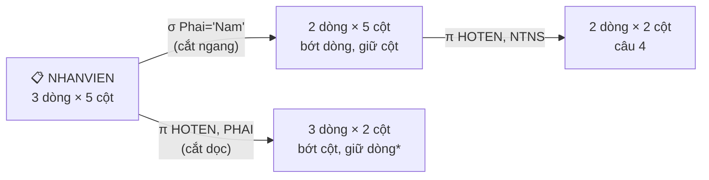

\* Phép chiếu chỉ giữ nguyên số dòng khi không phát sinh bộ trùng (xem cảnh báo bên dưới).

> [!CAUTION]
> **Bẫy đếm dòng sau khi chiếu** (đề hay hỏi "phép chiếu trả về bao nhiêu bộ"): $\pi$ có thể làm **giảm số dòng** vì tự bỏ trùng. Quy tắc kiểm tra nhanh: nếu danh sách cột chiếu **chứa một siêu khóa** thì không bao giờ trùng → số dòng giữ nguyên; nếu chỉ chứa thuộc tính không khóa thì phải tự soi dữ liệu. Vd $\pi_{PHONG}(NHANVIEN) = \{NC, DH\}$ chỉ còn **2 dòng** dù bảng gốc có 3.

### Phép tích Descartes và phép kết

#### Tích Descartes (Cartesian product, $\times$)

Cho $R$ là quan hệ xác định trên tập thuộc tính $\{A_1, A_2, \ldots, A_n\}$ và $S$ trên $\{B_1, B_2, \ldots, B_m\}$. **Tích Descartes** của $R$ và $S$ là tập các bộ $(n+m)$ thành phần - $n$ thành phần đầu là một bộ thuộc $R$, $m$ thành phần sau là một bộ thuộc $S$:

$$R \times S = \{t : t \text{ có dạng } (a_1, a_2, \ldots, a_n, b_1, b_2, \ldots, b_m)\}, \quad (a_1, \ldots, a_n) \in r,\ (b_1, \ldots, b_m) \in s$$

- **Bậc** kết quả $= n + m$ (cộng cột).
- **Số bộ** kết quả $= |r| \times |s|$ (nhân dòng - mọi dòng của $R$ ghép với mọi dòng của $S$).

**Ví dụ - Câu 5:** Tính tích Descartes giữa 2 quan hệ nhân viên và phòng ban: $NHANVIEN \times PHONGBAN$ → $3 \times 2 = 6$ dòng, $5 + 3 = 8$ cột.

| MANV | HOTEN | NTNS | PHAI | PHONG | MAPH | TENPH | TRPH |
|---|---|---|---|---|---|---|---|
| NV001 | Nguyễn Tấn Đạt | 10/12/1970 | Nam | NC | NC | Nghiên cứu | NV001 |
| NV001 | Nguyễn Tấn Đạt | 10/12/1970 | Nam | NC | DH | Điều hành | NV002 |
| NV002 | Trần Đông Anh | 01/08/1981 | Nữ | DH | NC | Nghiên cứu | NV001 |
| NV002 | Trần Đông Anh | 01/08/1981 | Nữ | DH | DH | Điều hành | NV002 |
| NV003 | Lý Phước Mẫn | 02/04/1969 | Nam | NC | NC | Nghiên cứu | NV001 |
| NV003 | Lý Phước Mẫn | 02/04/1969 | Nam | NC | DH | Điều hành | NV002 |

> [!WARNING]
> Tích Descartes ghép **mọi cặp dòng có thể**, kể cả vô nghĩa: trong bảng trên mỗi nhân viên "thuộc" cả 2 phòng - trái với ràng buộc khóa ngoại (mỗi NV chỉ thuộc 1 phòng). Kích thước cũng bùng nổ: 1000 NV $\times$ 10 phòng = 10.000 dòng. Vì vậy tích Descartes **gần như không bao giờ dùng một mình** - nó luôn đi kèm một phép chọn để giữ lại các cặp khớp đúng. Tổ hợp "tích Descartes + chọn" đó chính là phép kết.

> [!TIP]
> Tính nhanh kích thước tích Descartes (hay gặp trong đề): **bậc cộng - dòng nhân** - $\text{bậc}(R \times S) = n + m$ cột, $|R \times S| = |r| \cdot |s|$ dòng. Kiểm chứng ngay ở câu 5: $5 + 3 = 8$ cột, $3 \times 2 = 6$ dòng.
>
> Trong SQL, viết `FROM R, S` mà **quên** điều kiện ghép trong `WHERE`/`ON` là bug kinh điển tạo tích Descartes ngầm - kết quả bất ngờ phình hàng nghìn lần, thường chỉ phát hiện khi thấy truy vấn chạy ì ạch.

#### Phép kết (Join, $\bowtie$)

Phép kết hai quan hệ $R$ và $S$ là **ghép các bộ của hai quan hệ thỏa một điều kiện** - gọi là **điều kiện kết nối** (join condition, ký hiệu $\theta$):

$$R \bowtie_\theta S = \sigma_\theta(R \times S)$$

- $\theta$ là **phép hội** các toán hạng, mỗi toán hạng là **phép so sánh đơn giản giữa một thuộc tính của $R$ và một thuộc tính của $S$**.
- $\theta$ có thể là $\neq, =, >, <, \geq, \leq$ → gọi chung là **$\theta$-kết** (theta-join).
- Khi $\theta$ chỉ gồm phép so sánh $=$ → gọi là **kết bằng** (equi-join).

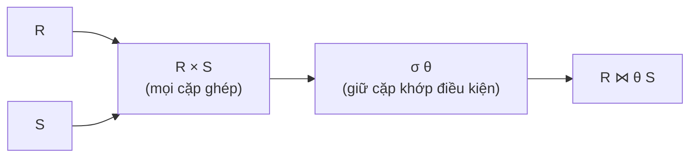

**Ví dụ - Câu 6:** Cho biết mã nhân viên, họ tên và tên phòng mà nhân viên trực thuộc?

- Cách 1: $\pi_{MANV,\ HOTEN,\ TENPH}\big(NHANVIEN \bowtie_{PHONG=MAPH} PHONGBAN\big)$
- Cách 2: $(NHANVIEN \times PHONGBAN : NHANVIEN.PHONG = PHONGBAN.MAPH)[MANV, HOTEN, TENPH]$

Kết quả (từ 6 dòng tích Descartes chỉ giữ 3 dòng khớp `PHONG = MAPH`):

| MANV | HOTEN | TENPH |
|---|---|---|
| NV001 | Nguyễn Tấn Đạt | Nghiên cứu |
| NV002 | Trần Đông Anh | Điều hành |
| NV003 | Lý Phước Mẫn | Nghiên cứu |

> [!NOTE]
> Quay lại bảng tích Descartes ở câu 5: điều kiện $PHONG = MAPH$ chính là **khóa ngoại khớp khóa chính** (buổi 2) - nó loại đi các cặp sai (vd NV001 ghép với phòng DH), chỉ giữ 3 cặp đúng. Đây là lý do join "biết" cách ghép bảng: nó đi theo đường tham chiếu giữa khóa ngoại và khóa chính.
>
> Trong thực tế, join chính là "VLOOKUP ghép bảng theo mã" - khớp `PHONG` của nhân viên với `MAPH` của phòng ban để lấy thêm `TENPH`.

> [!TIP]
> **Sanity check kích thước join** - chiêu tự kiểm tra bài rất đáng nhớ: khi kết trên **khóa ngoại → khóa chính**, mỗi bộ bên khóa ngoại khớp **tối đa 1** bộ bên khóa chính (khóa chính duy nhất) → $|R \bowtie S| \leq |R|$. Vd $NHANVIEN \bowtie PHONGBAN$ ra đúng 3 dòng; nếu bạn tính ra 5-6 dòng thì chắc chắn **sai điều kiện kết**. Join không qua khóa (điều kiện $>, <, \neq$...) thì có thể phình tới $|r| \cdot |s|$ như tích Descartes.

#### Kết bằng (equi-join) và kết tự nhiên (natural join)

- **Kết bằng** (equi-join): $\theta$-kết với điều kiện chỉ gồm phép $=$, vd $NHANVIEN \bowtie_{PHONG=MAPH} PHONGBAN$ - kết quả vẫn chứa **cả 2 cột** `PHONG` và `MAPH` (hơi thừa vì luôn bằng nhau).
- **Kết tự nhiên** (natural join): kết bằng trên các thuộc tính **cùng tên**, sau đó **bỏ đi 1 cột trùng**. Ký hiệu $NHANVIEN \bowtie PHONGBAN$ (không ghi điều kiện) hoặc $NHANVIEN * PHONGBAN$.

Trong ví dụ trên, nếu đổi tên cột `PHONG` của NHANVIEN thành `MAPH` thì hai quan hệ có thuộc tính chung `MAPH` → natural join tự ghép theo `MAPH` và kết quả chỉ còn **1 cột** `MAPH`.

> [!WARNING]
> Natural join "tiện nhưng nguy hiểm": nó tự ghép **mọi cặp cột trùng tên**, kể cả cột cùng tên mà khác nghĩa (vd cả 2 bảng đều có cột `GHI_CHU` hoặc `NGAY_TAO`). Thực tế nên viết kết bằng với điều kiện tường minh (`... ON a.X = b.Y`) thay vì `NATURAL JOIN` trong SQL.

> [!TIP]
> **Expert - self-join với phép đổi tên $\rho$**: nhớ lại `NHANVIEN.MA_NQL → NHANVIEN.MANV` (người quản lý cũng là nhân viên - buổi 2). Muốn in "tên nhân viên kèm tên người quản lý", dùng $\rho$ tạo **bản sao** của quan hệ rồi kết như 2 bảng khác nhau:
>
> $$\pi_{NV.HOTEN,\ QL.HOTEN}\big(\rho_{NV}(NHANVIEN) \bowtie_{NV.\text{MA\_NQL}\,=\,QL.MANV} \rho_{QL}(NHANVIEN)\big)$$
>
> Trong SQL tương đương `... FROM NHANVIEN nv JOIN NHANVIEN ql ON nv.MA_NQL = ql.MANV`. Kỹ thuật $\rho$ đổi tên cũng dùng khi cần natural join mà 2 bên cột khác tên (vd đổi `PHONG` thành `MAPH`). Xem ví dụ chạy trên dữ liệu thật ở mục [các ví dụ trên lược đồ công ty](#cac-vi-du-tren-luoc-do-cong-ty).

**Ví dụ - Câu 7:** Tìm họ tên các trưởng phòng của từng phòng?

$$\pi_{HOTEN,\ TENPH}\big(PHONGBAN \bowtie_{TRPH=MANV} NHANVIEN\big)$$

| HOTEN | TENPH |
|---|---|
| Nguyễn Tấn Đạt | Nghiên cứu |
| Trần Đông Anh | Điều hành |

> [!NOTE]
> Câu 6 và câu 7 cùng nối NHANVIEN với PHONGBAN nhưng **qua 2 đường khóa ngoại khác nhau**: câu 6 đi `NHANVIEN.PHONG → PHONGBAN.MAPH` (nhân viên **thuộc** phòng nào), câu 7 đi `PHONGBAN.TRPH → NHANVIEN.MANV` (phòng do ai **làm trưởng**). Cùng 2 bảng nhưng điều kiện kết khác thì ý nghĩa kết quả khác hẳn - luôn hỏi "mình đang đi theo mối quan hệ nào?" trước khi viết $\theta$.

**Ví dụ - Câu 8:** Cho lược đồ CSDL:

```
TAIXE(MaTX, HoTen, NgaySinh, GioiTinh, DiaChi)
CHUYENDI(SoCD, MaXe, MaTX, NgayDi, NgayVe, ChieuDai, SoNguoi)
```

Cho biết họ tên tài xế, ngày đi, ngày về của những chuyến đi có chiều dài $\geq 300$ km, chở từ 12 người trở lên trong mỗi chuyến?

- Cách 1:
  - Bước 1: $Q \leftarrow \sigma_{ChieuDai \geq 300\ \wedge\ SoNguoi \geq 12}(CHUYENDI)$
  - Bước 2: $\pi_{HoTen,\ NgayDi,\ NgayVe}(Q \bowtie_{MaTX} TAIXE)$
- Cách 2: $\big((CHUYENDI : ChieuDai \geq 300 \wedge SoNguoi \geq 12) \bowtie_{MaTX} TAIXE\big)[HoTen, NgayDi, NgayVe]$

> [!TIP]
> Mẹo làm bài dạng này: (1) xác định dữ liệu nằm ở **những quan hệ nào** → ở đây tên tài xế ở TAIXE, ngày đi/về + điều kiện ở CHUYENDI → phải **kết**; (2) tìm **cặp cột nối** - thường là khóa ngoại ↔ khóa chính cùng ngữ nghĩa (`MaTX`); (3) lọc dòng bằng $\sigma$; (4) chiếu cột đầu ra bằng $\pi$ cuối cùng.
>
> Kỹ thuật "đặt tên kết quả trung gian" (bước 1 gán vào $Q$) giúp biểu thức dài dễ đọc hơn rất nhiều - tương đương biến tạm / CTE trong SQL.

Biểu thức câu 8 có thể vẽ thành **cây truy vấn** (query tree) - lá là các bảng gốc, nút trong là phép toán, dữ liệu chảy từ dưới lên:

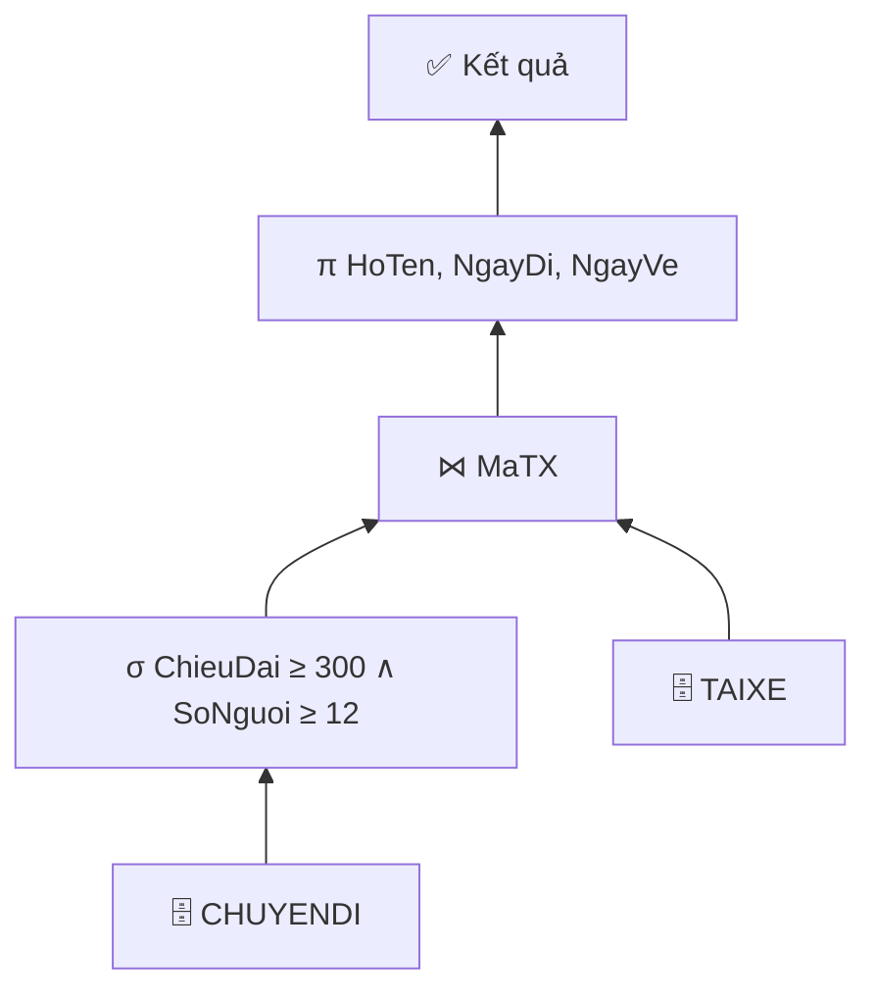

> [!TIP]
> Vẽ cây truy vấn ra nháp là cách nhanh nhất để **kiểm tra biểu thức lồng nhiều tầng**: mỗi nút phải nhận đầu vào có đủ cột nó cần (vd $\pi$ trên cùng cần `HoTen` từ TAIXE và `NgayDi`, `NgayVe` từ CHUYENDI → phép kết bên dưới phải mang đủ các cột này lên).

#### Phép kết ngoài (Outer join)

Phép kết thường (inner join) **làm mất** các bộ không khớp được bên kia. **Kết ngoài** mở rộng phép kết để tránh mất thông tin: kết xong, **thêm vào kết quả** các bộ của quan hệ không phù hợp với bộ nào trong quan hệ kia, phần thuộc tính thiếu điền `null`.

Có 3 loại:

| Loại | Ký hiệu | Giữ lại các bộ |
|---|---|---|
| Left outer join | $R$ ⟕ $S$ | của quan hệ **trái** |
| Right outer join | $R$ ⟖ $S$ | của quan hệ **phải** |
| Full outer join | $R$ ⟗ $S$ | của **cả hai** quan hệ |

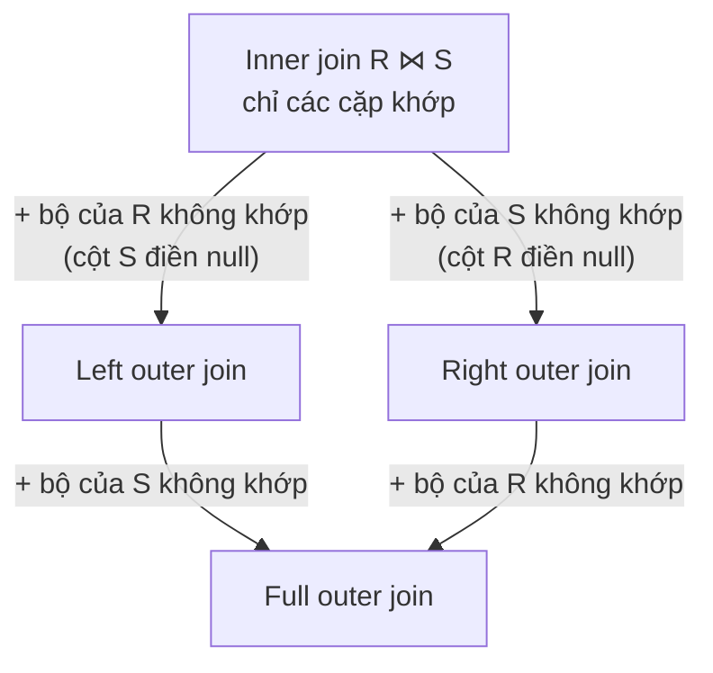

Quan hệ kích thước: $|R \bowtie S| \leq |R$ ⟕ $S| \leq |R$ ⟗ $S|$ - kết ngoài **không bao giờ ít dòng hơn** kết trong.

**Ví dụ:** In ra danh sách tất cả tài xế và số chuyến đi, mã xe mà tài xế đó lái (nếu có) → $TAIXE$ ⟕ $CHUYENDI$ theo `MaTX`:

| MaTX | Hoten | SoCD | MaTX | MaXe |
|---|---|---|---|---|
| TX01 | Huynh Trong Tao | CD01 | TX01 | 8659 |
| TX01 | Huynh Trong Tao | CD03 | TX01 | 8659 |
| TX02 | Nguyen Sang | CD02 | TX02 | 7715 |
| TX03 | Le Phuoc Long | CD04 | TX03 | 4573 |
| TX04 | Nguyen Anh Tuan | *null* | *null* | *null* |

Bộ `TX04` của TAIXE được thêm vào dù không khớp bộ nào của CHUYENDI - tài xế mới vào chưa chạy chuyến nào vẫn xuất hiện trong danh sách.

> [!TIP]
> Từ khóa nhận diện outer join trong đề: *"tất cả X, kể cả X không có/chưa có Y"*, *"danh sách ... (nếu có)"*. Inner join sẽ làm rơi mất các dòng "chưa có gì" đó - thường là mất điểm.
>
> Mẹo nhớ chiều: **left giữ trái, right giữ phải, full giữ cả hai** - "trái/phải" tính theo vị trí viết của quan hệ trong biểu thức.

> [!TIP]
> **Expert - anti-join bằng kết ngoài**: muốn tìm "tài xế **không có** chuyến đi nào" mà không dùng phép trừ, làm $T \leftarrow TAIXE$ ⟕ $CHUYENDI$ rồi $\sigma_{SoCD\ IS\ null}(T)$ - các bộ có `null` ở phần cột bên phải chính là các bộ không khớp được ai. Trong SQL đây là mẫu `LEFT JOIN ... WHERE col IS NULL`, rất hay dùng khi HQTCSDL không có `EXCEPT` (vd MySQL cũ). Kết quả tương đương $\pi_{MaTX}(TAIXE) - \pi_{MaTX}(CHUYENDI)$.

**Ví dụ thực tế - sinh viên và lớp học:** cùng một dữ liệu nhỏ, ba loại join trả lời ba câu hỏi khác nhau.

SINHVIEN

| MASV | TEN | MALOP |
|---|---|---|
| SV1 | An | L1 |
| SV2 | Bình | L1 |
| SV3 | Chi | L3 |
| SV4 | Dũng | *null* |

LOPHOC

| MALOP | TENLOP |
|---|---|
| L1 | Toán |
| L2 | Lý |
| L3 | Hóa |

Để ý 2 dữ kiện "lẻ loi": **SV4 - Dũng chưa được xếp lớp** (`MALOP = null`), và **lớp L2 - Lý chưa có sinh viên nào**. Inner join $SINHVIEN \bowtie LOPHOC$ chỉ ra 3 dòng khớp (SV1, SV2, SV3) - cả Dũng lẫn lớp Lý đều "biến mất". Ba loại kết ngoài dưới đây giữ lại các dòng lẻ loi đó theo cách khác nhau.

**a) Left join** - *"Danh sách **tất cả sinh viên**, kèm tên lớp (nếu đã xếp)"* → $SINHVIEN$ ⟕ $LOPHOC$ theo `MALOP`:

| MASV | TEN | MALOP | TENLOP |
|---|---|---|---|
| SV1 | An | L1 | Toán |
| SV2 | Bình | L1 | Toán |
| SV3 | Chi | L3 | Hóa |
| SV4 | Dũng | *null* | *null* |

Dũng vẫn xuất hiện dù chưa có lớp - cột bên LOPHOC điền `null`. Đây là câu truy vấn hay dùng nhất thực tế: bắt đầu từ **danh sách chính** (toàn bộ sinh viên / toàn bộ khách hàng / toàn bộ nhân viên) rồi "đính kèm" thông tin phụ. Phòng đào tạo nhìn cột `TENLOP = null` là biết ngay ai chưa xếp lớp.

**b) Right join** - *"Danh sách **tất cả lớp**, kèm sinh viên (kể cả lớp trống)"* → $SINHVIEN$ ⟖ $LOPHOC$ theo `MALOP`:

| MASV | TEN | MALOP | TENLOP |
|---|---|---|---|
| SV1 | An | L1 | Toán |
| SV2 | Bình | L1 | Toán |
| SV3 | Chi | L3 | Hóa |
| *null* | *null* | L2 | Lý |

Lần này lớp Lý được giữ lại dù không có ai đăng ký - cột bên SINHVIEN điền `null`. Đúng bài toán "tìm lớp vắng" để cân nhắc hủy lớp hoặc mở thêm đợt tuyển sinh.

**c) Full join** - *"Đối soát hai bảng: ai chưa có lớp **và** lớp nào còn trống"* → $SINHVIEN$ ⟗ $LOPHOC$ theo `MALOP`:

| MASV | TEN | MALOP | TENLOP |
|---|---|---|---|
| SV1 | An | L1 | Toán |
| SV2 | Bình | L1 | Toán |
| SV3 | Chi | L3 | Hóa |
| SV4 | Dũng | *null* | *null* |
| *null* | *null* | L2 | Lý |

Full join = left join + right join - cả hai phía "mồ côi" đều hiện trong một bảng. Thực tế dùng khi **đối chiếu dữ liệu giữa 2 hệ thống** (vd danh sách khách ở 2 phần mềm khác nhau, dữ liệu trước/sau migrate): dòng nào có `null` ở một phía là dòng chỉ tồn tại ở hệ thống kia.

Tóm tắt theo câu hỏi nghiệp vụ:

| Câu hỏi thực tế | Join phù hợp |
|---|---|
| Tất cả sinh viên, kèm lớp nếu có | $SINHVIEN$ ⟕ $LOPHOC$ |
| Tất cả lớp, kèm sinh viên nếu có | $SINHVIEN$ ⟖ $LOPHOC$ |
| Ai chưa có lớp + lớp nào trống | $SINHVIEN$ ⟗ $LOPHOC$ |

> [!TIP]
> Trong thực tế `LEFT JOIN` chiếm tuyệt đại đa số vì truy vấn thường đi từ "danh sách chính". `RIGHT JOIN` chỉ là `LEFT JOIN` viết ngược thứ tự bảng - $SINHVIEN$ ⟖ $LOPHOC$ cho kết quả y hệt $LOPHOC$ ⟕ $SINHVIEN$ - nên nhiều người chỉ dùng left cho nhất quán. `FULL JOIN` ít gặp hơn, chủ yếu phục vụ đối soát/kiểm toán dữ liệu (lưu ý MySQL **không hỗ trợ** `FULL OUTER JOIN`, phải `UNION` 2 nhánh left/right).
>
> Cách hình dung: hai bảng là 2 danh sách cần "ghép đôi". Inner join chỉ giữ các cặp ghép được; outer join quyết định **phía nào được bảo lưu** khi không có bạn đôi - bên được giữ xuất hiện trọn vẹn, phía thiếu điền `null`.

### Phép trừ, phép hợp, phép giao

#### Tương thích khả hợp (Union-compatible)

$R$ là quan hệ trên $\{A_1, A_2, \ldots, A_n\}$, $S$ trên $\{B_1, B_2, \ldots, B_m\}$. Hai lược đồ $R$ và $S$ là **tương thích khả hợp** nếu:

- **Cùng bậc** ($n = m$), và
- $DOM(A_i) = DOM(B_i)$ với mọi $1 \leq i \leq n$.

**Tất cả** các phép toán trừ/hợp/giao đều cần hai quan hệ đầu vào tương thích khả hợp, nghĩa là phải thỏa: **cùng số thuộc tính** và **các thuộc tính tương ứng có cùng kiểu dữ liệu, cùng miền giá trị**.

> [!NOTE]
> "Khả hợp" chỉ đòi cùng **số cột** và cùng **miền giá trị** ở vị trí tương ứng - **không** đòi trùng tên cột. Vì vậy trước khi trừ/hợp/giao 2 quan hệ khác lược đồ, phải dùng $\pi$ chiếu về cùng một tập cột trước (xem câu 9-11 bên dưới). Trong SQL, `UNION`/`EXCEPT`/`INTERSECT` cũng yêu cầu 2 vế `SELECT` cùng số cột, kiểu tương thích - y hệt.

#### Định nghĩa 3 phép toán

- **Phép trừ** (difference): $Q = R - S = \{t \mid t \in R \wedge t \notin S\}$
- **Phép hợp** (union): $Q = R \cup S = \{t \mid t \in R \vee t \in S\}$
- **Phép giao** (intersection): $Q = R \cap S = R - (R - S) = \{t \mid t \in R \wedge t \in S\}$

Giản đồ Venn của 2 tập hợp $R$, $S$ luôn chia mặt phẳng thành **đúng 3 vùng**: chỉ R, phần chung $R \cap S$, chỉ S. Mỗi phép toán thực chất là **chọn một số vùng** (✅ = lấy vào kết quả, ❌ = loại):

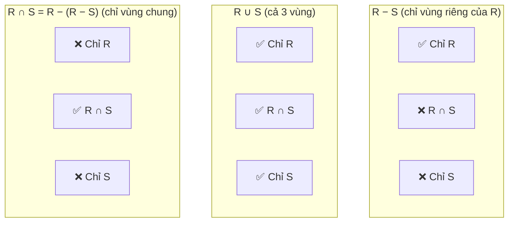

Mẹo nhớ theo vùng: **trừ** giữ phần riêng của vế trái, **hợp** lấy hết, **giao** chỉ lấy phần chung.

Ví dụ với $R = \{\text{Hồng Lam}, \text{Nguyễn Tùng}\}$ và $S = \{\text{Lê Loan}, \text{Hồng Lam}, \text{Quân Vũ}\}$:

| Phép | Kết quả |
|---|---|
| $R - S$ | $\{\text{Nguyễn Tùng}\}$ |
| $R \cup S$ | $\{\text{Hồng Lam}, \text{Nguyễn Tùng}, \text{Lê Loan}, \text{Quân Vũ}\}$ |
| $R \cap S$ | $\{\text{Hồng Lam}\}$ |

> [!NOTE]
> - Phép **hợp** và **giao** có tính **giao hoán**; phép **trừ không giao hoán** ($R - S \neq S - R$ - giống trừ số học).
> - Giao là **phép suy dẫn**: $R \cap S = R - (R - S)$. Đọc hiểu: "lấy $R$, bỏ đi phần của $R$ không nằm trong $S$ → còn lại phần nằm trong $S$".
> - Ví dụ thực tế: $R$ = khách đặt hàng tháng này, $S$ = khách tháng trước → $R - S$ = khách **mới**; $R \cap S$ = khách **quay lại**; $R \cup S$ = tổng khách 2 tháng.

> [!TIP]
> Checklist 3 giây trước khi viết $-$, $\cup$, $\cap$: (1) hai vế **cùng số cột** chưa? (2) cột tương ứng **cùng miền** chưa? (3) với phép trừ, **đúng chiều** chưa - "A không có B" viết là $A - B$ chứ không phải $B - A$?
>
> Ba phép này còn có tính **lũy đẳng** (idempotent) hay dùng để rút gọn: $R \cup R = R$, $R \cap R = R$, $R - R = \varnothing$. Trong SQL: `UNION`/`EXCEPT`/`INTERSECT` mặc định **bỏ trùng** (đúng ngữ nghĩa tập hợp); muốn giữ trùng phải ghi `UNION ALL`.

#### Các ví dụ trên lược đồ công ty

```
NHANVIEN(MANV, HOTEN, NTNS, PHAI, MA_NQL, MAPH, LUONG)
PHONGBAN(MAPH, TENPH, TRPH)
DEAN(MADA, TENDA, PHONG, NamThucHien)
PHANCONG(MANV, MADA, THOIGIAN)
```

Dữ liệu (slide 29):

NHANVIEN

| MANV | HOTEN | NTNS | PHAI | MA_NQL | MAPH | LUONG |
|---|---|---|---|---|---|---|
| 001 | Vuong Ngoc Quyen | 22/10/1957 | Nu | *null* | QL | 3.000.000 |
| 002 | Nguyen Thanh Tung | 09/01/1955 | Nam | 001 | NC | 2.500.000 |
| 003 | Le Thi Nhan | 18/12/1960 | Nu | 001 | DH | 2.500.000 |
| 004 | Dinh Ba Tien | 09/01/1968 | Nam | 002 | NC | 2.200.000 |
| 005 | Bui Thuy Vu | 19/07/1972 | Nam | 003 | DH | 2.200.000 |
| 006 | Nguyen Manh Hung | 15/09/1973 | Nam | 002 | NC | 2.000.000 |
| 007 | Tran Thanh Tam | 31/07/1975 | Nu | 002 | NC | 2.200.000 |
| 008 | Tran Hong Minh | 04/07/1976 | Nu | 004 | NC | 1.800.000 |

PHONGBAN

| MAPH | TENPH | TRPH |
|---|---|---|
| QL | Quan Ly | 001 |
| DH | Dieu Hanh | 003 |
| NC | Nghien Cuu | 002 |

DEAN

| MADA | TENDA | PHONG | NamThucHien |
|---|---|---|---|
| TH001 | Tin hoc hoa 1 | NC | 2002 |
| TH002 | Tin hoc hoa 2 | NC | 2003 |
| DT001 | Dao tao 1 | DH | 2004 |
| DT002 | Dao tao 2 | DH | 2004 |

PHANCONG

| MANV | MADA | THOIGIAN |
|---|---|---|
| 001 | TH001 | 30,0 |
| 001 | TH002 | 12,5 |
| 002 | TH001 | 10,0 |
| 002 | TH002 | 10,0 |
| 002 | DT001 | 10,0 |
| 002 | DT002 | 10,0 |
| 003 | TH001 | 37,5 |
| 004 | DT001 | 22,5 |
| 004 | DT002 | 10,0 |
| 006 | DT001 | 30,5 |
| 007 | TH001 | 20,0 |
| 007 | TH002 | 10,0 |
| 008 | DT002 | 12,5 |

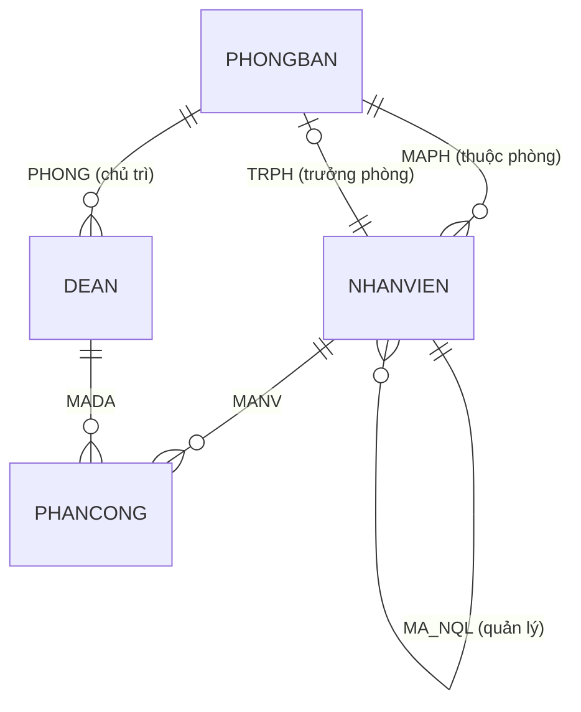

> [!TIP]
> Trước khi giải bất kỳ câu ĐSQH nào, hãy **vẽ (hoặc nhìn) sơ đồ khóa ngoại** như trên: mỗi đường nối là một điều kiện kết có thể dùng. Câu hỏi đụng tới 2 bảng không nối trực tiếp (vd NHANVIEN và DEAN) thì phải **đi vòng qua bảng trung gian** PHANCONG - kết 3 bảng.

**Câu 9:** Cho biết nhân viên **không** làm việc? (phép trừ)

- Cách 1: $\pi_{MANV}(NHANVIEN) - \pi_{MANV}(PHANCONG)$
- Cách 2: $NHANVIEN[MANV] - PHANCONG[MANV]$

Kết quả: $\{001, \ldots, 008\} - \{001, 002, 003, 004, 006, 007, 008\} = \{005\}$ - chỉ **Bui Thuy Vu** chưa được phân công đề án nào.

> [!TIP]
> Mẫu "lấy X **không** làm Y" luôn theo khuôn: $\pi_{\text{khóa}}(\text{tập đầy đủ}) - \pi_{\text{khóa}}(\text{tập đang làm})$. Vế trái phải là **toàn bộ ứng viên** (mọi nhân viên), vế phải là tập đang làm việc đó. Đừng viết ngược! Trong SQL tương đương `MANV NOT IN (SELECT MANV FROM PHANCONG)`.

> [!NOTE]
> Slide ghi mã đề án là `'TH01'`, `'TH02'` nhưng dữ liệu bảng DEAN là `TH001`, `TH002` - ghi chú này dùng đúng mã trong dữ liệu để tính ra kết quả.

**Câu 10:** Cho biết nhân viên được phân công tham gia đề án 'TH001' **hoặc** đề án 'TH002'? (phép hợp)

$$\pi_{MANV}\big(\sigma_{MADA='TH001'}(PHANCONG)\big) \cup \pi_{MANV}\big(\sigma_{MADA='TH002'}(PHANCONG)\big)$$

Hai tập thành phần: TH001 → $\{001, 002, 003, 007\}$, TH002 → $\{001, 002, 007\}$. Kết quả hợp: $\{001, 002, 003, 007\}$.

**Câu 11:** Cho biết nhân viên được phân công tham gia **cả 2** đề án 'TH001' **và** 'TH002'? (phép giao)

$$\pi_{MANV}\big(\sigma_{MADA='TH001'}(PHANCONG)\big) \cap \pi_{MANV}\big(\sigma_{MADA='TH002'}(PHANCONG)\big)$$

Kết quả giao: $\{001, 002, 007\}$ (NV003 chỉ làm TH001 nên bị loại).

> [!CAUTION]
> **Bẫy kinh điển giữa câu 10 và câu 11**: với câu 11, **không được** viết $\sigma_{MADA='TH001' \wedge MADA='TH002'}(PHANCONG)$ - một bộ chỉ có **một** giá trị `MADA` nên điều kiện này **luôn sai**, kết quả rỗng. "Cả A và B" ở đây là 2 dòng khác nhau của PHANCONG → bắt buộc tách thành 2 tập rồi **giao**. Ngược lại, "hoặc" trong câu 10 viết được gọn bằng $\vee$ trong 1 phép chọn (vì 1 dòng thỏa 1 trong 2 điều kiện là đủ).
>
> Quy tắc tay: **"hoặc" → $\vee$ hoặc $\cup$; "cả A và B" (mỗi cái một dòng) → $\cap$; "không/ngoại trừ" → $-$**.

**Câu thêm (self-join):** Cho biết họ tên nhân viên và họ tên người quản lý trực tiếp?

$$\pi_{NV.HOTEN,\ QL.HOTEN}\big(\rho_{NV}(NHANVIEN) \bowtie_{NV.\text{MA\_NQL}\,=\,QL.MANV} \rho_{QL}(NHANVIEN)\big)$$

| NV.HOTEN | QL.HOTEN |
|---|---|
| Nguyen Thanh Tung | Vuong Ngoc Quyen |
| Le Thi Nhan | Vuong Ngoc Quyen |
| Dinh Ba Tien | Nguyen Thanh Tung |
| Bui Thuy Vu | Le Thi Nhan |
| Nguyen Manh Hung | Nguyen Thanh Tung |
| Tran Thanh Tam | Nguyen Thanh Tung |
| Tran Hong Minh | Dinh Ba Tien |

> [!WARNING]
> Kết quả chỉ có **7 dòng**, mất **Vuong Ngoc Quyen** (001) vì `MA_NQL = null` - `null` không bằng bất kỳ giá trị nào nên không khớp được ai. Nếu đề yêu cầu "**tất cả** nhân viên kèm người quản lý (nếu có)" thì phải dùng **left outer join** để giữ lại bộ 001 với `QL.HOTEN = null`. Đây là ví dụ rất điển hình cho việc chọn sai inner/outer join.

### Phép chia (Division, $\div$)

Cho $R$ và $S$ là hai quan hệ, $R^+$ và $S^+$ lần lượt là tập thuộc tính của $R$ và $S$. Điều kiện: $S^+ \neq \varnothing$ là **tập con không bằng** của $R^+$ ($S^+ \subsetneq R^+$).

$Q$ là kết quả phép chia giữa $R$ và $S$, với $Q^+ = R^+ - S^+$:

$$Q = R \div S = \{t : \forall s \in S,\ (t, s) \in R\}$$

Đọc: kết quả gồm các bộ $t$ (trên các thuộc tính còn lại của $R$) sao cho **với mọi** bộ $s$ trong $S$, cặp $(t, s)$ đều có mặt trong $R$.

Công thức triển khai bằng các phép cơ bản (với $Y = R^+ - S^+$):

$$R \div S = \pi_Y(R) - \pi_Y\Big(\big(\pi_Y(R) \times S\big) - R\Big)$$

**Ví dụ:** Cho biết nhân viên làm việc cho **tất cả** các đề án? → $Q = PHANCONG \div DEAN$

PHANCONG ($R$)

| MANV | MADA |
|---|---|
| 001 | TH001 |
| 001 | TH002 |
| 002 | TH001 |
| 002 | TH002 |
| 002 | DT001 |
| 003 | TH001 |

DEAN ($S$)

| MADA |
|---|
| TH001 |
| TH002 |
| DT001 |

Kết quả $Q$: $\{002\}$ - chỉ nhân viên 002 ghép với **cả 3** đề án trong DEAN.

> [!NOTE]
> **Trace tay phép chia** - nên tự làm 1 lần để thấm bản chất:
>
> 1. $T_1 = \pi_{MANV}(PHANCONG) = \{001, 002, 003\}$ - tập ứng viên.
> 2. $T_1 \times DEAN$ = 9 cặp "lẽ ra phải có": $(001, TH001), (001, TH002), (001, DT001), (002, TH001), \ldots$
> 3. $(T_1 \times DEAN) - PHANCONG$ = các cặp **bị thiếu** trong thực tế: $\{(001, DT001), (003, TH002), (003, DT001)\}$.
> 4. $\pi_{MANV}$ của tập thiếu $= \{001, 003\}$ → các ứng viên **khuyết** đề án.
> 5. $T_1 - \{001, 003\} = \{002\}$ → đáp án.
>
> Kiểm tra ngược nhanh: mỗi ứng viên trong đáp án phải có số đề án tham gia **bằng đúng** $|DEAN| = 3$. NV002 có đủ 3, NV001 chỉ có 2, NV003 chỉ có 1.

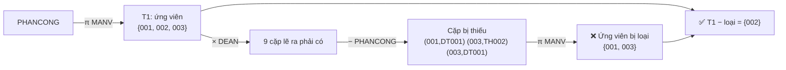

> [!TIP]
> **Trực giác của công thức 2 bước** (rất hay gặp khi phải tự triển khai phép chia):
>
> 1. $T_1 = \pi_Y(R)$ - **tập ứng viên** (mọi MANV có phân công).
> 2. $T_1 \times S$ - mọi cặp "lẽ ra phải có" (ứng viên $\times$ đề án). Trừ $R$ → các cặp **bị thiếu** trong thực tế. Chiếu $Y$ → danh sách **ứng viên thiếu sót**. $T_1$ trừ danh sách đó → còn ứng viên **đủ mặt ở mọi** cặp.
>
> Nói nôm na: "ứng viên nào ghép với $S$ mà phát sinh dòng không có trong $R$ thì bị loại; ai không thiếu dòng nào thì được nhận".

**Ví dụ 2:** trên quan hệ KETQUATHI và MONHOC, tìm học viên thi **tất cả** các môn → $KETQUATHI[Mahv, MaMH] \div MONHOC[MaMH]$ cho ra $\{HV01, HV03\}$ (HV02 chỉ thi CSDL và THDC, thiếu CTRR).

> [!WARNING]
> Phải **chiếu bỏ cột `Diem`** trước khi chia: nếu chia thẳng $KETQUATHI \div MONHOC[MaMH]$ thì $Y = \{Mahv, Diem\}$, mỗi ứng viên là cặp (học viên, điểm) - vd (HV01, 7.0) chỉ khớp CSDL và THDC → bị loại, kết quả sai hoàn toàn. Quy tắc: **bị chia chỉ được giữ đúng cột kết quả + cột của số chia**.

**Ví dụ 3:** trên dữ liệu công ty đầy đủ (4 đề án), nhân viên tham gia **tất cả** đề án: $PHANCONG[MANV, MADA] \div DEAN[MADA] = \{002\}$ - Nguyen Thanh Tung là người duy nhất có đủ TH001, TH002, DT001, DT002.

> [!TIP]
> - Từ khóa nhận diện phép chia trong đề: **"tất cả"**, **"mọi"**, **"với mọi"** ("nhân viên làm **tất cả** đề án", "khách mua **mọi** loại sản phẩm"). Ngược lại "ít nhất một" thường chỉ cần $\sigma$ + $\bowtie$.
> - Trước khi chia, kiểm tra điều kiện $S^+ \subsetneq R^+$: quan hệ bị chia phải chứa đủ cột của quan hệ chia + ít nhất 1 cột thừa (cột thừa đó chính là $Y$ - cột kết quả).
> - SQL **không có** toán tử chia - đây là câu truy vấn "khó nhất" để dịch sang SQL, thường viết bằng `NOT EXISTS` lồng 2 tầng hoặc `GROUP BY ... HAVING COUNT(DISTINCT ...) = số phần tử của S`.

#### Ứng dụng thực tế của phép chia

Phép chia là phép **duy nhất** trong ĐSQH thể hiện được lượng tử "với mọi" ($\forall$) - các phép khác chỉ diễn tả được "tồn tại ít nhất một". Mọi truy vấn nghiệp vụ dạng "**thỏa đủ hết một tập điều kiện**" đều là phép chia ngầm.

Mẫu chung: $R$ = quan hệ "ai - làm/nhận gì", $S$ = tập điều kiện phải thỏa **đủ hết**:

| Bài toán | $R$ (bị chia) | $S$ (số chia) | Kết quả |
|---|---|---|---|
| Xét tốt nghiệp | SINHVIEN_HOCTAP(MaSV, MaMon) | MONBATBUOC(MaMon) | SV học **đủ** mọi môn bắt buộc |
| Tuyển dụng | UNGVIEN_KYNANG(MaUV, KyNang) | KYNANG_YEUCAU(KyNang) | Ứng viên có **đủ** mọi kỹ năng job cần |
| Phân tích bán hàng | DONHANG(MaKH, MaSP) | SANPHAM_HOT(MaSP) | Khách đã mua **tất cả** sản phẩm hot |
| Phủ sóng chi nhánh | BANHANG(MaSP, MaCN) | CHINHANH(MaCN) | Sản phẩm bán được ở **mọi** chi nhánh |
| Tuân thủ đào tạo | NHANVIEN_TRAINING(MaNV, KhoaHoc) | KHOAHOC_BATBUOC(KhoaHoc) | NV hoàn thành **đủ** mọi khóa bắt buộc |

> [!TIP]
> Nhận dạng bài toán phép chia ngoài đời: có một **danh sách yêu cầu** (môn bắt buộc, kỹ năng job, chi nhánh...) và câu hỏi là "ai/thứ nào đáp ứng **hết** danh sách đó?". Danh sách yêu cầu chính là số chia $S$. Nếu chỉ cần "đáp ứng ít nhất một" thì không phải chia - chỉ cần $\sigma$ + $\bowtie$.

### Gom nhóm dữ liệu và tính toán

**Hàm tính toán** (aggregate functions) gồm 5 hàm: `avg` (trung bình), `min`, `max`, `sum`, `count`.

**Phép gom nhóm** (group by) có dạng:

$${}_{G_1,\ G_2,\ \ldots,\ G_k}\Im_{F_1(A_1),\ F_2(A_2),\ \ldots,\ F_n(A_n)}(E)$$

- $E$: biểu thức ĐSQH hoặc tên của một quan hệ.
- $G_i$: các **thuộc tính gom nhóm**. Nếu không có $G$ nào → **không chia nhóm** (tính trên toàn bảng); ngược lại, các nhóm nhỏ được hình thành dựa trên tập thuộc tính $G_i$ → hàm $F$ tính toán **trên từng nhóm nhỏ**.
- $F_i$: hàm tính toán; $A_i$: tên thuộc tính áp hàm.

> [!NOTE]
> Hình dung như PivotTable trong Excel: kéo một cột làm "nhóm" (GROUP BY), các cột còn lại tính tổng/đếm/trung bình **theo từng nhóm**. Mỗi nhóm sinh ra **đúng 1 dòng** kết quả. Tương đương SQL: `SELECT G, F(A) FROM E GROUP BY G`.

**Ví dụ:** trên quan hệ KETQUATHI:

| Mahv | MaMH | Diem |
|---|---|---|
| HV01 | CSDL | 7.0 |
| HV02 | CSDL | 8.5 |
| HV01 | CTRR | 8.5 |
| HV03 | CTRR | 9.0 |
| HV01 | THDC | 7.0 |
| HV02 | THDC | 5.0 |
| HV03 | THDC | 7.5 |
| HV03 | CSDL | 6.0 |

**Điểm thi cao nhất, thấp nhất, trung bình môn CSDL** (không gom nhóm - tính trên toàn bộ bảng sau khi chọn):

$$\Im_{max(Diem),\ min(Diem),\ avg(Diem)}\big(\sigma_{MaMH='CSDL'}(KETQUATHI)\big)$$

| MAX(Diem) | MIN(Diem) | Avg(Diem) |
|---|---|---|
| 8.5 | 6.0 | 7.16 |

> [!NOTE]
> Trung bình chính xác là $(7.0 + 8.5 + 6.0) / 3 = 7.1\overline{6}$ - slide ghi cắt cụt `7.16`, làm tròn đúng là $7.17$.

**Điểm thi cao nhất, thấp nhất, trung bình của từng môn** (gom nhóm theo `MaMH`):

$${}_{MaMH}\Im_{max(Diem),\ min(Diem),\ avg(Diem)}(KETQUATHI)$$

| MaMH | MAX(Diem) | MIN(Diem) | Avg(Diem) |
|---|---|---|---|
| CSDL | 8.5 | 6.0 | 7.16 |
| CTRR | 9.0 | 8.5 | 8.75 |
| THDC | 7.5 | 5.0 | 6.5 |

Quá trình gom nhóm: chia dòng theo `MaMH`, mỗi nhóm "nén" thành 1 dòng kết quả:

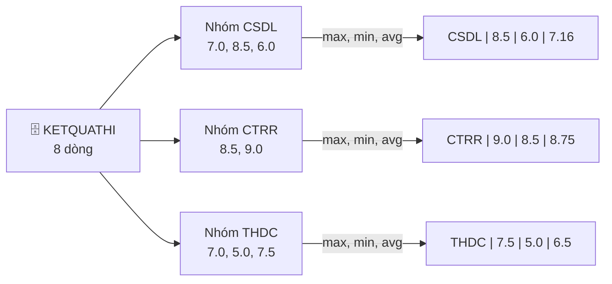

**Ví dụ trên dữ liệu công ty:** với mỗi phòng ban, cho biết số nhân viên và lương trung bình; chỉ lấy các phòng có từ 2 nhân viên trở lên.

- Bước 1: $`Q(MAPH, SoNV, LuongTB) \leftarrow {}_{MAPH}\Im_{count(MANV),\ avg(LUONG)}(NHANVIEN)`$
- Bước 2: $\sigma_{SoNV \geq 2}(Q)$

| MAPH | SoNV | LuongTB |
|---|---|---|
| QL | 1 | 3.000.000 |
| DH | 2 | 2.350.000 |
| NC | 5 | 2.140.000 |

Sau bước 2 chỉ còn **DH** và **NC** (QL bị loại vì có 1 nhân viên).

> [!TIP]
> Bước 1 dùng phép gán có đặt tên cột (`SoNV`, `LuongTB`) - nhờ vậy bước 2 mới viết được điều kiện $SoNV \geq 2$. Đây chính là cặp `GROUP BY MAPH` + `HAVING COUNT(MANV) >= 2` trong SQL. Không thể đưa $SoNV \geq 2$ vào $\sigma$ **trước** gom nhóm vì lúc đó cột `SoNV` chưa tồn tại.

> [!TIP]
> - Từ khóa nhận diện: "của **từng** môn", "**theo** phòng", "**mỗi** nhà cung cấp" → có $G$ gom nhóm; "của cả lớp", "toàn bảng" → không $G$.
> - Cần lọc **sau khi** gom nhóm (vd "phòng có lương TB > 30tr") → áp thêm $\sigma$ bên ngoài $\Im$ - đó chính là `HAVING` trong SQL (khác `WHERE` là lọc **trước** gom nhóm).
> - `count` có 2 dạng trong thực tế: `count(*)` đếm số **dòng**, `count(A)` đếm giá trị **khác null** của cột $A$ - ĐSQH ít phân biệt nhưng sang SQL rất hay sai.
> - Pipeline chuẩn khi phối hợp các phép: $\sigma$ (lọc dòng) → $\Im$ (gom nhóm) → $\sigma$ (lọc nhóm) → $\pi$ (chọn cột ra) - khớp đúng thứ tự SQL `WHERE` → `GROUP BY` → `HAVING` → `SELECT`.

### Góc chuyên sâu: các luật tương đương của biểu thức ĐSQH

Bộ tối ưu truy vấn (query optimizer) viết lại biểu thức ĐSQH nhờ các **luật tương đương** (equivalence rules). Đây cũng là dạng đề "chứng minh 2 biểu thức tương đương" / "biểu thức nào tối ưu hơn":

| Luật | Công thức | Ứng dụng tối ưu |
|---|---|---|
| Tách $\sigma$ (cascade) | $\sigma_{a \wedge b}(R) = \sigma_a\big(\sigma_b(R)\big)$ | tách để đẩy từng điều kiện xuống sâu |
| Giao hoán $\sigma$ | $\sigma_a\big(\sigma_b(R)\big) = \sigma_b\big(\sigma_a(R)\big)$ | điều kiện lọc mạnh đặt trước |
| $\sigma$ qua $\times$ / $\bowtie$ | $\sigma_{\text{đk chỉ trên }R}(R \times S) = \sigma_{\text{đk}}(R) \times S$ | **lọc trước khi join** - giảm bùng nổ dòng |
| $\sigma$ qua $\cup$, $\cap$, $-$ | $\sigma(R \; op \; S) = \sigma(R) \; op \; \sigma(S)$ | lọc sớm cả 2 nhánh |
| Kết hợp $\times$, $\bowtie$ | $(R \times S) \times T = R \times (S \times T)$ | sắp xếp thứ tự join tối ưu |
| Lũy đẳng | $R \cup R = R \cap R = R$ | gộp các nhánh truy vấn trùng |

> [!NOTE]
> Nguyên tắc vàng của tối ưu: **"lọc sớm - join muộn"**. Đẩy $\sigma$ và $\pi$ xuống sát bảng gốc nhất có thể để cắt bớt dòng/cột trước khi các phép đắt đỏ ($\times$, $\bowtie$) phải xử lý - vì vậy $\sigma\big(R \bowtie S\big)$ kém tối ưu hơn $\sigma(R) \bowtie S$ khi điều kiện chỉ đụng tới $R$.
>
> Lưu ý với $\pi$: chỉ đẩy được xuống nếu giữ lại đủ cột cho các phép phía trên (cột dùng trong điều kiện kết, điều kiện chọn, gom nhóm). Đây là lý do $\pi$ không giao hoán đã học ở trên.

Minh họa với câu 8 (giả sử 1.000 tài xế, 100.000 chuyến đi, chỉ 2% chuyến thỏa điều kiện):

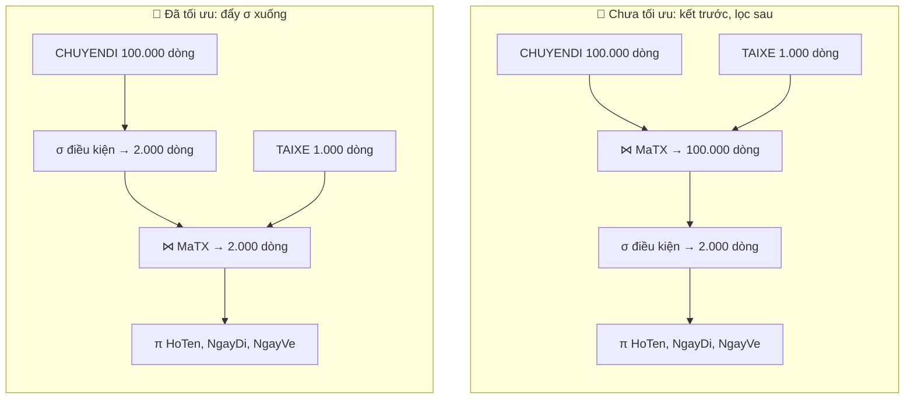

Hai cây cho **cùng kết quả** (luật "$\sigma$ qua $\bowtie$"), nhưng cây bên phải chỉ phải kết 2.000 dòng thay vì 100.000 - nhanh hơn khoảng 50 lần ở bước join. Đây chính là việc bộ tối ưu của HQTCSDL tự làm mỗi khi chạy câu `SELECT`.

> [!TIP]
> **Expert**: khi gặp dạng đề "cho 2 biểu thức, biểu thức nào hiệu quả hơn", chọn biểu thức có $\sigma$ (và $\pi$) **nằm sâu hơn** trong cây - tức thực hiện **trước** các phép $\times$/$\bowtie$. Còn dạng đề "2 biểu thức có tương đương không", thử biến đổi một vế bằng các luật trong bảng trên, hoặc tìm **một phản ví dụ** dữ liệu nhỏ làm 2 vế cho kết quả khác nhau.

### Bảng tổng hợp tính chất các phép toán

Với $R$ bậc $n$ có $|r|$ bộ, $S$ bậc $m$ có $|s|$ bộ:

| Phép | Bậc kết quả | Số bộ kết quả | Giao hoán | Cần khả hợp |
|---|---|---|---|---|
| $\sigma_{\text{đk}}(R)$ | $n$ | $0 \to \lvert r \rvert$ | Có (với $\sigma$) | Không |
| $\pi_{L}(R)$ | $\lvert L \rvert$ | $1 \to \lvert r \rvert$ (bỏ trùng) | Không | Không |
| $R \times S$ | $n + m$ | đúng $\lvert r \rvert \cdot \lvert s \rvert$ | Có* | Không |
| $R \bowtie_\theta S$ | $n + m$ | $0 \to \lvert r \rvert \cdot \lvert s \rvert$ | Có* | Không |
| $R \bowtie S$ (tự nhiên, $k$ cột chung) | $n + m - k$ | $0 \to \lvert r \rvert \cdot \lvert s \rvert$ | Có* | Không |
| $R \cup S$ | $n$ | $\max(\lvert r \rvert, \lvert s \rvert) \to \lvert r \rvert + \lvert s \rvert$ | Có | **Có** |
| $R \cap S$ | $n$ | $0 \to \min(\lvert r \rvert, \lvert s \rvert)$ | Có | **Có** |
| $R - S$ | $n$ | $0 \to \lvert r \rvert$ | Không | **Có** |
| $R \div S$ | $n - m$ | $0 \to \lvert \pi_Y(r) \rvert$ | Không | Không ($S^+ \subsetneq R^+$) |
| Gom nhóm theo $G$ | $\lvert G \rvert$ + số hàm | số nhóm (1 nếu không có $G$) | - | Không |

\* Giao hoán nếu bỏ qua thứ tự cột (tập thuộc tính như nhau, chỉ khác vị trí cột).

> [!TIP]
> Dùng bảng này để **tự chấm** đáp án: tính xong một biểu thức, kiểm tra số cột/số dòng có nằm trong khoảng hợp lệ không. Vd hợp 2 tập 4 và 3 phần tử mà ra 8 dòng → chắc chắn sai (tối đa $4 + 3 = 7$); phép giao ra nhiều dòng hơn tập nhỏ hơn → sai.

### Cheatsheet: nhận diện phép toán theo từ khóa đề bài

| Từ khóa / yêu cầu trong đề | Phép toán nên dùng |
|---|---|
| "...thỏa điều kiện", "màu đỏ", "lương > X" | Chọn $\sigma$ |
| "Cho biết/liệt kê [các cột]" | Chiếu $\pi$ - đặt ngoài cùng |
| Dữ liệu nằm ở ≥ 2 quan hệ | Kết $\bowtie$ (trên khóa ngoại ↔ khóa chính) |
| "**không** / chưa / ngoại trừ" | Trừ $-$ |
| "**hoặc**" (2 tập) | Hợp $\cup$ (hoặc $\vee$ trong $\sigma$) |
| "**cả** A **và** B" (mỗi cái một dòng) | Giao $\cap$ |
| "**tất cả** / **mọi**" | Chia $\div$ |
| "tổng / trung bình / đếm ... **theo / của từng / mỗi**" | Gom nhóm $\Im$ |
| "**tất cả** X, **kể cả** X chưa có Y" | Kết ngoài ⟕ ⟖ ⟗ |

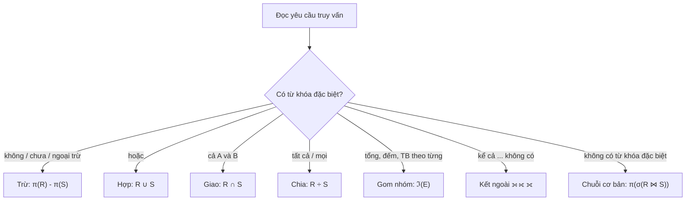

> [!TIP]
> **Quy trình 4 bước viết biểu thức ĐSQH:**
>
> 1. **Khoanh vùng dữ liệu**: câu hỏi đụng tới quan hệ nào? ≥ 2 quan hệ → kết trước, điều kiện kết thường là `khóa ngoại = khóa chính`.
> 2. **Lọc dòng**: các điều kiện còn lại đưa vào $\sigma$.
> 3. **Xử lý từ khóa đặc biệt**: trừ/hợp/giao/chia/gom nhóm nếu có (tra bảng trên).
> 4. **Chiếu cột đầu ra** bằng $\pi$ ngoài cùng.
>
> Dạng hay gặp nhất: $\pi_{\text{cột ra}}\big(\sigma_{\text{đk}}(R \bowtie_{\text{fk=pk}} S)\big)$ - đọc từ trong ra: kết trước, lọc sau, chiếu cuối.

### Bài tập tổng kết

Cho lược đồ quan hệ nhà cung cấp - mặt hàng:

S (nhà cung cấp - Supplier)

| S# | SNAME | STATUS | CITY |
|---|---|---|---|
| S1 | Smith | 20 | London |
| S2 | Jones | 10 | Paris |
| S3 | Kery | 30 | Roma |

P (mặt hàng - Product)

| P# | PNAME | COLOR | WEIGHT |
|---|---|---|---|
| P1 | Nut | Red | 12 |
| P2 | Bolt | Green | 17 |
| P3 | Screw | Blue | 17 |
| P4 | Screw | Red | 14 |

SP (cung ứng) - bảng trung gian nối S và P (mối kết hợp n-n):

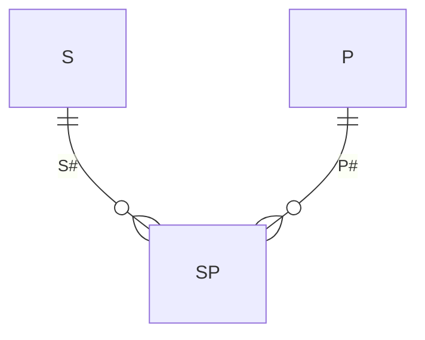

| S# | P# | QTY |
|---|---|---|
| S1 | P1 | 300 |
| S1 | P2 | 200 |
| S1 | P3 | 400 |
| S2 | P1 | 300 |
| S2 | P2 | 400 |
| S3 | P4 | 200 |

**1. Liệt kê danh sách các mặt hàng màu đỏ**

$$\sigma_{COLOR='Red'}(P)$$

Kết quả: `P1 Nut Red 12`, `P4 Screw Red 14`.

**2. Liệt kê P#, PName các mặt hàng màu đỏ và có Weight > 15**

$$\pi_{P\#,\ Pname}\big(\sigma_{COLOR='Red'\ \wedge\ Weight>15}(P)\big)$$

Kết quả: **rỗng** - 2 mặt hàng đỏ nặng 12 và 14, không cái nào > 15. Biểu thức đúng nhưng dữ liệu không có bộ thỏa.

**3. Liệt kê S# của các nhà cung cấp cung ứng mặt hàng 'P1' hoặc 'P2'**

$$\pi_{S\#}\big(\sigma_{P\#='P1'\ \vee\ P\#='P2'}(SP)\big) \quad \text{hoặc} \quad \pi_{S\#}\big(\sigma_{P\#='P1'}(SP)\big) \cup \pi_{S\#}\big(\sigma_{P\#='P2'}(SP)\big)$$

Kết quả: $\{S1, S2\}$ ($\sigma$ ra 4 dòng, $\pi$ bỏ trùng còn 2).

**4. Liệt kê S# của các nhà cung cấp cung ứng cả hai mặt hàng 'P1' và 'P2'**

$$\pi_{S\#}\big(\sigma_{P\#='P1'}(SP)\big) \cap \pi_{S\#}\big(\sigma_{P\#='P2'}(SP)\big)$$

Kết quả: $\{S1, S2\} \cap \{S1, S2\} = \{S1, S2\}$ - trùng với câu 3 chỉ do **dữ liệu tình cờ**, về ngữ nghĩa 2 câu khác hẳn nhau.

**5. Liệt kê S# của các nhà cung cấp không cung ứng mặt hàng 'P1'**

$$\pi_{S\#}(S) - \pi_{S\#}\big(\sigma_{P\#='P1'}(SP)\big)$$

Kết quả: $\{S1, S2, S3\} - \{S1, S2\} = \{S3\}$.

> [!CAUTION]
> Slide ghi $\pi_{S\#}(P)$ ở vế trái - đây là **lỗi đánh máy**: quan hệ P (mặt hàng) không có cột `S#`. Vế trái phải là $\pi_{S\#}(S)$. Cũng **không** được dùng $\pi_{S\#}(SP)$ vì sẽ bỏ sót nhà cung cấp chưa cung ứng mặt hàng nào (họ cũng "không cung ứng P1").

**6. Liệt kê S# của các nhà cung cấp cung ứng ít nhất một mặt hàng màu đỏ**

$$\pi_{S\#}\big(SP \bowtie \sigma_{COLOR='Red'}(P)\big)$$

Kết quả: mặt hàng đỏ là P1, P4 → các dòng SP khớp: (S1, P1), (S2, P1), (S3, P4) → $\{S1, S2, S3\}$. Để ý $\sigma$ đã được **đẩy xuống** áp lên P trước khi kết - đúng nguyên tắc "lọc sớm".

**7. Liệt kê S# của các nhà cung cấp cung ứng tất cả các mặt hàng**

$$\pi_{S\#,\ P\#}(SP) \div \pi_{P\#}(P)$$

Kết quả: **rỗng** - S1 cung ứng P1, P2, P3 nhưng thiếu P4; S2 thiếu P3, P4; S3 chỉ có P4. Chú ý bước $\pi_{S\#,\ P\#}(SP)$ bỏ cột `QTY` trước khi chia (cùng lý do như ví dụ KETQUATHI).

**8. Với mỗi nhà cung cấp, liệt kê tổng lượng hàng đã cung ứng**

$${}_{S\#}\Im_{sum(QTY)}(SP)$$

| S# | sum(QTY) |
|---|---|
| S1 | 900 |
| S2 | 700 |
| S3 | 200 |

> [!NOTE]
> Bộ bài tập này luyện đủ 8 phép toán: câu 1-2 là $\sigma + \pi$, câu 3-4 phân biệt $\cup$ vs $\cap$ (bẫy "hoặc/và" y hệt câu 10-11 ở trên), câu 5 là $-$, câu 6 là $\bowtie$, câu 7 là $\div$, câu 8 là $\Im$. Câu 5 chú ý chiếu $\pi_{S\#}$ trên **S** (toàn bộ nhà cung cấp) chứ không phải SP - vế trái của phép trừ luôn là tập ứng viên đầy đủ.

#### Luyện tập mở rộng

Tự viết biểu thức trước, sau đó đối chiếu với đáp án bên dưới (trên cùng lược đồ S, P, SP):

1. Liệt kê SNAME của các nhà cung cấp ở London đã cung ứng mặt hàng màu đỏ.
2. Liệt kê S# của nhà cung cấp cung ứng **tất cả** mặt hàng màu đỏ.
3. Liệt kê PNAME của mặt hàng **chưa** được nhà cung cấp nào cung ứng.
4. Với mỗi mặt hàng, cho biết số nhà cung cấp đã cung ứng; chỉ lấy mặt hàng có từ 2 nhà cung cấp trở lên.

> [!NOTE]
> **Đáp án gợi ý:**
>
> 1. $\pi_{SNAME}\big(\sigma_{CITY='London'}(S) \bowtie SP \bowtie \sigma_{COLOR='Red'}(P)\big)$ → `Smith` (S1 cung ứng P1 màu đỏ).
> 2. $\pi_{S\#,\ P\#}(SP) \div \pi_{P\#}\big(\sigma_{COLOR='Red'}(P)\big)$ → số chia là $\{P1, P4\}$; không ai có đủ cả 2 → **rỗng**. Mẹo: chỉ cần **thu nhỏ số chia** bằng $\sigma$ là đổi "tất cả mặt hàng" thành "tất cả mặt hàng đỏ".
> 3. $\pi_{PNAME}\big((\pi_{P\#}(P) - \pi_{P\#}(SP)) \bowtie P\big)$ → mọi mặt hàng P1-P4 đều đã được cung ứng → **rỗng**. Lưu ý phải trừ trên **khóa** `P#` rồi mới kết lại lấy tên - trừ trực tiếp trên `PNAME` sẽ sai khi 2 mặt hàng trùng tên (P3, P4 cùng tên `Screw`).
> 4. $`Q(P\#, SoNCC) \leftarrow {}_{P\#}\Im_{count(S\#)}(SP)`$, sau đó $\sigma_{SoNCC \geq 2}(Q)$ → $\{(P1, 2), (P2, 2)\}$.

### Bài tập thực hành 03: Quản lý đặt báo

Cho lược đồ CSDL quản lý đặt báo:

```
BAO (MaB, TenB, DonGiaTK)
KHACHHANG (MaKH, TenKH, LoaiKH, DienThoai)
PHIEUDATBAO (MaB, MaKH, NgayDat, SoTo, DonGia, ThanhTien)
```

- `BAO`: mỗi báo một mã phân biệt (vd 'B01' - Công an, 'B02' - Lao động, 'B03' - Thanh niên, 'B04' - Tuổi trẻ), tên báo và **đơn giá tham khảo**.
- `KHACHHANG`: `LoaiKH` chỉ nhận 1 trong 2 giá trị `'Cá nhân'` / `'Doanh nghiệp'`.
- `PHIEUDATBAO`: khách hàng đặt báo theo ngày cụ thể (`NgayDat`), số tờ mua (`SoTo`), đơn giá thực bán tại thời điểm mua (`DonGia`); `ThanhTien = SoTo × DonGia`.

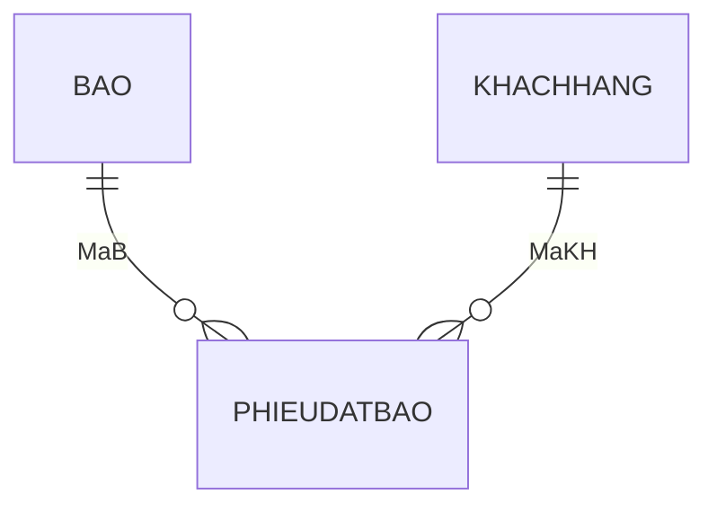

**Câu 1:** Cho biết các báo có đơn giá tham khảo < 10000.

$$\sigma_{DonGiaTK < 10000}(BAO)$$

**Câu 2:** Cho biết danh sách khách hàng thuộc loại 'Doanh nghiệp'.

$$\sigma_{LoaiKH = \text{'Doanh nghiệp'}}(KHACHHANG)$$

**Câu 3:** Cho biết họ tên, điện thoại các khách hàng đặt mua báo Tuổi trẻ ($TenB =$ 'Tuổi trẻ') trong quý 1 năm 2016.

- Bước 1: $BTT \leftarrow \sigma_{TenB=\text{'Tuổi trẻ'}}(BAO)$ - bảng báo chỉ còn báo Tuổi trẻ.
- Bước 2: $PQ1 \leftarrow \sigma_{NgayDat \geq '01/01/2016'\ \wedge\ NgayDat \leq '31/03/2016'}(PHIEUDATBAO)$ - phiếu đặt trong quý 1/2016.
- Bước 3: $\pi_{TenKH,\ DienThoai}\big(KHACHHANG \bowtie PQ1 \bowtie BTT\big)$

Viết gọn một dòng (đẩy $\sigma$ xuống sát bảng - đúng nguyên tắc "lọc sớm"):

$$\pi_{TenKH,\ DienThoai}\Big(KHACHHANG \bowtie \sigma_{Year(NgayDat)=2016\ \wedge\ Month(NgayDat) \leq 3}(PHIEUDATBAO) \bowtie \sigma_{TenB=\text{'Tuổi trẻ'}}(BAO)\Big)$$

**Câu 4:** Cho biết MaKH, TenKH của khách hàng đặt mua báo có tên báo là "Người lao động" vào ngày 1/12/2016.

$$\pi_{MaKH,\ TenKH}\Big(KHACHHANG \bowtie \sigma_{NgayDat='01/12/2016'}(PHIEUDATBAO) \bowtie \sigma_{TenB=\text{'Người lao động'}}(BAO)\Big)$$

> [!TIP]
> Câu 3 và 4 cùng một khuôn: dữ liệu trải **3 bảng** → kết 3 bảng qua 2 khóa ngoại (`MaKH`, `MaB`); điều kiện nào thuộc bảng nào thì $\sigma$ đặt sát bảng đó, $\pi$ bọc ngoài cùng. Điều kiện thời gian viết được bằng cả 2 cách: khoảng ngày (`NgayDat ≥ '01/01/2016' ∧ NgayDat ≤ '31/03/2016'`) hoặc hàm (`Year(NgayDat)=2016 ∧ Month(NgayDat) ≤ 3`).

**Câu 5:** Cho biết báo nào (MaB, TenB) có giá tham khảo **cao nhất**.

Cách 1 - "cao nhất" = **không có báo nào đắt hơn**: tìm tập báo *bị đắt hơn* rồi trừ đi.

- $B_1 \leftarrow \rho_{B_1(MaB1,\ TenB1,\ Gia1)}(BAO)$, $B_2 \leftarrow \rho_{B_2(MaB2,\ TenB2,\ Gia2)}(BAO)$
- $Q \leftarrow \pi_{MaB1,\ TenB1,\ Gia1}\big(B_1 \bowtie_{Gia1 < Gia2} B_2\big)$ - các báo tồn tại ít nhất một báo khác đắt hơn.
- KQ: $\pi_{MaB,\ TenB}(BAO - Q)$

Cách 2 - dùng hàm `max`: tính giá lớn nhất rồi **kết bằng** để giữ đúng báo đạt giá đó:

$$\pi_{MaB,\ TenB}\Big(BAO \bowtie_{DonGiaTK\,=\,GiaMax} \Im_{max(DonGiaTK) \to GiaMax}(BAO)\Big)$$

> [!TIP]
> Khuôn "lớn nhất / nhỏ nhất / cao nhất" rất hay ra đề: hoặc **tự kết chéo** tìm phần tử bị-vượt rồi trừ (cách 1), hoặc tính `max`/`min` bằng $\Im$ rồi kết bằng (cách 2). Cách 2 gọn hơn; cách 1 thuần 5 phép cơ bản + đổi tên nên an toàn hơn khi đề yêu cầu trình bày từng bước.

**Câu 6:** Cho biết MaKH đã đặt mua **cả 2** báo có mã 'B04' và 'B05'.

$$\pi_{MaKH}\big(\sigma_{MaB='B04'}(PHIEUDATBAO)\big) \cap \pi_{MaKH}\big(\sigma_{MaB='B05'}(PHIEUDATBAO)\big)$$

> [!CAUTION]
> Bẫy y hệt câu 10-11 ở phần phép giao: **không** viết $\sigma_{MaB='B04' \wedge MaB='B05'}(PHIEUDATBAO)$ - một phiếu đặt chỉ mang một `MaB` nên điều kiện này luôn sai. "Cả A và B" với mỗi cái là một dòng riêng → tách thành 2 tập rồi **giao**.

**Câu 7:** Cho biết tổng số tờ khách hàng đặt mua trong năm 2015 **theo từng báo** (hiển thị 2 cột: MaB, tổng số tờ).

$$Q(MaB,\ TongSoTo) \leftarrow {}_{MaB}\Im_{sum(SoTo)}\big(\sigma_{Year(NgayDat)=2015}(PHIEUDATBAO)\big)$$

**Câu 8:** Cho biết MaB, TenB, tổng tiền bán được của **từng báo** trong năm 2015.

$${}_{MaB,\ TenB}\Im_{sum(ThanhTien)}\Big(\sigma_{Year(NgayDat)=2015}(PHIEUDATBAO) \bowtie BAO\Big)$$

> [!NOTE]
> Câu 8 chỉ khác câu 7 ở cột `TenB` - cột này nằm ở bảng BAO nên phải **kết BAO vào trước khi gom nhóm**. Gom theo cặp `MaB, TenB` an toàn vì `TenB` phụ thuộc hàm vào `MaB` (mỗi mã đi với đúng một tên). Quy tắc chung: **cột hiển thị nằm ở bảng nào thì phải kết bảng đó vào trước $\Im$**.

**Câu 9:** Cho biết khách hàng đã mua **tất cả** loại báo.

$$\pi_{MaKH,\ MaB}(PHIEUDATBAO) \div \pi_{MaB}(BAO)$$

**Câu 10:** Trong năm 2015, cho biết khách hàng nào đã mua **tất cả** báo.

$$\pi_{MaKH,\ MaB}\big(\sigma_{Year(NgayDat)=2015}(PHIEUDATBAO)\big) \div \pi_{MaB}(BAO)$$

> [!NOTE]
> Câu 10 khác câu 9 đúng một chỗ: **lọc phiếu đặt theo năm 2015 trước khi chia**. Đề hơi mập mờ ở chữ "tất cả báo": hiểu thông thường là tất cả báo **trong danh mục** ($BAO[MaB]$ - như trên). Nếu ý đề là "tất cả báo **được bán** trong năm 2015" thì số chia đổi thành $\pi_{MaB}\big(\sigma_{Year(NgayDat)=2015}(PHIEUDATBAO)\big)$ - điều kiện nhẹ hơn nên kết quả sẽ nhiều khách hàng hơn. Khi làm bài nên ghi rõ mình chọn cách hiểu nào.

> [!NOTE]
> Bộ 10 câu luyện gần đủ các phép: câu 1-2 là $\sigma$, câu 3-4 là $\sigma$ + kết 3 bảng, câu 5 luyện mẫu "cao nhất" (kết chéo + trừ, hoặc $\Im$ + kết bằng), câu 6 là $\cap$, câu 7-8 là $\Im$ (câu 8 thêm bước kết để lấy tên), câu 9-10 là $\div$.
