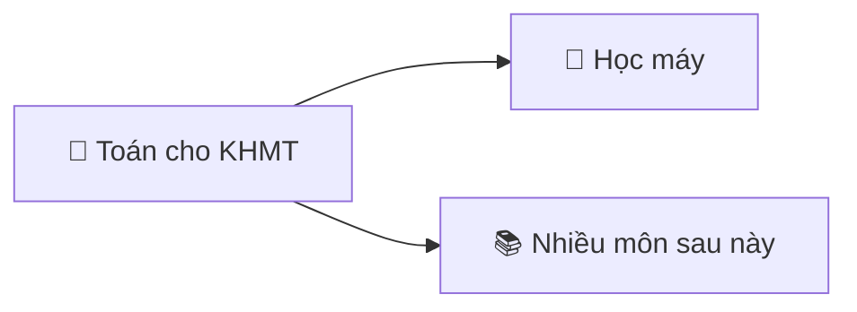
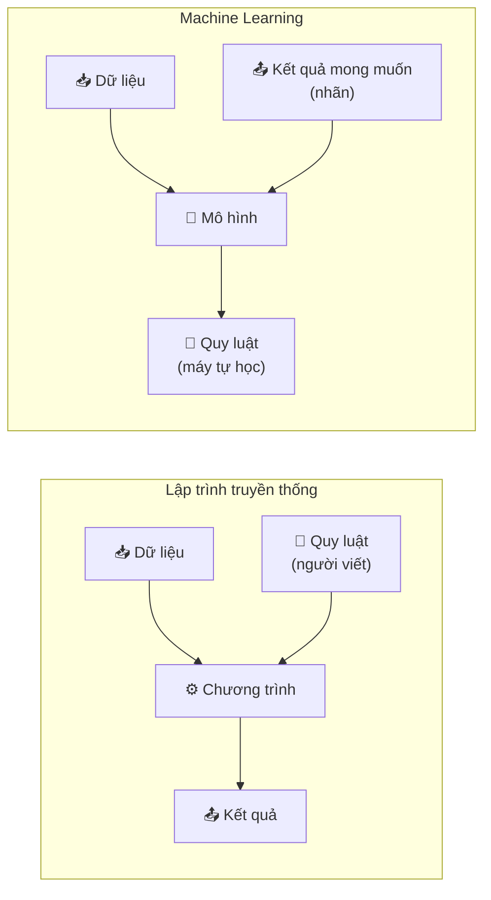
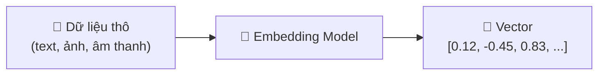
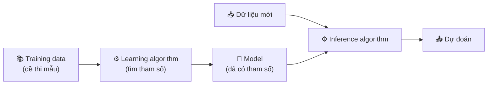
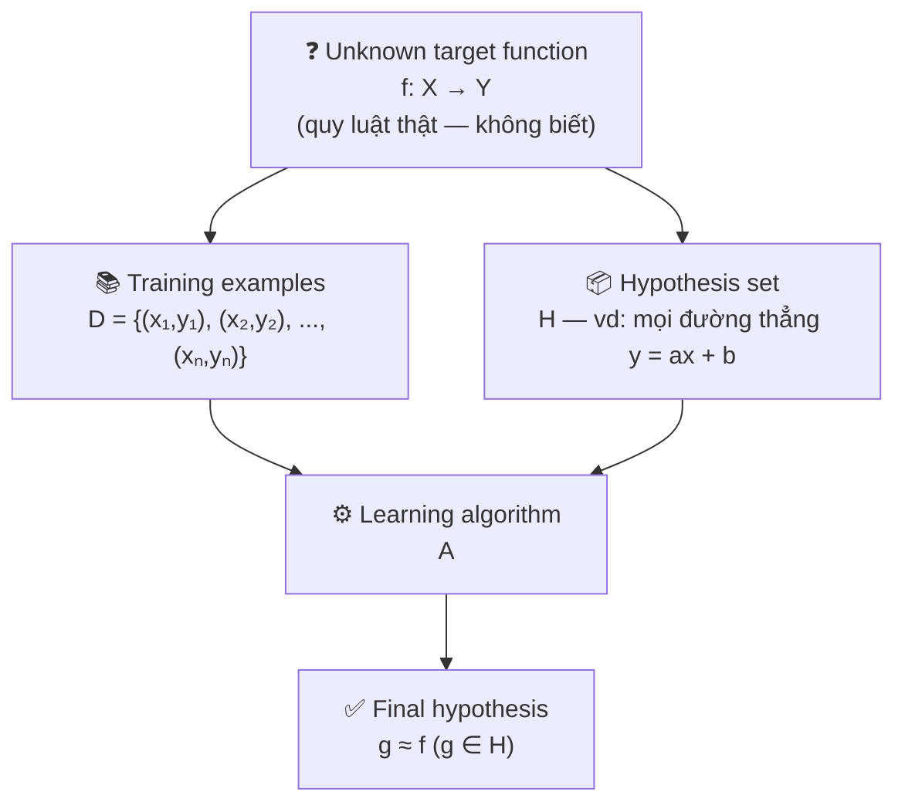

# Buổi 1 — Giới thiệu môn học

- **Ngày**: 30/10/2026
- **Môn**: Toán cho Khoa học máy tính (CS115.G11.CN2.TTNT)
- **Giảng viên**: Dương Việt Hằng
- **Lịch học**: Thứ 6, 18h15 – 22h00

## Tài liệu môn học

- Bài giảng online: https://www.youtube.com/watch?v=fM0iXXrTGtg
- Trang môn học trên elearning: https://elearning.citd.edu.vn/course/view.php?id=1997
- Tài liệu xem thêm: https://machinelearningcoban.com

## Nội dung buổi học

### Nội dung môn học

Môn học gồm 3 phần chính:

- **Đại số tuyến tính**
- **Giải tích**
- **Xác suất thống kê** (phần ít)

> [!NOTE]
> Đối tượng của môn học thường là **vector** hoặc **ma trận** (matrix).

#### Nội dung theo tuần

**Tuần 1–3: Giới thiệu và ôn tập**

- Giới thiệu môn học Toán cho KHMT
- Tổng quan về Học máy (Machine Learning)
- Ôn tập các nội dung Vi tích phân (Calculus)
- Ôn tập các nội dung Đại số tuyến tính (Linear algebra)
- Ôn tập các nội dung Xác suất Thống kê (Probability & Statistics)

**Tuần 4–5: Phân tích hồi quy (Regression Analysis)**

- Ước lượng hợp lý cực đại (Maximum Likelihood Estimation — MLE)
- Linear regression
- Logistic regression
- Các hàm mất mát: squared-error loss, cross entropy loss,…

**Tuần 6–7: Tối ưu hóa (Optimization)**

- Giới thiệu về tối ưu hóa lồi (convex)
- Phương pháp Newton (Newton's method)
- Gradient descent
- L1, L2 Regularization
- Stochastic gradient descent
- Momentum, Nesterov, Adagrad, RMSprop, Adadelta, Adam

**Tuần 8: Giới thiệu mạng nơ-ron (Neural network)**

- Mạng perceptron nhiều lớp (Multi-layer perceptron)
- Đồ thị tính toán (Computational graph)
- Quy tắc dây chuyền (Chain rule) và Lan truyền ngược (Backpropagation)
- Cross-validation
- Batch normalization
- Điều chỉnh Hyperparameters

**Tuần 9–10: Seminar đồ án môn học về một số chủ đề mở rộng**

- Linear Discriminant Analysis (LDA)
- Singular Value Decomposition (SVD)
- Principal Component Analysis (PCA)
- Nonnegative Matrix Factorization (NMF)
- Support Vector Machine (SVM) and kernels
- Expectation Maximization
- Clustering, Hierarchical Clustering, Spectral Clustering
- Decision Tree, Random Forest

#### Danh sách topics đồ án gợi ý

| STT | Topic | Giải thích | Nhóm |
|---|---|---|---|
| 1 | Singular Value Decomposition (SVD) and Principal Component Analysis (PCA) *Phân tích giá trị kỳ dị (SVD) và Phân tích thành phần chính (PCA)* | Kỹ thuật phân rã ma trận → tìm các hướng phương sai lớn nhất của dữ liệu để **nén/giảm chiều** mà giữ lại thông tin quan trọng nhất. | Giảm chiều & ma trận |
| 2 | Support Vector Machine (SVM) *Máy vector hỗ trợ* | Thuật toán phân loại tìm **siêu phẳng** (hyperplane) tách các lớp với **lề** (margin) lớn nhất; bản chất là bài toán tối ưu lồi. | Phân loại có giám sát |
| 3 | Backpropagation in Convolutional Neural Networks (CNNs) *Lan truyền ngược trong mạng nơ-ron tích chập (CNN)* | Cách tính gradient bằng chain rule và lan truyền ngược để cập nhật trọng số trong mạng tích chập — loại mạng chuyên xử lý ảnh. | Deep learning — computer vision |
| 4 | Recurrent Neural Networks (RNNs), and the Exploding and Vanishing Gradient Problems *Mạng nơ-ron hồi quy (RNN) và các vấn đề bùng nổ / tiêu biến gradient* | Mạng cho **dữ liệu chuỗi** (văn bản, chuỗi thời gian); phân tích vì sao gradient qua nhiều bước thời gian bị *quá lớn* hoặc *quá nhỏ*. | Deep learning — dữ liệu chuỗi |
| 5 | Linear Discriminant Analysis (LDA) *Phân tích biệt thức tuyến tính* | Tìm hướng chiếu sao cho các lớp **tách xa nhau nhất** — vừa dùng giảm chiều, vừa dùng phân loại. | Giảm chiều + Phân loại |
| 6 | Probably Approximately Correct (PAC) learning and Vapnik–Chervonenkis (VC) dimension *Học "xấp xỉ đúng với xác suất cao" (PAC) và chiều VC* | Nền tảng **lý thuyết** của học máy: khi nào một bài toán "học được", cần bao nhiêu mẫu; chiều VC đo *độ phức tạp* của tập giả thuyết $\mathcal{H}$. | Lý thuyết học máy |
| 7 | Hierarchical Clustering Analysis *Phân tích gom cụm phân cấp* | Gom cụm dạng **cây** (dendrogram) — từng bước gộp/tách cụm; không cần cho trước số cụm. | Clustering |
| 8 | Clustering: Gaussian Mixture Models and Expectation-Maximization method *Gom cụm: mô hình hỗn hợp Gauss và phương pháp kỳ vọng–cực đại hóa (EM)* | Gom cụm **mềm**: mỗi cụm là một phân bố Gauss, mỗi điểm thuộc nhiều cụm theo xác suất; EM là thuật toán lặp để ước lượng tham số. | Clustering |
| 9 | Spectral Clustering *Gom cụm phổ* | Gom cụm bằng cách phân tích **trị riêng/vector riêng** của ma trận tương tự giữa các điểm — nặng đại số tuyến tính. | Clustering |
| 10 | T-distributed Stochastic Neighbor Embedding (t-SNE) *Nhúng lân cận ngẫu nhiên phân bố t — kỹ thuật giảm chiều để trực quan hóa* | Giảm chiều **phi tuyến** giữ cấu trúc lân cận — dùng vẽ dữ liệu nhiều chiều lên 2D/3D để quan sát cụm. | Giảm chiều / trực quan hóa |
| 11 | Trees, Forests, Bagging, and Boosting *Cây quyết định, rừng (forest), bagging và boosting* | Mô hình cây quyết định + kỹ thuật **ensemble** kết hợp nhiều cây yếu thành mô hình mạnh (Random Forest, Gradient Boosting...). | Phân loại có giám sát (ensemble) |
| 12 | Policy Gradient for Reinforcement Learning (RL) *Gradient chính sách cho học tăng cường* | Học tăng cường: agent học **chính sách hành động** bằng cách tối ưu trực tiếp bằng gradient — khác hẳn supervised learning. | Học tăng cường |
| 13 | Dimensionality Reduction *Giảm chiều dữ liệu* | Nhóm kỹ thuật nén dữ liệu từ nhiều chiều về ít chiều — giảm nhiễu, tăng tốc, dễ trực quan hóa. | Giảm chiều |
| 14 | Nonnegative Matrix Factorization (NMF) *Phân rã ma trận không âm* | Phân rã ma trận thành tích các ma trận **không âm** → các thành phần có ý nghĩa trực quan (tách chủ đề văn bản, bộ phận ảnh). | Giảm chiều & ma trận |
| 15 | Hidden Markov Model (HMM) *Mô hình Markov ẩn* | Mô hình chuỗi có **trạng thái ẩn** — quan sát được đầu ra nhưng không thấy trạng thái sinh ra nó (nhận diện giọng nói, gán nhãn từ loại). | Dữ liệu chuỗi |
| 16 | Other — need discuss with teacher *Chủ đề khác — cần trao đổi với giảng viên* | Tự chọn chủ đề ngoài danh sách — phải được cô duyệt trước. | — |

**Phân loại các topic theo hướng bài toán:**

- **Giảm chiều & phân rã ma trận** — thuần đại số tuyến tính, *rất hợp môn này*: 1 (SVD/PCA), 5 (LDA), 10 (t-SNE), 13 (Dimensionality Reduction), 14 (NMF).
- **Phân loại có giám sát** (supervised classification): 2 (SVM), 5 (LDA), 11 (Trees/Forest/Bagging/Boosting).
- **Deep learning**: 3 (Backprop trong CNN — hướng *computer vision*), 4 (RNN — hướng *dữ liệu chuỗi/NLP*).
- **Gom cụm không giám sát** (unsupervised clustering — hướng *data analysis/data mining*): 7 (Hierarchical), 8 (GMM + EM), 9 (Spectral).
- **Dữ liệu chuỗi / thời gian** (sequence data — *speech, NLP, time-series*): 4 (RNN), 15 (HMM).
- **Lý thuyết học máy** (learning theory — nghiêng chứng minh, ít code): 6 (PAC/VC).
- **Học tăng cường** (reinforcement learning): 12 (Policy Gradient).
- **Khác**: 16.

> [!TIP]
> Cách chọn theo định hướng:
> - Thích **toán thuần** (ma trận, đại số tuyến tính) → nhóm giảm chiều: 1, 9, 13, 14.
> - Thích **phân tích dữ liệu** (DA/data mining) → clustering: 7, 8, 9 + dim reduction: 1, 10.
> - Thích **computer vision** → 3 (CNN); thích **NLP/speech/time-series** → 4 (RNN), 15 (HMM).
> - Thích **lý thuyết** → 6 (PAC/VC); thích **bài toán quyết định/agent** → 12 (RL).

> [!WARNING]
> **Quy định nhóm đồ án:**
> - Mỗi topic chỉ được chọn trùng **tối đa 2 nhóm**.
> - Mỗi nhóm có **tối đa 5 thành viên**.
> - Ngày báo cáo và thứ tự báo cáo sẽ được sắp xếp sau.

> [!NOTE]
> **Yêu cầu nội dung đồ án:** chủ yếu phải hiểu và trình bày được:
> - **Fitting**: quá trình khớp tham số với data (chính là bước *learning*) diễn ra như thế nào.
> - **Inference**: quá trình suy luận/dự đoán từ mô hình đã học.
> - **Model được build như thế nào** — toán đằng sau mô hình, không chỉ chạy code.
>
> Vd với $y = ax + b$: phải **giải thích được tại sao** chỉ với 4 điểm dữ liệu, thuật toán lại tìm ra $a = 2$, $b = 3$ — tức trình bày được cách thiết lập hàm mất mát, cách tối ưu để ra các tham số đó.

> [!TIP]
> Cấu trúc báo cáo gồm 2 phần:
> - **Lý thuyết**: làm rõ mô hình được build trên **nền tảng toán nào** (đại số tuyến tính, giải tích, xác suất thống kê...).
> - **Thực hành**: chạy thử và trình bày **đánh giá, so sánh** mô hình ra sao (dùng độ đo $P$ nào, so với baseline/phương pháp khác thế nào).

### Chuẩn đầu ra môn học (Learning Outcome)

Sau khi học xong môn học, sinh viên có thể:

| CĐRMH | Mô tả CĐRMH (mục tiêu cụ thể) |
|---|---|
| CLO 1 | Hiểu và trình bày được các cơ sở Toán học trong một số thuật toán Học máy căn bản. |
| CLO 2 | Vận dụng các công cụ Toán học để giải quyết một số bài toán Học máy căn bản. |
| CLO 3 | So sánh được các phương pháp Toán và các giải thuật Tin học khi áp dụng giải quyết các vấn đề trong Khoa học máy tính. Trình bày được sự cần thiết của các giải thuật xấp xỉ. |
| CLO 4 | Có khả năng làm việc nhóm hiệu quả để thực hiện Đồ án môn học với các chủ đề mở rộng, và báo cáo kết quả tìm hiểu. |

### Đánh giá môn học

| Thành phần đánh giá | Hình thức | Tỷ lệ |
|---|---|---|
| **A1. Quá trình** | | **40%** |
| A1.1 Quiz | | 10% |
| A1.2 Thuyết trình, làm bài tập về nhà | | 30% |
| **A2. Cuối kỳ** | | **60%** |
| A2.1 Thi Lý thuyết | Thi viết + trắc nghiệm | 30% |
| A2.2 Đồ án cuối kỳ | Báo cáo đồ án môn học | 30% |

> [!TIP]
> Đi thi và làm đồ án đầy đủ thì cô sẽ **cộng thêm điểm quá trình** để gỡ gạc điểm số.

> [!WARNING]
> Điểm quá trình = 0 → **không thể nào kéo nổi bằng điểm cuối kỳ** — phải chăm chỉ làm bài/quiz ngay từ đầu.

> [!CAUTION]
> **Nhiệm vụ bắt buộc:** phải **học lại đại số tuyến tính** thì mới thi được. → Ôn lại các **cheatsheets đại số tuyến tính** đã có sẵn trên elearning portal.

### Vai trò của môn học

- Môn này là **nền tảng** cho rất nhiều môn học sau này.
- Được **ứng dụng nhiều trong học máy** (machine learning).

> [!TIP]
> Vì là môn nền tảng, nên **cố gắng học chắc ngay từ đầu** — yếu môn này sẽ ảnh hưởng tới các môn sau, đặc biệt là các môn liên quan đến học máy.

### Học máy là gì? (What is Machine Learning?)

- Machine Learning (ML) là một **lĩnh vực con đang phát triển tích cực** của AI.
- ML tìm cách trả lời câu hỏi:

> *"How can we build computer systems that automatically improve with experience, and what are the fundamental laws that govern learning process?"*
> — Mitchell, 2016

Tức là: *"Làm thế nào xây dựng các hệ thống máy tính tự động cải thiện theo kinh nghiệm, và các quy luật nền tảng nào chi phối quá trình học?"*

#### Định nghĩa của Tom Mitchell

> *"A computer program is said to learn from **experience E** with respect to some class of **tasks T**, and **performance measure P**, if its performance at tasks in T, as measured by P, improves with experience E."*
> — Tom Mitchell

Tức là: một chương trình máy tính được gọi là **học** từ kinh nghiệm $E$ đối với một lớp tác vụ $T$ và độ đo hiệu năng $P$, nếu hiệu năng của nó trên các tác vụ trong $T$ — đo bằng $P$ — được cải thiện nhờ kinh nghiệm $E$.

Nói gọn lại theo slide:

> *"Improve on task $T$, with respect to performance metric $P$, based on experience $E$."*
>
> → **Cải thiện trên tác vụ $T$, xét theo độ đo $P$, nhờ kinh nghiệm $E$.**

Có nhiều loại ML khác nhau, tùy thuộc vào:

- **Tác vụ $T$** (task) mà ta muốn hệ thống học
- **Độ đo hiệu năng $P$** (performance measure) dùng để đánh giá hệ thống
- **Tín hiệu huấn luyện hay kinh nghiệm $E$** (training signal / experience) mà ta cung cấp cho hệ thống

> [!NOTE]
> Tương tự **học của con người**: con người nhận thức từ **khái niệm** (concept) → suy luận thông qua kinh nghiệm $E$ — với máy tính thì $E$ chính là **dữ liệu** (data).
>
> Tác vụ $T$ có thể là **đánh giá**, **phân loại** (classification), **phán đoán** — bản chất là **kết hợp các khái niệm để giải quyết** một vấn đề. Kết hợp các phán đoán → tạo ra được **mệnh đề** (statement).

> [!TIP]
> **Không có một mô hình nào là tốt nhất** cho mọi bài toán — việc chọn mô hình chỉ phụ thuộc vào **tài nguyên** (resource), **dữ liệu** (data) và **cấu hình** (configuration) cụ thể.

#### Cách hiểu đơn giản về $T$–$E$–$P$

Máy tính tự hoàn thiện mình qua quá trình luyện tập giống như con người:

- $T$ (Task — Nhiệm vụ): công việc muốn máy tính thực hiện
- $E$ (Experience — Trải nghiệm / Kinh nghiệm): dữ liệu mẫu hoặc quá trình thực hành nạp cho máy
- $P$ (Performance — Hiệu suất / Điểm số): thước đo máy làm tốt đến mức nào

**Quy luật**: càng có nhiều kinh nghiệm $E$ → hiệu suất $P$ khi thực hiện nhiệm vụ $T$ càng tăng.

> [!NOTE]
> Điểm khác biệt cốt lõi: **máy phải tự học ra quy luật** từ dữ liệu — ta **không đưa sẵn quy luật** cho nó.

| Ví dụ | $T$ | $E$ | $P$ |
|---|---|---|---|
| Nhận diện chữ viết tay (hand-written words recognition) | Nhận diện các từ viết tay | Cơ sở dữ liệu ảnh chữ viết tay đã được con người gán nhãn | Tỷ lệ % từ được phân loại đúng |
| Gán nhãn / chú thích ảnh (image tagging/annotation/captioning) | Đưa ra các từ mô tả ý nghĩa của một bức ảnh | Tập ảnh, mỗi ảnh đã được chú thích bằng một tập từ | **???** — khó định nghĩa (xem chú thích bên dưới) |
| Nhận diện email rác (spam filter) | Lọc / phán đoán / phân loại email spam | Tập email cũ, mỗi email có nhãn spam/normal | Độ chính xác — % email được phân loại đúng normal/spam |
| Luyện thi toán | Đi thi giải đề toán | Số lượng đề mẫu đã luyện qua | Điểm số đạt được trong kỳ thi chính thức |
| Phán đoán của em bé | Phân biệt con gà, con chó | Những lần được xem / được chỉ con gà, con chó | Tỷ lệ phán đoán đúng |

> [!NOTE]
> Với tác vụ **captioning**, $P$ rất khó định nghĩa vì **một ảnh có thể có nhiều mô tả đúng** (mang tính chủ quan) — không có đáp án duy nhất để so sánh. Thực tế người ta hay chấm thủ công hoặc dùng độ đo đo *độ tương đồng* giữa caption sinh ra và caption tham chiếu (BLEU, ROUGE, CIDEr...).

> [!NOTE]
> Chữ **w.r.t** trên slide là viết tắt của "*with respect to*" — nghĩa là "đối với" hoặc "xét về khía cạnh".

> [!NOTE]
> Dữ liệu phải có **nhãn** (label) — mỗi mẫu là một cặp $\{\text{data}, \text{label}\}$. Đây là **cơ sở để đánh giá hiệu suất** $P$: so sánh phán đoán của máy với nhãn đúng.

> [!WARNING]
> **Dữ liệu mất cân bằng** (imbalanced data): số mẫu giữa các nhãn **chênh lệch quá lớn** — vd tập email có 99% *normal*, chỉ 1% *spam*.
>
> Khi đó $P$ kiểu **accuracy** sẽ "ảo": mô hình lúc nào cũng đoán *normal* cũng đạt 99% đúng mà **không học được gì**. → Phải dùng độ đo phù hợp hơn (precision, recall, F1...) và/hoặc cân bằng lại dữ liệu (resampling, class weight).

> [!CAUTION]
> **Rò rỉ dữ liệu** (data leakage): dữ liệu **test không được bị quá trình train nhìn thấy**. Nếu dữ liệu test lộ vào lúc train → $P$ đo được sẽ "ảo", không phản ánh đúng khả năng của mô hình.

#### Các nhóm tác vụ nên giải bằng học máy

- **Nhận diện khuôn mẫu** (recognizing patterns):
  - Nhận diện khuôn mặt hoặc biểu cảm khuôn mặt (facial identities/expressions)
  - Nhận diện chữ viết tay hoặc lời nói (handwritten/spoken words)
  - Ảnh y khoa (medical images)
- **Sinh khuôn mẫu** (generating patterns):
  - Sinh ảnh hoặc chuỗi chuyển động (images, motion sequences)
- **Phát hiện bất thường** (recognizing anomalies):
  - Giao dịch thẻ tín dụng bất thường (unusual credit card transactions)
  - Mẫu đọc cảm biến bất thường trong nhà máy điện hạt nhân
- **Dự đoán** (prediction):
  - Giá cổ phiếu hoặc tỷ giá hối đoái trong tương lai (future stock prices, currency exchange rates)

#### Các độ đo hiệu năng $P$ (Evaluation Metrics)

Các độ đo phổ biến để đánh giá mô hình:

- **Confusion matrix** (ma trận nhầm lẫn) — bảng đếm số mẫu đoán đúng/sai theo từng loại, là nền tảng để tính các độ đo còn lại.
- **Accuracy** — tỷ lệ mẫu được phân loại đúng trên tổng số mẫu.
- **Precision** — trong các mẫu mô hình đoán *positive*, có bao nhiêu mẫu đúng.
- **Recall** — trong các mẫu thật sự *positive*, mô hình bắt được bao nhiêu.
- **F-score** ($F_\beta$, $F_1$) — trung bình điều hòa của precision và recall.
- **ROC / AUC** — đường cong ROC và diện tích bên dưới nó, đánh giá khả năng phân biệt của mô hình ở mọi ngưỡng quyết định.
- **IoU** (Intersection over Union) — độ chồng lấp giữa dự đoán và ground truth, hay dùng trong bài toán ảnh (object detection, segmentation).
- **Explained Variance** — tỷ lệ phương sai của dữ liệu được mô hình giải thích, dùng cho hồi quy.
- ...và nhiều độ đo khác tùy loại bài toán.

Với bài toán **phân loại nhị phân** (binary classification), confusion matrix gồm 4 ô:

| Dự đoán \ Thực tế | Positive | Negative |
|---|---|---|
| **Positive** | TP — True Positive | FP — False Positive |
| **Negative** | FN — False Negative | TN — True Negative |

- **TP**: đoán positive và đúng là positive.
- **FP**: đoán positive nhưng thật ra là negative — *báo động giả* (bắt nhầm).
- **FN**: đoán negative nhưng thật ra là positive — *bỏ sót*.
- **TN**: đoán negative và đúng là negative.

> [!TIP]
> Có bài toán **bắt nhầm (FP) còn hơn bỏ sót (FN)** — vd phát hiện khối u trong ảnh y khoa: báo nhầm thì bệnh nhân chỉ tốn thêm xét nghiệm kiểm tra, còn **bỏ sót khối u thật là nguy hiểm tính mạng** → bài toán này ưu tiên **recall cao**.
>
> Ngược lại có bài toán **bỏ sót còn hơn bắt nhầm** — vd spam filter: gắn nhầm nhãn *spam* cho email quan trọng (FP) tệ hơn để lọt một email rác vào inbox (FN) → ưu tiên **precision cao**.

Công thức các độ đo:

$$\text{accuracy} = \frac{\text{correct predictions}}{\text{all predictions}} = \frac{TP + TN}{TP + FP + FN + TN}$$

$$\text{precision} = \frac{TP}{TP + FP}$$

$$\text{recall} = \frac{TP}{TP + FN}$$

$$F_\beta = (1 + \beta^2) \, \frac{\text{Precision} \cdot \text{Recall}}{\beta^2 \cdot \text{Precision} + \text{Recall}}$$

$$F_1 = 2 \, \frac{\text{Precision} \cdot \text{Recall}}{\text{Precision} + \text{Recall}}$$

> [!NOTE]
> $F_1$ là trường hợp riêng của $F_\beta$ khi $\beta = 1$ — coi precision và recall **quan trọng ngang nhau**. $\beta > 1$ thiên về recall, $\beta < 1$ thiên về precision.

> [!WARNING]
> Để đánh giá một mô hình phải dùng **ít nhất 3 độ đo** — accuracy, precision, recall. Mỗi độ đo nhìn mô hình ở một khía cạnh khác nhau; chỉ nhìn 1 độ đo (vd accuracy) rất dễ bị đánh lừa — nhất là khi dữ liệu mất cân bằng.

**Bounding box và IoU:**

- **Bounding box** = hộp chữ nhật bao quanh đối tượng trong ảnh — mô tả vị trí + kích thước của vật thể. Thường biểu diễn bằng $(x_1, y_1, x_2, y_2)$ (tọa độ 2 góc đối diện) hoặc $(x, y, w, h)$ (góc trái trên + chiều rộng + chiều cao).
- Trong **object detection**: mô hình dự đoán một bounding box → so với box *ground truth* (do người gán nhãn).
- **IoU** đo độ trùng khớp của 2 box — diện tích phần **giao** chia cho diện tích phần **hợp**:

$$\text{IoU} = \frac{\text{diện tích } B_{\text{pred}} \cap B_{\text{gt}}}{\text{diện tích } B_{\text{pred}} \cup B_{\text{gt}}}$$

- $\text{IoU} = 1$ → 2 box trùng khít hoàn toàn; $\text{IoU} = 0$ → không giao nhau. Quy ước phổ biến: $\text{IoU} \geq 0.5$ được tính là dự đoán **đúng**.

> [!NOTE]
> Nhóm **confusion matrix → accuracy → precision → recall → F-score** là bộ độ đo căn bản nhất cho bài toán phân loại — chính là nhóm được khoanh trên slide.

#### Mô hình nhúng (Embedding Model)

Máy tính chỉ xử lý được **số**, còn dữ liệu thực tế là **văn bản, hình ảnh, âm thanh...** → cần một bước trung gian chuyển dữ liệu thô thành **vector số**. Đây chính là lý do môn học lấy **vector/ma trận** làm đối tượng chính.

- **Embedding** = biểu diễn dữ liệu thành một vector trong không gian nhiều chiều $\mathbb{R}^d$.
- **Embedding model** = mô hình học cách "nhúng" dữ liệu vào không gian đó, sao cho **dữ liệu giống nhau về ngữ nghĩa → vector nằm gần nhau**, khác nhau → nằm xa nhau.

**Ví dụ kinh điển** với word embedding:

$$
\text{vec}(\text{vua}) - \text{vec}(\text{đàn ông}) + \text{vec}(\text{phụ nữ}) \approx \text{vec}(\text{nữ hoàng})
$$

- $\text{vec}(\text{chó})$ gần $\text{vec}(\text{mèo})$ hơn $\text{vec}(\text{bàn})$ — vì chó và mèo cùng là động vật.

> [!NOTE]
> Một khi dữ liệu đã là vector, mọi thuật toán ML (phân loại, gom cụm, hồi quy...) đều quy về **phép toán trên vector và ma trận** — đúng nội dung đại số tuyến tính của môn học.

### Máy học cái gì? (What does a machine learn?)

Máy học ra một **ánh xạ** (mapping) — tức một **hàm** (function):

$$f: x \mapsto y$$

- $x$: **quan sát** (observations) — dữ liệu, kinh nghiệm trong quá khứ.
- $y$: **dự đoán** (prediction) — tri thức mới, kinh nghiệm mới,...

> [!NOTE]
> "Quy luật" mà máy tự học ra chính là hàm $f$ này. Học = tìm ra $f$ tốt từ kinh nghiệm $E$; dùng mô hình = áp $f$ lên $x$ mới để suy ra $y$.

#### Mô hình (Model)

- Dữ liệu thường được **giả định** (supposed) tuân theo — hoặc được **sinh ra** (generated) — từ một mô hình *chưa biết* (unknown): $y = f(x)$.
- **Học một mô hình** = học các **tham số** (parameters) của mô hình đó.

> [!NOTE]
> Ví dụ với linear regression $f(x) = w \cdot x + b$ — "học" tức là đi tìm giá trị **tham số** $w$ và $b$ sao cho $f$ xấp xỉ tốt nhất quy luật ẩn đằng sau dữ liệu. Mô hình càng lớn (neural network) thì số tham số càng nhiều.

> [!TIP]
> Nói cách khác: **quá trình học là quá trình tìm ra tham số** — chữ "học" trong machine learning nghĩa đen là *tối ưu tham số của mô hình cho khớp với dữ liệu*.

### Các thành phần của học máy (Elements of Machine Learning)

Học máy gồm 4 thành phần. Để dễ hiểu, gắn với ví dụ **học sinh luyện thi**:

1. **Tổng quát hóa** (Generalization) — *mục tiêu cốt lõi của học máy*.
   - Máy **không học thuộc lòng** từng ví dụ, mà phải rút ra **quy luật chung** để xử lý được trường hợp *chưa từng thấy* — giống học sinh làm nhiều đề mẫu để làm được đề thật, chứ không phải thuộc đáp án từng đề.
   - Vd: học từ 1000 ảnh chó → nhận diện được ảnh chó *mới* chưa từng gặp.
   - Nền tảng là **suy luận thống kê** (statistical inference): từ một mẫu hữu hạn → rút kết luận cho tổng thể, luôn kèm theo khả năng sai.

> [!WARNING]
> Nếu mô hình chỉ "học vẹt" — đúng tuyệt đối trên training data nhưng sai trên dữ liệu mới → tức là **không tổng quát hóa được**. Hiện tượng này gọi là **overfitting** — sẽ gặp lại rất nhiều.

2. **Dữ liệu** (Data) — chính là "kinh nghiệm" $E$, luôn chia làm 2 phần:
   - **Training data**: các ví dụ dùng để học — như **đề thi mẫu** học sinh luyện qua.
   - **Test data**: các ví dụ *mới* giữ riêng để chấm điểm — như **đề thi thật**. Tuyệt đối không được để lộ trong lúc học (xem phần *data leakage* ở trên).
   - Vì sao phải tách? Vì mục tiêu là tổng quát hóa — nếu chấm điểm bằng chính bài đã học thì điểm cao nhưng không đo được khả năng thật.

3. **Mô hình** (Models) — "khuôn dạng" của quy luật mà ta **giả định trước** về bài toán:
   - Vd: giả định quan hệ tuyến tính $y = wx + b$, hoặc giả định dữ liệu đi qua một mạng nơ-ron nhiều lớp.
   - Mô hình chứa các **tham số chưa biết** — tham số này sẽ được *suy ra từ dữ liệu* (parameters inferred from data).
   - Chọn mô hình = chọn giả định. Giả định sai (vd dữ liệu cong mà bắt học đường thẳng) thì tối ưu tới đâu tham số cũng không khớp.

4. **Thuật toán** (Algorithms) — cách thức cụ thể để làm 2 việc khác nhau:
   - **Learning algorithm** (thuật toán học): tự động điều chỉnh tham số sao cho mô hình khớp training data → đây chính là *quá trình học*. Vd: gradient descent — sẽ học kỹ ở tuần 6–7.
   - **Inference algorithm** (thuật toán suy luận): cho $x$ mới đi qua mô hình đã học → ra dự đoán $y$ → đây là lúc *dùng* mô hình.

> [!NOTE]
> Tóm lại: **data** là thứ để học từ, **model** là hình dáng quy luật ta giả định, **learning algorithm** là cách tìm ra tham số, còn **generalization** là tiêu chí đánh giá cuối cùng — làm tốt trên cái *chưa từng thấy*, chứ không phải trên cái đã học.

### Sơ đồ các thành phần học (Learning Components)

Sơ đồ kinh điển mô tả đầy đủ một bài toán học máy:

Giải thích từng thành phần:

- **Unknown target function** $f: \mathcal{X} \to \mathcal{Y}$ — quy luật **thật** ẩn sau dữ liệu. Ta *không bao giờ biết* $f$ là gì, chỉ cố gắng xấp xỉ nó.
- **Training examples** $\mathcal{D} = \{(x_1, y_1), (x_2, y_2), \dots, (x_n, y_n)\}$ — dữ liệu huấn luyện: các cặp *(đầu vào, nhãn đúng)* do $f$ sinh ra.
- **Hypothesis set** $\mathcal{H}$ — **tập tất cả hàm ứng viên** mà ta cho phép chọn. Vd chọn $\mathcal{H}$ = họ mọi đường thẳng $y = ax + b$ → mỗi $(a, b)$ là một hàm trong $\mathcal{H}$. *Chọn $\mathcal{H}$ chính là chọn mô hình/giả định.*
- **Learning algorithm** $\mathcal{A}$ — thuật toán dùng $\mathcal{D}$ để **chọn ra một hàm tốt nhất trong $\mathcal{H}$** — tức chọn tham số.
- **Final hypothesis** $g \approx f$, $g \in \mathcal{H}$ — hàm cuối cùng được chọn. Vd học xong được $g: y = 2x + 5$ — một phần tử cụ thể của $\mathcal{H}$, là bản xấp xỉ của $f$.

> [!NOTE]
> Đọc theo slide cô vẽ: hypothesis set là *hình dáng* hàm $y = ax + b$ (chưa biết $a$, $b$) → qua learning algorithm + data → ra được hàm cụ thể $y = 2x + 5$. **"Học" = đi từ $y = ax + b$ (dạng) đến $y = 2x + 5$ (tham số cụ thể).**

> [!WARNING]
> Ký hiệu $g \approx f$ rất quan trọng: ta **không bao giờ đòi** $g = f$, chỉ cần $g$ *đủ gần* $f$ trên dữ liệu chưa thấy. Đây chính là tinh thần "giải thuật xấp xỉ" trong CLO 3 của môn học.
#### Ký hiệu dùng trong môn học (Notations)

| Ký hiệu | Ý nghĩa |
|---|---|
| $a, b, c, N\dots$ | Số vô hướng (scalar) |
| $\mathbf{w}, \mathbf{v}, \mathbf{x}, \mathbf{y}\dots$ | Vector cột (column vector) — chữ thường, **in đậm** |
| $\mathbf{X}, \mathbf{Y}\dots$ | Ma trận (matrix) — chữ hoa, **in đậm** |
| $\mathbb{R}$ | Tập số thực |
| $\mathbb{Z}$ | Tập số nguyên |
| $\mathbb{N}$ | Tập số tự nhiên |
| $\mathbb{R}^D$ | Tập các vector $D$ chiều |
| $\mathcal{X}, \mathcal{Y}, \dots$ | Tập hợp (set) |
| $\mathcal{A}$ | Thuật toán (algorithm) |

| Toán tử | Ý nghĩa |
|---|---|
| $\mathbf{w}^{\mathsf{T}}$ | Chuyển vị (transpose) |
| $\mathbf{X}\mathbf{Y}$ | Nhân ma trận (matrix multiplication) |
| $\mathbf{X}^{-1}$ | Ma trận nghịch đảo (inverse) |

> [!NOTE]
> Quy ước quan trọng cần nhớ: **chữ thường đậm = vector, chữ hoa đậm = ma trận, chữ thường = số vô hướng, chữ hoa calligraphy** ($\mathcal{X}, \mathcal{D}, \mathcal{H}$) **= tập hợp**.
#### Ví dụ: duyệt thẻ tín dụng (Credit Approval)

**Bài toán**: ngân hàng nhận *hàng nghìn* đơn đăng ký thẻ tín dụng mỗi ngày → muốn **tự động hóa** việc đánh giá: approve hay reject?

Một đơn đăng ký (đầu vào $x$) gồm các thông tin:

| Thuộc tính | Giá trị mẫu |
|---|---|
| Age — Tuổi | 23 years |
| Gender — Giới tính | male |
| Annual salary — Thu nhập/năm | $30,000 |
| Year of residence — Số năm cư trú | 1 year |
| Years in job — Thâm niên công việc | 1 year |
| Current debt — Nợ hiện tại | $15,000 |

→ Câu hỏi: **Approve credit?** (đầu ra $y$ = duyệt / không duyệt)

> [!NOTE]
> Đây là bài toán **phân loại nhị phân**: $x$ = vector đặc trưng của người đăng ký, $y \in \{\text{approve}, \text{reject}\}$. Quy luật thật $f$ = "tiêu chuẩn duyệt lý tưởng" mà ngân hàng không viết thành luật được — phải **học từ hồ sơ đơn cũ** (kinh nghiệm $E$).
