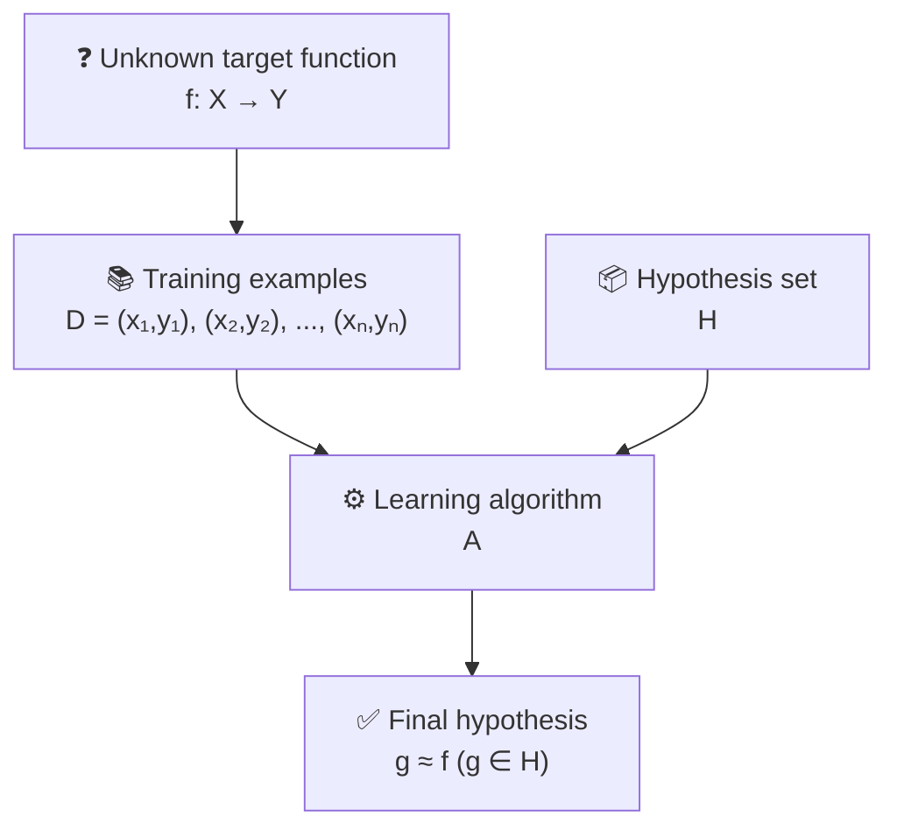
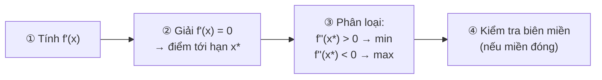
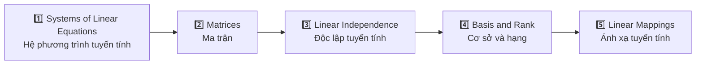
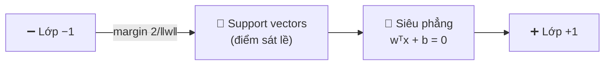

# Buổi 2 – Tổng quan Machine Learning (tiếp)

- **Ngày**: 06/11/2026
- **Môn**: Toán cho Khoa học máy tính (CS115.G11.CN2.TTNT)
- **Giảng viên**: Dương Việt Hằng
- **Lịch học**: Thứ 6, 18h15 – 22h00

## Tài liệu môn học

- Bài giảng online: https://www.youtube.com/watch?v=fM0iXXrTGtg
- Trang môn học trên elearning: https://elearning.citd.edu.vn/course/view.php?id=1997
- Tài liệu xem thêm: https://machinelearningcoban.com

## Nội dung buổi học

### Sơ đồ các thành phần học (Learning Components)

Sơ đồ kinh điển mô tả đầy đủ một bài toán học máy, gồm 5 thành phần:



Giải thích từng thành phần:

- **Unknown target function** $f: \mathcal{X} \to \mathcal{Y}$ – quy luật **thật** ẩn sau dữ liệu. Ta *không bao giờ biết* $f$ là gì, chỉ cố gắng xấp xỉ nó.
- **Training examples** $\mathcal{D} = \{(\mathbf{x}_1, y_1), (\mathbf{x}_2, y_2), \dots, (\mathbf{x}_n, y_n)\}$ – dữ liệu huấn luyện: các cặp *(đầu vào, nhãn đúng)* do $f$ sinh ra.
- **Hypothesis set** $\mathcal{H}$ – **tập tất cả hàm ứng viên** mà thuật toán được phép chọn. Vd $\mathcal{H}$ = họ mọi đường thẳng $y = ax + b$ → mỗi cặp tham số $(a, b)$ là một hàm trong $\mathcal{H}$. *Chọn $\mathcal{H}$ chính là chọn mô hình/giả định.*
- **Learning algorithm** $\mathcal{A}$ – thuật toán dùng $\mathcal{D}$ để **chọn ra một hàm tốt nhất trong $\mathcal{H}$** – tức đi tìm tham số.
- **Final hypothesis** $g \approx f$, $g \in \mathcal{H}$ – hàm cuối cùng được chọn. Vd học xong được $g: y = 2x + 5$ – một phần tử cụ thể của $\mathcal{H}$, là bản xấp xỉ của $f$.

> [!NOTE]
> Đọc theo chiều mũi tên: $f$ (không biết) sinh ra dữ liệu $\mathcal{D}$; dữ liệu $\mathcal{D}$ + tập giả thuyết $\mathcal{H}$ đi vào thuật toán $\mathcal{A}$; $\mathcal{A}$ chọn ra giả thuyết cuối $g \in \mathcal{H}$ sao cho $g \approx f$.

> [!NOTE]
> Nói theo ví dụ cô minh họa: hypothesis set là *hình dáng* hàm $y = ax + b$ (chưa biết $a$, $b$) → qua learning algorithm + data → ra hàm cụ thể $y = 2x + 5$. **"Học" = đi từ $y = ax + b$ (dạng) đến $y = 2x + 5$ (tham số cụ thể).**

> [!WARNING]
> Ký hiệu $g \approx f$ rất quan trọng: ta **không bao giờ đòi** $g = f$, chỉ cần $g$ *đủ gần* $f$ trên dữ liệu chưa thấy. Đây chính là tinh thần "giải thuật xấp xỉ" trong CLO 3 của môn học.

### Hàm chấm điểm (Score function)

> [!NOTE]
> **Mục tiêu của bài toán học là đi tìm score function** – hàm $g$ trong sơ đồ trên chính là score function ta muốn có.

- **Score function** = hàm gán cho mỗi đầu vào $\mathbf{x}$ một **điểm số** (score). Mỗi hàm $h \in \mathcal{H}$ là một score function ứng viên; học = chọn ra score function tốt nhất $g \in \mathcal{H}$.
- Với bài toán **phân loại**: score function cho ra điểm của **từng lớp** (còn gọi là *logits*); dự đoán = lớp có score cao nhất:

$$\hat{y} = \arg\max_c \, s_c(\mathbf{x})$$

- Ví dụ score tuyến tính:

$$s(\mathbf{x}) = \mathbf{w}^{\mathsf{T}}\mathbf{x} + b$$

Score càng cao → $\mathbf{x}$ càng nghiêng về lớp positive; $s(\mathbf{x}) = 0$ là *biên quyết định* (decision boundary).

> [!NOTE]
> Từ toán phổ thông sang ML: quen viết $y = ax + b$ với $a$, $x$ là **số**. Trong ML đầu vào $\mathbf{x}$ là **vector** nhiều đặc trưng (vd hồ sơ tín dụng có 6 thuộc tính) → hệ số cũng phải là **vector trọng số** $\mathbf{w}$, mỗi chiều ứng với một đặc trưng:
>
> $$s(\mathbf{x}) = \mathbf{w}^{\mathsf{T}}\mathbf{x} + b = w_1 x_1 + w_2 x_2 + \dots + w_D x_D + b$$
>
> Chữ $w$ là viết tắt của *weights* (trọng số), $b$ là *bias* (độ lệch). Tích $\mathbf{w}^{\mathsf{T}}\mathbf{x}$ chính là **tích vô hướng** (dot product) giữa 2 vector.

> [!WARNING]
> **Score không phải xác suất** – score có thể âm hoặc lớn hơn 1. Muốn biến score thành xác suất phải đi qua hàm *sigmoid* (2 lớp) hoặc *softmax* (nhiều lớp). Đừng nhầm lẫn hai khái niệm này.

#### Score function tường minh vs không tường minh

- **Tường minh** (explicit) – trường hợp đang học trong môn này: score function có **công thức đóng, đơn giản**, nhìn thấy rõ các tham số. Vd $s(\mathbf{x}) = \mathbf{w}^{\mathsf{T}}\mathbf{x} + b$ → "học" là tìm ra con số cụ thể cho $\mathbf{w}$ và $b$.
- **Không tường minh** (implicit) – khi đi vào **mạng nơ-ron sâu** (deep neural network): score function là *hợp* của rất nhiều lớp biến đổi phi tuyến xếp chồng nhau:

$$s(\mathbf{x}) = f_L\big(f_{L-1}(\dots f_1(\mathbf{x})\dots)\big)$$

  Với hàng triệu tham số rải rác qua các lớp, ta **không viết gọn** được thành một công thức như $y = ax + b$ nữa – bản chất vẫn là "đi tìm score function", nhưng hình dáng hàm không còn minh bạch.


> [!NOTE]
> Dù tường minh hay không, **khung bài toán không đổi**: score function $\in \mathcal{H}$, dùng loss function + data $\mathcal{D}$ để chọn ra $g \approx f$. Chỉ khác là $\mathcal{H}$ của deep learning lớn và phức tạp hơn nhiều.

### Hàm mất mát (Loss function)

Nếu score function là "thứ cần tìm", thì loss function là **thước đo để biết score function nào tốt**:

- **Loss function** = hàm đo **mức độ sai** của score function trên một mẫu: $L\big(y, s(\mathbf{x})\big)$ – so nhãn đúng $y$ với score mà mô hình cho ra. Loss càng **nhỏ** → mô hình càng tốt.
- Ví dụ các loss phổ biến:
  - **Squared error**: $L = (y - \hat{y})^2$ – dùng cho hồi quy.
  - **0–1 loss**: $L = \mathbb{1}[\hat{y} \neq y]$ – sai thì mất 1, đúng thì mất 0 (phân loại).
  - **Cross-entropy loss**: đo độ lệch giữa phân bố dự đoán và nhãn thật – dùng cho phân loại nhiều lớp (sẽ gặp lại ở phần logistic regression).
- **Loss trên cả tập train** (training loss / empirical risk) = trung bình loss trên $n$ mẫu:

$$L_{\mathcal{D}} = \frac{1}{n} \sum_{i=1}^{n} L\big(y_i, s(\mathbf{x}_i)\big)$$

> [!NOTE]
> Gắn lại vào sơ đồ learning components:
> - **Score function** định nghĩa "hình dáng" của hàm → chính là tập $\mathcal{H}$.
> - **Loss function** là tiêu chí chấm điểm mà thuật toán $\mathcal{A}$ dùng để so sánh các ứng viên trong $\mathcal{H}$ → chọn ra $g$ có loss nhỏ nhất.
>
> Tức là: **"học" = tìm score function $g \in \mathcal{H}$ tối thiểu hóa loss trên dữ liệu $\mathcal{D}$**.

#### Quy trình tổng quát của một bài toán học


1. **Xây dựng score function** – chọn "hình dáng" hàm (tuyến tính, perceptron, mạng nơ-ron...) → xác định tập giả thuyết $\mathcal{H}$.
2. **Xây dựng hàm mục tiêu** (objective) – chọn thước đo để chấm điểm các score function:
   - **Loss function** → cần **cực tiểu** (minimize): squared error, cross-entropy...
   - Hoặc hàm đo "độ tốt" → cần **cực đại** (maximize): likelihood (MLE), margin của SVM, accuracy, reward...
3. **Tối ưu hóa** – dùng thuật toán tối ưu (gradient descent, Newton's method... – học kỹ tuần 6–7) để tìm tham số làm hàm mục tiêu đạt **min hoặc max** → ra $g$.

> [!NOTE]
> Minimize hay maximize chỉ là **hai mặt của một bài toán**: đổi dấu hàm thì min ↔ max. Vd SVM nói "cực đại margin $\frac{2}{\|\mathbf{w}\|}$" hay "cực tiểu $\frac{1}{2}\|\mathbf{w}\|^2$" là một; minimize squared-error trên dữ liệu Gauss cũng tương đương maximize likelihood.

**Khi nào min, khi nào max** – nhìn hàm đo *cái gì*:

| Minimize – hàm đo **sai số / độ xấu** | Maximize – hàm đo **độ đúng / độ tốt** |
|---|---|
| Squared error $(y - \hat{y})^2$ – linear regression | Likelihood / log-likelihood – MLE (tuần 4–5) |
| Cross-entropy loss – logistic regression, mạng nơ-ron | Margin $\frac{2}{\|\mathbf{w}\|}$ – SVM |
| Hinge loss – SVM dạng soft margin | Accuracy, $F_1$ – độ đo hiệu năng |
| $\frac{1}{2}\|\mathbf{w}\|^2$ – SVM (≡ max margin) | Reward – học tăng cường (RL) |
| Penalty L1/L2 – regularization (tuần 6–7) | Xác suất / độ khớp của mô hình nói chung |

> [!TIP]
> Mẹo nhận biết nhanh: hỏi *"hàm này càng lớn là càng tốt hay càng tệ?"* – đo **khoảng cách, sai số, hình phạt** → min; đo **xác suất đúng, lợi ích, độ rộng lề** → max.

#### Ôn lại: quy trình tìm cực trị (Extrema)

Bước 3 "tối ưu hóa" ở trên chính là bài toán **tìm cực trị** quen thuộc trong giải tích.

> [!WARNING]
> **Trọng tâm buổi hôm nay**: tìm cực trị của hàm mà **biến là vector** – $f(\mathbf{w})$ với $\mathbf{w} \in \mathbb{R}^D$. Đây đúng là tình huống của ML: tham số mô hình không phải một con số mà là *vector trọng số* (với mạng nơ-ron: hàng triệu chiều). Phần hàm một biến dưới đây chỉ ôn lại để làm bệ phóng.

**Với hàm một biến** $f(x)$:



1. Tính **đạo hàm** $f'(x)$.
2. Giải $f'(x) = 0$ → các **điểm tới hạn** (critical / stationary points) – nơi tiếp tuyến nằm ngang.
3. Phân loại từng điểm:
   - Đạo hàm cấp 2: $f''(x^*) > 0$ → **cực tiểu**; $f''(x^*) < 0$ → **cực đại**; $f''(x^*) = 0$ → chưa kết luận được.
   - Hoặc xét dấu $f'$ quanh điểm (bảng biến thiên): đổi dấu $-$ sang $+$ → cực tiểu; $+$ sang $-$ → cực đại.
4. Nếu miền **đóng**, so thêm giá trị $f$ ở hai đầu biên – cực trị toàn cục có thể nằm ở biên.

**Với hàm nhiều biến** $f(\mathbf{w})$ – trường hợp của ML (tham số là *vector*, không phải một số):

- Đạo hàm thay bằng **gradient**: $\nabla f = \left(\frac{\partial f}{\partial w_1}, \dots, \frac{\partial f}{\partial w_D}\right)$ – vector các đạo hàm riêng.
- Điểm tới hạn thỏa $\nabla f = \mathbf{0}$ (tất cả đạo hàm riêng cùng bằng 0).
- Đạo hàm cấp 2 thay bằng **ma trận Hessian** $\mathbf{H}$ (ma trận các đạo hàm riêng cấp 2): $\mathbf{H}$ *xác định dương* → cực tiểu; *xác định âm* → cực đại.

> [!TIP]
> Liên hệ ML: "học" = tìm $\mathbf{w}$ sao cho $\nabla_{\mathbf{w}} L = \mathbf{0}$ – cực trị của hàm loss.
> - Với hàm **đơn giản** (vd squared error của linear regression): giải $\nabla L = \mathbf{0}$ ra được **nghiệm đóng** (closed-form).
> - Với hàm **phức tạp** (mạng nơ-ron): phương trình $\nabla L = \mathbf{0}$ không giải được → phải *đi dần từng bước* theo hướng gradient giảm – đó chính là **gradient descent** (tuần 6–7).

#### Gradient descent – công thức cơ bản

Khi không giải được $\nabla L = \mathbf{0}$ trực tiếp, ta **lặp** từ một điểm khởi tạo $\mathbf{w}_0$:

$$\boxed{\;\mathbf{w}_{k+1} = \mathbf{w}_k - \eta \, \nabla L(\mathbf{w}_k)\;}$$

- $\mathbf{w}_k$ – vector tham số tại bước lặp thứ $k$.
- $\nabla L(\mathbf{w}_k)$ – **gradient** tại điểm hiện tại: vector chỉ *hướng hàm tăng nhanh nhất* → $-\nabla L$ là hướng **giảm nhanh nhất**. Dấu trừ trong công thức nghĩa là "đi xuống dốc".
- $\eta$ (eta – đọc "ê-ta") – **learning rate** (tốc độ học): độ lớn của mỗi bước nhảy.

> [!WARNING]
> **Điều kiện tối thượng: vòng lặp phải hội tụ** – dãy $\mathbf{w}_k$ phải tiến về điểm cực trị $\mathbf{w}^*$ khi $k \to \infty$. Lặp mà *không hội tụ* (dao động qua lại, hoặc phân kỳ bay xa) thì mọi phương pháp lặp đều vô nghĩa. Với hàm **lồi** (convex) + $\eta$ đủ nhỏ → bảo đảm hội tụ về min toàn cục; với hàm không lồi (mạng nơ-ron) thì chỉ hội tụ về cực trị địa phương hoặc kẹt ở saddle.

**Learning rate $\eta$ – con số quyết định hội tụ:**

| Độ lớn $\eta$ | Hệ quả |
|---|---|
| Quá **nhỏ** | Bước nhảy tí hon → hội tụ rất chậm, tốn nhiều vòng lặp |
| **Vừa** | Tiến đều, ổn định về đáy |
| Quá **lớn** | Nhảy quá đà, vượt qua đáy → dao động hai bên min, thậm chí phân kỳ (loss tăng dần) |

- $\eta$ là **hyperparameter** (siêu tham số) quan trọng bậc nhất của ML – chọn sai thì cả quá trình học hỏng; nó do *người* chọn, không phải tham số máy tự học.
- **Điều kiện dừng** trong thực tế: $\|\nabla L(\mathbf{w}_k)\| < \varepsilon$ (gradient ≈ 0 → tới điểm tới hạn), hoặc $|L(\mathbf{w}_{k+1}) - L(\mathbf{w}_k)| < \varepsilon$ (loss không cải thiện), hoặc chạm số vòng lặp tối đa.
- Khắc phục khó chọn $\eta$: *learning rate schedule* (giảm $\eta$ dần theo thời gian), hoặc các biến thể tự thích nghi – Momentum, Nesterov, Adagrad, RMSprop, Adam (đúng danh sách tuần 6–7).

#### Quick review: đại số tuyến tính

Roadmap phần ôn tập trên lớp (theo chương 2 – *Mathematics for Machine Learning*):



**1. Hệ phương trình tuyến tính (Systems of linear equations)**

- Dạng ma trận $\mathbf{A}\mathbf{x} = \mathbf{b}$ – viết tường minh là $m$ phương trình bậc nhất, $n$ ẩn:

$$\begin{cases} a_{11}x_1 + a_{12}x_2 + \dots + a_{1n}x_n = b_1 \\ \;\; \vdots \\ a_{m1}x_1 + a_{m2}x_2 + \dots + a_{mn}x_n = b_m \end{cases} \iff \mathbf{A}\mathbf{x} = \mathbf{b}$$

với các **biến ẩn** $(x_1, \dots, x_n) \in \mathbb{R}^n$.

- **Hai cách nhìn $\mathbf{A}\mathbf{x} = \mathbf{b}$:**
  - *Theo hàng* (row picture): $m$ phương trình – phương trình thứ $i$ là tích vô hướng của *hàng* $i$ của $\mathbf{A}$ với $\mathbf{x}$. Về hình học mỗi phương trình là một siêu phẳng; nghiệm = giao điểm các siêu phẳng.
  - *Theo cột* (column picture) – cách nhìn quan trọng của slide: $\mathbf{A}\mathbf{x}$ chính là **tổ hợp tuyến tính của các cột** $\mathbf{A}$ với hệ số $x_i$:

$$x_1 \begin{pmatrix} a_{11} \\ \vdots \\ a_{m1} \end{pmatrix} + x_2 \begin{pmatrix} a_{12} \\ \vdots \\ a_{m2} \end{pmatrix} + \dots + x_n \begin{pmatrix} a_{1n} \\ \vdots \\ a_{mn} \end{pmatrix} = \mathbf{b}$$

  → Giải hệ = hỏi *"có tồn tại cách trộn các cột của $\mathbf{A}$ ra $\mathbf{b}$ không?"* – hệ có nghiệm ⟺ $\mathbf{b}$ thuộc **không gian cột** (column space – không gian con sinh bởi các cột của $\mathbf{A}$). Đây là gốc rễ của luật rank quyết định số nghiệm ở dưới.

- Cách giải kinh điển: **khử Gauss** (Gaussian elimination).

**Phương pháp khử Gauss (Gaussian elimination)**

*Ý tưởng*: biến đổi hệ thành hệ **tương đương đơn giản hơn** dạng tam giác – ẩn cuối chỉ xuất hiện ở phương trình cuối → giải từ dưới lên (thế ngược).

- Làm việc trên **ma trận mở rộng** $[\mathbf{A} \,|\, \mathbf{b}]$ (augmented matrix) – ghép cột $\mathbf{b}$ vào $\mathbf{A}$, khỏi phải viết lại cả hệ.
- Chỉ được dùng 3 **phép biến đổi sơ cấp trên hàng** (elementary row operations) – vì chúng *không làm đổi tập nghiệm*:
  1. **Đổi chỗ** 2 hàng.
  2. **Nhân** một hàng với số $\neq 0$.
  3. **Cộng bội số** của một hàng vào hàng khác (đây là phép "khử" – dùng để triệt tiêu ẩn).
- Mục tiêu: đưa về **dạng bậc thang** (xem giải thích bên dưới).
- Sau đó **thế ngược** (back-substitution): từ phương trình cuối tính ẩn cuối, thế dần lên trên.

**Ma trận dạng bậc thang (Row Echelon Form – REF)**

Là ma trận thỏa 3 điều kiện – hình dung giống *cầu thang*, các "bậc" lùi dần sang phải khi đi xuống:

1. Hàng toàn số 0 (nếu có) nằm **dưới cùng**.
2. Phần tử khác 0 đầu tiên của mỗi hàng – gọi là **pivot** (phần tử trụ / leading entry) – nằm **bên phải** pivot của hàng phía trên.
3. Mọi phần tử *dưới* một pivot đều bằng 0 (hệ quả của điều kiện 2).

$$\begin{pmatrix} \boxed{1} & * & * & * \\ 0 & 0 & \boxed{2} & * \\ 0 & 0 & 0 & \boxed{3} \\ 0 & 0 & 0 & 0 \end{pmatrix} \quad \text{pivot ở cột 1, 3, 4}$$

- **Dạng bậc thang rút gọn** (Reduced REF – RREF): thêm 2 điều kiện – mọi pivot $= 1$ và *toàn bộ* phần tử còn lại trong cột chứa pivot $= 0$. RREF của một ma trận là **duy nhất** (còn REF thì có thể nhiều dạng khác nhau).
- **Đọc nghiệm từ dạng bậc thang** của $[\mathbf{A} \,|\, \mathbf{b}]$:
  - Xuất hiện hàng $[0 \; \dots \; 0 \,|\, c]$ với $c \neq 0$ → phương trình $0 = c$ vô lý → hệ **vô nghiệm**.
  - Số pivot của $\mathbf{A}$ = $\text{rank}(\mathbf{A})$ → **số pivot chính là hạng ma trận** – khử Gauss cũng là cách tính rank.
  - Số pivot $=$ số ẩn $n$ → **nghiệm duy nhất**; số pivot $< n$ → có $n - \text{rank}$ **ẩn tự do** (free variables – gán giá trị tùy ý được) → **vô số nghiệm**.

> [!NOTE]
> Ba trường hợp nghiệm của hệ tuyến tính – *vô nghiệm / duy nhất / vô số* – đọc hết ra từ dạng bậc thang, không cần giải tiếp. Đây là lý do khử Gauss là công cụ nền: nó biến câu hỏi "hệ có nghiệm không?" thành "đếm pivot".

**Ví dụ trên lớp – hệ 3 phương trình, 4 ẩn:**

$$\begin{cases} 2x_1 - 4x_2 + 12x_3 - 10x_4 = 58 \\ -x_1 + 2x_2 - 3x_3 + 2x_4 = -14 \\ 2x_1 - 4x_2 + 9x_3 - 6x_4 = 44 \end{cases}$$

Cô giải theo hướng **Gauss–Jordan** – không dừng ở dạng bậc thang rồi thế ngược, mà khử luôn các phần tử *trên* pivot để về RREF, đọc nghiệm trực tiếp:

$$\left[\begin{array}{cccc|c} 2 & -4 & 12 & -10 & 58 \\ -1 & 2 & -3 & 2 & -14 \\ 2 & -4 & 9 & -6 & 44 \end{array}\right] \xrightarrow{(1/2)R_1} \left[\begin{array}{cccc|c} 1 & -2 & 6 & -5 & 29 \\ -1 & 2 & -3 & 2 & -14 \\ 2 & -4 & 9 & -6 & 44 \end{array}\right] \xrightarrow{\begin{subarray}{l} R_2 + R_1 \\ R_3 - 2R_1 \end{subarray}} \left[\begin{array}{cccc|c} 1 & -2 & 6 & -5 & 29 \\ 0 & 0 & 3 & -3 & 15 \\ 0 & 0 & -3 & 4 & -14 \end{array}\right]$$

$$\xrightarrow{(1/3)R_2} \left[\begin{array}{cccc|c} 1 & -2 & 6 & -5 & 29 \\ 0 & 0 & 1 & -1 & 5 \\ 0 & 0 & -3 & 4 & -14 \end{array}\right] \xrightarrow{\begin{subarray}{l} R_1 - 6R_2 \\ R_3 + 3R_2 \end{subarray}} \left[\begin{array}{cccc|c} 1 & -2 & 0 & 1 & -1 \\ 0 & 0 & 1 & -1 & 5 \\ 0 & 0 & 0 & 1 & 1 \end{array}\right] \xrightarrow{\begin{subarray}{l} R_1 - R_3 \\ R_2 + R_3 \end{subarray}} \left[\begin{array}{cccc|c} \boxed{1} & -2 & 0 & 0 & -2 \\ 0 & 0 & \boxed{1} & 0 & 6 \\ 0 & 0 & 0 & \boxed{1} & 1 \end{array}\right]$$

Ma trận cuối chính là **RREF** – đọc nghiệm trực tiếp, không cần thế ngược:

$$\begin{cases} x_1 - 2x_2 = -2 \\ x_3 = 6 \\ x_4 = 1 \end{cases}$$

- Pivot ở **cột 1, 3, 4** → $\text{rank}(\mathbf{A}) = 3$; cột 2 **không có pivot** → $x_2$ là **ẩn tự do** (free variable).
- rank $= 3 < n = 4$ → **vô số nghiệm**, đúng 1 ẩn tự do ($n - \text{rank} = 1$).
- $x_1 = 2x_2 - 2$ – phụ thuộc vào ẩn tự do.

Đặt $x_2 = t \in \mathbb{R}$ → **nghiệm tổng quát**:

$$\mathbf{x} = \begin{pmatrix} 2t - 2 \\ t \\ 6 \\ 1 \end{pmatrix} = \underbrace{\begin{pmatrix} -2 \\ 0 \\ 6 \\ 1 \end{pmatrix}}_{\text{một nghiệm riêng}} + t \underbrace{\begin{pmatrix} 2 \\ 1 \\ 0 \\ 0 \end{pmatrix}}_{\text{nghiệm hệ thuần nhất}}$$

> [!TIP]
> Thử lại nhanh (với mọi $t$): phương trình 1 cho $4t - 4 - 4t + 72 - 10 = 58$ ✓. Cấu trúc nghiệm *một nghiệm riêng + bội số nghiệm thuần nhất* ($\mathbf{A}\mathbf{x} = \mathbf{0}$) là dạng chuẩn của nghiệm tổng quát hệ tuyến tính.

**Ví dụ**: $\begin{cases} x + y = 3 \\ x - y = 1 \end{cases}$

$$\left[\begin{array}{cc|c} 1 & 1 & 3 \\ 1 & -1 & 1 \end{array}\right] \xrightarrow{\text{hàng}_2 - \text{hàng}_1} \left[\begin{array}{cc|c} 1 & 1 & 3 \\ 0 & -2 & -2 \end{array}\right] \Rightarrow y = 1,\; x = 2$$

> [!TIP]
> Biến thể **Gauss–Jordan**: khử tiếp cả phần *trên* đường chéo để về dạng bậc thang rút gọn (pivot = 1, cột pivot toàn số 0) → đọc nghiệm trực tiếp, không cần thế ngược. Cùng một thao tác áp lên $[\mathbf{A} \,|\, \mathbf{I}]$ cho ra $[\mathbf{I} \,|\, \mathbf{A}^{-1}]$ – đây cũng là **cách tính ma trận nghịch đảo**.
- Hệ **vuông** ($m = n$) với $\det(\mathbf{A}) \neq 0$ ($\mathbf{A}$ khả nghịch) → nghiệm **duy nhất** $\mathbf{x} = \mathbf{A}^{-1}\mathbf{b}$.
- Nói chung số nghiệm phụ thuộc **hạng** (rank) của ma trận: hệ có nghiệm ⟺ $\text{rank}(\mathbf{A}) = \text{rank}\big([\mathbf{A}|\mathbf{b}]\big)$; nghiệm *duy nhất* khi rank bằng số ẩn; ít hơn → vô số nghiệm; hai rank khác nhau → vô nghiệm.

> [!NOTE]
> **Liên hệ ML – mấu chốt của buổi học**: với linear regression, đặt $\nabla L = \mathbf{0}$ cho ra đúng một **hệ phương trình tuyến tính** theo $\mathbf{w}$:
>
> $$\nabla_{\mathbf{w}} L = \mathbf{0} \iff \mathbf{X}^{\mathsf{T}}\mathbf{X}\,\mathbf{w} = \mathbf{X}^{\mathsf{T}}\mathbf{y} \;\Rightarrow\; \hat{\mathbf{w}} = \left(\mathbf{X}^{\mathsf{T}}\mathbf{X}\right)^{-1}\mathbf{X}^{\mathsf{T}}\mathbf{y}$$
>
> Hệ $\mathbf{X}^{\mathsf{T}}\mathbf{X}\,\mathbf{w} = \mathbf{X}^{\mathsf{T}}\mathbf{y}$ gọi là **hệ phương trình chuẩn** (normal equations). Nó xuất hiện vì hệ gốc $\mathbf{X}\mathbf{w} = \mathbf{y}$ thường **quá xác định** (overdetermined – nhiều điểm dữ liệu hơn tham số) nên không có nghiệm chính xác → phải giải *xấp xỉ* theo nghĩa **bình phương tối thiểu** (least squares): $\min_{\mathbf{w}} \|\mathbf{X}\mathbf{w} - \mathbf{y}\|^2$. Đây chính là trường hợp "giải $\nabla L = \mathbf{0}$ ra nghiệm đóng".

**Least squares (bình phương tối thiểu) là gì?**

- **Bối cảnh**: hệ $\mathbf{A}\mathbf{x} = \mathbf{b}$ *quá xác định* – $\mathbf{b}$ không nằm trong không gian cột của $\mathbf{A}$ nên **không có nghiệm chính xác**. Trong ML: nhiều điểm dữ liệu hơn tham số, không đường nào đi qua hết được.
- **Ý tưởng**: chấp nhận không khớp tuyệt đối – tìm $\mathbf{x}$ sao cho $\mathbf{A}\mathbf{x}$ **gần $\mathbf{b}$ nhất có thể**. "Gần" đo bằng tổng bình phương các sai số (residuals):

$$\min_{\mathbf{x}} \; \|\mathbf{A}\mathbf{x} - \mathbf{b}\|^2 = \sum_{i=1}^{m} \big((\mathbf{A}\mathbf{x})_i - b_i\big)^2$$

  Tên gọi "least squares" = tổng *bình phương* sai số *nhỏ nhất* – squared-error loss chính là least squares, và linear regression bản chất là một bài toán least squares.

- **Nhìn hình học**: nghiệm least squares $\hat{\mathbf{x}}$ cho $\mathbf{A}\hat{\mathbf{x}}$ = **hình chiếu vuông góc** của $\mathbf{b}$ lên không gian cột $\mathbf{A}$ – điểm gần $\mathbf{b}$ nhất trong không gian cột. Khi đó residual $\mathbf{b} - \mathbf{A}\hat{\mathbf{x}}$ *vuông góc với mọi cột* của $\mathbf{A}$:

$$\mathbf{A}^{\mathsf{T}}\big(\mathbf{b} - \mathbf{A}\hat{\mathbf{x}}\big) = \mathbf{0} \iff \mathbf{A}^{\mathsf{T}}\mathbf{A}\hat{\mathbf{x}} = \mathbf{A}^{\mathsf{T}}\mathbf{b}$$

  → Đây chính là chỗ **normal equations** sinh ra: "thặng dư vuông góc không gian cột".

> [!NOTE]
> **Vì sao lấy bình phương?** (1) phạt sai lớn nặng hơn sai nhỏ; (2) đạo hàm tuyến tính theo $\mathbf{w}$ → hệ tuyến tính → nghiệm đóng; (3) tương đương Maximum Likelihood khi nhiễu Gauss – sẽ gặp lại trong phần MLE (tuần 4–5).

**Các thuật toán giải hệ tuyến tính**

1. **Pseudo-inverse (Moore–Penrose)**: nhân hai vế của $\mathbf{A}\mathbf{x} = \mathbf{b}$ với $\mathbf{A}^{\mathsf{T}}$:

$$\mathbf{A}\mathbf{x} = \mathbf{b} \implies \mathbf{A}^{\mathsf{T}}\mathbf{A}\mathbf{x} = \mathbf{A}^{\mathsf{T}}\mathbf{b} \iff \mathbf{x} = (\mathbf{A}^{\mathsf{T}}\mathbf{A})^{-1}\mathbf{A}^{\mathsf{T}}\mathbf{b}$$

   - Ma trận $(\mathbf{A}^{\mathsf{T}}\mathbf{A})^{-1}\mathbf{A}^{\mathsf{T}}$ gọi là **giả nghịch đảo Moore–Penrose** $\mathbf{A}^{+}$ – "nghịch đảo" dành cho ma trận *không vuông*; đây chính là công thức nghiệm least squares ở note trên.
   - Đẹp về lý thuyết nhưng **tốn nhiều phép tính** (nhân ma trận, nghịch đảo) → ít khi dùng trực tiếp cho hệ lớn.

> [!NOTE]
> **Vì sao $\mathbf{A}^{-1}$ không tồn tại?** Có 2 nguyên nhân:
>
> 1. **$\mathbf{A}$ không vuông** ($m \neq n$): nghịch đảo đòi $\mathbf{A}\mathbf{B} = \mathbf{I}$ *và* $\mathbf{B}\mathbf{A} = \mathbf{I}$ cùng lúc – chỉ khả thi với ma trận vuông. Với hệ quá xác định ($m > n$ – nhiều phương trình hơn ẩn), $\mathbf{A}$ "cao gầy" ánh xạ từ $\mathbb{R}^n$ vào $\mathbb{R}^m$ lớn hơn: ảnh của nó chỉ phủ một *không gian con* của $\mathbb{R}^m$ → không đảo ngược toàn bộ được.
> 2. **$\mathbf{A}$ vuông nhưng singular** ($\det(\mathbf{A}) = 0$, rank $< n$): các cột phụ thuộc tuyến tính → phép nhân $\mathbf{A}$ *nén mất thông tin*, nhiều $\mathbf{x}$ khác nhau cho cùng một $\mathbf{A}\mathbf{x}$ → không tồn tại ánh xạ ngược.
>
> → Pseudo-inverse khắc phục cả hai: $\mathbf{A}^{\mathsf{T}}\mathbf{A}$ là ma trận **vuông** $n \times n$ – khi các cột của $\mathbf{A}$ độc lập (full column rank) thì $\mathbf{A}^{\mathsf{T}}\mathbf{A}$ khả nghịch, cho ta *nghịch đảo một phía*: $\underbrace{(\mathbf{A}^{\mathsf{T}}\mathbf{A})^{-1}\mathbf{A}^{\mathsf{T}}}_{\mathbf{A}^{+}}\mathbf{A} = \mathbf{I}$.

> [!WARNING]
> **$(\mathbf{A}^{\mathsf{T}}\mathbf{A})^{-1}$ có luôn tồn tại không? – KHÔNG.**
>
> Tính chất quan trọng: $\text{rank}(\mathbf{A}^{\mathsf{T}}\mathbf{A}) = \text{rank}(\mathbf{A})$. Mà $\mathbf{A}^{\mathsf{T}}\mathbf{A}$ là ma trận vuông $n \times n$ nên khả nghịch ⟺ $\text{rank}(\mathbf{A}) = n$ ⟺ **các cột của $\mathbf{A}$ độc lập tuyến tính** (full column rank).
>
> Nó hỏng khi:
> - Các cột $\mathbf{A}$ **phụ thuộc tuyến tính** – trong ML gọi là *đa cộng tuyến* (multicollinearity): một đặc trưng biểu diễn được qua các đặc trưng khác (vd hai cột thông tin trùng nhau).
> - $m < n$ – hệ **thiếu xác định** (underdetermined, ít phương trình hơn ẩn): rank $\leq m < n$ nên không bao giờ full column rank.
>
> Cách cứu khi $(\mathbf{A}^{\mathsf{T}}\mathbf{A})$ singular:
> - **Ridge / regularization L2**: dùng $(\mathbf{A}^{\mathsf{T}}\mathbf{A} + \lambda\mathbf{I})^{-1}$ với $\lambda > 0$ – luôn khả nghịch (đây chính là lý do $\lambda\mathbf{I}$ xuất hiện ở note trên).
> - **Giả nghịch đảo Moore–Penrose bản đầy đủ** (tính qua SVD – chủ đề đồ án số 1) thì tồn tại với *mọi* ma trận; công thức $(\mathbf{A}^{\mathsf{T}}\mathbf{A})^{-1}\mathbf{A}^{\mathsf{T}}$ chỉ là trường hợp riêng khi $\mathbf{A}$ full column rank.

2. **Khử Gauss** (Gaussian elimination): cách **trực quan, xây dựng từng bước** (constructive) như trên – độ phức tạp **bậc ba** $O(n^3)$ theo số phương trình đồng thời.

3. **Phương pháp lặp** (iterative methods): giải *gián tiếp* – xuất phát từ một nghiệm đoán ban đầu rồi **cải thiện dần qua từng vòng lặp**; cách thực tế khi hệ rất lớn (nhất là ma trận thưa):
   - *Stationary iterative methods*: Richardson, Jacobi, Gauss–Seidel, successive over-relaxation (SOR).
   - *Krylov subspace methods*: conjugate gradient (CG), GMRES, biconjugate gradients.

> [!TIP]
> Tư tưởng "lặp dần tới nghiệm" của nhóm 3 chính là tinh thần **gradient descent**: khi không giải trực tiếp được (hệ quá lớn hoặc loss phi tuyến), ta xấp xỉ nghiệm qua nhiều bước cập nhật – sẽ gặp lại ở tuần 6–7.

**2. Ma trận (Matrices)**

Ma trận $\mathbf{A} \in \mathbb{R}^{m \times n}$ – "ma trận a thuộc R mũ m nhân n": $m$ hàng, $n$ cột, phần tử $a_{ij}$ ở hàng $i$ cột $j$.

- **Phép cộng**: chỉ cộng được 2 ma trận *cùng kích thước* – cộng từng phần tử tương ứng (element-wise):

$$\mathbf{A} + \mathbf{B} := \begin{pmatrix} a_{11} + b_{11} & \cdots & a_{1n} + b_{1n} \\ \vdots & & \vdots \\ a_{m1} + b_{m1} & \cdots & a_{mn} + b_{mn} \end{pmatrix} \in \mathbb{R}^{m \times n}$$

- **Phép nhân**: $\mathbf{A} \in \mathbb{R}^{m \times n}$, $\mathbf{B} \in \mathbb{R}^{n \times k}$ → $\mathbf{C} = \mathbf{A}\mathbf{B} \in \mathbb{R}^{m \times k}$, với phần tử:

$$c_{ij} = \sum_{l=1}^{n} a_{il}\, b_{lj}, \quad i = 1,\dots,m, \;\; j = 1,\dots,k$$

  Tức $c_{ij}$ = **tích vô hướng** của *hàng* $i$ của $\mathbf{A}$ với *cột* $j$ của $\mathbf{B}$.

**Điều kiện thực hiện phép toán:**

| Phép | Điều kiện | Kích thước kết quả |
|---|---|---|
| Cộng $\mathbf{A} + \mathbf{B}$ | $\mathbf{A}$, $\mathbf{B}$ **cùng kích thước** | $m \times n$ (giữ nguyên) |
| Nhân $\mathbf{A}\mathbf{B}$ | **số cột của $\mathbf{A}$ = số hàng của $\mathbf{B}$** – $(m \times n)(n \times k)$ | $m \times k$ (hai chiều ngoài) |

> [!TIP]
> Mẹo nhớ phép nhân: viết kích thước cạnh nhau $(m \times \mathbf{n})(\mathbf{n} \times k)$ – **hai chiều trong giống nhau thì nhân được, hai chiều ngoài là kích thước kết quả**.

> [!WARNING]
> Phép nhân ma trận **không giao hoán**: nói chung $\mathbf{A}\mathbf{B} \neq \mathbf{B}\mathbf{A}$ – thứ tự nhân rất quan trọng. Nhưng vẫn *kết hợp* $(\mathbf{A}\mathbf{B})\mathbf{C} = \mathbf{A}(\mathbf{B}\mathbf{C})$ (với $\mathbf{A} \in \mathbb{R}^{m \times n}$, $\mathbf{B} \in \mathbb{R}^{n \times p}$, $\mathbf{C} \in \mathbb{R}^{p \times q}$) và *phân phối cả hai phía*: $\mathbf{A}(\mathbf{C}+\mathbf{D}) = \mathbf{A}\mathbf{C} + \mathbf{A}\mathbf{D}$ và $(\mathbf{A}+\mathbf{B})\mathbf{C} = \mathbf{A}\mathbf{C} + \mathbf{B}\mathbf{C}$.

- **Chuyển vị** (transpose) $\mathbf{A}^{\mathsf{T}}$: đổi hàng thành cột. Quy tắc hay dùng: $(\mathbf{A}\mathbf{B})^{\mathsf{T}} = \mathbf{B}^{\mathsf{T}}\mathbf{A}^{\mathsf{T}}$ – **đảo thứ tự**.
- **Ma trận đơn vị** (identity matrix) $\mathbf{I}_n$: ma trận *vuông* cỡ $n \times n$, đường chéo toàn số 1 ($I_{ii} = 1$), các vị trí còn lại toàn số 0 ($I_{ij} = 0$ với $i \neq j$):

$$\mathbf{I}_2 = \begin{pmatrix} 1 & 0 \\ 0 & 1 \end{pmatrix}, \qquad \mathbf{I}_4 = \begin{pmatrix} 1 & 0 & 0 & 0 \\ 0 & 1 & 0 & 0 \\ 0 & 0 & 1 & 0 \\ 0 & 0 & 0 & 1 \end{pmatrix}$$

  $\mathbf{I}$ là **phần tử trung hòa của phép nhân** – nhân với $\mathbf{I}$ không làm gì thay đổi, giống nhân với số 1: với $\mathbf{A} \in \mathbb{R}^{m \times n}$ thì $\mathbf{I}_m \mathbf{A} = \mathbf{A} \mathbf{I}_n = \mathbf{A}$ – lưu ý cỡ của $\mathbf{I}$ **khác nhau ở hai phía** (trái là $\mathbf{I}_m$, phải là $\mathbf{I}_n$) để phép nhân khớp chiều.
- **Ma trận không** (zero matrix) $\mathbf{0}$: ma trận toàn số 0 – **phần tử trung hòa của phép cộng**: $\mathbf{A} + \mathbf{0} = \mathbf{A}$, giống cộng với số 0.
- **Ma trận nghịch đảo** (inverse) $\mathbf{A}^{-1}$ – chỉ xét cho ma trận *vuông* $\mathbf{A} \in \mathbb{R}^{n \times n}$: $\mathbf{B}$ là nghịch đảo của $\mathbf{A}$, ký hiệu $\mathbf{A}^{-1}$, khi

$$\mathbf{A}\mathbf{B} = \mathbf{I}_n = \mathbf{B}\mathbf{A}$$

  (cần đúng **cả hai chiều** nhân – đừng quên vì phép nhân không giao hoán).
  - Ma trận có nghịch đảo được gọi là **regular / invertible / nonsingular** (khả nghịch, không suy biến); ngược lại là **singular** (suy biến).
  - Nghịch đảo **không phải lúc nào cũng tồn tại** – khác với số, ở đây chỉ số 0 mới không có $\frac{1}{a}$, còn ma trận thì *rất nhiều* ma trận $\neq \mathbf{0}$ vẫn singular (khi $\det(\mathbf{A}) = 0$, tức các cột phụ thuộc tuyến tính). Nhưng nếu tồn tại thì **duy nhất**.
  - Ý nghĩa: nghịch đảo là "phép chia" của ma trận – giống $\frac{1}{a}$ với số; và là phần tử *nghịch đảo* đối với phép nhân (nhân ra phần tử trung hòa $\mathbf{I}$).
  - Quy tắc hay dùng: $(\mathbf{A}\mathbf{B})^{-1} = \mathbf{B}^{-1}\mathbf{A}^{-1}$ – đảo thứ tự như chuyển vị.

**Tổng hợp tính chất nghịch đảo & chuyển vị:**

| Nghịch đảo | Chuyển vị |
|---|---|
| $\mathbf{A}\mathbf{A}^{-1} = \mathbf{I} = \mathbf{A}^{-1}\mathbf{A}$ | $(\mathbf{A}^{\mathsf{T}})^{\mathsf{T}} = \mathbf{A}$ |
| $(\mathbf{A}\mathbf{B})^{-1} = \mathbf{B}^{-1}\mathbf{A}^{-1}$ | $(\mathbf{A}\mathbf{B})^{\mathsf{T}} = \mathbf{B}^{\mathsf{T}}\mathbf{A}^{\mathsf{T}}$ |
| $(\mathbf{A}+\mathbf{B})^{-1} \neq \mathbf{A}^{-1} + \mathbf{B}^{-1}$ ⚠️ | $(\mathbf{A}+\mathbf{B})^{\mathsf{T}} = \mathbf{A}^{\mathsf{T}} + \mathbf{B}^{\mathsf{T}}$ ✅ |

> [!WARNING]
> Khác biệt dễ nhầm: **chuyển vị** phân phối được qua phép *cộng*, còn **nghịch đảo thì không** – $(\mathbf{A}+\mathbf{B})^{-1} \neq \mathbf{A}^{-1} + \mathbf{B}^{-1}$.

> [!NOTE]
> **Ứng dụng trong ML:**
> - **Ma trận nghịch đảo** chính là trái tim của nghiệm đóng linear regression: $\hat{\mathbf{w}} = (\mathbf{X}^{\mathsf{T}}\mathbf{X})^{-1}\mathbf{X}^{\mathsf{T}}\mathbf{y}$ – "học" quy về một phép nghịch đảo. Nghịch đảo của ma trận hiệp phương sai (covariance) còn gọi là *precision matrix*, dùng trong GMM, LDA.
> - **Ma trận đơn vị** xuất hiện khắp nơi: trong phương trình trị riêng $\det(\mathbf{A} - \lambda\mathbf{I}) = 0$, và đặc biệt trong **regularization L2 (ridge)**: $\hat{\mathbf{w}} = (\mathbf{X}^{\mathsf{T}}\mathbf{X} + \lambda\mathbf{I})^{-1}\mathbf{X}^{\mathsf{T}}\mathbf{y}$ – cộng $\lambda\mathbf{I}$ khiến ma trận luôn khả nghịch, tránh trường hợp singular.

> [!CAUTION]
> Trong thực hành lập trình, **không bao giờ tính $\mathbf{A}^{-1}$ rồi nhân** để giải $\mathbf{A}\mathbf{x} = \mathbf{b}$ – vừa tốn kém ($O(n^3)$) vừa kém ổn định số. Dùng các phương pháp số trực tiếp (LU, QR...): `np.linalg.solve(A, b)` thay vì `np.linalg.inv(A) @ b`.

- **Định thức** $\det(\mathbf{A})$ (đọc "det A") – ma trận $2\times2$: $ad - bc$; $\det \neq 0$ ⟺ khả nghịch.
- **Nhân vô hướng** (scalar multiplication) $\lambda \mathbf{A}$, $\lambda \in \mathbb{R}$: nhân *từng phần tử* của ma trận với $\lambda$:

$$3 \cdot \begin{pmatrix} 0 & 2 \\ 1 & -1 \\ 0 & 1 \end{pmatrix} = \begin{pmatrix} 0 & 6 \\ 3 & -3 \\ 0 & 3 \end{pmatrix}$$

  Tính chất:
  - *Kết hợp* (associativity): $(\lambda\psi)\mathbf{C} = \lambda(\psi\mathbf{C})$; $\lambda(\mathbf{B}\mathbf{C}) = (\lambda\mathbf{B})\mathbf{C} = \mathbf{B}(\lambda\mathbf{C})$; $(\lambda\mathbf{C})^{\mathsf{T}} = \lambda\mathbf{C}^{\mathsf{T}}$ – vô hướng "trôi" được qua phép nhân và chuyển vị.
  - *Phân phối* (distributivity): $(\lambda + \psi)\mathbf{C} = \lambda\mathbf{C} + \psi\mathbf{C}$ và $\lambda(\mathbf{B} + \mathbf{C}) = \lambda\mathbf{B} + \lambda\mathbf{C}$.
  - $\lambda$, $\psi$ là chữ Hy Lạp – đọc "lam-đa", "si" (psi) – quy ước hay dùng cho hệ số vô hướng.

**3. Độc lập tuyến tính (Linear independence)**

- **Tổ hợp tuyến tính** (linear combination): $\lambda_1 \mathbf{v}_1 + \lambda_2 \mathbf{v}_2 + \dots + \lambda_k \mathbf{v}_k$ – cộng các vector đã nhân hệ số.
- Các vector $\mathbf{v}_1, \dots, \mathbf{v}_k$ **độc lập tuyến tính** (linearly independent) khi:

$$\lambda_1 \mathbf{v}_1 + \dots + \lambda_k \mathbf{v}_k = \mathbf{0} \;\Rightarrow\; \lambda_1 = \dots = \lambda_k = 0$$

  Tức *không có cách nào* tổ hợp ra $\mathbf{0}$ ngoài cách tầm thường (mọi hệ số = 0).
- Ngược lại là **phụ thuộc tuyến tính** (linearly dependent): tồn tại tổ hợp ra $\mathbf{0}$ với hệ số không đồng thời bằng 0 ⟺ *một vector viết được qua các vector còn lại* → có vector **dư thừa**, không mang thông tin mới.

> [!NOTE]
> **Kiểm tra độc lập của các tổ hợp tuyến tính**: cho $k$ vector $\mathbf{b}_1, \dots, \mathbf{b}_k$ *độc lập* trong không gian $V$, và $m$ vector $\mathbf{x}_j$ là tổ hợp của chúng – $\mathbf{x}_j = \mathbf{B}\boldsymbol{\lambda}_j$ với $\mathbf{B} = [\mathbf{b}_1 \; \dots \; \mathbf{b}_k]$ và $\boldsymbol{\lambda}_j$ là vector hệ số. Khi đó mọi tổ hợp của các $\mathbf{x}_j$ đều viết được:
>
> $$\sum_{j=1}^{m}\psi_j \mathbf{x}_j = \sum_{j=1}^{m}\psi_j \mathbf{B}\boldsymbol{\lambda}_j = \mathbf{B}\sum_{j=1}^{m}\psi_j \boldsymbol{\lambda}_j$$
>
> Vì các $\mathbf{b}_i$ độc lập, vế phải bằng $\mathbf{0}$ chỉ khi $\sum \psi_j \boldsymbol{\lambda}_j = \mathbf{0}$. Suy ra kết luận then chốt:
>
> $$\{\mathbf{x}_j\} \text{ độc lập tuyến tính} \iff \{\boldsymbol{\lambda}_j\} \text{ độc lập tuyến tính}$$
>
> Tức việc kiểm tra độc lập của các *tổ hợp* quy về kiểm tra các **vector hệ số** – chỉ là một hệ tuyến tính theo $\boldsymbol{\lambda}$.
>
> **Hệ quả**: nếu $m > k$ (nhiều tổ hợp hơn số vector gốc) thì $\{\mathbf{x}_j\}$ *chắc chắn phụ thuộc* – vì $m$ vector $\boldsymbol{\lambda}_j \in \mathbb{R}^k$ không thể độc lập khi nhiều hơn số chiều.

> [!TIP]
> **Ứng dụng trong ML:**
>
> *Tổ hợp tuyến tính*:
> - Bản thân dự đoán $\hat{\mathbf{y}} = \mathbf{X}\mathbf{w}$ là tổ hợp tuyến tính các **cột** của $\mathbf{X}$ (đúng column picture ở trên) → dự đoán của linear model luôn nằm trong không gian cột của dữ liệu.
> - Score $s(\mathbf{x}) = \mathbf{w}^{\mathsf{T}}\mathbf{x} + b$ là tổ hợp các *đặc trưng* $x_i$ với hệ số $w_i$ – học chính là chỉnh "tỉ lệ trộn" này.
> - **Ensemble methods** (bagging, boosting – topic đồ án số 11): mô hình mạnh = tổ hợp tuyến tính nhiều mô hình yếu.
>
> *Độc lập tuyến tính*:
> - **Đa cộng tuyến** (multicollinearity): đặc trưng phụ thuộc tuyến tính → $\mathbf{X}^{\mathsf{T}}\mathbf{X}$ singular → nghiệm least squares không duy nhất, $\mathbf{w}$ bị "phình" bất ổn → cần bỏ bớt đặc trưng hoặc regularization.
> - **Feature selection / giảm chiều**: rank = số đặc trưng "thật sự" độc lập; PCA (topic số 1) đi tìm *cơ sở mới* gồm các hướng độc lập mang nhiều thông tin nhất.
> - **Dummy variable trap**: one-hot encode $k$ lớp thành $k$ cột thì tổng các cột $= \mathbf{1}$ → tự động phụ thuộc → phải bỏ bớt 1 cột (để lại $k - 1$ cột độc lập).

**4. Cơ sở và hạng (Basis and rank)**

- **Cơ sở** (basis) = tập vector vừa *độc lập tuyến tính*, vừa *sinh ra* (span) toàn bộ không gian – tập "khung" tối thiểu để biểu diễn mọi vector. Số vector của cơ sở = **số chiều** (dimension) của không gian.
- **Hạng** (rank) của ma trận $\text{rank}(\mathbf{A})$ = số cột (cũng = số hàng) độc lập tuyến tính tối đa – đo "lượng thông tin thật" ma trận chứa.
- Ma trận **full rank** = các cột độc lập hết. Với ma trận vuông: full rank ⟺ $\det \neq 0$ ⟺ khả nghịch ⟺ hệ $\mathbf{A}\mathbf{x} = \mathbf{b}$ có nghiệm duy nhất.

**5. Ánh xạ tuyến tính (Linear mappings)**

- Ánh xạ $\Phi$ là **tuyến tính** (linear) khi bảo toàn cộng và nhân vô hướng:

$$\Phi(\mathbf{u} + \mathbf{v}) = \Phi(\mathbf{u}) + \Phi(\mathbf{v}), \qquad \Phi(\lambda \mathbf{u}) = \lambda \Phi(\mathbf{u})$$

- Định lý nền tảng: **mọi ánh xạ tuyến tính tương ứng với một ma trận** – $\Phi(\mathbf{x}) = \mathbf{A}\mathbf{x}$, các cột của $\mathbf{A}$ là ảnh của các vector đơn vị. ⇒ Nói "nhân ma trận" cũng là nói "áp một ánh xạ tuyến tính".

> [!NOTE]
> Liên hệ ML: $s(\mathbf{x}) = \mathbf{w}^{\mathsf{T}}\mathbf{x}$ là ánh xạ tuyến tính $\mathbb{R}^D \to \mathbb{R}$; thêm bias $b$ thì thành **ánh xạ affine**. Mỗi **lớp (layer) của mạng nơ-ron** = một linear mapping $\mathbf{W}$ + một hàm kích hoạt phi tuyến – chồng nhiều lớp như vậy mới tạo ra score function *không tuyến tính*.

**6. Trị riêng và vector riêng (Eigenvalue – Eigenvector)**

- Với ma trận vuông $\mathbf{A}$: vector $\mathbf{v} \neq \mathbf{0}$ là **vector riêng** của $\mathbf{A}$ nếu:

$$\mathbf{A}\mathbf{v} = \lambda \mathbf{v}$$

  số $\lambda$ tương ứng gọi là **trị riêng**. Ý nghĩa: $\mathbf{A}$ tác động lên $\mathbf{v}$ chỉ **giãn/co** nó theo hệ số $\lambda$, không đổi hướng.
- Tìm trị riêng: giải **phương trình đặc trưng** $\det(\mathbf{A} - \lambda \mathbf{I}) = 0$ – với ma trận $2\times2$ ra phương trình bậc 2 theo $\lambda$.
- $\lambda$ (lambda – chữ Hy Lạp) đọc "lam-đa".

**7. Dạng toàn phương (Quadratic form)**

- Biểu thức $\mathbf{x}^{\mathsf{T}}\mathbf{A}\mathbf{x}$ – dạng tổng quát của **hàm bậc 2 nhiều biến**, vd với $\mathbf{x} \in \mathbb{R}^2$ và $\mathbf{A}$ đối xứng ($a_{12} = a_{21}$):

$$\mathbf{x}^{\mathsf{T}}\mathbf{A}\mathbf{x} = a_{11}x_1^2 + 2a_{12}x_1x_2 + a_{22}x_2^2$$

- Đây chính là "phiên bản vector" của $ax^2$ trong hàm một biến.

**8. Xét dấu ma trận đối xứng (Definiteness)**

Ma trận đối xứng $\mathbf{A}$ (đạo hàm cấp 2 luôn cho ma trận đối xứng) được phân loại theo dấu của dạng toàn phương – và cách kiểm tra nhanh nhất là **nhìn trị riêng**:

| Loại | Điều kiện ($\forall \mathbf{x} \neq \mathbf{0}$) | Trị riêng | Hình dáng hàm |
|---|---|---|---|
| Xác định dương (pos. def., $\mathbf{A} \succ 0$) | $\mathbf{x}^{\mathsf{T}}\mathbf{A}\mathbf{x} > 0$ | mọi $\lambda_i > 0$ | Đáy bát → **cực tiểu** |
| Xác định âm (neg. def., $\mathbf{A} \prec 0$) | $\mathbf{x}^{\mathsf{T}}\mathbf{A}\mathbf{x} < 0$ | mọi $\lambda_i < 0$ | Đỉnh đồi → **cực đại** |
| Nửa xác định dương/âm | $\geq 0$ / $\leq 0$ | mọi $\lambda_i \geq 0$ / $\leq 0$ | Có hướng "bẹt" |
| Không xác định dấu (indefinite) | đổi dấu tùy $\mathbf{x}$ | có cả $\lambda > 0$ lẫn $\lambda < 0$ | **Yên ngựa** (saddle) |

- Với ma trận nhỏ có thể dùng **tiêu chuẩn Sylvester** thay cho trị riêng: $\mathbf{A}$ xác định dương ⟺ mọi *định thức con chính* (góc trên-trái) đều $> 0$. Vd $2\times2$: $a_{11} > 0$ và $\det(\mathbf{A}) > 0$.

> [!WARNING]
> **Điểm yên ngựa (saddle point)** là "cơn ác mộng" của deep learning: gradient vẫn bằng 0 nhưng không phải min lẫn max – hướng này cong lên, hướng kia cong xuống. Trong không gian nhiều chiều, điểm tới hạn gặp được *phần lớn là saddle chứ không phải min* – một lý do tối ưu mạng nơ-ron khó.

**9. Vì sao dấu của Hessian quyết định cực trị?**

Khai triển **Taylor bậc 2** của hàm loss quanh điểm tới hạn $\mathbf{w}^*$ (nơi $\nabla L = \mathbf{0}$ nên số hạng bậc 1 triệt tiêu):

$$L(\mathbf{w}) \approx L(\mathbf{w}^*) + \frac{1}{2}(\mathbf{w} - \mathbf{w}^*)^{\mathsf{T}} \mathbf{H} \, (\mathbf{w} - \mathbf{w}^*)$$

→ Gần $\mathbf{w}^*$, loss "trông như" một **dạng toàn phương** theo $\mathbf{H}$. Nên:

- $\mathbf{H}$ xác định **dương** → hàm cong lên theo *mọi* hướng → $\mathbf{w}^*$ là **cực tiểu** (đáy bát).
- $\mathbf{H}$ xác định **âm** → cong xuống mọi hướng → **cực đại** (đỉnh đồi).
- $\mathbf{H}$ không xác định → **điểm yên ngựa**.

> [!NOTE]
> Đây là bản chất của quy tắc "$f'' > 0$ → min" quen thuộc: Hessian xác định dương chính là "đạo hàm cấp 2 dương *theo mọi hướng*" – bản nhiều chiều của điều kiện cực tiểu.

**10. Một vài ký hiệu hay dùng kèm**

- $\|\mathbf{x}\| = \sqrt{\mathbf{x}^{\mathsf{T}}\mathbf{x}}$ – **chuẩn** (norm/độ dài) của vector; $\|\mathbf{x}\|^2 = \mathbf{x}^{\mathsf{T}}\mathbf{x}$ chính là một dạng toàn phương với $\mathbf{A} = \mathbf{I}$.
- $\frac{\partial f}{\partial w_i}$ – đạo hàm riêng, đọc "đê f trên đê vê kép i" (ký hiệu $\partial$ đọc là "partial" hoặc "đê tròn").
- $\nabla$ (nabla) – ký hiệu gradient, đọc "na-bla" hoặc "grad".

### Mô hình Perceptron

Ví dụ cụ thể nhất của một score function tuyến tính, gắn với bài toán **duyệt thẻ tín dụng** (buổi 1): ngân hàng nhận *hàng nghìn* đơn đăng ký mỗi ngày → muốn **tự động hóa** việc đánh giá.

Một đơn đăng ký = một vector đầu vào $\mathbf{x}$ gồm các thuộc tính:

| Thuộc tính | Giá trị mẫu | Thành phần của $\mathbf{x}$ |
|---|---|---|
| Age – Tuổi | 23 years | $x_1$ |
| Gender – Giới tính | male | $x_2$ |
| Annual salary – Thu nhập/năm | <span>$</span>30,000 | $x_3$ |
| Year of residence – Số năm cư trú | 1 year | $x_4$ |
| Years in job – Thâm niên công việc | 1 year | $x_5$ |
| Current debt – Nợ hiện tại | <span>$</span>15,000 | $x_6$ |

→ Câu hỏi đầu ra $y$: **Approve credit?**

- **Đầu vào**: $\mathbf{x} = (x_1, x_2, \dots, x_d)$ – vector gồm $d$ thuộc tính của một khách hàng (attributes: tuổi, thu nhập, nợ hiện tại...). Cả $\mathbf{x}$ lẫn $\mathbf{w}$ đều là **vector**.
- **Luật quyết định**:
  - *Approve credit* (duyệt) nếu $\displaystyle\sum_{i=1}^{d} w_i x_i \geq \text{threshold}$ – tổng có trọng số đủ lớn.
  - *Deny credit* (từ chối) nếu $\displaystyle\sum_{i=1}^{d} w_i x_i < \text{threshold}$.
- Mỗi $w_i$ đo **mức độ quan trọng** của thuộc tính $x_i$ – $w_i$ càng lớn thì thuộc tính đó càng ảnh hưởng mạnh tới quyết định; $w_i < 0$ nghĩa là thuộc tính đó *giảm* khả năng được duyệt (vd nợ cao).

Công thức tuyến tính $h \in \mathcal{H}$ của perceptron:

$$h(\mathbf{x}) = h_{\mathbf{w}, \text{threshold}}(\mathbf{x}) = \text{sign}\left(\left(\sum_{i=1}^{d} w_i x_i\right) - \text{threshold}\right)$$

trong đó hàm $\text{sign}(t)$ trả về $+1$ (duyệt) nếu $t \geq 0$, trả về $-1$ (từ chối) nếu $t < 0$.

> [!NOTE]
> Chữ **"threshold"** (ngưỡng) chính là *bias* đổi dấu: đặt $b = -\text{threshold}$ thì
>
> $$h(\mathbf{x}) = \text{sign}\big(\mathbf{w}^{\mathsf{T}}\mathbf{x} + b\big) = \text{sign}\big(s(\mathbf{x})\big)$$
>
> Tức perceptron = **score function tuyến tính + hàm dấu (sign)**. Quy ước gọn hơn nữa: thêm $x_0 = 1$, $w_0 = b$ vào vector → viết luôn $h(\mathbf{x}) = \text{sign}(\mathbf{w}^{\mathsf{T}}\mathbf{x})$.

> [!TIP]
> Perceptron chính là **một nơ-ron đơn lẻ** – đơn vị cơ bản cấu thành mạng nơ-ron (neural network, tuần 8): xếp chồng nhiều perceptron/nơ-ron theo nhiều lớp ta được score function *không tường minh* ở phần trên.

### Siêu phẳng (Hyperplane)

**Siêu phẳng** = mặt "phẳng" trong không gian nhiều chiều – luôn *kém không gian chứa nó đúng 1 chiều*:

| Không gian | Siêu phẳng tương ứng |
|---|---|
| $\mathbb{R}^2$ (mặt phẳng) | Đường thẳng |
| $\mathbb{R}^3$ | Mặt phẳng |
| $\mathbb{R}^D$ ($D \geq 4$) | Siêu phẳng – không vẽ được, chỉ mô tả bằng công thức |

- Phương trình siêu phẳng:

$$\mathbf{w}^{\mathsf{T}}\mathbf{x} + b = 0$$

trong đó $\mathbf{w}$ là **vector pháp tuyến** (normal vector) – vuông góc với siêu phẳng, quyết định *hướng* của nó; $b$ quyết định *vị trí* (siêu phẳng qua gốc tọa độ khi $b = 0$).

- Siêu phẳng chia không gian thành **2 nửa**: phía có $s(\mathbf{x}) = \mathbf{w}^{\mathsf{T}}\mathbf{x} + b > 0$ và phía có $s(\mathbf{x}) < 0$. Đây chính là *decision boundary* của score function tuyến tính – **bản chất hình học của mọi bộ phân loại tuyến tính là một siêu phẳng**.
- Khoảng cách từ một điểm $\mathbf{x}_0$ bất kỳ tới siêu phẳng:

$$\text{dist}(\mathbf{x}_0) = \frac{|\mathbf{w}^{\mathsf{T}}\mathbf{x}_0 + b|}{\|\mathbf{w}\|}$$

> [!NOTE]
> Tử số là *độ lớn score* tại $\mathbf{x}_0$ – score càng xa 0 thì điểm càng xa siêu phẳng, tức mô hình càng "chắc chắn" về dự đoán. Mẫu số $\|\mathbf{w}\|$ (chuẩn của vector pháp tuyến) đóng vai trò chuẩn hóa.

### Máy vector hỗ trợ (Support Vector Machine – SVM)

**Bài toán**: phân loại nhị phân $y \in \{-1, +1\}$, dữ liệu tách được bằng tuyến tính.

**Vấn đề**: có *vô số* siêu phẳng tách được 2 lớp – chọn cái nào?

**Ý tưởng của SVM**: chọn siêu phẳng có **lề** (margin) **lớn nhất** – tức khoảng cách từ siêu phẳng tới *điểm gần nhất của mỗi lớp* là cực đại. Siêu phẳng tối ưu nằm "chính giữa" 2 lớp, xa cả hai phía nhất có thể.

- **Support vectors** (vector hỗ trợ) = các điểm nằm sát lề, *gần siêu phẳng nhất* – chúng "chống đỡ" cái lề. **Chỉ các điểm này quyết định siêu phẳng**: xóa các điểm khác đi, nghiệm SVM vẫn y nguyên.
- **Vì sao margin lớn tốt?** Siêu phẳng càng xa dữ liệu → dự đoán càng *ổn định, ít nhạy* với nhiễu → **tổng quát hóa tốt hơn** trên dữ liệu chưa thấy.

**Bài toán tối ưu của SVM** (dạng hard margin – tách hoàn toàn):

$$\min_{\mathbf{w}, b} \; \frac{1}{2}\|\mathbf{w}\|^2 \quad \text{với ràng buộc} \quad y_i\big(\mathbf{w}^{\mathsf{T}}\mathbf{x}_i + b\big) \geq 1, \;\; i = 1, \dots, n$$

- Ràng buộc $y_i \cdot s(\mathbf{x}_i) \geq 1$: mọi điểm phải **đúng lớp** *và* nằm ngoài lề. (Vì $y_i \in \{-1,+1\}$: nhân với score dương khi đúng lớp.)
- Cực tiểu $\frac{1}{2}\|\mathbf{w}\|^2$ $\Leftrightarrow$ cực đại margin $\frac{2}{\|\mathbf{w}\|}$ – hai phát biểu tương đương.
- Đây là **bài toán tối ưu lồi có ràng buộc** (quadratic programming) – giải bằng nhân tử Lagrange, ra nghiệm duy nhất.



> [!TIP]
> Khi dữ liệu **không tách tuyến tính hoàn toàn**, SVM có 2 hướng mở rộng:
> - **Soft margin**: cho phép một số điểm lọt vào lề / sai lớp, phạt bằng tham số $C$ (đánh đổi giữa margin rộng và ít lỗi).
> - **Kernel trick**: ánh xạ dữ liệu sang không gian nhiều chiều hơn để tách được tuyến tính – vd kernel đa thức (polynomial), kernel RBF. Đây cũng là chủ đề đồ án gợi ý số 2 của môn.

> [!NOTE]
> Gắn về sơ đồ learning components: SVM là ví dụ điển hình của $\mathcal{H}$ = *họ mọi siêu phẳng* (score function tuyến tính), còn thuật toán $\mathcal{A}$ = giải bài toán tối ưu lồi trên để tìm siêu phẳng margin lớn nhất → ra $g$.

### Cách đọc các ký hiệu Latin

Cùng một chữ cái nhưng **kiểu chữ khác nhau → ý nghĩa toán học khác nhau** (xem lại [bảng ký hiệu buổi 1](./01-30-10-buoi-1-gioi-thieu-mon-hoc)):

| Kiểu chữ | Ví dụ | English | Cách đọc |
|---|---|---|---|
| Thường | $x, y, a$ | "x", "y", "a" | xích, i (dài), a |
| In đậm thường | $\mathbf{x}, \mathbf{w}$ | "bold x", "bold w" | xích đậm, vê kép đậm (= vector) |
| In đậm hoa | $\mathbf{X}, \mathbf{Y}$ | "bold X" | xích đậm hoa (= ma trận) |
| Calligraphy | $\mathcal{X}, \mathcal{H}, \mathcal{D}, \mathcal{A}$ | "calligraphic / script X" | tập xích, tập hát, tập đê... (= tập hợp) |
| Blackboard bold | $\mathbb{R}, \mathbb{Z}, \mathbb{N}$ | "double-struck R" | R kép, Z kép, N kép (= tập số) |

#### Phiên âm chữ cái Latin trong môn toán

| Chữ | English | Đọc kiểu VN |
|---|---|---|
| $a$ | a /eɪ/ | a |
| $b$ | bee /biː/ | bê |
| $c$ | cee /siː/ | xê |
| $d$ | dee /diː/ | dê |
| $e$ | e /iː/ | e |
| $f$ | ef /ɛf/ | ép |
| $g$ | gee /dʒiː/ | gê |
| $h$ | aitch /eɪtʃ/ | hát |
| $i$ | i /aɪ/ | i |
| $j$ | jay /dʒeɪ/ | giây |
| $k$ | kay /keɪ/ | ka |
| $l$ | el /ɛl/ | lờ |
| $m$ | em /ɛm/ | mờ |
| $n$ | en /ɛn/ | nờ |
| $o$ | o /oʊ/ | o |
| $p$ | pee /piː/ | pê |
| $q$ | cue /kjuː/ | quy |
| $r$ | ar /ɑːr/ | rờ |
| $s$ | es /ɛs/ | ét |
| $t$ | tee /tiː/ | tê |
| $u$ | u /juː/ | u |
| $v$ | vee /viː/ | vê |
| $w$ | double-u /ˈdʌbəl.juː/ | vê kép |
| $x$ | ex /ɛks/ | xích |
| $y$ | why /waɪ/ | i dài |
| $z$ | zee /ziː/ | dét |

> [!NOTE]
> Phiên âm kiểu Việt chỉ mang tính tham khảo – mỗi người có thể đọc khác (vd $h$ đọc "hát" hay "eich"). **Điều bắt buộc là nhận diện được kiểu chữ** (thường / đậm / calligraphy / blackboard bold) vì đó mới là phần mang ý nghĩa toán học.

#### Đọc các biểu thức hay gặp

| Biểu thức | English | Cách đọc |
|---|---|---|
| $x_1, y_i$ | "x one", "y sub i" | xích một, i chỉ số i |
| $\mathbf{w}^{\mathsf{T}}$ | "w transpose" | vê kép chuyển vị |
| $f: \mathcal{X} \to \mathcal{Y}$ | "f maps X to Y" | f đi từ tập X sang tập Y |
| $g \approx f$ | "g approximately equals f" | g xấp xỉ bằng f |
| $g \in \mathcal{H}$ | "g in H" | g thuộc tập H |
| $\mathcal{D} = \{(\mathbf{x}_1, y_1), \dots, (\mathbf{x}_n, y_n)\}$ | "D equals pairs x-i, y-i" | tập D gồm các cặp xích-i, i-i |
| $\sum_{i=1}^{n}$ | "sum from i equals 1 to n" | tổng i chạy từ 1 đến n |
| $\arg\max$ / $\arg\min$ | "arg max / arg min" | giá trị đối số làm hàm đạt max / min |
| $\mathbb{R}^D$ | "R to the D" | R mũ D (= không gian D chiều) |

## Tự kiểm tra

Quiz ôn lại nội dung buổi học – chế độ *practice* chấm từng câu:

```quiz
{
  "id": "buoi2-tong-quan-ml",
  "title": "Tự kiểm tra – Buổi 2: Tổng quan Machine Learning",
  "mode": "practice",
  "questions": [
    {
      "type": "single",
      "question": "Trong sơ đồ learning components, thuật toán học $\\mathcal{A}$ làm nhiệm vụ gì?",
      "options": [
        "Sinh ra dữ liệu huấn luyện $\\mathcal{D}$",
        "Dùng $\\mathcal{D}$ để chọn ra hàm tốt nhất $g \\in \\mathcal{H}$",
        "Định nghĩa hàm mục tiêu $f: \\mathcal{X} \\to \\mathcal{Y}$",
        "Kiểm chứng rằng $g = f$ trên mọi đầu vào"
      ],
      "answer": 1,
      "explanation": "$\\mathcal{A}$ nhận dữ liệu $\\mathcal{D}$ và tập giả thuyết $\\mathcal{H}$, chọn ra $g \\in \\mathcal{H}$ sao cho $g \\approx f$. Ta không bao giờ biết $f$ nên không thể 'kiểm chứng $g = f$' – chỉ cần $g$ đủ gần."
    },
    {
      "type": "single",
      "question": "Với bài toán phân loại, mô hình dự đoán nhãn từ score function như thế nào?",
      "options": [
        "Chọn lớp có score nhỏ nhất",
        "Chuẩn hóa score về $[0,1]$ rồi lấy lớp vượt ngưỡng 0.5",
        "Chọn lớp $c$ có score cao nhất: $\\hat{y} = \\arg\\max_c s_c(\\mathbf{x})$",
        "Cộng score của mọi lớp rồi so với ngưỡng 0"
      ],
      "answer": 2,
      "explanation": "Score là điểm của từng lớp (logits); dự đoán là lớp có score lớn nhất. Score không phải xác suất nên không tồn tại ngưỡng 0.5 – muốn xác suất phải đi qua sigmoid/softmax."
    },
    {
      "type": "true-false",
      "question": "Score function luôn cho ra giá trị trong đoạn $[0, 1]$.",
      "answer": false,
      "explanation": "Score có thể âm hoặc lớn hơn 1 – nó không phải xác suất. Muốn xác suất phải đi qua sigmoid (2 lớp) hoặc softmax (nhiều lớp)."
    },
    {
      "type": "single",
      "question": "Hàm mục tiêu nào sau đây cần được **cực đại** hóa?",
      "options": [
        "Cross-entropy loss",
        "Hinge loss",
        "Likelihood trong MLE",
        "$\\frac{1}{2}\\|\\mathbf{w}\\|^2$ của SVM"
      ],
      "answer": 2,
      "explanation": "Hàm đo sai số (squared error, cross-entropy, hinge, penalty) → min; hàm đo 'độ tốt' (likelihood, margin, accuracy, reward) → max. $\\frac{1}{2}\\|\\mathbf{w}\\|^2$ tương đương với maximize margin nhưng bản thân nó là hàm minimize."
    },
    {
      "type": "single",
      "question": "Trong cập nhật $\\mathbf{w}_{k+1} = \\mathbf{w}_k - \\eta \\nabla L(\\mathbf{w}_k)$ của gradient descent, dấu trừ thể hiện điều gì?",
      "options": [
        "Đi ngược hướng gradient, tức đi theo hướng $L$ giảm nhanh nhất",
        "Khử nhiễu có trong dữ liệu huấn luyện",
        "Đảo dấu tham số để tránh tràn số",
        "Đảm bảo $\\mathbf{w}$ luôn giảm về 0"
      ],
      "answer": 0,
      "explanation": "$\\nabla L$ chỉ hướng hàm tăng nhanh nhất nên $-\\nabla L$ là hướng giảm nhanh nhất – cập nhật chính là 'đi xuống dốc'."
    },
    {
      "type": "single",
      "question": "Chọn learning rate $\\eta$ **quá lớn** thường dẫn tới hệ quả nào?",
      "options": [
        "Hội tụ nhanh hơn về cực tiểu toàn cục",
        "Hội tụ chậm nhưng rất ổn định",
        "Bước nhảy quá đà, dao động hai bên cực tiểu hoặc phân kỳ",
        "Gradient tự co lại nên không ảnh hưởng"
      ],
      "answer": 2,
      "explanation": "$\\eta$ quá nhỏ → hội tụ rất chậm; quá lớn → vượt qua đáy, loss dao động hoặc tăng dần. $\\eta$ là hyperparameter do người chọn, không phải tham số máy tự học."
    },
    {
      "type": "multiple",
      "question": "Chọn các phát biểu **đúng** về dạng bậc thang và số nghiệm của hệ tuyến tính.",
      "options": [
        "Số pivot của ma trận hệ số bằng hạng của nó",
        "Xuất hiện hàng $[0 \\; \\dots \\; 0 \\mid c]$ với $c \\neq 0$ nghĩa là hệ có vô số nghiệm",
        "Số pivot nhỏ hơn số ẩn thì có ẩn tự do và vô số nghiệm",
        "Dạng bậc thang REF của một ma trận là duy nhất"
      ],
      "answer": [0, 2],
      "explanation": "Hàng $[0 \\; \\dots \\; 0 \\mid c]$ cho phương trình $0 = c$ vô lý → **vô nghiệm**, không phải vô số. REF không duy nhất – chỉ RREF mới duy nhất. Hai ý còn lại đúng: số pivot = rank; pivot < số ẩn → free variables → vô số nghiệm."
    },
    {
      "type": "single",
      "question": "Ma trận $\\mathbf{A}^{\\mathsf{T}}\\mathbf{A}$ trong normal equations khả nghịch khi nào?",
      "options": [
        "Khi $\\mathbf{A}$ là ma trận vuông",
        "Khi các cột của $\\mathbf{A}$ độc lập tuyến tính (full column rank)",
        "Luôn khả nghịch với mọi ma trận $\\mathbf{A}$",
        "Khi $\\mathbf{A}$ có ít hàng hơn cột"
      ],
      "answer": 1,
      "explanation": "$\\text{rank}(\\mathbf{A}^{\\mathsf{T}}\\mathbf{A}) = \\text{rank}(\\mathbf{A})$; ma trận vuông $n \\times n$ khả nghịch ⟺ rank $= n$ ⟺ các cột độc lập. Hỏng khi đa cộng tuyến hoặc hệ thiếu xác định ($m < n$)."
    },
    {
      "type": "true-false",
      "question": "Với hai ma trận khả nghịch $\\mathbf{A}$ và $\\mathbf{B}$ thì $(\\mathbf{A}\\mathbf{B})^{-1} = \\mathbf{A}^{-1}\\mathbf{B}^{-1}$.",
      "answer": false,
      "explanation": "Phải **đảo thứ tự**: $(\\mathbf{A}\\mathbf{B})^{-1} = \\mathbf{B}^{-1}\\mathbf{A}^{-1}$, giống quy tắc chuyển vị $(\\mathbf{A}\\mathbf{B})^{\\mathsf{T}} = \\mathbf{B}^{\\mathsf{T}}\\mathbf{A}^{\\mathsf{T}}$."
    },
    {
      "type": "single",
      "question": "Vì sao ridge regression dùng $(\\mathbf{X}^{\\mathsf{T}}\\mathbf{X} + \\lambda\\mathbf{I})^{-1}$ thay cho $(\\mathbf{X}^{\\mathsf{T}}\\mathbf{X})^{-1}$?",
      "options": [
        "Để ma trận luôn khả nghịch, kể cả khi các cột của $\\mathbf{X}$ phụ thuộc tuyến tính",
        "Để tăng rank của ma trận thiết kế $\\mathbf{X}$",
        "Để loại bỏ hằng số bias khỏi mô hình",
        "Để giảm số chiều của dữ liệu đầu vào"
      ],
      "answer": 0,
      "explanation": "Cộng $\\lambda\\mathbf{I}$ ($\\lambda > 0$) làm ma trận luôn khả nghịch – cứu được trường hợp đa cộng tuyến hoặc thiếu xác định; đây đồng thời là regularization L2. Lưu ý rank của $\\mathbf{X}$ không đổi."
    },
    {
      "type": "single",
      "question": "Tại điểm tới hạn $\\mathbf{w}^*$ ($\\nabla L = \\mathbf{0}$), Hessian $\\mathbf{H}$ có cả trị riêng dương lẫn âm. $\\mathbf{w}^*$ là loại điểm nào?",
      "options": [
        "Cực tiểu địa phương",
        "Cực đại địa phương",
        "Điểm yên ngựa (saddle point)",
        "Cực tiểu toàn cục"
      ],
      "answer": 2,
      "explanation": "$\\mathbf{H}$ không xác định dấu → hàm cong lên theo hướng này, cong xuống theo hướng kia → saddle. Xác định dương → min; xác định âm → max."
    },
    {
      "type": "single",
      "question": "Ý tưởng chính của SVM hard-margin là gì?",
      "options": [
        "Chọn siêu phẳng đi qua nhiều điểm dữ liệu nhất",
        "Cực đại $\\|\\mathbf{w}\\|^2$ để tăng độ tin cậy",
        "Chọn siêu phẳng có margin (lề) lớn nhất giữa hai lớp",
        "Cực tiểu số lượng support vectors"
      ],
      "answer": 2,
      "explanation": "SVM chọn siêu phẳng 'chính giữa' hai lớp: $\\min \\frac{1}{2}\\|\\mathbf{w}\\|^2$ tương đương $\\max$ margin $\\frac{2}{\\|\\mathbf{w}\\|}$. Margin lớn → tổng quát hóa tốt; chỉ các support vectors quyết định siêu phẳng."
    },
    {
      "type": "single",
      "question": "Trong perceptron $h(\\mathbf{x}) = \\text{sign}(\\mathbf{w}^{\\mathsf{T}}\\mathbf{x} + b)$, tham số $b$ đóng vai trò gì?",
      "options": [
        "Ngưỡng quyết định đổi dấu ($b = -\\text{threshold}$): duyệt khi $\\mathbf{w}^{\\mathsf{T}}\\mathbf{x} \\geq -b$",
        "Trọng số của đặc trưng quan trọng nhất",
        "Tốc độ học của thuật toán cập nhật",
        "Khoảng cách từ $\\mathbf{x}$ tới siêu phẳng"
      ],
      "answer": 0,
      "explanation": "$b$ là bias – ngưỡng đổi dấu; nó quyết định *vị trí* của siêu phẳng còn $\\mathbf{w}$ quyết định *hướng*. Quy ước gọn: gắn $x_0 = 1$, $w_0 = b$ để viết $h(\\mathbf{x}) = \\text{sign}(\\mathbf{w}^{\\mathsf{T}}\\mathbf{x})$."
    },
    {
      "type": "single",
      "question": "Nghiệm bình phương tối thiểu $\\hat{\\mathbf{x}}$ của hệ quá xác định $\\mathbf{A}\\mathbf{x} = \\mathbf{b}$ có ý nghĩa hình học gì?",
      "options": [
        "$\\hat{\\mathbf{x}}$ là nghiệm chính xác duy nhất của hệ",
        "$\\mathbf{A}\\hat{\\mathbf{x}}$ là hình chiếu vuông góc của $\\mathbf{b}$ lên không gian cột của $\\mathbf{A}$",
        "$\\mathbf{A}\\hat{\\mathbf{x}}$ là điểm gần gốc tọa độ nhất",
        "Residual vuông góc với mọi **hàng** của $\\mathbf{A}$"
      ],
      "answer": 1,
      "explanation": "Hệ quá xác định không có nghiệm chính xác; least squares tìm $\\hat{\\mathbf{x}}$ sao cho $\\mathbf{A}\\hat{\\mathbf{x}}$ gần $\\mathbf{b}$ nhất trong column space – tức phép chiếu vuông góc. Residual vuông góc với các **cột** (không phải hàng) → normal equations."
    }
  ]
}
```
