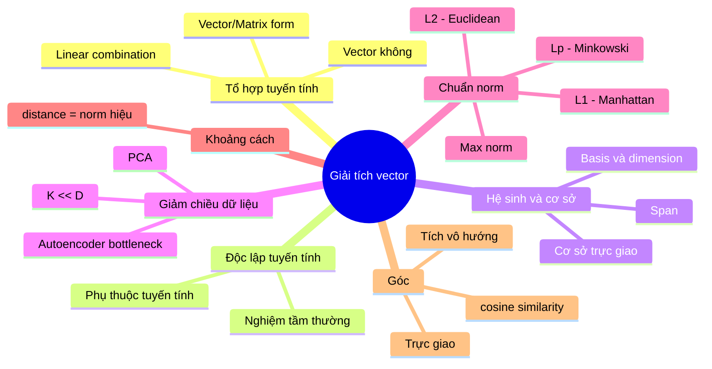
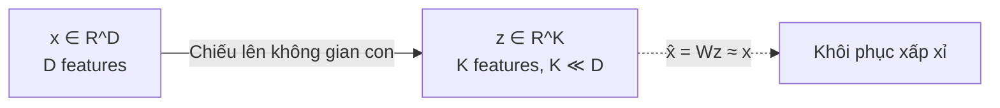
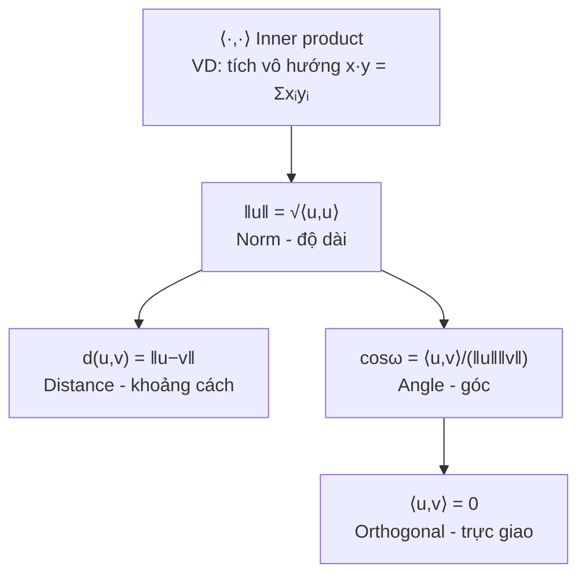

# Buổi 3 – Giải tích vector: Chuẩn, Khoảng cách, Góc

- **Ngày**: 20/11/2026 (nghỉ 1 buổi trước đó)
- **Môn**: Toán cho Khoa học máy tính (CS115.G11.CN2.TTNT)
- **Giảng viên**: Dương Việt Hằng
- **Lịch học**: Thứ 6, 18h15 – 22h00

## Tài liệu môn học

- Bài giảng online: https://www.youtube.com/watch?v=fM0iXXrTGtg
- Trang môn học trên elearning: https://elearning.citd.edu.vn/course/view.php?id=1997
- Tài liệu xem thêm: https://machinelearningcoban.com

## Nội dung buổi học



### Tổ hợp tuyến tính (Linear combination)

Cho tập các vector $\{\mathbf{v}_1, \dots, \mathbf{v}_p\}$ trong $\mathbb{R}^n$ và các vô hướng $x_1, x_2, \dots, x_p$. Vector

$$\mathbf{w} = x_1\mathbf{v}_1 + x_2\mathbf{v}_2 + \dots + x_p\mathbf{v}_p$$

được gọi là một **tổ hợp tuyến tính** của các vector $\mathbf{v}_1, \dots, \mathbf{v}_p$.

> [!NOTE]
> Trực quan: mỗi vector là một "hướng di chuyển", hệ số $x_i$ là "đi bao xa theo hướng đó". Tổ hợp tuyến tính = kết quả khi đi lần lượt theo từng hướng rồi cộng lại. Tập *mọi* tổ hợp tuyến tính của một hệ gọi là **không gian con sinh bởi hệ đó** (span).

**Nhận xét:**

- Vector không $\theta$ luôn là một tổ hợp tuyến tính của mọi hệ vector – chỉ cần lấy hệ số biểu diễn toàn $0$.
- Tổng của hai hay nhiều tổ hợp tuyến tính lại là một tổ hợp tuyến tính (tức span đóng với phép cộng vector).

#### Dạng vector/ma trận (Vector/Matrix form)

Hai cách viết gọn tổ hợp tuyến tính trên lớp dùng liên tục:

**Tổng các số vô hướng → tích vô hướng.** Với $b, w_i, x_i$ là các scalar:

$$b + w_1x_1 + w_2x_2 + \dots + w_Dx_D = b + \mathbf{w}^{\mathsf{T}}\mathbf{x}$$

– đây chính là **score function** của buổi 2: tổng $D$ số hạng gọn lại thành một tích vô hướng giữa vector trọng số $\mathbf{w}$ và vector đặc trưng $\mathbf{x}$.

**Tổng các (scalar × vector) → ma trận nhân vector.** Với $z_{nk}$ là scalar, $\mathbf{u}_k$ là vector:

$$\sum_{k=1}^{K} z_{nk}\,\mathbf{u}_k = \mathbf{W}\,\mathbf{z}_n$$

trong đó $\mathbf{W}$ là ma trận có các **cột** là $\mathbf{u}_1, \dots, \mathbf{u}_K$, còn $\mathbf{z}_n$ là vector các hệ số.

> [!NOTE]
> Đây chính là **cách nhìn theo cột** (column picture) của buổi 2: $\mathbf{W}\mathbf{z}_n$ = tổ hợp tuyến tính các cột của $\mathbf{W}$ với hệ số lấy từ $\mathbf{z}_n$. Mọi tổ hợp tuyến tính đều viết được thành $\mathbf{W}\mathbf{z}$ – nên "tìm hệ số biểu diễn" và "giải hệ $\mathbf{W}\mathbf{z} = \mathbf{b}$" là một.
>
> Chỉ số $n$ ở $z_{nk}$ gợi ý đây là hệ số của **điểm dữ liệu thứ $n$** trong tập train – mỗi điểm dữ liệu là một tổ hợp tuyến tính khác nhau của cùng một bộ vector $\mathbf{u}_k$ (vd tổ hợp các vector cơ sở, hay các hàng của ma trận trọng số trong neural network).

### Độc lập tuyến tính và Phụ thuộc tuyến tính

Tập các vector $\{\mathbf{v}_1, \dots, \mathbf{v}_p\}$ trong $\mathbb{R}^n$ được gọi là **độc lập tuyến tính** (linearly independent) nếu phương trình vector

$$x_1\mathbf{v}_1 + x_2\mathbf{v}_2 + \dots + x_p\mathbf{v}_p = \theta$$

chỉ có **nghiệm tầm thường** $(0, 0, \dots, 0)$.

Ngược lại, tập được gọi là **phụ thuộc tuyến tính** (linearly dependent) nếu tồn tại các trọng số $c_1, \dots, c_p$ **không đồng thời bằng 0** thỏa

$$c_1\mathbf{v}_1 + c_2\mathbf{v}_2 + \dots + c_p\mathbf{v}_p = \theta \tag{*}$$

#### Hiểu trực quan

Mỗi vector là một **hướng di chuyển** trong không gian:

- **Độc lập tuyến tính**: mỗi vector mang lại một **hướng hoàn toàn mới** mà các vector còn lại không tạo ra được – không vector nào "thừa".
- **Phụ thuộc tuyến tính**: có ít nhất một vector **thừa** – nó chỉ là "pha trộn" của các vector khác, không thêm hướng mới nào.

#### Vì sao định nghĩa lại viết qua phương trình $= \theta$?

Bộ hệ số $(0, 0, \dots, 0)$ luôn làm vế trái ra $\theta$ – đó là nghiệm tầm thường, ai cũng thấy. Câu hỏi đặt ra: *ngoài cách hiển nhiên đó, còn cách nào khác để các vector "triệt tiêu" nhau không?*

- **Không còn cách nào khác** → độc lập: các vector không thể trộn lẫn để triệt tiêu nhau, vì không vector nào nằm trong "thế giới" (span) của các vector kia.
- **Có cách khác** (ít nhất một $c_i \neq 0$) → phụ thuộc: giả sử $c_1 \neq 0$, chuyển vế $(*)$ được

$$\mathbf{v}_1 = -\frac{c_2}{c_1}\mathbf{v}_2 - \dots - \frac{c_p}{c_1}\mathbf{v}_p$$

tức $\mathbf{v}_1$ **biểu diễn được qua các vector còn lại** → nó thừa.

> [!TIP]
> Nghĩa đen của chữ "phụ thuộc": có vector nào đó **phụ thuộc** vào (viết được từ) các vector khác. Độc lập = không vector nào viết được qua phần còn lại.

#### Ví dụ

**Ví dụ 1 – độc lập**: $\mathbf{v}_1 = \begin{pmatrix}1\\0\end{pmatrix}$, $\mathbf{v}_2 = \begin{pmatrix}0\\1\end{pmatrix}$ trong $\mathbb{R}^2$.

$$c_1\mathbf{v}_1 + c_2\mathbf{v}_2 = \begin{pmatrix}c_1\\c_2\end{pmatrix} = \begin{pmatrix}0\\0\end{pmatrix} \implies c_1 = c_2 = 0$$

Chỉ có nghiệm tầm thường → độc lập. Hai vector mỗi cái chỉ một hướng riêng, không thể tạo ra nhau.

**Ví dụ 2 – phụ thuộc**: $\mathbf{v}_1 = \begin{pmatrix}1\\0\end{pmatrix}$, $\mathbf{v}_2 = \begin{pmatrix}2\\0\end{pmatrix}$.

Lấy $c_1 = 2$, $c_2 = -1$: $2\mathbf{v}_1 - \mathbf{v}_2 = \theta$ – tồn tại hệ số khác 0 → phụ thuộc. Trực quan: cả hai **cùng phương**, $\mathbf{v}_2 = 2\mathbf{v}_1$ không thêm hướng mới.

**Ví dụ 3 – phụ thuộc**: 3 vector **đồng phẳng** trong $\mathbb{R}^3$. Dù 3 hướng khác nhau nhưng cùng nằm trên một mặt phẳng → vector thứ 3 viết được qua 2 vector kia → phụ thuộc.

#### Nhận biết nhanh

| Dấu hiệu | Kết luận |
|---|---|
| Tập chứa vector $\theta$ | Luôn phụ thuộc (viết $\theta$ qua chính nó với hệ số 1) |
| Hai vector cùng phương ($\mathbf{v}_2 = k\mathbf{v}_1$) | Phụ thuộc |
| Số vector $>$ số chiều ($p > n$ trong $\mathbb{R}^n$) | Luôn phụ thuộc |
| $\text{rank}(\mathbf{V}) = p$ (bằng số vector cột) | Độc lập |

> [!NOTE]
> Liên hệ buổi 2: kiểm tra độc lập tuyến tính = xét nghiệm của hệ thuần nhất $\mathbf{V}\mathbf{x} = \theta$ với $\mathbf{V}$ là ma trận các cột $\mathbf{v}_i$. Hệ chỉ có nghiệm tầm thường ⟺ $\text{rank}(\mathbf{V}) = p$ ⟺ không có ẩn tự do → khử Gauss đếm pivot là xong.

> [!NOTE]
> Liên hệ ML: đặc trưng (cột của ma trận dữ liệu) phụ thuộc tuyến tính = thông tin dư thừa – vd 3 cột `a`, `b`, `a+b`. Đây chính là hiện tượng **đa cộng tuyến** (multicollinearity) làm $\mathbf{X}^{\mathsf{T}}\mathbf{X}$ suy biến, không khả nghịch → linear regression phải nhờ nghiệm giả nghịch đảo hoặc regularization.

> [!TIP]
> **Phụ thuộc tuyến tính → có thể giảm chiều dữ liệu**: nếu một đặc trưng viết được qua các đặc trưng khác thì nó không chứa thông tin mới → bỏ đi không mất gì. Nói cách khác, dữ liệu thực chất chỉ "nằm" trong không gian con $\text{rank}(\mathbf{X})$ chiều thay vì toàn bộ $n$ chiều. Đây là ý tưởng nền tảng của **giảm chiều dữ liệu** (dimensionality reduction): PCA đi tìm các hướng độc lập tuyến tính mang nhiều thông tin nhất rồi chiếu dữ liệu lên đó.

### Hệ sinh và Cơ sở (Generating Set and Basis)

Xét không gian vector $V = (\mathcal{V}, +, \cdot)$ và tập vector $\mathcal{A} = \{\mathbf{x}_1, \dots, \mathbf{x}_k\} \subset \mathcal{V}$.

**Hệ sinh (generating set)**

- Nếu **mọi** $\mathbf{v} \in \mathcal{V}$ đều biểu diễn được thành tổ hợp tuyến tính của $\mathbf{x}_1, \dots, \mathbf{x}_k$ thì $\mathcal{A}$ được gọi là một **hệ sinh** (generating set) của $V$ – nói ngắn gọn: hệ $\mathcal{A}$ "sinh ra" cả không gian.
- Tập *tất cả* các tổ hợp tuyến tính của $\mathcal{A}$ gọi là **bao tuyến tính** (**span**) của $\mathcal{A}$.
- Khi $\mathcal{A}$ sinh ra $V$, ta viết $V = \text{span}[\mathcal{A}]$ hay $V = \text{span}[\mathbf{x}_1, \dots, \mathbf{x}_k]$.

> [!NOTE]
> Hệ sinh được phép **thừa** vector – chỉ cần sinh ra đủ cả không gian. Vd 3 vector đồng phẳng (không cùng phương) trong $\mathbb{R}^3$ vẫn "sinh" được mặt phẳng chứa chúng (không gian con 2 chiều) dù phụ thuộc tuyến tính; tương tự 3 vector bất kỳ không cùng phương trong $\mathbb{R}^2$ vẫn sinh được cả $\mathbb{R}^2$.

**Cơ sở (basis)**

- **Hệ sinh tối thiểu** $\mathcal{B}$ của $V$ – hệ sinh mà rút đi bất kỳ vector nào cũng không còn sinh được $V$ – gọi là **cơ sở** (basis) của $V$.
- Mỗi phần tử của $\mathcal{B}$ gọi là một **vector cơ sở** (basis vector); số vector cơ sở gọi là **số chiều** (dimension) của $V$.

**Tính chất của cơ sở:**

- $\mathcal{B}$ là tập **độc lập tuyến tính tối đại** (maximally linearly independent) trong $V$ – thêm bất kỳ vector nào nữa đều phụ thuộc.
- Mọi vector $\mathbf{x} \in V$ đều là tổ hợp tuyến tính của $\mathcal{B}$, và biểu diễn đó là **duy nhất** – mỗi vector có đúng một bộ "tọa độ" theo cơ sở.

> [!TIP]
> Nối 3 khái niệm lại: **hệ sinh** = sinh ra đủ (có thể thừa); **độc lập tuyến tính** = không thừa (có thể thiếu); **cơ sở** = vừa đủ vừa không thừa – hệ sinh tối thiểu ≡ tập độc lập tối đại. Trong $\mathbb{R}^n$, mọi cơ sở đều có đúng $n$ vector → $\dim(\mathbb{R}^n) = n$.

#### Cơ sở trực giao và trực chuẩn – "cơ sở xịn" hơn cơ sở thường

Một cơ sở thường chỉ cần độc lập tuyến tính – các vector cơ sở được phép **xiên góc** tùy ý với nhau. Cơ sở đẹp hơn là:

- **Cơ sở trực giao** (orthogonal basis): các vector cơ sở **đôi một vuông góc**: $\langle \mathbf{b}_i, \mathbf{b}_j \rangle = 0$ với mọi $i \neq j$.
- **Cơ sở trực chuẩn** (orthonormal basis): trực giao *và* mỗi vector có chuẩn bằng 1: $\|\mathbf{b}_i\| = 1$.

Ví dụ kinh điển: cơ sở đơn vị $\{\mathbf{e}_1 = (1,0), \mathbf{e}_2 = (0,1)\}$ của $\mathbb{R}^2$ – chính là hệ trục tọa độ Descartes quen thuộc – là một cơ sở trực chuẩn.

**Điểm "xịn" cốt lõi – tìm tọa độ cực dễ.** Nhắc lại: mọi vector $\mathbf{x}$ biểu diễn duy nhất qua cơ sở $\mathcal{B}$:

$$\mathbf{x} = \lambda_1 \mathbf{b}_1 + \lambda_2 \mathbf{b}_2 + \dots + \lambda_n \mathbf{b}_n$$

| | Cơ sở **thường** | Cơ sở **trực giao** | Cơ sở **trực chuẩn** |
|---|---|---|---|
| Tìm tọa độ $\lambda_i$ | Phải **giải hệ** $\mathbf{B}\boldsymbol{\lambda} = \mathbf{x}$ (khử Gauss) | $\lambda_i = \dfrac{\langle \mathbf{x}, \mathbf{b}_i \rangle}{\langle \mathbf{b}_i, \mathbf{b}_i \rangle}$ – chỉ tích vô hướng | $\lambda_i = \langle \mathbf{x}, \mathbf{b}_i \rangle$ – đơn giản nhất |
| Chi phí | $O(n^3)$ giải hệ | $O(n)$ mỗi tọa độ | $O(n)$ mỗi tọa độ |

> [!NOTE]
> Vì sao trực giao lại dễ vậy? Lấy tích vô hướng hai vế của $\mathbf{x} = \sum_j \lambda_j \mathbf{b}_j$ với $\mathbf{b}_i$: mọi số hạng $j \neq i$ triệt tiêu vì $\langle \mathbf{b}_j, \mathbf{b}_i \rangle = 0$, chỉ còn $\langle \mathbf{x}, \mathbf{b}_i \rangle = \lambda_i \langle \mathbf{b}_i, \mathbf{b}_i \rangle$ → tách được từng tọa độ một cách độc lập. Với cơ sở xiên, các số hạng "dính" vào nhau nên bắt buộc giải nguyên hệ.
>
> Trực quan: tọa độ $\lambda_i = \langle \mathbf{x}, \mathbf{b}_i \rangle$ chính là **hình chiếu vuông góc** của $\mathbf{x}$ lên trục $\mathbf{b}_i$ – giống hệt cách ta đọc tọa độ $(x, y)$ trên hệ trục vuông góc.

> [!TIP]
> Liên hệ ML: **PCA** thực chất là tìm một **cơ sở trực chuẩn mới** (các vector riêng của ma trận hiệp phương sai) rồi đọc tọa độ dữ liệu theo cơ sở đó – vì trực chuẩn nên chiếu dữ liệu chỉ là phép tích vô hướng, rẻ và không mất thông tin khi giữ đủ chiều. Ma trận trực giao còn **bảo toàn chuẩn và góc**: $\|\mathbf{U}\mathbf{x}\| = \|\mathbf{x}\|$ – xoay/phản chiếu dữ liệu mà không làm méo khoảng cách.

### Giảm chiều dữ liệu (Dimension Reduction)

Ý tưởng: biểu diễn dữ liệu từ $D$ features về $K$ features với $K \ll D$, mà mất ít thông tin nhất có thể.




**Vì sao giảm được mà không mất nhiều thông tin?** Nối thẳng vào phần trên: nếu các điểm dữ liệu $\mathbf{x} \in \mathbb{R}^D$ (gần) nằm trong không gian con sinh bởi $K$ vector $\{\mathbf{u}_1, \dots, \mathbf{u}_K\}$, thì

$$\mathbf{x} \approx \sum_{k=1}^{K} z_{k}\mathbf{u}_k = \mathbf{W}\mathbf{z}$$

– thay vì lưu $D$ tọa độ của $\mathbf{x}$, chỉ cần lưu $K$ hệ số $\mathbf{z}$. Khi các đặc trưng phụ thuộc tuyến tính (hoặc tương quan mạnh), $K$ có thể nhỏ hơn $D$ rất nhiều.

**Thiết lập hình thức trên lớp:**

$$\mathbf{x}_n \approx \sum_{k=1}^{K} z_{nk}\mathbf{w}_k = \mathbf{W}\mathbf{z}_n$$

- $\mathbf{x}_n \in \mathbb{R}^D$, $n = 1, 2, \dots, N$ – $N$ điểm dữ liệu, mỗi điểm là (xấp xỉ) một tổ hợp tuyến tính của $K$ **vector cơ sở** $\mathbf{w}_1, \dots, \mathbf{w}_K \in \mathbb{R}^D$, với $K \ll \min\{D, N\}$.
- $\mathbf{W} = [\mathbf{w}_1, \mathbf{w}_2, \dots, \mathbf{w}_K]$ – ma trận kích thước $D \times K$, các cột là $K$ vector cơ sở **dùng chung** cho mọi điểm dữ liệu.
- $\mathbf{z}_n = [z_{n1}, z_{n2}, \dots, z_{nK}]^{\mathsf{T}}$ – vector $K \times 1$ chứa hệ số biểu diễn riêng của điểm thứ $n$.
- Hai vai trò của $\mathbf{W}$: nhân $\mathbf{W}\mathbf{z}_n$ là **ánh xạ tuyến tính** đưa biểu diễn chiều thấp $\mathbf{z}_n$ ngược lên không gian $\mathbb{R}^D$ (dựng lại $\hat{\mathbf{x}}_n$); chiều ngược lại cần một **kỹ thuật nén** $f$ sao cho $\mathbf{z}_n = f(\mathbf{x}_n)$ – vd với PCA thì $f$ chỉ là phép chiếu $\mathbf{z}_n = \mathbf{W}^{\mathsf{T}}\mathbf{x}_n$.

> [!NOTE]
> Kiểm tra kích thước luôn phải khớp:
>
> $$\underbrace{\mathbf{x}_n}_{D \times 1} \;=\; \underbrace{\mathbf{W}}_{D \times K} \cdot \underbrace{\mathbf{z}_n}_{K \times 1}$$
>
> $(D \times K) \times (K \times 1) \to D \times 1$ ✓ – mẹo nhớ: hai kích thước "kề nhau" ($K$ và $K$) phải bằng nhau, kết quả mang hai kích thước "ngoài" ($D \times 1$).

**Đếm bộ nhớ – vì sao gọi là "giảm":**

|| Trước giảm chiều | Sau giảm chiều |
|---|---|---|
| Cần lưu | $N$ vector $\mathbf{x}_n$ → $N \times D$ số | $\mathbf{W}$ ($D \times K$) + $N$ vector $\mathbf{z}_n$ ($N \times K$) |
| Tổng số phần tử | $N \cdot D$ | $N \cdot K + D \cdot K = (N + D) \cdot K$ |

Vì $K \ll \min\{D, N\}$ nên $(N + D)K \ll ND$ – tiết kiệm bộ nhớ lớn. Vd $N = 10^4$, $D = 10^3$, $K = 10$: trước $10^7$ số, sau $(10^4 + 10^3) \times 10 \approx 1.1 \times 10^5$ – nhẹ hơn ~90 lần.

- **Mất mát**: chiếu xuống không gian con luôn bỏ đi phần thông tin nằm *ngoài* không gian đó – hình trụ chiếu xuống phẳng thành elip mất chiều cao. Chọn hướng chiếu tốt → $\hat{\mathbf{x}} \approx \mathbf{x}$; chọn hướng tệ → vò nát dữ liệu.
- **Chọn hướng nào?** → PCA: chiếu lên các hướng mà dữ liệu **biến thiên nhiều nhất** (phương sai lớn nhất) – các vector riêng ứng trị riêng lớn của ma trận hiệp phương sai.

> [!TIP]
> Trong deep learning, ý tưởng này xuất hiện khắp nơi: *bottleneck layer* của autoencoder ép dữ liệu qua ít neuron hơn; *embedding* nén one-hot vector khổng lồ thành vector dày nhỏ; *pooling* trong CNN giảm kích thước feature map. Bản chất chung: tìm biểu diễn $K$ chiều "giữ được cái quan trọng".

#### Ứng dụng cụ thể trong Machine Learning

Giảm chiều không chỉ là bài toán lý thuyết – nó xuất hiện xuyên suốt pipeline ML:

**1. Tiền xử lý và chọn đặc trưng (preprocessing / feature selection)**

- Bỏ các cột **phụ thuộc tuyến tính** hoặc tương quan cao khỏi ma trận dữ liệu $\mathbf{X}$ – giảm $D$ trực tiếp, chống đa cộng tuyến, model chạy nhanh hơn.
- **PCA** trước khi train: nén $D$ đặc trưng → $K$ thành phần chính; lọc nhiễu (giữ các hướng phương sai lớn, bỏ hướng "nhiễu" phương sai nhỏ), tăng tốc train, đôi khi cải thiện cả độ chính xác.

**2. Trực quan hóa dữ liệu nhiều chiều (visualization)**

- Dữ liệu $D$ chiều không vẽ được → chiếu xuống 2D/3D bằng **PCA**, **t-SNE** hay **UMAP** để nhìn cụm, phát hiện outlier, kiểm tra phân tách lớp – đúng hình ảnh 3D → 2D → 1D ở trên.

**3. Recommender systems – phân rã ma trận (matrix factorization)**

- Ma trận user–item (rating) khổng lồ và thưa → xấp xỉ bởi tích hai ma trận hạng thấp $\mathbf{R} \approx \mathbf{P}\mathbf{Q}^{\mathsf{T}}$: mỗi user và mỗi item chỉ cần vector $K$ chiều "sở thích/đặc tính" – chính là dạng $\mathbf{x} = \mathbf{W}\mathbf{z}$ với $K \ll \min\{D, N\}$.

**4. Nén ảnh và nén mô hình**

- Ảnh xám $m \times n$ xem như ma trận → **SVD** giữ $K$ giá trị suy biến (singular values) lớn nhất cùng $K$ cặp vector suy biến → lưu $K(m + n + 1)$ số thay $mn$ – đúng công thức đếm bộ nhớ ở trên.
- Nén mô hình: phân rã hạng thấp các ma trận trọng số, hoặc **bottleneck layer** trong autoencoder – mạng tự học biểu diễn $K$ chiều của dữ liệu.

**5. Chống "lời nguyền chiều không gian" (curse of dimensionality)**

- Số chiều càng lớn thì dữ liệu càng thưa, khoảng cách giữa các điểm càng "đều nhau" → mô hình cần dữ liệu nhiều theo cấp số nhân. Giảm chiều trước khi train giúp mô hình học tốt hơn với ít mẫu hơn.

> [!NOTE]
> Cả 5 ứng dụng cùng một ý niệm: **dữ liệu thật có cấu trúc hạng thấp** – số chiều "hữu ích" nhỏ hơn kích thước danh nghĩa rất nhiều. Toán buổi này (tổ hợp tuyến tính, cơ sở, chiếu lên không gian con) là nền cho tất cả.

#### Ví dụ áp dụng: nhận diện khuôn mặt 80 sinh viên

Bài toán: lớp có **80 sinh viên**, mỗi người chụp **5 ảnh train + 1 ảnh test**, mỗi ảnh **30 × 30** pixel. Nhận diện ảnh test thuộc về ai.

**Bước 1 – vector hóa ảnh.** Duỗi ảnh 30×30 thành vector cột:

$$\mathbf{x}_n \in \mathbb{R}^{900} \quad (D = 30 \times 30 = 900 \text{ features})$$

- Tập train: $N = 80 \times 5 = 400$ ảnh → ma trận dữ liệu $\mathbf{X}$ kích thước $400 \times 900$.
- Tập test: $80$ ảnh (mỗi người 1 ảnh).

**Bước 2 – giảm chiều.** Chọn $K \ll \min\{D, N\} = \min\{900, 400\}$, vd $K = 50$. Học ma trận cơ sở $\mathbf{W}$ ($900 \times 50$) – với PCA thì các cột $\mathbf{w}_k$ là các "eigenface" (ảnh khuôn mặt tổng quát), mỗi ảnh xấp xỉ tổ hợp tuyến tính của 50 eigenface này:

> [!NOTE]
> **$K = 50$ lấy ở đâu?** Đây là hyperparameter do người chọn, miễn $K \ll \min\{D, N\}$. Cách chọn trong thực tế: (1) *explained variance* – chọn $K$ nhỏ nhất sao cho tổng $K$ trị riêng đầu chiếm ≥ 90–95% tổng phương sai; (2) *elbow* – lấy $K$ tại điểm khuỷu của đồ thị trị riêng; (3) *validation* – thử vài giá trị $K$, chọn giá trị cho accuracy nhận diện tốt nhất. $K$ quá nhỏ → mất thông tin; quá lớn → mang theo nhiễu, tốn bộ nhớ.

$$\mathbf{x}_n \approx \mathbf{W}\mathbf{z}_n, \quad \mathbf{z}_n = \mathbf{W}^{\mathsf{T}}\mathbf{x}_n \in \mathbb{R}^{50}$$

> [!WARNING]
> Công thức gọn $\mathbf{z}_n = \mathbf{W}^{\mathsf{T}}\mathbf{x}_n$ ngầm giả định 2 điều: (1) các cột của $\mathbf{W}$ **trực chuẩn**, (2) dữ liệu đã **trừ trung bình** (centering). Khi cài đặt thật phải viết $\mathbf{z}_n = \mathbf{W}^{\mathsf{T}}(\mathbf{x}_n - \bar{\mathbf{x}})$ và tái dựng $\hat{\mathbf{x}}_n = \bar{\mathbf{x}} + \mathbf{W}\mathbf{z}_n$, với $\bar{\mathbf{x}}$ là "khuôn mặt trung bình" tính trên tập **train** (ảnh test cũng trừ đúng $\bar{\mathbf{x}}$ này).

**Bước 3 – chiếu toàn bộ dữ liệu.** Mỗi ảnh train $900$ chiều → vector đặc trưng $\mathbf{z}_n$ chỉ $50$ chiều. Đếm bộ nhớ:

|| Trước | Sau |
|---|---|---|
| Dữ liệu train | $400 \times 900 = 360{,}000$ số | $400 \times 50 = 20{,}000$ số |
| Cơ sở $\mathbf{W}$ | – | $900 \times 50 = 45{,}000$ số |
| **Tổng** | $360{,}000$ | $65{,}000$ (nhẹ hơn ~5.5 lần) |

**Bước 4 – nhận diện ảnh test.** Chiếu ảnh test $\mathbf{x}_{test}$ xuống $\mathbf{z}_{test} = \mathbf{W}^{\mathsf{T}}\mathbf{x}_{test}$, rồi so sánh với các $\mathbf{z}_n$ train:


- Mỗi người có 5 vector train → lấy **centroid** (trung bình 5 vector $\mathbf{z}$) làm "đại diện lớp" → 80 centroid trong $\mathbb{R}^{50}$.
- Dự đoán = người có centroid **gần $\mathbf{z}_{test}$ nhất** – đo "gần" bằng **khoảng cách Euclid** (phần Distance bên dưới) hoặc **cosine similarity** (phần Angle).

> [!TIP]
> Đây chính là phương pháp **Eigenfaces** kinh điển (Turk & Pentland, 1991) – ứng dụng nổi tiếng nhất của PCA vào nhận diện mặt người. Lưu ý: khi nhận diện ta **không cần tái dựng ảnh** $\hat{\mathbf{x}}$, chỉ cần làm việc trong không gian $K$ chiều – vừa nhanh vừa lọc được nhiễu (mục 1 phần ứng dụng). Đây cũng là lý do buổi này học norm, distance, angle: chúng là công cụ để "so sánh" trong không gian đã giảm chiều.

### Khung chung: Norm, Distance, Angle, Orthogonality từ Inner Product

Định nghĩa của chuẩn (độ dài), khoảng cách, góc, trực giao và chuẩn hóa cho **không gian tích trong tổng quát** (general inner product space) hoàn toàn song song với các định nghĩa dựa trên tích vô hướng trong không gian Euclid $n$ chiều. Nghĩa là: chỉ cần có một phép **tích trong** $\langle \cdot, \cdot \rangle$, mọi khái niệm hình học còn lại tự động theo sau:

$$\text{Inner product } \langle \cdot, \cdot \rangle \;\Longrightarrow\; \begin{cases} \textbf{Norm}: & \|\mathbf{u}\| = \sqrt{\langle \mathbf{u}, \mathbf{u} \rangle} \\[4pt] \textbf{Distance}: & d(\mathbf{u}, \mathbf{v}) = \|\mathbf{u} - \mathbf{v}\| = \sqrt{\langle \mathbf{u}-\mathbf{v}, \mathbf{u}-\mathbf{v} \rangle} \\[4pt] \textbf{Angle}: & \cos\omega = \dfrac{\langle \mathbf{u}, \mathbf{v} \rangle}{\|\mathbf{u}\| \, \|\mathbf{v}\|}, \quad 0 \leq \omega \leq \pi \\[6pt] \textbf{Orthogonal}: & \mathbf{u} \perp \mathbf{v} \iff \langle \mathbf{u}, \mathbf{v} \rangle = 0 \end{cases}$$



**Tích trong (inner product) – định nghĩa hình thức.** Là một ánh xạ $\langle \cdot, \cdot \rangle: V \times V \mapsto \mathbb{R}$ thỏa 4 điều kiện sau với mọi vector $\mathbf{u}, \mathbf{v}, \mathbf{w} \in V$ và mọi vô hướng $\lambda \in \mathbb{R}$:

1. $\langle \mathbf{u} + \mathbf{v}, \mathbf{w} \rangle = \langle \mathbf{u}, \mathbf{w} \rangle + \langle \mathbf{v}, \mathbf{w} \rangle$ – phân phối theo phép cộng.
2. $\langle \lambda\mathbf{v}, \mathbf{w} \rangle = \lambda \langle \mathbf{v}, \mathbf{w} \rangle$ – kéo được vô hướng ra ngoài.
3. $\langle \mathbf{v}, \mathbf{w} \rangle = \langle \mathbf{w}, \mathbf{v} \rangle$ – đối xứng.
4. $\langle \mathbf{v}, \mathbf{v} \rangle \geq 0$, dấu bằng chỉ khi $\mathbf{v} = \theta$ – xác định dương.

Hai điều kiện đầu + đối xứng cho thấy tích trong **tuyến tính theo cả hai đối số** (bilinear). Cặp $(V, \langle \cdot, \cdot \rangle)$ – không gian vector kèm một phép tích trong – được gọi là một **không gian tích trong** (inner product space). Dot product là trường hợp riêng phổ biến nhất, nhưng **không phải duy nhất**:

**Các ví dụ trên lớp:**

1. **Dot product** trên $V = \mathbb{R}^n$: $\langle \mathbf{x}, \mathbf{y} \rangle := \mathbf{x}^{\mathsf{T}}\mathbf{y}$ – tích trong quen thuộc nhất.

2. **Tích trong "lạ"** trên $V = \mathbb{R}^2$:

$$\langle \mathbf{x}, \mathbf{y} \rangle := x_1 y_1 - (x_1 y_2 + x_2 y_1) + 2 x_2 y_2$$

   Kiểm tra là inner product hợp lệ: viết lại dưới dạng ma trận $\langle \mathbf{x}, \mathbf{y} \rangle = \mathbf{x}^{\mathsf{T}}\mathbf{A}\mathbf{y}$ với $\mathbf{A} = \begin{pmatrix} 1 & -1 \\ -1 & 2 \end{pmatrix}$ – đối xứng và xác định dương (hai định thức con chính: $1 > 0$ và $\det\mathbf{A} = 1 > 0$). Kiểm trực tiếp điều kiện 4: $\langle \mathbf{x}, \mathbf{x} \rangle = x_1^2 - 2x_1x_2 + 2x_2^2 = (x_1 - x_2)^2 + x_2^2 \geq 0$, bằng 0 chỉ khi $x_2 = 0$ và $x_1 = x_2$ tức $\mathbf{x} = \theta$ ✓.

3. **Tích trong trên không gian hàm**: $V$ = các hàm liên tục trên đoạn $[a, b]$:

$$\langle u, v \rangle := \int_a^b u(x)\, v(x)\, dx$$

   – tích phân của tích thay cho tổng của tích; nền của phân tích Fourier (hai hàm trực giao khi tích phân bằng 0, vd $\sin$ và $\cos$ trên $[-\pi, \pi]$).

> [!TIP]
> Dạng tổng quát của ví dụ 2: $\langle \mathbf{u}, \mathbf{v} \rangle = \mathbf{u}^{\mathsf{T}}\mathbf{A}\mathbf{v}$ là inner product hợp lệ ⟺ $\mathbf{A}$ **đối xứng xác định dương**. Chọn $\mathbf{A} = \mathbf{\Sigma}^{-1}$ (nghịch đảo ma trận hiệp phương sai) thu được **khoảng cách Mahalanobis** – đo khoảng cách có tính đến tương quan giữa các đặc trưng, dùng trong anomaly detection.

**Bài kiểm tra trên lớp** – Xét $\mathbb{R}^2$ với $\langle \mathbf{x}, \mathbf{y} \rangle := \mathbf{x}^{\mathsf{T}}\mathbf{A}\mathbf{y}$, $\mathbf{A} := \begin{pmatrix} 2 & 0 \\ 1 & 2 \end{pmatrix}$. Đây có phải inner product không?

**Không** – $\mathbf{A}$ không đối xứng nên vi phạm tiên đề 3 (đối xứng). Phản ví dụ: lấy $\mathbf{x} = \begin{pmatrix}1\\0\end{pmatrix}$, $\mathbf{y} = \begin{pmatrix}0\\1\end{pmatrix}$:

$$\langle \mathbf{x}, \mathbf{y} \rangle = \begin{pmatrix}1 & 0\end{pmatrix} \mathbf{A} \begin{pmatrix}0\\1\end{pmatrix} = 0, \qquad \langle \mathbf{y}, \mathbf{x} \rangle = \begin{pmatrix}0 & 1\end{pmatrix} \mathbf{A} \begin{pmatrix}1\\0\end{pmatrix} = 1$$

$\langle \mathbf{x}, \mathbf{y} \rangle \neq \langle \mathbf{y}, \mathbf{x} \rangle$ → không đối xứng → **không phải inner product**.

> [!WARNING]
> Bẫy hay gặp: $\mathbf{A}$ xác định dương *một mình chưa đủ* – ví dụ này $\langle \mathbf{x}, \mathbf{x} \rangle = 2x_1^2 + x_1x_2 + 2x_2^2 > 0$ vẫn đúng, nhưng mất đối xứng thì đã hỏng. $\mathbf{A}$ phải **vừa đối xứng vừa xác định dương**. (Mẹo: mọi $\mathbf{A}$ đều cho $\mathbf{x}^{\mathsf{T}}\mathbf{A}\mathbf{x} = \mathbf{x}^{\mathsf{T}}\frac{\mathbf{A} + \mathbf{A}^{\mathsf{T}}}{2}\mathbf{x}$ – chỉ phần đối xứng mới đóng vai trò.)

> [!NOTE]
> **Một hình học, nhiều thước đo**: đổi inner product là đổi cả 4 đại lượng cùng lúc – "dài", "xa", "góc", "vuông góc" đều định nghĩa lại. Đây là lý do cùng một tập dữ liệu nhưng scale khác nhau lại cho kết quả k-NN khác nhau: thực chất là ta đang đo bằng một "thước" khác.

#### Ứng dụng của tích trong trong ML

Tích trong xuất hiện ở khắp nơi trong machine learning – không chỉ ở các khái niệm hình học:

| Ứng dụng | Vai trò của tích trong |
|---|---|
| **Score function** $s(\mathbf{x}) = \mathbf{w}^{\mathsf{T}}\mathbf{x} + b$ | Bản thân score là tích vô hướng – mỗi $w_i x_i$ là "phiếu bầu" của đặc trưng $i$; $w_i$ lớn + $x_i$ lớn + cùng dấu → đóng góp mạnh |
| **Neural network** | Mỗi neuron tính $\mathbf{w}^{\mathsf{T}}\mathbf{x} + b$ rồi qua hàm kích hoạt – forward pass là hàng loạt tích trong |
| **Attention** (transformer) | Score chú ý $\frac{\mathbf{Q}\mathbf{K}^{\mathsf{T}}}{\sqrt{d_k}}$ – query "hỏi" key bằng tích vô hướng; $\langle \mathbf{q}, \mathbf{k} \rangle$ lớn → token này "để ý" token kia |
| **Cosine similarity / retrieval** | $\cos\omega = \frac{\langle \mathbf{x}, \mathbf{y} \rangle}{\Vert \mathbf{x}\Vert \Vert \mathbf{y}\Vert }$ đo độ giống nhau của hai embedding – nền của semantic search, recommendation, face verification |
| **Kernel trick** | $k(\mathbf{x}, \mathbf{y}) = \langle \phi(\mathbf{x}), \phi(\mathbf{y}) \rangle$ – tính tích trong trong không gian đặc trưng *mà không cần tính* $\phi$: SVM kernel, Gaussian process, kernel PCA |
| **Tính khoảng cách L2** | $\Vert \mathbf{x} - \mathbf{y}\Vert ^2 = \langle \mathbf{x},\mathbf{x}\rangle + \langle \mathbf{y},\mathbf{y}\rangle - 2\langle \mathbf{x},\mathbf{y}\rangle$ – mọi khoảng cách Euclid đều quy về 3 tích trong (cách GPU/vector DB tính nhanh) |
| **Hiệp phương sai / tương quan** | $\text{cov}(x_i, x_j)$ trên dữ liệu đã chuẩn hóa tâm chính là tích trong giữa hai cột đặc trưng – gốc của ma trận $\mathbf{X}^{\mathsf{T}}\mathbf{X}$ trong PCA |

> [!TIP]
> Góc nhìn thống nhất: **tích trong đo "mức độ cùng hướng"** – score function hỏi "đặc trưng có cùng hướng với trọng số không", attention hỏi "query có cùng hướng với key không", retrieval hỏi "hai văn bản có cùng hướng ngữ nghĩa không". Cùng một phép nhân, khác ngữ cảnh.

### Chuẩn (Norm)

**Chuẩn** của vector là khái niệm tổng quát hóa "độ dài" – một hàm $\|\cdot\|: \mathbb{R}^n \to \mathbb{R}$ gán cho mỗi vector một số thực không âm, thỏa 3 tính chất:

1. **Tuyệt đối thuần nhất**: $\|\lambda \mathbf{x}\| = |\lambda| \cdot \|\mathbf{x}\|$ với mọi vô hướng $\lambda$ – co giãn vector bao nhiêu lần thì độ dài co giãn bấy nhiêu.
2. **Bất đẳng thức tam giác**: $\|\mathbf{x} + \mathbf{y}\| \leq \|\mathbf{x}\| + \|\mathbf{y}\|$ – đi thẳng không bao giờ dài hơn đi vòng.
3. **Xác định dương**: $\|\mathbf{x}\| \geq 0$, và $\|\mathbf{x}\| = 0 \iff \mathbf{x} = \theta$ – chỉ vector không mới có độ dài 0.

#### Các chuẩn thông dụng

| Chuẩn | Ký hiệu | Công thức | Đặc điểm |
|---|---|---|---|
| **Manhattan** ($L_1$) | $\Vert \mathbf{x}\Vert _1$ | $\sum_{i=1}^{n} \vert x_i\vert $ | Tổng trị tuyệt đối các tọa độ – như đi bộ trong khu phố ô bàn cờ |
| **Euclidean** ($L_2$) | $\Vert \mathbf{x}\Vert _2$ | $\sqrt{\sum_{i=1}^{n} x_i^2}$ | Độ dài hình học quen thuộc; viết $\Vert \mathbf{x}\Vert $ không chỉ số thì ngầm hiểu $L_2$ |
| **Minkowski** ($L_p$) | $\Vert \mathbf{x}\Vert _p$ | $\left(\sum_{i=1}^{n} \vert x_i\vert ^p\right)^{1/p}$, $p \geq 1$ | Chuẩn tổng quát; $p = 1, 2$ cho hai chuẩn trên |
| **Max** ($L_\infty$) | $\Vert \mathbf{x}\Vert _\infty$ | $\max_i \vert x_i\vert $ | Giới hạn của $L_p$ khi $p \to \infty$ – chỉ phần tử lớn nhất quyết định |

**Ví dụ**: $\mathbf{x} = \begin{pmatrix}2\\3\end{pmatrix}$:

$$\|\mathbf{x}\|_1 = 2 + 3 = 5, \qquad \|\mathbf{x}\|_2 = \sqrt{2^2 + 3^2} = \sqrt{13}, \qquad \|\mathbf{x}\|_\infty = 3$$

> [!NOTE]
> Cùng một vector nhưng mỗi chuẩn cho một con số khác nhau – không có chuẩn nào "đúng", tùy bài toán mà chọn. "Vòng tròn đơn vị" (tập $\|\mathbf{x}\| \leq 1$) của $L_1$ là hình thoi, của $L_2$ là hình tròn, của $L_\infty$ là hình vuông.

#### Vector đơn vị và chuẩn hóa

- **Vector đơn vị** (unit vector): vector có chuẩn bằng 1 – chỉ giữ "hướng", không còn "độ lớn".
- **Chuẩn hóa** (normalization): chia vector cho chuẩn của nó để được vector đơn vị cùng hướng:

$$\mathbf{u} = \frac{\mathbf{x}}{\|\mathbf{x}\|}, \qquad \|\mathbf{u}\| = 1$$

#### Chuẩn của ma trận

Ma trận $\mathbf{A} \in \mathbb{R}^{m \times n}$ cũng có chuẩn. Phổ biến nhất là **chuẩn Frobenius** – xem ma trận như một vector dài $m \cdot n$ phần tử rồi lấy chuẩn Euclid:

$$\|\mathbf{A}\|_F = \sqrt{\sum_{i=1}^{m}\sum_{j=1}^{n} a_{ij}^2} = \sqrt{\text{tr}(\mathbf{A}^{\mathsf{T}}\mathbf{A})}$$

> [!TIP]
> Liên hệ ML – **regularization** (điều chuẩn): thêm số hạng phạt vào hàm loss để giữ trọng số nhỏ. Phạt $\lambda\|\mathbf{w}\|_2^2$ → *L2 regularization* (ridge, weights phân tán đều, hiếm khi bằng 0 hẳn); phạt $\lambda\|\mathbf{w}\|_1$ → *L1 regularization* (lasso, ép nhiều weight về đúng 0 → chọn đặc trưng tự động). Chọn L1 hay L2 chính là chọn "chuẩn" đo độ lớn của trọng số.

### Khoảng cách (Distance)

**Khoảng cách** giữa hai vector $\mathbf{x}, \mathbf{y}$ được định nghĩa qua chuẩn của hiệu:

$$d(\mathbf{x}, \mathbf{y}) = \|\mathbf{x} - \mathbf{y}\|$$

Mỗi chuẩn sinh ra một cách đo khoảng cách tương ứng:

- **Khoảng cách Euclid**: $d_2(\mathbf{x}, \mathbf{y}) = \|\mathbf{x} - \mathbf{y}\|_2 = \sqrt{\sum_i (x_i - y_i)^2}$ – đường chim bay.
- **Khoảng cách Manhattan**: $d_1(\mathbf{x}, \mathbf{y}) = \sum_i |x_i - y_i|$ – đường đi bộ dọc-ngang.

> [!NOTE]
> Một hàm khoảng cách hợp lệ (metric) thỏa: không âm và $d = 0 \iff \mathbf{x} = \mathbf{y}$; đối xứng $d(\mathbf{x},\mathbf{y}) = d(\mathbf{y},\mathbf{x})$; bất đẳng thức tam giác $d(\mathbf{x},\mathbf{z}) \leq d(\mathbf{x},\mathbf{y}) + d(\mathbf{y},\mathbf{z})$ – cả ba kế thừa trực tiếp từ 3 tính chất của chuẩn.

> [!TIP]
> Liên hệ ML: k-NN phân loại theo "láng giềng gần nhất" – tức theo khoảng cách; k-means gom cụm theo khoảng cách tới centroid; loss của regression $\sum_i (y_i - \hat{y}_i)^2$ là bình phương khoảng cách Euclid giữa vector nhãn và vector dự đoán. **Dữ liệu nhiều chiều thì khái niệm "gần/xa" phụ thuộc hẳn vào chọn chuẩn nào** – và các đặc trưng thường phải *scale* về cùng thang trước khi đo.

### Góc giữa hai vector (Angle)

#### Tích vô hướng nhắc lại

**Tích vô hướng** (dot product / inner product chuẩn) của $\mathbf{x}, \mathbf{y} \in \mathbb{R}^n$:

$$\mathbf{x}^{\mathsf{T}}\mathbf{y} = \langle \mathbf{x}, \mathbf{y} \rangle = \sum_{i=1}^{n} x_i y_i$$

Liên hệ với chuẩn Euclid: $\|\mathbf{x}\|_2 = \sqrt{\mathbf{x}^{\mathsf{T}}\mathbf{x}}$ – độ dài bình phương chính là "vector nhân với chính nó".

#### Công thức góc

**Góc** $\omega$ giữa hai vector $\mathbf{x}, \mathbf{y}$ khác $\theta$ định nghĩa bởi:

$$\cos\omega = \frac{\langle \mathbf{x}, \mathbf{y} \rangle}{\|\mathbf{x}\| \cdot \|\mathbf{y}\|}$$

Công thức này chỉ có nghĩa khi vế phải nằm trong $[-1, 1]$ – điều đó được bảo đảm bởi **bất đẳng thức Cauchy–Schwarz**:

$$|\langle \mathbf{x}, \mathbf{y} \rangle| \leq \|\mathbf{x}\| \cdot \|\mathbf{y}\|$$

> [!NOTE]
> Thứ tự logic: Cauchy–Schwarz được chứng minh **trước** (chỉ từ 4 tiên đề tích trong), rồi mới dùng nó để *định nghĩa* góc. Nói "vì $|\cos\omega| \leq 1$ nên có Cauchy–Schwarz" là lập luận vòng tròn trong không gian tổng quát – nó chỉ đúng như một cách *nhớ*. Dấu bằng xảy ra ⟺ $\mathbf{x}, \mathbf{y}$ **cùng phương** (phụ thuộc tuyến tính).

Đọc công thức theo hướng ngược lại: $\langle \mathbf{x}, \mathbf{y} \rangle = \|\mathbf{x}\| \cdot \|\mathbf{y}\| \cdot \cos\omega$ – tích vô hướng đo mức độ **cùng hướng** của hai vector: lớn khi cùng hướng ($\cos\omega = 1$), bằng 0 khi vuông góc, âm khi ngược hướng ($\cos\omega = -1$).

#### Vector trực giao (Orthogonal)

- Hai vector $\mathbf{x}, \mathbf{y}$ **trực giao** (orthogonal – vuông góc) khi và chỉ khi $\langle \mathbf{x}, \mathbf{y} \rangle = 0$.
- Vector $\theta$ trực giao với mọi vector.
- Trực giao **và** cùng có chuẩn bằng 1 → **trực chuẩn** (orthonormal). Ma trận **vuông** có các cột trực chuẩn gọi là **ma trận trực giao** $\mathbf{U}$, thỏa $\mathbf{U}^{\mathsf{T}}\mathbf{U} = \mathbf{U}\mathbf{U}^{\mathsf{T}} = \mathbf{I}$ – nghịch đảo chỉ là chuyển vị. (Ma trận chữ nhật $D \times K$ có cột trực chuẩn như $\mathbf{W}$ của PCA chỉ thỏa $\mathbf{W}^{\mathsf{T}}\mathbf{W} = \mathbf{I}_K$, còn $\mathbf{W}\mathbf{W}^{\mathsf{T}}$ là phép chiếu, không phải $\mathbf{I}$.)

> [!TIP]
> Liên hệ ML – **cosine similarity**: độ tương đồng cosin $\cos\omega = \dfrac{\langle \mathbf{x}, \mathbf{y} \rangle}{\|\mathbf{x}\|\|\mathbf{y}\|}$ chính là cosin góc giữa hai vector – chỉ quan tâm *hướng*, bỏ qua *độ lớn*. Đây là độ đo chuẩn khi so sánh embedding của văn bản/hình ảnh trong NLP, search, recommendation: hai vector cùng hướng = nội dung tương tự, dù một cái "dài" hơn.

## Mẹo và thủ thuật (Tips & Tricks)

### Tính nhanh và tự kiểm tra kết quả

**Chuỗi bất đẳng thức giữa các chuẩn** – dùng để soát đáp số ngay khi làm bài, với $\mathbf{x} \in \mathbb{R}^n$:

$$\|\mathbf{x}\|_\infty \;\leq\; \|\mathbf{x}\|_2 \;\leq\; \|\mathbf{x}\|_1 \;\leq\; \sqrt{n}\,\|\mathbf{x}\|_2 \;\leq\; n\,\|\mathbf{x}\|_\infty$$

Kiểm với ví dụ $\mathbf{x} = (2, 3)$: $3 \leq \sqrt{13} \approx 3.61 \leq 5 \leq \sqrt{2}\cdot\sqrt{13} \approx 5.10 \leq 6$ ✓. Tính ra $L_2 > L_1$ hay $L_\infty > L_2$ → chắc chắn sai.

| Việc cần làm | Cách nhanh |
|---|---|
| 2 vector có độc lập? | Xem tọa độ có **tỉ lệ** với nhau không – tỉ lệ → phụ thuộc |
| $n$ vector trong $\mathbb{R}^n$ có độc lập? | Tính $\det$ ma trận cột – $\det \neq 0$ ⟺ độc lập (và là cơ sở luôn) |
| $p$ vector trong $\mathbb{R}^n$ với $p > n$ | Kết luận **phụ thuộc** ngay, không cần tính |
| $\mathbf{A}$ 2×2 có cho inner product $\mathbf{x}^{\mathsf{T}}\mathbf{A}\mathbf{y}$? | Kiểm **đối xứng** trước, rồi $a_{11} > 0$ và $\det\mathbf{A} > 0$ (tiêu chuẩn Sylvester) |
| Hai vector vuông góc? | Chỉ cần $\langle \mathbf{x}, \mathbf{y} \rangle = 0$, **không** cần tính chuẩn |
| Góc nhọn hay tù? | Chỉ nhìn **dấu** của $\langle \mathbf{x}, \mathbf{y} \rangle$: dương → nhọn, âm → tù |
| So sánh khoảng cách (k-NN, k-means) | So $\Vert \mathbf{x} - \mathbf{y} \Vert^2$, bỏ căn – $\sqrt{\cdot}$ đồng biến nên thứ hạng không đổi |

### Các đẳng thức đáng thuộc

Đều suy ra từ khai triển $\|\mathbf{x} \pm \mathbf{y}\|^2 = \|\mathbf{x}\|^2 + \|\mathbf{y}\|^2 \pm 2\langle \mathbf{x}, \mathbf{y} \rangle$ (giống hằng đẳng thức $(a \pm b)^2$):

- **Pythagoras**: $\mathbf{x} \perp \mathbf{y} \implies \|\mathbf{x} + \mathbf{y}\|^2 = \|\mathbf{x}\|^2 + \|\mathbf{y}\|^2$.
- **Hình bình hành**: $\|\mathbf{x} + \mathbf{y}\|^2 + \|\mathbf{x} - \mathbf{y}\|^2 = 2\|\mathbf{x}\|^2 + 2\|\mathbf{y}\|^2$.
- **Phân cực** (polarization) – lấy lại tích trong từ chuẩn: $\langle \mathbf{x}, \mathbf{y} \rangle = \frac{1}{4}\left(\|\mathbf{x} + \mathbf{y}\|^2 - \|\mathbf{x} - \mathbf{y}\|^2\right)$.
- **Hình chiếu** của $\mathbf{x}$ lên phương $\mathbf{b}$: $\text{proj}_{\mathbf{b}}\,\mathbf{x} = \dfrac{\langle \mathbf{x}, \mathbf{b} \rangle}{\langle \mathbf{b}, \mathbf{b} \rangle}\,\mathbf{b}$ – đúng công thức tọa độ theo cơ sở trực giao ở trên.
- **Vector đã chuẩn hóa** ($\|\mathbf{u}\| = \|\mathbf{v}\| = 1$): $\|\mathbf{u} - \mathbf{v}\|^2 = 2 - 2\cos\omega$.

> [!TIP]
> Đẳng thức cuối là "mẹo nghề" của vector database: sau khi chuẩn hóa embedding, **Euclid nhỏ nhất ⟺ cosine lớn nhất** – hai độ đo cho cùng thứ hạng. Vì vậy hệ thống chỉ cần chuẩn hóa một lần lúc lưu, rồi tìm kiếm bằng tích vô hướng thuần (nhanh nhất trên GPU).

> [!NOTE]
> Đẳng thức hình bình hành là **phép thử** một chuẩn có sinh ra từ tích trong hay không: chuẩn thỏa đẳng thức này ⟺ có tích trong sinh ra nó. $L_1$ trượt ngay: với $\mathbf{e}_1, \mathbf{e}_2$, vế trái $= 2^2 + 2^2 = 8$, vế phải $= 2 + 2 = 4$. Hệ quả: $L_1$, $L_\infty$ **không có khái niệm góc** đi kèm – chỉ $L_2$ (và các biến thể $\mathbf{x}^{\mathsf{T}}\mathbf{A}\mathbf{x}$) mới có đủ bộ "dài – xa – góc – vuông góc".

### Bẫy hay gặp khi làm bài

> [!WARNING]
> - **Quên căn**: $\|\mathbf{x}\|_2 = \sqrt{\mathbf{x}^{\mathsf{T}}\mathbf{x}}$, còn $\mathbf{x}^{\mathsf{T}}\mathbf{x} = \|\mathbf{x}\|^2$. Rất hay nhầm khi thế vào công thức cosine.
> - **Cộng chuẩn**: nói chung $\|\mathbf{x} + \mathbf{y}\| \neq \|\mathbf{x}\| + \|\mathbf{y}\|$ – dấu bằng chỉ khi hai vector cùng hướng.
> - **Ký hiệu $\theta$**: trong môn này $\theta$ là **vector không**, nên ghi chú dùng $\omega$ cho góc để khỏi lẫn.
> - **Cosine với vector không**: $\cos\omega$ không xác định khi một vector là $\theta$ (chia cho 0) – code thực tế cộng thêm $\varepsilon$ nhỏ ở mẫu.

> [!CAUTION]
> Những thứ **mang tên "chuẩn"/"khoảng cách" nhưng không phải**:
>
> - **"$L_0$ norm"** (đếm số phần tử khác 0): vi phạm tuyệt đối thuần nhất – $\|2\mathbf{x}\|_0 = \|\mathbf{x}\|_0$ chứ không gấp đôi.
> - **$L_p$ với $0 < p < 1$**: vi phạm bất đẳng thức tam giác. Vd $p = \frac{1}{2}$, $\mathbf{x} = (1, 0)$, $\mathbf{y} = (0, 1)$: $\|\mathbf{x} + \mathbf{y}\|_{1/2} = (1 + 1)^2 = 4 > 2 = \|\mathbf{x}\|_{1/2} + \|\mathbf{y}\|_{1/2}$.
> - **Cosine distance** $1 - \cos\omega$: không thỏa bất đẳng thức tam giác nên không phải metric – vẫn dùng tốt để xếp hạng, nhưng thuật toán nào đòi hỏi metric (vd một số cấu trúc index) thì phải cẩn thận.

### Chọn độ đo nào trong thực tế?

| Tình huống | Nên dùng | Lý do |
|---|---|---|
| Đặc trưng số liên tục, đã scale | Euclid ($L_2$) | Mặc định, có hình học đầy đủ |
| Dữ liệu có outlier, nhiễu lớn | Manhattan ($L_1$) | Không bình phương sai số nên ít bị điểm lệch kéo |
| Chỉ quan tâm sai lệch lớn nhất (dung sai) | $L_\infty$ | Kiểm soát phần tử tệ nhất |
| Embedding văn bản/ảnh, độ dài vector không mang nghĩa | Cosine | Chỉ so hướng |
| Đặc trưng tương quan, khác thang đo | Mahalanobis | Tự "trải phẳng" tương quan bằng $\mathbf{\Sigma}^{-1}$ |

> [!WARNING]
> Cosine **bỏ qua độ lớn**: $(1, 1)$ và $(100, 100)$ có $\cos\omega = 1$. Nếu độ lớn mang thông tin (vd tổng số lượt mua, cường độ tín hiệu) thì cosine sẽ làm mất nó. Ngược lại, Euclid trên dữ liệu **chưa scale** thì đặc trưng có đơn vị lớn (vd thu nhập theo đồng) sẽ "nuốt" các đặc trưng còn lại.

### Cheatsheet NumPy

```python
import numpy as np

x, y = np.array([2.0, 3.0]), np.array([1.0, -1.0])

np.linalg.norm(x, 1)        # 5.0      L1
np.linalg.norm(x)           # 3.6056   L2 (mặc định)
np.linalg.norm(x, np.inf)   # 3.0      L-infinity
np.linalg.norm(A, "fro")    # chuẩn Frobenius của ma trận A

cos = x @ y / (np.linalg.norm(x) * np.linalg.norm(y) + 1e-12)

independent = np.linalg.matrix_rank(V) == V.shape[1]

Xn = X / np.linalg.norm(X, axis=1, keepdims=True)
S = Xn @ Xn.T

D2 = (X**2).sum(1)[:, None] + (Y**2).sum(1)[None, :] - 2 * X @ Y.T
D2 = np.clip(D2, 0, None)
```

- `S`: ma trận cosine similarity của mọi cặp hàng, chỉ bằng **một phép nhân ma trận** sau khi chuẩn hóa từng hàng.
- `D2`: ma trận bình phương khoảng cách Euclid mọi cặp, dùng đúng khai triển $\|\mathbf{x}\|^2 + \|\mathbf{y}\|^2 - 2\langle \mathbf{x}, \mathbf{y} \rangle$ – nhanh hơn vòng lặp hàng chục lần. `np.clip` để chặn giá trị âm rất nhỏ do sai số dấu phẩy động.
- `matrix_rank` dùng ngưỡng sai số: dữ liệu thực "gần phụ thuộc" có thể vẫn ra full rank – khi đó xem các giá trị suy biến (`np.linalg.svd`) để biết có cột nào gần như thừa không.

## Tóm tắt buổi học

- **Tổ hợp tuyến tính**: $\mathbf{w} = \sum_i x_i\mathbf{v}_i$ – mọi cách "trộn" các vector; vector $\theta$ luôn biểu diễn được.
- **Độc lập tuyến tính**: $\sum_i x_i\mathbf{v}_i = \theta$ chỉ có nghiệm tầm thường ⟺ không vector nào viết được qua các vector còn lại; ngược lại là **phụ thuộc** – đặc trưng dư thừa, bỏ được → nền tảng giảm chiều dữ liệu (PCA).
- **Hệ sinh & cơ sở**: span = mọi tổ hợp tuyến tính; **cơ sở** = hệ sinh tối thiểu = tập độc lập tối đại; số vector cơ sở = **số chiều**; mọi vector biểu diễn duy nhất qua cơ sở. **Cơ sở trực giao/trực chuẩn** cho tọa độ ngay bằng tích vô hướng, không cần giải hệ.
- **Chuẩn**: tổng quát hóa "độ dài" – $L_1$, $L_2$, $L_p$, $L_\infty$; nền của regularization trong ML.
- **Khoảng cách**: chuẩn của hiệu $d(\mathbf{x}, \mathbf{y}) = \|\mathbf{x} - \mathbf{y}\|$ – nền của k-NN, k-means, least squares.
- **Góc**: $\cos\omega = \dfrac{\langle \mathbf{x}, \mathbf{y} \rangle}{\|\mathbf{x}\|\|\mathbf{y}\|}$; tích vô hướng $= 0$ ⟺ trực giao; cosine similarity đo độ tương đồng của embedding.
