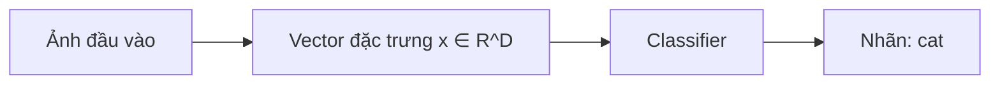
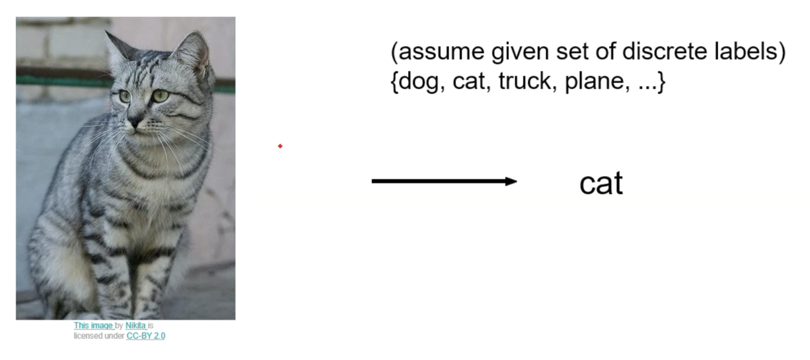
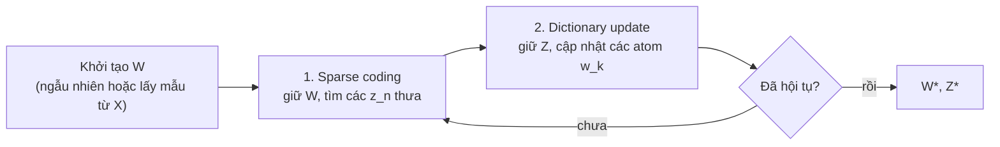

# Buổi 4 – Chuẩn, Khoảng cách, Góc (tiếp) và Ứng dụng

- **Ngày**: 27/11/2026
- **Môn**: Toán cho Khoa học máy tính (CS115.G11.CN2.TTNT)
- **Giảng viên**: Dương Việt Hằng
- **Lịch học**: Thứ 6, 18h15 – 22h00

## Nội dung buổi học

### Ôn lại: Cơ sở của không gian (Basis)

Nhắc nhanh từ buổi 3 – ba khái niệm đi liền nhau:

- **Hệ sinh** (generating set): tập vector "sinh ra" cả không gian – mọi $\mathbf{x}$ đều viết được thành tổ hợp tuyến tính của nó. Được phép **thừa** vector.
- **Độc lập tuyến tính**: không vector nào viết được qua các vector còn lại. Được phép **thiếu**.
- **Cơ sở** (basis): hệ sinh tối thiểu = tập độc lập tối đại – vừa đủ vừa không thừa. Trong $\mathbb{R}^n$ mọi cơ sở có đúng $n$ vector.

Hệ quả quan trọng nhất của cơ sở: mọi vector $\mathbf{x}$ có biểu diễn **duy nhất**

$$\mathbf{x} = \lambda_1\mathbf{b}_1 + \dots + \lambda_n\mathbf{b}_n = \mathbf{B}\boldsymbol{\lambda}$$

– mỗi vector ứng đúng một bộ tọa độ $\boldsymbol{\lambda}$, tìm bằng cách giải hệ $\mathbf{B}\boldsymbol{\lambda} = \mathbf{x}$ (hoặc chỉ cần tích vô hướng $\lambda_i = \langle \mathbf{x}, \mathbf{b}_i \rangle$ nếu cơ sở trực chuẩn).

> [!NOTE]
> Cách nhìn cho buổi này: một cơ sở là một **hệ mã hóa** – nó quy định cách biểu diễn (encode) mọi vector thành vector tọa độ, và cách dựng lại (decode) $\mathbf{x}$ từ tọa độ đó. Câu hỏi tự nhiên: thay vì dùng cơ sở "có sẵn" (cơ sở đơn vị, cơ sở trực chuẩn), ta có thể **học một cơ sở phù hợp với dữ liệu** không? PCA trả lời theo cách riêng (cơ sở trực chuẩn theo phương sai lớn nhất), dictionary learning trả lời tổng quát hơn.

### Chuẩn trên không gian vector tổng quát (Norm)

> [!WARNING]
> **Khả năng cao ra thi** – phần Norm được nhấn là trọng tâm kiểm tra. Cần nắm chắc: 3 tiên đề của chuẩn, cách kiểm tra một hàm có phải norm không, và tính thành thạo các chuẩn $L_1$, $L_2$, $L_\infty$.

Buổi 3 định nghĩa chuẩn trên $\mathbb{R}^n$. Bản đầy đủ phát biểu cho **không gian vector tổng quát** $V$ – phần tử của $V$ không nhất thiết là "vector tọa độ", mà có thể là ma trận, hàm số, dãy số... Nói ngắn gọn: **norm là độ lớn của đối tượng**, bất kể đối tượng đó là gì.

**Định nghĩa.** Chuẩn trên không gian vector $V$ là một hàm $\|\cdot\| : V \to \mathbb{R}$ thỏa mãn ba tính chất sau với mọi vô hướng $\lambda \in \mathbb{R}$ và mọi $\mathbf{x}, \mathbf{y} \in V$:

1. **Tuyệt đối thuần nhất** (absolutely homogeneous): $\|\lambda \mathbf{x}\| = |\lambda| \, \|\mathbf{x}\|$.
2. **Bất đẳng thức tam giác** (triangle inequality): $\|\mathbf{x} + \mathbf{y}\| \leq \|\mathbf{x}\| + \|\mathbf{y}\|$.
3. **Xác định dương** (positive definite): $\|\mathbf{x}\| \geq 0$ và $\|\mathbf{x}\| = 0 \iff \mathbf{x} = \theta$.

> [!NOTE]
> **Quy ước quan trọng**: viết $\|\mathbf{x}\|$ **không kèm chỉ số** (không nói gì thêm) thì ngầm hiểu là **chuẩn $L_2$ (Euclid)**. Muốn chỉ chuẩn khác phải ghi rõ, vd $\|\mathbf{x}\|_1$, $\|\mathbf{x}\|_\infty$.

> [!NOTE]
> Trực quan vẫn y nguyên $\mathbb{R}^n$: (1) co giãn đối tượng bao nhiêu lần thì độ lớn co giãn bấy nhiêu; (2) "đi thẳng không dài hơn đi vòng"; (3) chỉ phần tử không mới có độ lớn 0. Chỉ khác ở chỗ ba tính chất này giờ được đòi trên **mọi không gian vector** – một hàm nào đó trên $V$ chỉ cần thỏa cả ba là được gọi là chuẩn, kể cả khi "đối tượng" là hàm số hay ma trận.

#### Ví dụ khi $V = \mathbb{R}^n$

Các chuẩn quen thuộc từ buổi 3 chính là "trường hợp $V = \mathbb{R}^n$" của định nghĩa trên. Với $\mathbf{x} = [x_1, \dots, x_n] \in \mathbb{R}^n$:

- **Chuẩn Manhattan** ($\ell_1$ norm):

$$\|\mathbf{x}\|_1 := \sum_{i=1}^{n} |x_i|$$

- **Chuẩn Euclidean** ($\ell_2$ norm):

$$\|\mathbf{x}\|_2 := \sqrt{\sum_{i=1}^{n} x_i^2} = \sqrt{\mathbf{x}^{\mathsf{T}}\mathbf{x}}$$

> [!NOTE]
> Viết $\|\mathbf{x}\|_2 = \sqrt{\mathbf{x}^{\mathsf{T}}\mathbf{x}}$ để thấy rõ mối quan hệ chuẩn – tích trong: chuẩn Euclid chính là $\sqrt{\langle \mathbf{x}, \mathbf{x} \rangle}$, tức chuẩn **cảm sinh** (induced) bởi dot product. Đây là trường hợp riêng của khung "tích trong $\Rightarrow$ chuẩn" ở buổi 3.

- **Chuẩn max** ($\ell_\infty$ norm, Chebyshev):

$$\|\mathbf{x}\|_\infty := \max_{i} |x_i|$$

- **Chuẩn $\ell_p$ tổng quát** ($p \geq 1$), gom cả ba chuẩn trên vào một công thức: $p = 1$, $p = 2$ là hai chuẩn đầu, còn $p \to \infty$ cho chuẩn max:

$$\|\mathbf{x}\|_p := \left(\sum_{i=1}^{n} |x_i|^p\right)^{1/p}$$

**Ví dụ tính nhanh** với $\mathbf{x} = (3, -4, 1)$: $\|\mathbf{x}\|_1 = 3 + 4 + 1 = 8$, $\|\mathbf{x}\|_2 = \sqrt{9 + 16 + 1} = \sqrt{26} \approx 5.10$, $\|\mathbf{x}\|_\infty = 4$. Luôn có $\|\mathbf{x}\|_\infty \leq \|\mathbf{x}\|_2 \leq \|\mathbf{x}\|_1$, dùng để tự kiểm tra kết quả.

> [!CAUTION]
> Với $0 < p < 1$ công thức $\ell_p$ **không còn là chuẩn** vì vi phạm bất đẳng thức tam giác. Phản ví dụ: $\mathbf{x} = (1, 0)$, $\mathbf{y} = (0, 1)$, $p = \tfrac{1}{2}$ thì $\|\mathbf{x} + \mathbf{y}\|_{1/2} = (1 + 1)^2 = 4 > 2 = \|\mathbf{x}\|_{1/2} + \|\mathbf{y}\|_{1/2}$. Đây là lý do định nghĩa luôn kèm điều kiện $p \geq 1$.

Mỗi chuẩn cho một hình dạng "vòng tròn đơn vị" khác nhau – đường biên của **quả cầu đơn vị** (unit ball, tập các điểm có $\|\mathbf{x}\| \leq 1$), tức tập điểm cách gốc đúng 1 đơn vị theo chuẩn đang dùng:


*Nguồn: [Waldir Pimenta](https://commons.wikimedia.org/wiki/File:2D_unit_balls.svg), CC BY-SA 3.0*

> [!NOTE]
> Nhìn hình mà đoán tính chất: unit ball của $L_1$ (hình thoi) có **đỉnh nhọn nằm trên các trục tọa độ** – nghiệm tối ưu có phạt $L_1$ rất dễ "rơi vào đỉnh" tức có thành phần bằng 0. Đây là lý do hình học khiến $L_1$ sinh nghiệm **thưa** trong LASSO và sparse coding – sẽ gặp lại ở phần dictionary learning.

**Cùng ba tiên đề, nhiều loại đối tượng:**

| Đối tượng trong $V$ | Chuẩn thường gặp | Ý nghĩa "độ lớn" |
|---|---|---|
| Vector $\mathbf{x} \in \mathbb{R}^n$ | $L_1$, $L_2$, $L_p$, $L_\infty$ | Độ dài hình học / cỡ của tọa độ |
| Ma trận $\mathbf{A}$ | Frobenius $\Vert \mathbf{A}\Vert _F$; spectral $\Vert \mathbf{A}\Vert _2 = \sigma_{\max}$ | "Khối lượng" ma trận / khả năng khuếch đại tối đa |
| Hàm số $f$ trên $[a,b]$ | $\Vert f\Vert _p = \left(\int_a^b \vert f(x)\vert ^p dx\right)^{1/p}$; $\Vert f\Vert _\infty = \sup_x \vert f(x)\vert $ | Cỡ của hàm – nền của không gian $L^p$ |
| Dãy số $(x_k)$ | $\ell_p$: $\left(\sum_k \vert x_k\vert ^p\right)^{1/p}$ | $\mathbb{R}^n$ kéo dài ra vô hạn chiều |

Và cứ có chuẩn là có **khoảng cách** đi kèm: $d(\mathbf{x}, \mathbf{y}) = \|\mathbf{x} - \mathbf{y}\|$ – chuẩn của *hiệu* hai đối tượng đo "độ khác nhau" giữa chúng. Vd $d(f, g) = \|f - g\|_2$ đo hai hàm "cách nhau" bao xa – nền của bài toán xấp xỉ hàm và fitting nói chung.

> [!TIP]
> Liên hệ ML: hàm loss $\|\mathbf{y} - \hat{\mathbf{y}}\|^2$ thực chất là **khoảng cách giữa hai đối tượng** (nhãn thật vs dự đoán) trong một không gian vector – chọn chuẩn nào là chọn "thước đo sai số" đó. Với đối tượng là hàm, regularization kiểu $\|f\|^2$ trong RKHS đo "độ phức tạp" của hàm học được – một cách dùng norm lên thứ không phải vector.

### Khoảng cách (Distance)

> [!WARNING]
> **Khả năng cao ra thi** – cùng với Norm, phần Distance là trọng tâm kiểm tra. Cần nắm chắc: 3 tiên đề metric, phân biệt "khoảng cách sinh từ chuẩn" với "metric nói chung", và tính được $d(\mathbf{x}, \mathbf{y}) = \|\mathbf{x} - \mathbf{y}\|$ như ví dụ tài liệu $A, B, C$ bên dưới.

**Khoảng cách giữa hai điểm** $\mathbf{x}, \mathbf{y}$ trong $\mathbb{R}^n$ chính là **độ dài của vector nối từ $\mathbf{x}$ đến $\mathbf{y}$**:

$$d(\mathbf{x}, \mathbf{y}) = \|\mathbf{y} - \mathbf{x}\|$$

Viết qua tích trong (khi chuẩn là chuẩn cảm sinh):

$$d(\mathbf{x}, \mathbf{y}) := \|\mathbf{x} - \mathbf{y}\| = \sqrt{\langle \mathbf{x} - \mathbf{y},\, \mathbf{x} - \mathbf{y} \rangle}$$

- Dùng **dot product** làm tích trong trên $\mathbb{R}^n$ → thu được **khoảng cách Euclid** (Euclidean distance) quen thuộc.
- Đổi inner product (vd $\langle \mathbf{x}, \mathbf{y} \rangle = \mathbf{x}^{\mathsf{T}}\mathbf{A}\mathbf{y}$) → ra một khoảng cách khác – đúng tinh thần "một hình học, nhiều thước đo" của buổi 3.


*Nguồn: [Psychonaut](https://commons.wikimedia.org/wiki/File:Manhattan_distance.svg), public domain*

Cùng hai điểm nhưng hai con số khác nhau: $d_1 = 12$ (đi theo ô lưới như taxi trong thành phố) và $d_2 = \sqrt{72} \approx 8.49$ (đường chim bay) – "xa" hay "gần" phụ thuộc hẳn vào chuẩn đang dùng.

> [!NOTE]
> **Khoảng cách không bắt buộc phải đi qua chuẩn** – chuẩn chỉ là điều kiện *đủ*, không phải điều kiện *cần*. Một hàm $d$ bất kỳ được gọi là **metric** (khái niệm khoảng cách hợp lệ) nếu thỏa ba tính chất:
>
> 1. **Xác định dương** (positive definite): $d(\mathbf{x}, \mathbf{y}) \geq 0$ với mọi $\mathbf{x}, \mathbf{y}$, và $d(\mathbf{x}, \mathbf{y}) = 0 \iff \mathbf{x} = \mathbf{y}$.
> 2. **Đối xứng** (symmetric): $d(\mathbf{x}, \mathbf{y}) = d(\mathbf{y}, \mathbf{x})$.
> 3. **Bất đẳng thức tam giác** (triangle inequality): $d(\mathbf{x}, \mathbf{z}) \leq d(\mathbf{x}, \mathbf{y}) + d(\mathbf{y}, \mathbf{z})$.
>
> Khoảng cách sinh từ chuẩn tự động thỏa cả ba điều này. Ngược lại không đúng – có metric không đi kèm chuẩn nào, vd **metric rời rạc**: $d(\mathbf{x}, \mathbf{y}) = 0$ nếu $\mathbf{x} = \mathbf{y}$, $= 1$ nếu khác – thỏa đủ ba tiên đề nhưng không sinh từ norm nào (khoảng cách không "co giãn" theo vector).


*Nguồn: [Cmglee](https://commons.wikimedia.org/wiki/File:Minkowski_distance_examples.svg), CC BY-SA 4.0*

#### Vector đơn vị (Unit vector)

Vector đơn vị là vector có **độ dài bằng 1**:

$$\|\mathbf{x}\| = \sqrt{\mathbf{x} \cdot \mathbf{x}} = 1$$

**Ví dụ – chuẩn hóa vector $(2, 1)$ theo chuẩn $L_2$:** cho $\mathbf{x} = \begin{pmatrix} 2 \\ 1 \end{pmatrix}$, độ dài Euclid:

$$\|\mathbf{x}\|_2 = \sqrt{\mathbf{x} \cdot \mathbf{x}} = \sqrt{2^2 + 1^2} = \sqrt{5}$$

Vector đơn vị cùng hướng:

$$\mathbf{u} = \frac{\mathbf{x}}{\|\mathbf{x}\|_2} = \frac{1}{\sqrt{5}}\begin{pmatrix} 2 \\ 1 \end{pmatrix} = \begin{pmatrix} 2/\sqrt{5} \\ 1/\sqrt{5} \end{pmatrix} \approx \begin{pmatrix} 0.894 \\ 0.447 \end{pmatrix}$$

Kiểm tra: $\|\mathbf{u}\|_2 = \sqrt{\frac{4}{5} + \frac{1}{5}} = \sqrt{1} = 1$ ✓

> [!TIP]
> Chuẩn hóa = chia vector cho chuẩn của chính nó: giữ nguyên **hướng**, đặt **độ dài bằng 1**. Đây là bước bắt buộc trước khi so sánh embedding bằng cosine similarity – sau khi chuẩn hóa, tích vô hướng chính là $\cos\omega$.

#### Ví dụ áp dụng: hệ thống tìm kiếm tài liệu

Bài toán trên lớp: mỗi văn bản được biểu diễn bởi vector 3 chiều – số lần xuất hiện của 3 từ khóa `"data"`, `"AI"`, `"cloud"`:

$$A = \begin{pmatrix} 3 \\ 1 \\ 2 \end{pmatrix}, \qquad B = \begin{pmatrix} 1 \\ 0 \\ 2 \end{pmatrix}, \qquad C = \begin{pmatrix} 0 \\ 2 \\ 1 \end{pmatrix}$$

**a) Chuẩn Euclid ($L_2$) của từng tài liệu:**

$$\|A\|_2 = \sqrt{3^2 + 1^2 + 2^2} = \sqrt{14} \approx 3.74$$
$$\|B\|_2 = \sqrt{1^2 + 0^2 + 2^2} = \sqrt{5} \approx 2.24$$
$$\|C\|_2 = \sqrt{0^2 + 2^2 + 1^2} = \sqrt{5} \approx 2.24$$

**b) Tài liệu nào giống $A$ nhất – $B$ hay $C$?**

So khoảng cách Euclid tới $A$:

$$d(A, B) = \|A - B\|_2 = \left\| \begin{pmatrix} 2 \\ 1 \\ 0 \end{pmatrix} \right\|_2 = \sqrt{5} \approx 2.24$$
$$d(A, C) = \|A - C\|_2 = \left\| \begin{pmatrix} 3 \\ -1 \\ 1 \end{pmatrix} \right\|_2 = \sqrt{11} \approx 3.32$$

$d(A, B) < d(A, C)$ → **$B$ giống $A$ hơn $C$** – vì hiệu $A - B$ chỉ khác ở hai từ khóa, còn $A - C$ lệch cả ba.

> [!NOTE]
> Kiểm tra chéo bằng **góc** (công thức cosine ở [buổi 3](./03-20-11-buoi-3-giai-tich-vector-chuan-khoang-cach-goc)): $\cos(A, B) = \dfrac{A \cdot B}{\|A\| \|B\|} = \dfrac{3 + 0 + 4}{\sqrt{70}} = \dfrac{7}{\sqrt{70}} \approx 0.84$, còn $\cos(A, C) = \dfrac{0 + 2 + 2}{\sqrt{70}} = \dfrac{4}{\sqrt{70}} \approx 0.48$ – cosine cũng kết luận $B$ giống $A$ hơn. Vì $\|B\| = \|C\| = \sqrt{5}$, hai độ đo không bị lệch bởi độ dài nên đồng ý nhau; khi các tài liệu dài ngắn chênh nhau nhiều, Euclid và cosine có thể cho kết luận khác nhau – với tìm kiếm tài liệu người ta thường tin **cosine** hơn (chỉ quan tâm "chủ đề", không quan tâm độ dài văn bản).

#### Ví dụ: đổi tích trong thì đổi khoảng cách

Bài tập trên lớp: tính khoảng cách giữa $\mathbf{x} = \begin{pmatrix} 1 \\ 2 \\ 3 \end{pmatrix}$ và $\mathbf{y} = \begin{pmatrix} -1 \\ -1 \\ 0 \end{pmatrix}$ theo **hai tích trong khác nhau**.

**a) Dot product $\langle \mathbf{x}, \mathbf{y} \rangle := \mathbf{x}^{\mathsf{T}}\mathbf{y}$:**

$$\mathbf{x} - \mathbf{y} = \begin{pmatrix} 2 \\ 3 \\ 3 \end{pmatrix} \quad\Longrightarrow\quad d(\mathbf{x}, \mathbf{y}) = \sqrt{2^2 + 3^2 + 3^2} = \sqrt{22} \approx 4.69$$

**b) Tích trong $\langle \mathbf{x}, \mathbf{y} \rangle := \mathbf{x}^{\mathsf{T}}\mathbf{A}\mathbf{y}$, với $\mathbf{A} = \begin{pmatrix} 2 & 1 & 0 \\ 1 & 3 & -1 \\ 0 & -1 & 2 \end{pmatrix}$:**

Kiểm tra $\mathbf{A}$ hợp lệ trước (nhớ bẫy ở buổi 3): $\mathbf{A}$ **đối xứng** ✓ và các định thức con chính $2 > 0$, $\det\begin{pmatrix} 2 & 1 \\ 1 & 3 \end{pmatrix} = 5 > 0$, $\det\mathbf{A} = 8 > 0$ → xác định dương ✓ → đây là inner product hợp lệ.

Khoảng cách theo thước mới:

$$d^2(\mathbf{x}, \mathbf{y}) = (\mathbf{x} - \mathbf{y})^{\mathsf{T}}\mathbf{A}(\mathbf{x} - \mathbf{y})$$

$$\mathbf{A}(\mathbf{x} - \mathbf{y}) = \begin{pmatrix} 2 & 1 & 0 \\ 1 & 3 & -1 \\ 0 & -1 & 2 \end{pmatrix} \begin{pmatrix} 2 \\ 3 \\ 3 \end{pmatrix} = \begin{pmatrix} 7 \\ 8 \\ 3 \end{pmatrix}$$

$$d(\mathbf{x}, \mathbf{y}) = \sqrt{\begin{pmatrix} 2 \\ 3 \\ 3 \end{pmatrix}^{\mathsf{T}} \begin{pmatrix} 7 \\ 8 \\ 3 \end{pmatrix}} = \sqrt{14 + 24 + 9} = \sqrt{47} \approx 6.86$$

**Kết luận**: cùng hai điểm $\mathbf{x}, \mathbf{y}$ nhưng $d = \sqrt{22}$ theo thước Euclid và $d = \sqrt{47}$ theo thước $\mathbf{A}$ – **đổi inner product là đổi thước đo**, đúng tinh thần "một hình học, nhiều thước đo".


*Nguồn: [Piotrg](https://commons.wikimedia.org/wiki/File:MahalanobisDist2.png), CC BY-SA 3.0*

> [!NOTE]
> Hình trên giải thích trực quan vì sao $d$ thay đổi: với tích trong $\mathbf{x}^{\mathsf{T}}\mathbf{A}\mathbf{y}$, tập các điểm "cùng khoảng cách tới tâm" không còn là **đường tròn** mà là **ellipse nghiêng** – các trục ellipse đi theo **vector riêng của $\mathbf{A}$** (ở đây nghiêng $\pi/4$ theo hướng tương quan của dữ liệu). Điểm nằm dọc theo trục dài của ellipse được "kéo gần lại" so với Euclid, điểm lệch trục ngắn bị "đẩy xa ra" – tức thước đo mới **thưởng/phạt theo hướng** chứ không đối xử đều mọi hướng như dot product.
>
> Đây chính là cơ chế của **khoảng cách Mahalanobis** (buổi 3): chọn $\mathbf{A} = \mathbf{\Sigma}^{-1}$ thì khoảng cách tự động "kìm" các đặc trưng biến thiên mạnh và tính đến tương quan giữa chúng – dùng trong anomaly detection, phân loại.

#### Ứng dụng: feature distance và láng giềng gần nhất (nearest neighbor)

- **Feature distance**: nếu $\mathbf{x}$ và $\mathbf{y}$ là vector đặc trưng của hai đối tượng thì $\|\mathbf{x} - \mathbf{y}\|$ chính là **khoảng cách đặc trưng** – đo mức độ "khác nhau" của hai đối tượng trong không gian đặc trưng.
- **Láng giềng gần nhất** (nearest neighbor): cho danh sách vector $\mathbf{z}_1, \dots, \mathbf{z}_m$, vector $\mathbf{z}_j$ là láng giềng gần nhất của $\mathbf{x}$ nếu

$$\|\mathbf{x} - \mathbf{z}_j\| \;\leq\; \|\mathbf{x} - \mathbf{z}_i\|, \qquad i = 1, \dots, m$$

– tức $\mathbf{z}_j$ là điểm **gần $\mathbf{x}$ nhất** trong cả danh sách, theo đúng chuẩn đang dùng.

> [!NOTE]
> Trong ví dụ tìm kiếm tài liệu phía trên, $B$ chính là nearest neighbor của $A$ trong danh sách $\{B, C\}$ vì $d(A, B) = \sqrt{5} < \sqrt{11} = d(A, C)$.

Hai ý tưởng đơn giản này được dùng **rất rộng**:

- **k-NN phân loại / hồi quy**: lấy $k$ láng giềng gần nhất rồi tổng hợp nhãn (chi tiết bên dưới).
- **Retrieval / recommendation**: "sản phẩm tương tự", "bài viết liên quan" thực chất là tìm nearest neighbor trong không gian embedding.
- **Face recognition**: ví dụ eigenface ở buổi 3 – dự đoán ảnh test bằng centroid gần nhất chính là 1-NN trên tập 80 centroid.

##### k-NN: bốn bước của thuật toán

1. **Look at the data** – nhận điểm mới $\mathbf{x}$ cần dự đoán, kèm tập train đã gán nhãn.
2. **Calculate distances** – tính khoảng cách tới **mọi** điểm train: $d(\mathbf{x}, \mathbf{z}_i) = \|\mathbf{x} - \mathbf{z}_i\|$ (thường là Euclid).
3. **Find neighbours** – xếp hạng các điểm theo khoảng cách **tăng dần**, chọn $k$ điểm đầu bảng.
4. **Vote on labels** – tổng hợp nhãn của $k$ láng giềng:

| | Classification (phân loại) | Regression (hồi quy) |
|---|---|---|
| Input | Vector đặc trưng $\mathbf{x} \in \mathbb{R}^D$ của đối tượng cần dự đoán | Giống phân loại – cũng là $\mathbf{x} \in \mathbb{R}^D$ |
| Output | **Nhãn rời rạc** – một trong $C$ lớp cho trước | **Giá trị liên tục** $y \in \mathbb{R}$ |
| Cách dự đoán | **Bỏ phiếu đa số** – lớp nào chiếm nhiều phiếu nhất trong $k$ láng giềng | **Lấy trung bình** – $y_{pred} = \dfrac{1}{k} \displaystyle\sum_{\mathbf{x}_i \in \mathcal{N}_k} y_i$ |
| Ví dụ trên slide | $k = 3$: 2 phiếu đỏ vs 1 phiếu xanh → dự đoán **đỏ** | $k = 4$: trung bình giá trị của 4 láng giềng |


*Nguồn: [Natana Jadri AnAj](https://commons.wikimedia.org/wiki/File:KnnClassification.svg), CC BY-SA 3.0*

Hình kinh điển trên cho thấy **kết quả phân loại đổi theo $k$**: $k = 3$ → đỏ thắng, $k = 5$ → xanh lật kèo – minh họa trực tiếp cho việc $k$ là hyperparameter cần chọn cẩn thận.


*Nguồn: [Sewaqu](https://commons.wikimedia.org/wiki/File:Linear_regression.svg), public domain*

> [!TIP]
> Hai điểm cần nhớ khi dùng k-NN: (1) $k$ là hyperparameter – $k$ nhỏ thì nhạy nhiễu (overfit láng giềng), $k$ lớn thì làm mịn quá mức (underfit); $k = 1$ chính là nearest neighbor thuần túy. (2) k-NN "sống bằng khoảng cách" nên **phải scale các đặc trưng về cùng thang** trước khi đo – nếu không đặc trưng có đơn vị lớn sẽ nuốt hết các đặc trưng còn lại.

#### Ứng dụng: độ khác biệt giữa các văn bản (document dissimilarity)

Ví dụ thực tế trên lớp: lấy **5 bài Wikipedia** – `Veterans Day`, `Memorial Day`, `Academy Awards`, `Golden Globe Awards`, `Super Bowl` – biểu diễn mỗi bài bằng **histogram số lần xuất hiện của các từ** trong một từ điển gồm $4423$ từ → mỗi bài là một vector $\mathbf{x}_i \in \mathbb{R}^{4423}$. Tính khoảng cách đôi một (pairwise distances):

> [!NOTE]
> **Từ điển 4423 từ ở đâu ra?** Đây là vocabulary được **dựng sẵn từ corpus** (ví dụ trong giáo trình Boyd & Vandenberghe, VMLS): tách từ toàn bộ các bài viết trong tập dữ liệu (lowercase, bỏ dấu câu...), gom tất cả các từ **khác nhau** → từ điển cố định $D = 4423$ từ. Mỗi văn bản sau đó được mã hóa thành vector đếm/tần suất trên từ điển chung đó – một bài chỉ dùng vài trăm từ nên vector **rất thưa** (đa số phần tử bằng 0). Đổi corpus thì đổi cả từ điển lẫn số chiều – $4423$ phụ thuộc hoàn toàn vào dữ liệu và cách tiền xử lý.

| | Veterans Day | Memorial Day | Academy Awards | Golden Globe | Super Bowl |
|---|---|---|---|---|---|
| Veterans Day | 0 | 0.095 | 0.130 | 0.153 | 0.170 |
| Memorial Day | 0.095 | 0 | 0.122 | 0.147 | 0.164 |
| Academy Awards | 0.130 | 0.122 | 0 | 0.108 | 0.164 |
| Golden Globe Awards | 0.153 | 0.147 | 0.108 | 0 | 0.181 |
| Super Bowl | 0.170 | 0.164 | 0.164 | 0.181 | 0 |

Đọc bảng:

- **Gần nhất**: `Veterans Day` – `Memorial Day` ($0.095$) – cả hai đều là ngày lễ tưởng nhớ quân nhân của Mỹ → nội dung rất giống nhau.
- **Gần tiếp theo**: `Academy Awards` – `Golden Globe Awards` ($0.108$) – hai giải thưởng điện ảnh.
- **Xa mọi bài**: `Super Bowl` ($0.164$ đến $0.181$) – bài về thể thao, khác hẳn ngày lễ lẫn giải thưởng.

> [!NOTE]
> Khoảng cách **thuần toán học** (norm của hiệu hai histogram) đã tái hiện được đúng **quan hệ ngữ nghĩa** giữa các bài viết – đây chính là ý tưởng nền của vector space model trong IR và embedding hiện đại. Ma trận khoảng cách này cũng minh họa trực quan 2 tiên đề metric: **đối xứng** (bảng đối xứng qua đường chéo) và $d(\mathbf{x}, \mathbf{x}) = 0$ (đường chéo toàn 0). Muốn gợi ý "bài liên quan" hay gom cụm tài liệu thì chỉ cần đọc bảng này – nearest neighbor của `Veterans Day` chính là `Memorial Day`.

#### Ứng dụng: phân loại ảnh (image classification) – bài toán lõi của Computer Vision

Bài toán: cho trước một **tập nhãn rời rạc** `{dog, cat, truck, plane, ...}`, nhận đầu vào là một **bức ảnh** và phải trả về đúng một nhãn.





*Ảnh mèo đầu vào – output mong muốn là nhãn "cat". Ảnh mèo của Nikita, CC-BY 2.0.*

> [!NOTE]
> Đây chính là bản thể của **classification** trong bảng k-NN phía trên: input là vector đặc trưng $\mathbf{x} \in \mathbb{R}^D$ (ảnh sau khi trích đặc trưng), output là **nhãn rời rạc** trong tập $C$ lớp cho trước. Với k-NN thì việc "nhận ra mèo" quy về đo $\|\mathbf{x} - \mathbf{x}_i\|$ tới các ảnh đã gán nhãn và lấy phiếu bầu của $k$ láng giềng gần nhất. Đây cũng là ứng dụng trực tiếp của nearest neighbor trên ảnh mặt người (eigenface) đã học buổi trước.

**Cách tiếp cận data-driven** (không viết rule bằng tay):

1. **Thu thập dataset** gồm ảnh và nhãn tương ứng (training set – vd lưới ảnh nhỏ xếp theo lớp: airplane, automobile, bird, cat, deer, ...).
2. **Dùng Machine Learning để train** một classifier trên dataset đó.
3. **Đánh giá** classifier trên các ảnh mới chưa từng thấy.

Toàn bộ hệ thống gói gọn trong hai hàm:

```python
def train(images, labels):
    # Machine learning!
    return model

def predict(model, test_images):
    # Use model to predict labels
    return test_labels
```

> [!NOTE]
> `train()` là nơi "phép màu" xảy ra – mọi thuật toán ML chỉ là các cách khác nhau để điền phần thân của hàm này. Với k-NN thì `train()` gần như không làm gì (chỉ lưu lại dataset), còn `predict()` mới là phần nặng: tính khoảng cách tới mọi ảnh train rồi bỏ phiếu. Ngược lại với các mô hình như linear classifier hay neural net thì `train()` nặng (tối ưu tham số) còn `predict()` rất nhanh.

**Hyperparameter** (siêu tham số) là các giá trị **do người thiết kế chọn trước khi train**, không được học từ dữ liệu – khác với **parameter** (tham số) là thứ `train()` học ra (vd trọng số $\mathbf{w}$ của linear classifier). Ví dụ hyperparameter: $k$ trong k-NN, loại khoảng cách dùng ($L_1$ hay $L_2$), learning rate, hệ số regularization $\lambda$.

> [!TIP]
> Vì hyperparameter không học được từ train data nên phải **chọn bằng tay hoặc tune**: thường tách một phần dữ liệu làm **validation set**, chạy nhiều giá trị hyperparameter khác nhau rồi lấy giá trị cho kết quả tốt nhất (grid search, cross-validation). Chọn trên test set là phạm quy – sẽ đánh giá lạc quan hơn thực tế.

**Cài đặt cụ thể bằng NumPy** – nearest neighbor classifier đầy đủ chỉ trong vài dòng:

```python
import numpy as np

class NearestNeighbor:
    def __init__(self):
        pass

    def train(self, X, y):
        """ X is N x D where each row is an example. Y is 1-dimension of size N """
        # the nearest neighbor classifier simply remembers all the training data
        self.Xtr = X
        self.ytr = y

    def predict(self, X):
        """ X is N x D where each row is an example we wish to predict label for """
        num_test = X.shape[0]
        # lets make sure that the output type matches the input type
        Ypred = np.zeros(num_test, dtype=self.ytr.dtype)

        # loop over all test rows
        for i in range(num_test):
            # find the nearest training image to the i'th test image
            # using the L1 distance (sum of absolute value differences)
            distances = np.sum(np.abs(self.Xtr - X[i,:]), axis=1)
            min_index = np.argmin(distances)  # get the index with smallest distance
            Ypred[i] = self.ytr[min_index]    # predict the label of the nearest example

        return Ypred
```

Đọc code:

- **`X`, `y` trong `train(X, y)`**: `X` là **ma trận dữ liệu** $N \times D$ – mỗi hàng là một mẫu (một ảnh duỗi thành vector $D$ chiều, vd ảnh xám $32 \times 32$ một kênh màu → hàng dài $1024$); `y` là **vector nhãn** $N$ phần tử, `y[i]` là nhãn (`cat`, `dog`, ...) của ảnh ở hàng `X[i]`. Hai thứ này chính là "dataset gồm ảnh và nhãn" ở bước 1.
- `train()` chỉ **ghi nhớ** toàn bộ dữ liệu (`self.Xtr`, `self.ytr`) – đúng nhận xét ở trên: train nhẹ, predict nặng.
- `np.abs(self.Xtr - X[i,:])` nhờ **broadcasting** trừ ảnh test $i$ vào mọi hàng của ma trận train, rồi `np.sum(..., axis=1)` cộng theo hàng → đây chính là **khoảng cách Manhattan** $\|\mathbf{x} - \mathbf{x}_i\|_1$ giữa ảnh test và từng ảnh train.
- `np.argmin` lấy chỉ số ảnh train gần nhất → gán nhãn của nó cho ảnh test.

> [!NOTE]
> Đây là **1-NN** với chuẩn $L_1$. k-NN có **đúng 2 hyperparameter**:
>
> 1. **Hàm khoảng cách** – $L_1$ (Manhattan), $L_2$ (Euclid), ... Trong code: `np.sum(np.abs(...))` là $L_1$; đổi sang `np.sum((self.Xtr - X[i,:])**2, axis=1)` là $L_2$.
> 2. **Số láng giềng $k$** – trong code đang là $k = 1$ (`argmin`); đổi thành `np.argsort(distances)[:k]` rồi bỏ phiếu đa số là k-NN tổng quát.

**Độ phức tạp**: với $N$ mẫu train thì

- `train()` = $O(1)$ – chỉ lưu tham chiếu tới dữ liệu, không tính toán gì.
- `predict()` = $O(N)$ cho mỗi ảnh test – phải đo khoảng cách tới **cả $N$** ảnh train (chính xác hơn là $O(N \cdot D)$ nếu tính cả chi phí mỗi phép trừ vector $D$ chiều).

> [!WARNING]
> Đây là **điểm chí mạng** của nearest neighbor: thực tế ta muốn ngược lại – `train()` chậm không sao (train một lần, offline), nhưng `predict()` phải **nhanh** vì nó chạy mỗi khi có input mới (user upload ảnh, xe tự lái đọc camera theo thời gian thực...). k-NN làm ngược điều mong muốn: predict càng chậm khi dataset càng lớn → gần như không dùng được cho dữ liệu lớn nếu không có cấu trúc dữ liệu tăng tốc (KD-tree, LSH...). Các mô hình **parametric** (linear classifier, CNN) ngược lại: train rất lâu nhưng predict gần như $O(1)$ – đúng thứ thực tế cần.

**Tính khái quát hóa (generalization)**: là khả năng model predict đúng trên **dữ liệu mới chưa từng thấy** – mục tiêu thật của ML, không phải làm đúng trên tập train. Trong ví dụ trên:

- `train()` chỉ ghi nhớ dữ liệu → với $k = 1$, độ chính xác trên tập train **luôn bằng 100%** (láng giềng gần nhất của mỗi điểm train chính là nó) – đây là "học vẹt", không phải khái quát hóa.
- Khái quát hóa chỉ đo được khi chạy `predict()` trên **test set tách biệt** – độ chính xác test mới cho biết giả định "điểm gần nhau trong không gian đặc trưng thì cùng nhãn" có đúng trên dữ liệu mới không.
- **$k$ điều khiển mức khái quát hóa**: $k$ nhỏ → biên quyết định gập khúc theo từng điểm → overfit (nhạy nhiễu); $k$ lớn quá → biên quá mượt → underfit. Chênh lệch giữa accuracy train và test gọi là **generalization gap**.

### Dictionary learning (Học từ điển)

#### Từ "cơ sở" đến "từ điển" – nới lỏng ba ràng buộc

| | Cơ sở (basis) | Từ điển (dictionary) |
|---|---|---|
| Số vector | Đúng $D$ (trong $\mathbb{R}^D$) | $K$ tùy ý – thường $K > D$ (**overcomplete**) |
| Độc lập tuyến tính | Bắt buộc | Không cần – atom được phép phụ thuộc |
| Biểu diễn | Duy nhất, $D$ tọa độ | Vô số biểu diễn → phải thêm tiêu chí chọn: **thưa** |

- **Từ điển** (dictionary) $\mathbf{W} = [\mathbf{w}_1, \dots, \mathbf{w}_K]$, mỗi cột $\mathbf{w}_k \in \mathbb{R}^D$ gọi là một **atom** – một "từ vựng" cơ bản.
- Từ điển không có sẵn mà **học từ chính dữ liệu** – đó là chữ "learning".
- Vì $K$ có thể lớn hơn $D$, phương trình $\mathbf{W}\mathbf{z} = \mathbf{x}$ có vô số nghiệm → trong vô số cách "dùng từ" đó, chọn cách dùng **ít từ nhất** – biểu diễn **thưa** (sparse representation).

> [!NOTE]
> Trực quan: một ảnh khuôn mặt thực chất chỉ "pha" từ vài chục đặc trưng (mắt, mũi, contour...) trong khi từ điển có thể chứa cả trăm atom. Từ điển càng phong phú (overcomplete), mỗi tín hiệu càng có cơ hội diễn đạt bằng rất ít từ – giống người biết nhiều từ vựng thì nói càng cô đọng.

#### Phát biểu bài toán

Cho $N$ điểm dữ liệu $\mathbf{x}_1, \dots, \mathbf{x}_N \in \mathbb{R}^D$ (các cột của ma trận $\mathbf{X}$). Tìm từ điển $\mathbf{W} \in \mathbb{R}^{D \times K}$ và các mã $\mathbf{z}_n \in \mathbb{R}^K$ sao cho

$$\mathbf{x}_n \approx \mathbf{W}\mathbf{z}_n, \qquad \mathbf{z}_n \text{ có càng ít thành phần khác 0 càng tốt}$$

Dạng tối ưu thường gặp – dùng chuẩn $L_1$ làm "bản lỏng" của "$L_0$":

$$\min_{\mathbf{W},\, \mathbf{Z}} \; \|\mathbf{X} - \mathbf{W}\mathbf{Z}\|_F^2 \;+\; \lambda \sum_{n=1}^{N} \|\mathbf{z}_n\|_1$$

trong đó $\mathbf{Z} = [\mathbf{z}_1, \dots, \mathbf{z}_N] \in \mathbb{R}^{K \times N}$, còn $\lambda > 0$ cân bằng hai yêu cầu **tái dựng tốt** và **mã thưa**.

- **Số hạng 1** – sai số tái dựng (reconstruction error): đo bằng chuẩn Frobenius / $L_2$ – "từ điển phải dựng lại được dữ liệu".
- **Số hạng 2** – phạt thưa (sparsity penalty): $L_1$ ép nhiều hệ số về đúng 0 – "mỗi điểm chỉ được dùng vài atom".
- **Ràng buộc phụ** bắt buộc có: $\|\mathbf{w}_k\|_2 = 1$ cho mọi atom. Nếu không, bài toán có "lỗ hổng tỉ lệ": nhân atom lên $c$ lần rồi chia hệ số cho $c$ thì sai số tái dựng không đổi mà phạt $L_1$ giảm vô hạn → chuẩn hóa atom để bịt lỗ hổng này.

> [!TIP]
> Đây chính là **ứng dụng trực tiếp của norm** trong buổi này: sai số đo bằng $L_2$/Frobenius, độ thưa đo bằng $L_1$. Bản lý tưởng của phạt thưa là "$L_0$" (đếm số hệ số khác 0) nhưng tối ưu "$L_0$" là NP-hard → $L_1$ là xấp xỉ lồi gần nhất mà vẫn cho nghiệm thưa – đúng tinh thần LASSO ở phần regularization buổi 3.

#### Cách giải: tối ưu luân phiên (alternating minimization)

Bài toán **không lồi theo đồng thời** $(\mathbf{W}, \mathbf{Z})$ nhưng **lồi theo từng biến một** → lặp luân phiên hai bước:



- **Bước sparse coding**: với $\mathbf{W}$ cố định, mỗi $\mathbf{z}_n$ tách riêng thành đúng bài toán **LASSO**: $\min_{\mathbf{z}} \|\mathbf{x}_n - \mathbf{W}\mathbf{z}\|_2^2 + \lambda\|\mathbf{z}\|_1$ – giải bằng LARS / coordinate descent. Nếu ràng buộc ở dạng cứng "$\|\mathbf{z}_n\|_0 \leq T_0$" thì dùng thuật toán tham lam kiểu **OMP** (orthogonal matching pursuit): mỗi lượt chọn atom "ăn" nhất với phần dư.
- **Bước dictionary update**: với $\mathbf{Z}$ cố định, $\min_{\mathbf{W}} \|\mathbf{X} - \mathbf{W}\mathbf{Z}\|_F^2$ là bài toán least squares, sau đó chuẩn hóa lại $\|\mathbf{w}_k\|_2 = 1$. Thuật toán kinh điển **K-SVD** cập nhật **từng atom một** bằng SVD trên phần dư – tên gọi ghép từ "K lần SVD".

#### Đặt cạnh PCA và K-means: cùng một khung $\mathbf{x} \approx \mathbf{W}\mathbf{z}$

| | PCA | K-means | Dictionary learning |
|---|---|---|---|
| Ràng buộc trên $\mathbf{W}$ | Cột trực chuẩn, $K \leq D$ | Không (cột = centroid) | Chuẩn atom $= 1$, cho phép $K > D$ |
| Ràng buộc trên $\mathbf{z}_n$ | Không – $\mathbf{z}_n = \mathbf{W}^{\mathsf{T}}\mathbf{x}_n$, dày | Cực đoan nhất: đúng **1 phần tử** $= 1$, còn lại 0 | Thưa: **vài** phần tử khác 0 |
| Cách tối ưu | Trị riêng của ma trận hiệp phương sai | Lặp: gán cụm / cập nhật centroid | Lặp: sparse coding / update atom |

- **K-means là trường hợp biên** của dictionary learning: ép mỗi $\mathbf{z}_n$ thành vector one-hot → mỗi điểm xấp xỉ bởi **đúng một** atom (centroid gần nhất). Dictionary learning nới lỏng: cho phép **vài** atom cùng tham gia → mô tả tín hiệu phức tạp hơn mà vẫn tiết kiệm.
- **PCA đi hướng ngược lại**: không ép thưa mà ép **trực chuẩn** – mã dày nhưng tính tọa độ cực rẻ (một tích vô hướng). Dictionary learning đánh đổi: bỏ trực giao, lấy thưa và overcomplete.

#### Ứng dụng

- **Khử nhiễu ảnh** (denoising): ảnh nhiễu = ảnh sạch + nhiễu ngẫu nhiên. Biểu diễn thưa trên từ điển chỉ giữ được phần "có cấu trúc" (cạnh, texture) – nhiễu không biểu diễn thưa được nên bị loại. K-SVD từng là state-of-the-art cho bài toán này.
- **Inpainting**: khôi phục vùng ảnh bị che/mất – suy ra pixel thiếu từ biểu diễn thưa của phần còn lại.
- **Nén** (compression): chỉ lưu vài hệ số khác 0 thay vì $D$ giá trị.
- **Phân loại** (SRC – sparse representation classification): xếp toàn bộ ảnh train thành một từ điển khổng lồ; biểu diễn thưa ảnh test trên đó → hệ số khác 0 tập trung ở các ảnh train **cùng lớp** → xem "lớp nào đóng góp nhiều nhất" mà dự đoán. Bản chất gần với k-NN nhưng mạnh hơn, từng rất nổi cho nhận diện mặt.
- **Tiền thân của feature learning**: ý tưởng "biểu diễn thưa" sống tiếp trong sparse autoencoder và các mạng có kích hoạt thưa – ReLU thực chất cũng sinh activation thưa.

> [!TIP]
> Nhìn xa hơn: cả ba mô hình (PCA, K-means, dictionary learning) cùng nằm trong khung $\mathbf{x} \approx \mathbf{W}\mathbf{z}$ – khác nhau chỉ ở **ràng buộc đặt lên $\mathbf{W}$ và $\mathbf{z}$**. Đây là mô-tip lớn của ML cổ điển: một phương trình, đổi ràng buộc → ra mô hình mới.

## Mẹo và thủ thuật (Tips & Tricks)

### Kiểm tra nhanh một hàm có phải chuẩn

Gặp đề "hàm $f$ có phải là chuẩn không?", thử theo thứ tự từ rẻ đến đắt, gặp vi phạm là dừng:

1. **Thử $f(\theta)$**: phải bằng 0. Hàm có hằng số cộng thêm (vd $\|\mathbf{x}\|_2 + 1$) trượt ngay.
2. **Thử $\lambda = -1$ và $\lambda = 2$**: kiểm $f(-\mathbf{x}) = f(\mathbf{x})$ và $f(2\mathbf{x}) = 2f(\mathbf{x})$. Hàm có bình phương (vd $x_1^2 + x_2^2$) cho $f(2\mathbf{x}) = 4f(\mathbf{x})$ nên trượt.
3. **Tìm $\mathbf{x} \neq \theta$ mà $f(\mathbf{x}) = 0$**: hàm "bỏ sót" tọa độ (vd $|x_1|$ trên $\mathbb{R}^2$, lấy $\mathbf{x} = (0, 1)$) trượt xác định dương.
4. **Bất đẳng thức tam giác** để sau cùng: hàm dựng từ tổng, max, căn tổng bình phương của $|x_i|$ thường thỏa; nghi ngờ thì thử cặp $\mathbf{e}_1, \mathbf{e}_2$.

| Hàm trên $\mathbb{R}^2$ | Là chuẩn? | Vi phạm tiên đề nào |
|---|---|---|
| $\max(\vert x_1\vert, \vert x_2\vert)$ | Có | Không vi phạm |
| $2\vert x_1\vert + 3\vert x_2\vert$ | Có | Không vi phạm (chuẩn $L_1$ có trọng số dương) |
| $x_1^2 + x_2^2$ | Không | Tuyệt đối thuần nhất |
| $\vert x_1\vert$ | Không | Xác định dương |
| $\vert x_1\vert + \vert x_2\vert + 1$ | Không | Xác định dương ($f(\theta) = 1$) và thuần nhất |
| $\left(\sqrt{\vert x_1\vert} + \sqrt{\vert x_2\vert}\right)^2$ | Không | Bất đẳng thức tam giác ($\ell_{1/2}$) |

> [!TIP]
> Mẹo nhớ: chuẩn phải "tuyến tính theo độ lớn". Thấy **bình phương không có căn**, **hằng số cộng thêm** hoặc **tọa độ bị bỏ quên** là gần như chắc chắn không phải chuẩn.

### Kiểm tra nhanh một hàm có phải metric

> [!CAUTION]
> **Bình phương khoảng cách không phải metric.** $d(x, y) = (x - y)^2$ trên $\mathbb{R}$ vi phạm bất đẳng thức tam giác: với $x = 0$, $y = 1$, $z = 2$ thì $d(0, 2) = 4 > 1 + 1 = d(0, 1) + d(1, 2)$. Trong k-NN vẫn được dùng $\|\mathbf{x} - \mathbf{z}\|^2$ để **xếp hạng** (thứ tự không đổi), nhưng đừng gọi nó là metric khi làm bài.

- Hàm có dạng $\|\mathbf{x} - \mathbf{y}\|$ với $\|\cdot\|$ là chuẩn thì **tự động** là metric, không cần chứng minh lại ba tiên đề.
- Hàm không đối xứng (vd $d(\mathbf{x}, \mathbf{y}) = \|\mathbf{x}\| - \|\mathbf{y}\|$, có thể âm) trượt ngay ở tiên đề 1 hoặc 2.

### Tính khoảng cách theo tích trong $\mathbf{x}^{\mathsf{T}}\mathbf{A}\mathbf{y}$ không sai

1. Tính $\mathbf{u} = \mathbf{x} - \mathbf{y}$ **trước**, không khai triển $\langle \mathbf{x}, \mathbf{x} \rangle - 2\langle \mathbf{x}, \mathbf{y} \rangle + \langle \mathbf{y}, \mathbf{y} \rangle$ (tốn gấp ba phép nhân ma trận).
2. Tính $\mathbf{A}\mathbf{u}$, rồi lấy tích vô hướng thường $\mathbf{u}^{\mathsf{T}}(\mathbf{A}\mathbf{u})$.
3. **Tự kiểm tra**: $d^2$ phải dương; ra số âm nghĩa là tính sai hoặc $\mathbf{A}$ không xác định dương.

> [!TIP]
> Nếu $\mathbf{A}$ là **ma trận đường chéo** $\text{diag}(a_1, \dots, a_n)$ thì không cần nhân ma trận: $d^2 = \sum_i a_i u_i^2$, tức Euclid có **trọng số** $a_i$ cho từng đặc trưng. Vd $\mathbf{A} = \text{diag}(2, 1)$, $\mathbf{u} = (1, 2)$ thì $d^2 = 2 \cdot 1 + 1 \cdot 4 = 6$.

### Chuẩn hóa theo chuẩn nào thì chia cho chuẩn đó

Vector đơn vị phụ thuộc chuẩn đang dùng: với $\mathbf{x} = (2, 1)$, chuẩn hóa $L_2$ cho $\left(\tfrac{2}{\sqrt{5}}, \tfrac{1}{\sqrt{5}}\right)$, còn chuẩn hóa $L_1$ cho $\left(\tfrac{2}{3}, \tfrac{1}{3}\right)$, tức **phân phối xác suất** (các thành phần không âm, tổng bằng 1). Histogram văn bản thường được chuẩn hóa $L_1$ để thành tần suất từ, embedding thường chuẩn hóa $L_2$ để dùng cosine.

### k-NN trong thực tế

- **Chọn $k$ lẻ** khi phân loại 2 lớp để không bao giờ hòa phiếu.
- **So sánh $d^2$ thay vì $d$**: căn bậc hai đồng biến nên `argmin` không đổi, bỏ được phép `sqrt` cho mọi điểm.
- **Scale đặc trưng** (standardize hoặc min-max) trước khi đo khoảng cách.
- **Vector hóa** thay cho vòng `for` trong code ở trên, dùng khai triển $\|\mathbf{x} - \mathbf{z}\|^2 = \|\mathbf{x}\|^2 - 2\mathbf{x}^{\mathsf{T}}\mathbf{z} + \|\mathbf{z}\|^2$ để tính cả ma trận khoảng cách bằng một phép nhân ma trận:

```python
import numpy as np

def pairwise_sq_l2(X_test, X_train):
    # (M x D), (N x D) -> (M x N): d2[i, j] = ||X_test[i] - X_train[j]||^2
    return ((X_test ** 2).sum(axis=1)[:, None]
            - 2 * X_test @ X_train.T
            + (X_train ** 2).sum(axis=1)[None, :])

d2 = pairwise_sq_l2(X_test, X_train)
knn_idx = np.argsort(d2, axis=1)[:, :k]   # k láng giềng gần nhất của mỗi ảnh test
```

> [!WARNING]
> Ma trận khoảng cách $M \times N$ tốn bộ nhớ: $10^4$ ảnh test nhân $5 \cdot 10^4$ ảnh train ở `float64` là khoảng 4 GB. Với dữ liệu lớn hãy chia batch theo `X_test`, hoặc dùng thư viện tìm láng giềng xấp xỉ (FAISS, Annoy, HNSW).

### Ghi nhớ khung $\mathbf{x} \approx \mathbf{W}\mathbf{z}$

| Mô hình | Một câu để nhớ |
|---|---|
| PCA | Ít atom, **trực chuẩn**, mã dày |
| K-means | Mỗi điểm dùng **đúng 1** atom (centroid) |
| Dictionary learning | Nhiều atom (**overcomplete**), mỗi điểm dùng **vài** atom (thưa) |

## Tóm tắt buổi học

- **Chuẩn trên không gian vector tổng quát**: hàm $V \to \mathbb{R}$ thỏa tuyệt đối thuần nhất, bất đẳng thức tam giác, xác định dương; áp dụng được cho vector, ma trận, hàm số, dãy số. Các chuẩn hay gặp: $L_1$, $L_2$, $L_\infty$, $L_p$ với $p \geq 1$.
- **Khoảng cách**: $d(\mathbf{x}, \mathbf{y}) = \|\mathbf{x} - \mathbf{y}\|$; metric tổng quát chỉ cần 3 tiên đề (xác định dương, đối xứng, tam giác) và không bắt buộc sinh từ chuẩn. Đổi tích trong $\mathbf{x}^{\mathsf{T}}\mathbf{A}\mathbf{y}$ là đổi thước đo (Mahalanobis).
- **Ứng dụng khoảng cách**: tìm kiếm tài liệu, document dissimilarity, nearest neighbor, k-NN phân loại (bỏ phiếu) và hồi quy (lấy trung bình).
- **Phân loại ảnh với k-NN**: `train()` $O(1)$, `predict()` $O(ND)$, ngược với điều thực tế cần; $k$ và hàm khoảng cách là hyperparameter, chọn trên validation set.
- **Dictionary learning**: học từ điển overcomplete + mã thưa, tối ưu luân phiên sparse coding (LASSO / OMP) và dictionary update (K-SVD); cùng khung $\mathbf{x} \approx \mathbf{W}\mathbf{z}$ với PCA và K-means.

## Tự kiểm tra

```quiz
{
  "id": "buoi4-chuan-khoang-cach-ung-dung",
  "title": "Tự kiểm tra – Buổi 4: Chuẩn, Khoảng cách và Ứng dụng",
  "mode": "practice",
  "questions": [
    {
      "type": "single",
      "question": "Hàm nào sau đây là một **chuẩn** trên ℝ²?",
      "options": [
        "f(x) = x₁² + x₂²",
        "f(x) = |x₁|",
        "f(x) = max(|x₁|, |x₂|)",
        "f(x) = |x₁| + |x₂| + 1"
      ],
      "answer": 2,
      "explanation": "max(|x₁|, |x₂|) là chuẩn L∞. x₁² + x₂² cho f(2x) = 4·f(x) nên vi phạm tính thuần nhất; |x₁| bằng 0 tại (0, 1) ≠ θ nên vi phạm xác định dương; hằng số +1 làm f(θ) = 1 ≠ 0."
    },
    {
      "type": "single",
      "question": "Cho x = (3, −4, 1). Bộ giá trị (‖x‖₁, ‖x‖₂, ‖x‖∞) đúng là:",
      "options": [
        "(8, √26, 4)",
        "(0, √26, 3)",
        "(8, 26, 4)",
        "(8, 5, 4)"
      ],
      "answer": 0,
      "explanation": "L1 = 3 + 4 + 1 = 8, L2 = √(9 + 16 + 1) = √26, L∞ = max = 4. Ra 0 là quên trị tuyệt đối, ra 26 là quên căn, ra 5 là bỏ sót thành phần thứ ba. Tự kiểm tra: ‖x‖∞ ≤ ‖x‖₂ ≤ ‖x‖₁."
    },
    {
      "type": "multiple",
      "question": "Một hàm d là **metric** khi thỏa những tính chất nào?",
      "options": [
        "Xác định dương: d(x, y) ≥ 0, và d(x, y) = 0 ⟺ x = y",
        "Đối xứng: d(x, y) = d(y, x)",
        "Bất đẳng thức tam giác: d(x, z) ≤ d(x, y) + d(y, z)",
        "Tuyệt đối thuần nhất: d(λx, λy) = |λ|·d(x, y)"
      ],
      "answer": [0, 1, 2],
      "explanation": "Metric chỉ cần 3 tiên đề đầu. Tính thuần nhất là tiên đề của **chuẩn**: khoảng cách sinh từ chuẩn có thêm tính chất này, nhưng metric nói chung thì không (vd metric rời rạc)."
    },
    {
      "type": "true-false",
      "question": "Mọi metric đều sinh ra từ một chuẩn theo công thức d(x, y) = ‖x − y‖.",
      "answer": false,
      "explanation": "Chiều ngược lại mới đúng: chuẩn sinh ra metric. Metric rời rạc (0 nếu bằng nhau, 1 nếu khác) thỏa đủ 3 tiên đề nhưng không co giãn theo vector nên không sinh từ chuẩn nào."
    },
    {
      "type": "true-false",
      "question": "d(x, y) = (x − y)² trên ℝ là một metric.",
      "answer": false,
      "explanation": "Vi phạm bất đẳng thức tam giác: d(0, 2) = 4 > d(0, 1) + d(1, 2) = 2. Bình phương khoảng cách chỉ dùng được để xếp hạng, không phải metric."
    },
    {
      "type": "single",
      "question": "Với tích trong ⟨x, y⟩ = xᵀAy, A = diag(2, 1), khoảng cách giữa x = (2, 3) và y = (1, 1) là:",
      "options": [
        "√5",
        "√6",
        "6",
        "3"
      ],
      "answer": 1,
      "explanation": "u = x − y = (1, 2), d² = 2·1² + 1·2² = 6 nên d = √6. √5 là khoảng cách Euclid (quên A), 6 là quên lấy căn."
    },
    {
      "type": "single",
      "question": "Lý do hình học khiến phạt L1 sinh nghiệm **thưa** là gì?",
      "options": [
        "Unit ball của L1 có đỉnh nhọn nằm trên các trục tọa độ",
        "L1 khả vi tại mọi điểm nên gradient descent hội tụ về 0",
        "L1 luôn nhỏ hơn L2 nên phạt nhẹ hơn",
        "Unit ball của L1 là hình tròn nên đối xứng mọi hướng"
      ],
      "answer": 0,
      "explanation": "Đường mức của hàm mất mát dễ chạm hình thoi L1 tại đỉnh, nơi có tọa độ bằng 0. L1 **không** khả vi tại 0, và thực tế ‖x‖₁ ≥ ‖x‖₂; hình tròn là unit ball của L2."
    },
    {
      "type": "single",
      "question": "Độ phức tạp của nearest neighbor classifier (cài bằng NumPy ở trên) với N ảnh train, mỗi ảnh D chiều là:",
      "options": [
        "`train()` O(N·D), `predict()` O(1) mỗi ảnh test",
        "`train()` O(1), `predict()` O(N·D) mỗi ảnh test",
        "`train()` O(N²), `predict()` O(N) mỗi ảnh test",
        "Cả hai đều O(N·D)"
      ],
      "answer": 1,
      "explanation": "`train()` chỉ ghi nhớ dữ liệu, còn `predict()` phải đo khoảng cách tới cả N ảnh train, mỗi lần tốn O(D). Phương án đầu là đặc điểm của mô hình parametric, ngược với k-NN."
    },
    {
      "type": "single",
      "question": "Nên chọn hyperparameter k của k-NN dựa trên tập dữ liệu nào?",
      "options": [
        "Training set",
        "Test set",
        "Validation set",
        "Gộp train và test để có nhiều dữ liệu hơn"
      ],
      "answer": 2,
      "explanation": "Trên training set, k = 1 luôn đạt 100% nên vô nghĩa. Chọn trên test set làm kết quả đánh giá lạc quan giả tạo. Validation set (hoặc cross-validation) là cách đúng."
    },
    {
      "type": "single",
      "question": "Trong dictionary learning, vì sao phải ràng buộc ‖wₖ‖₂ = 1 cho mọi atom?",
      "options": [
        "Để các atom trực giao với nhau như PCA",
        "Để bài toán trở thành lồi theo cả W và Z",
        "Để chặn lỗ hổng tỉ lệ: phóng to atom, thu nhỏ hệ số làm phạt L1 giảm mà sai số không đổi",
        "Để bảo đảm số atom K ≤ D"
      ],
      "answer": 2,
      "explanation": "Thay wₖ → c·wₖ và zₖ → zₖ / c thì Wz không đổi nhưng ‖z‖₁ giảm về 0 khi c → ∞. Chuẩn hóa không làm atom trực giao, không làm bài toán lồi đồng thời, và dictionary learning còn cho phép K > D."
    },
    {
      "type": "single",
      "question": "K-means là trường hợp đặc biệt của khung x ≈ Wz khi mã zₙ bị ép:",
      "options": [
        "Có các cột trực chuẩn",
        "Là vector one-hot (đúng một phần tử bằng 1)",
        "Dày, không có ràng buộc",
        "Có chuẩn L2 bằng 1"
      ],
      "answer": 1,
      "explanation": "Mỗi điểm được xấp xỉ bằng đúng một centroid, nên zₙ là one-hot. Trực chuẩn là ràng buộc trên W của PCA; mã dày cũng là đặc điểm của PCA."
    },
    {
      "type": "self-check",
      "question": "Chuẩn hóa x = (2, 1) theo chuẩn L1. Kết quả khác gì so với chuẩn hóa theo L2?",
      "answer": "‖x‖₁ = 3 nên u = (2/3, 1/3): tổng các thành phần bằng 1 (giống phân phối xác suất). Theo L2 được (2/√5, 1/√5): tổng bình phương bằng 1. Cùng hướng, khác độ dài."
    }
  ]
}
```
