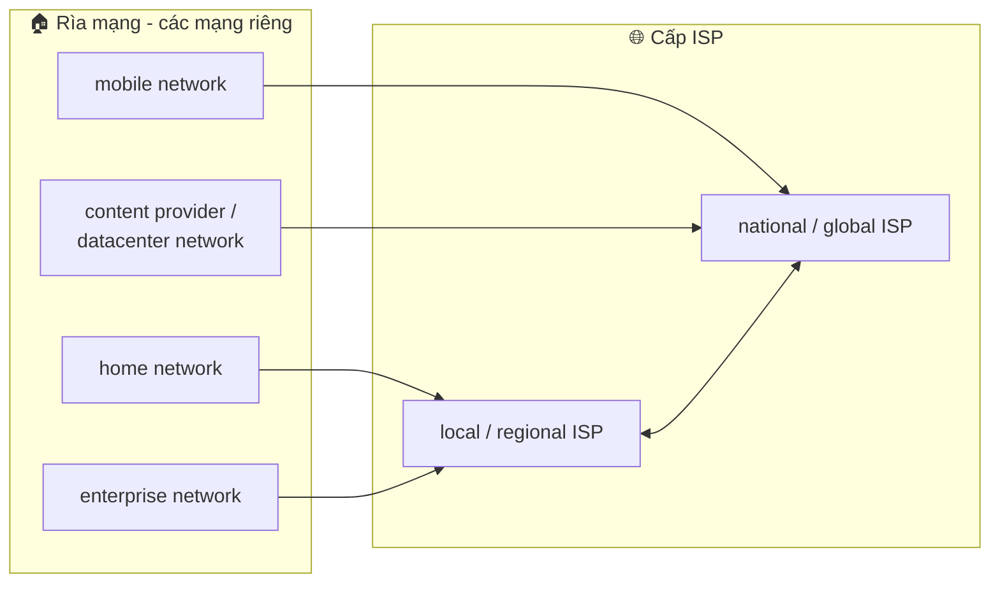
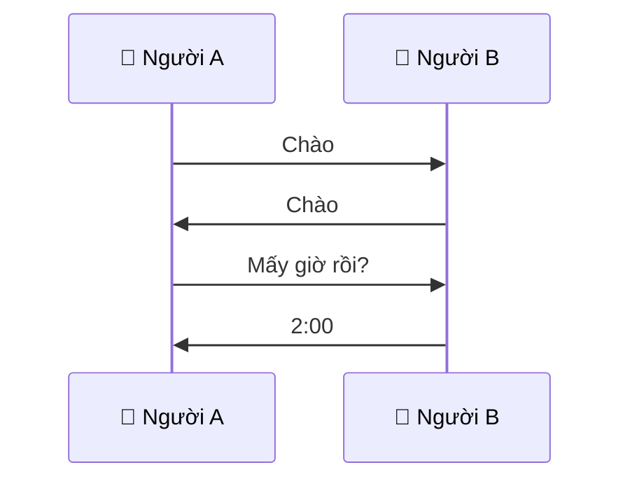
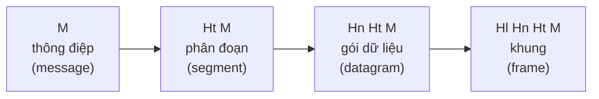

# Buổi 1 - Giới thiệu môn học

- **Ngày**: 01/11/2026
- **Môn**: Nhập môn mạng máy tính (IT005.G13.CN2.TTNT)
- **Giảng viên**: Đỗ Thị Hương Lan
- **Lịch học**: Chủ nhật, 8h00 – 11h45
- **Website môn học**: https://elearning.citd.edu.vn/login/index.php

## Nội dung buổi học

### Thông tin chung (General information)

| Mục | Nội dung |
|---|---|
| Tên môn học (tiếng Việt) | Nhập môn Mạng máy tính |
| Tên môn học (tiếng Anh) | Introduction to Computer Network |
| Mã môn học | IT005 |
| Thuộc khối kiến thức | Cơ sở ngành |
| Khoa phụ trách | Khoa Mạng máy tính và Truyền thông |
| Giảng viên giảng dạy | Các giảng viên thuộc Khoa và Trường |
| Số tín chỉ | 4 (Lý thuyết 3, Thực hành 1) |
| Môn học tiên quyết | Không |
| Môn học trước | Không |
| Thời lượng | 10 tuần |

### Mô tả và mục tiêu môn học (Course description, Course goals)

**Mô tả môn học**: Cung cấp cho sinh viên những khái niệm cơ bản về mạng máy tính và truyền dữ liệu trên mạng; các dịch vụ mạng cơ bản, kỹ thuật mạng không dây.

**Mục tiêu môn học**: Sau khi hoàn thành môn học này, sinh viên có thể:

| Ký hiệu | Mục tiêu môn học | Chuẩn đầu ra trong CTĐT | Mức độ |
|---|---|---|---|
| G1 | Nhận biết và phân biệt được các mô hình và giao thức mạng | LO2 (2.1) | Nhận thức - 3 |
| G2 | Xác định được mô hình mạng, phân tích được các giao thức mạng hoạt động trong mô hình | LO3 (3.1) | Kỹ năng - 2 |
| G3 | Hiểu được các thuật ngữ chuyên môn cơ bản bằng ngoại ngữ | LO6 (6.1) | Kỹ năng - 2 |

> [!NOTE]
> Thang mức độ (theo Bloom): 1 - Ghi nhớ, 2 - Hiểu, 3 - Áp dụng, 4 - Phân tích, 5 - Đánh giá, 6 - Sáng tạo.

### Chuẩn đầu ra môn học (Course learning outcomes)

| CĐRMH | Mô tả CĐRMH (Mục tiêu cụ thể) | Mức độ giảng dạy |
|---|---|---|
| G1.1 | Nắm được kiến thức nền tảng về Mạng máy tính như các mô hình OSI và TCP/IP, các giao thức mạng cơ bản | IT |
| G2.1 | Phân tích và giải quyết vấn đề về Mạng máy tính | ITU |
| G2.2 | Triển khai và thử nghiệm các mô hình mạng trên hệ thống giả lập | ITU |
| G3.1 | Hiểu thuật ngữ chuyên môn bằng tiếng Anh để có thể tham khảo tài liệu môn học | I |

> [!NOTE]
> Mức độ giảng dạy: **I** (Introduce - Giới thiệu), **T** (Teach - Giảng dạy), **U** (Utilize - Sử dụng).

### Nội dung môn học (Course content)

**Lý thuyết** (45 tiết):

| Số tiết | Nội dung | CĐRMH | Thành phần đánh giá |
|---|---|---|---|
| 6 tiết | Chương 1: Giới thiệu về mạng máy tính và Internet | G1.1, G3.1 | A2, A4 |
| 6 tiết | Chương 2: Tầng ứng dụng | G1.1, G2.1 | A2, A3, A4 |
| 12 tiết | Chương 3: Tầng vận chuyển | G1.1, G2.1 | A2, A4 |
| 12 tiết | Chương 4: Tầng mạng | G1.1, G2.1 | A2, A3, A4 |
| 9 tiết | Chương 5: Tầng liên kết dữ liệu | G1.1, G2.1 | A2, A4 |

**Thực hành** (5 bài, 25 tiết):

| Số tiết | Nội dung | CĐRMH | Thành phần đánh giá |
|---|---|---|---|
| 5 tiết | Bài thực hành 1: Giới thiệu Wireshark | G1.1, G2.2 | A3 |
| 5 tiết | Bài thực hành 2: Giao thức HTTP | G1.1 | A3 |
| 5 tiết | Bài thực hành 3: Giao thức TCP và UDP | G1.1 | A3 |
| 5 tiết | Bài thực hành 4: IP và chia Subnet | G1.1 | A3 |
| 5 tiết | Bài thực hành 5: Giả lập với Packet Tracer | G1.1, G2.2 | A3 |

### Đánh giá môn học (Course assessment)

| Thành phần đánh giá | CĐRMH | Tỷ lệ (%) |
|---|---|---|
| Quá trình - A2 (Bài tập, Quiz...) | G1.1, G2.1 | 15% |
| Thực hành - A3 | G1.1, G2.1, G2.2 | 25% |
| Cuối kỳ - A4 (thi trực tiếp, trắc nghiệm) | G1.1, G2.1, G3.1 | 60% |

> [!NOTE]
> Đối chiếu với bảng nội dung ở trên: **A2** = quá trình, **A3** = thực hành, **A4** = cuối kỳ. Không có A1/A5 như môn CSDL.

> [!NOTE]
> Cô đã up bài tập lên **elearning** theo 2 hình thức: **cá nhân** và **nhóm**. Hiện tại các bài tập **chưa có hạn nộp** (chưa đặt thời gian đóng).

> [!NOTE]
> Môn học **không điểm danh**.

### Tài liệu học tập, phần mềm và công cụ hỗ trợ thực hành

**Tài liệu tham khảo:**

- Jim Kurose, Keith Ross, *Computer Networking: A Top-Down Approach Featuring the Internet*, 8th edition, Pearson.
- Website đồng hành của giáo trình (slide, bài lab Wireshark, video...): https://gaia.cs.umass.edu/kurose_ross/

> [!NOTE]
> Giáo trình Kurose & Ross đi theo hướng **top-down** (từ tầng ứng dụng xuống tầng liên kết dữ liệu) - đúng thứ tự các chương 2-5 trong bảng nội dung lý thuyết ở trên.

**Phần mềm và công cụ hỗ trợ thực hành:**

1. Wireshark
2. Packet Tracer
3. Kìm bấm cáp mạng, cáp mạng, đầu bấm...

**Phần mềm thực hành trên macOS** - cả 2 phần mềm chính đều cài được trên macOS (Apple Silicon):

- **Wireshark** (bài 1-3): có bản **native macOS** (hỗ trợ Apple Silicon), cài qua file `.dmg` trên wireshark.org hoặc qua Homebrew:

```bash
brew install --cask wireshark
```

- **Cisco Packet Tracer** (bài 5): có bản macOS (`.dmg`) nhưng là bản **Intel x86** → trên Mac Apple Silicon chạy qua **Rosetta 2**. Tải miễn phí từ Cisco Networking Academy (netacad.com) - cần tạo tài khoản NetAcad/Skills for All.
- Bài 4 (IP và chia Subnet) chủ yếu là bài tập tính toán, không cần phần mềm riêng.

## Chương 1: Giới thiệu về mạng máy tính và Internet

Slide chương 1 biên soạn từ giáo trình *Computer Networking: a Top-Down Approach* (8th edition) - Kurose & Ross, gồm 5 phần:

| Mục | Nội dung |
|---|---|
| 1.1 | Internet là gì? Giao thức là gì? |
| 1.2 | Mạng biên: hosts, mạng truy cập, đường truyền vật lý |
| 1.3 | Mạng lõi: chuyển mạch gói, chuyển mạch kênh, cấu trúc của Internet |
| 1.4 | Hiệu suất: mất mát, chậm trễ, thông lượng |
| 1.5 | Các lớp giao thức, các mô hình dịch vụ |

### 1.1 Internet là gì? Giao thức là gì?

#### Internet - góc nhìn thực tế (nuts and bolts)

Nhìn từ góc độ **cấu tạo vật lý**, Internet gồm các thành phần:

- **Hàng tỷ thiết bị tính toán được kết nối** - gọi là **hosts** (các hệ thống đầu cuối / end systems): laptop, điện thoại, server, tủ lạnh thông minh, xe hơi, thiết bị IoT... Các host **chạy các ứng dụng mạng ở "rìa" (edge) của Internet**.
- **Chuyển mạch gói (packet switching)**: chuyển tiếp các **gói** (packet - các khối dữ liệu) qua mạng. Thiết bị chuyển mạch gói gồm **bộ định tuyến** (router) và **bộ chuyển mạch** (switch).
- **Liên kết truyền thông** (communication links): cáp quang (fiber), cáp đồng (copper), vô tuyến (radio), vệ tinh (satellite). **Tốc độ truyền** của liên kết gọi là **băng thông** (bandwidth).
- **Mạng** (network): tập hợp các **thiết bị, bộ định tuyến, liên kết** được **quản lý bởi một tổ chức** - vd: mạng gia đình (home network), mạng doanh nghiệp (enterprise network), mạng di động (mobile network), mạng nhà cung cấp nội dung (content provider network - datacenter network).

> [!NOTE]
> Internet = **"mạng của các mạng"** (network of networks): các mạng riêng lẻ (home, enterprise, mobile, datacenter) nối với nhau qua các nhà cung cấp dịch vụ - **ISP cấp vùng/quốc gia** (local/regional ISP → national/global ISP). Các ISP được kết nối với nhau.



- **Giao thức (protocol)** được sử dụng ở nhiều nơi trong Internet - quản lý việc **truyền, nhận các thông điệp**. Ví dụ: HTTP (Web), video trực tuyến, Skype, TCP, IP, WiFi, 4G/5G, Ethernet.
- **Các bộ tiêu chuẩn Internet** (Internet standards):
  - **RFC** - Request for Comments: các tài liệu đặc tả kỹ thuật của Internet.
  - **IETF** - Internet Engineering Task Force: tổ chức phát triển và ban hành tiêu chuẩn Internet (qua RFC).

#### Internet - góc nhìn dịch vụ (services)

Nhìn từ góc độ **dịch vụ**, Internet là:

- **Cơ sở hạ tầng cung cấp dịch vụ cho các ứng dụng**: Web, video trực tuyến, hội nghị từ xa đa phương tiện, thư điện tử (email), trò chơi trực tuyến, thương mại điện tử, truyền thông xã hội, thiết bị kết nối...
- **Giao diện lập trình** (programming interface) cho các **ứng dụng phân tán** (distributed applications):
  - Cung cấp các **"hooks"** cho phép ứng dụng (bên gửi hoặc bên nhận) kết nối và sử dụng dịch vụ vận chuyển của Internet.
  - Cung cấp các **tùy chọn dịch vụ** - tương tự dịch vụ bưu chính (thư thường, thư nhanh, thư bảo đảm...).

> [!NOTE]
> Hai góc nhìn bổ sung nhau: **nuts and bolts** nói Internet *được cấu tạo từ gì* (host, router, link, mạng), còn **services** nói Internet *cung cấp cái gì cho ứng dụng* (hạ tầng + API vận chuyển). "Hooks" ở đây chính là socket API mà ứng dụng dùng để gửi/nhận dữ liệu - sẽ gặp lại ở chương Tầng ứng dụng.

#### Giao thức là gì? (What's a protocol)

**Phép tương tự - giao thức của con người** (human protocols):

- Ví dụ: hỏi *"mấy giờ rồi?"*, nói *"tôi có một câu hỏi"*, lời giới thiệu (introductions).
- Đó là các **quy tắc** cho việc: gửi một tin nhắn cụ thể, và thực hiện một hành động cụ thể khi nhận được một thông điệp hoặc một sự kiện.

**Giao thức mạng** (network protocols): giống vậy nhưng các bên là **máy tính (thiết bị)** thay vì con người. **Tất cả hoạt động truyền thông trên Internet đều được quy định bởi các giao thức.**

> [!WARNING]
> **Định nghĩa quan trọng**: Giao thức định nghĩa **cấu trúc** (format) và **thứ tự** (order) của thông điệp khi gửi và nhận giữa các thành phần trong mạng, và **các hành động** được thực hiện khi truyền hoặc nhận một thông điệp.

**So sánh giao thức con người và giao thức mạng** - cùng một khuôn mẫu: bắt tay/chào hỏi trước, rồi trao đổi yêu cầu - đáp:



```mermaid
sequenceDiagram
    participant C as 💻 Client
    participant S as 🖥️ Server
    C->>S: TCP connection request
    S->>C: TCP connection response
    C->>S: GET http://gaia.cs.umass.edu/kurose_ross
    S->>C: &lt;file&gt;
```

> [!TIP]
> Trao đổi `TCP connection request` → `TCP connection response` trước khi gửi `GET` chính là bản chất của **bắt tay TCP** (TCP handshake) - sẽ học kỹ ở chương Tầng vận chuyển.

### 1.2 Mạng biên: hosts, mạng truy cập, đường truyền vật lý

#### Cái nhìn cận cảnh về cấu trúc Internet

Nhìn cận cảnh, Internet gồm 3 phần:

| Phần | Thành phần |
|---|---|
| **Mạng biên** (network edge) | **hosts**: máy khách (clients) và máy chủ (servers); máy chủ thường được đặt ở các **trung tâm dữ liệu** (data centers) |
| **Mạng truy cập, đường truyền vật lý** (access networks, physical media) | các **liên kết truyền thông có dây và không dây** |
| **Mạng lõi** (network core) | các **bộ định tuyến được liên kết với nhau** (interconnected routers) - "mạng của các mạng" |

#### Mạng truy cập - đặt vấn đề

- **Câu hỏi đặt ra**: làm sao để kết nối **hệ thống đầu cuối** (end systems) vào **bộ định tuyến biên** (edge router)?
- Có 3 nhóm mạng truy cập chính:

| Loại mạng truy cập | Tiếng Anh | Ví dụ / bối cảnh |
|---|---|---|
| Mạng truy cập khu dân cư | Residential access | Mạng gia đình: DSL, cáp đồng trục (cable), cáp quang (FTTH) |
| Mạng truy cập tổ chức | Institutional access | Trường học, công ty - thường qua Ethernet/LAN |
| Mạng truy cập di động | Mobile access | WiFi, 4G/5G |

> [!NOTE]
> **Bộ định tuyến biên** (edge router) là router đầu tiên trên đường từ host vào lõi mạng - thường là router của ISP khu vực, còn trong mạng gia đình thường là modem/router nhà bạn.

#### Mạng truy cập bằng cáp (cable access)

- **Ghép kênh theo tần số** (FDM - Frequency Division Multiplexing): các kênh khác nhau (video, data, control) được truyền trong **các dải tần số khác nhau** trên cùng một cáp.
- **Kiến trúc**: cable modem → splitter → mạng cáp phân phối **dùng chung** → **cable headend** (với **CMTS** - Cable Modem Termination System, hệ thống đầu cuối cable modem) → ISP.
- Dữ liệu và truyền hình được truyền ở **những tần số khác nhau** trên cùng một mạng cáp phân phối dùng chung.
- **HFC - Hybrid Fiber Coax** (đồng trục sợi lai): kết hợp sợi quang và cáp đồng trục.
- Tốc độ **bất đối xứng** (asymmetric): tải xuống 40 Mb/s đến 1.2 Gb/s, tải lên 30 đến 100 Mb/s.
- Mạng cáp và sợi quang kết nối mạng gia đình đến bộ định tuyến của ISP; các gia đình **chia sẻ** mạng truy cập đến cable headend.

#### Mạng truy cập: đường thuê bao kỹ thuật số (DSL)

- **DSL** (Digital Subscriber Line): sử dụng **đường điện thoại có sẵn** để kết nối đến **DSLAM** (DSL Access Multiplexer) tại văn phòng trung tâm (central office).
- Tín hiệu thoại và dữ liệu được truyền ở **các tần số khác nhau** qua đường dây **chuyên dụng** về văn phòng trung tâm:
  - Dữ liệu qua đường điện thoại DSL → đi đến **Internet**.
  - Tín hiệu thoại qua đường điện thoại DSL → đi đến **mạng điện thoại**.
- Tốc độ tải xuống: 24 - 52 Mb/s; tốc độ tải lên: 3.5 - 16 Mb/s.

> [!NOTE]
> Khác biệt then chốt: **DSL** dùng đường dây **chuyên dụng** (dedicated) từ nhà đến central office, còn **cáp/HFC** là mạng **dùng chung** (shared) giữa nhiều gia đình đến cable headend → mạng cáp có thể chậm vào giờ cao điểm.

#### Mạng truy cập: mạng gia đình (home network)

- Trong nhà: **cable/DSL modem** nhận đường truyền từ headend hoặc central office → **router, firewall, NAT** → các thiết bị trong nhà.
- Thiết bị **có dây** qua **Ethernet có dây (1 Gbps)**, thiết bị **không dây** qua **điểm truy cập WiFi (54, 450 Mbps)**.
- Modem, router/firewall/NAT, Ethernet switch và WiFi AP thường được **tích hợp trong một hộp duy nhất** (single box) - chính là "modem/router wifi" ở nhà.

#### Mạng truy cập không dây (wireless access)

- Mạng truy cập không dây **dùng chung** (shared) - kết nối hệ thống đầu cuối đến bộ định tuyến.
- Kết nối thông qua **trạm gốc** (base station), hay còn gọi là **điểm truy cập** (access point - AP).
- Có 2 loại chính:

| Loại | Phạm vi phủ sóng | Công nghệ / tốc độ |
|---|---|---|
| **Mạng cục bộ không dây** (WLAN - Wireless LAN) | Bên trong hoặc xung quanh tòa nhà, khoảng ~30 m | 802.11b/g/n (WiFi): tốc độ 11, 54, 450 Mb/s |
| **Mạng truy cập tế bào diện rộng** (Wide-area cellular access networks) | Hàng chục km, do nhà cung cấp mạng di động vận hành | ~10 Mbps; mạng tế bào 4G/5G |

> [!NOTE]
> Khác biệt cốt lõi: WLAN là mạng **tư nhân, cục bộ** (nhà, văn phòng, do người dùng/tổ chức tự triển khai), còn mạng tế bào là hạ tầng **diện rộng do nhà mạng sở hữu** - phủ sóng xa hơn nhiều nhưng tốc độ truyền thống thấp hơn WiFi.

#### Mạng truy cập: mạng doanh nghiệp (enterprise)

- Áp dụng cho **công ty, trường học**...
- **Kết hợp** giữa các công nghệ kết nối **có dây và không dây**, phối hợp giữa các **bộ chuyển mạch** (switches) và **bộ định tuyến** (routers):
  - **Ethernet**: kết nối có dây tốc độ 100 Mb/s, 1 Gb/s, 10 Gb/s.
  - **WiFi**: điểm truy cập không dây tốc độ 11, 54, 450 Mb/s.
- Kiến trúc điển hình: end systems → Ethernet switch → institutional router → đường truyền doanh nghiệp đến ISP; các mail/web server của tổ chức cũng nằm trong mạng.

#### Mạng truy cập: mạng trung tâm dữ liệu (datacenter)

- **Liên kết băng thông cao (10 - 100 Gb/s)** kết nối **hàng trăm đến hàng nghìn máy chủ** với nhau và kết nối với Internet.

#### Host: gửi các gói dữ liệu

Chức năng gửi của host:

1. Nhận thông điệp của ứng dụng.
2. Chia nhỏ thành nhiều phần nhỏ hơn - gọi là các **gói** (packets), có độ dài $L$ bit.
3. Chuyển gói vào mạng truy cập với **tốc độ truyền** $R$.

> [!NOTE]
> Tốc độ truyền $R$ của liên kết còn được gọi là **dung lượng** (capacity), hay **băng thông đường truyền** (link bandwidth).

**Độ trễ truyền gói** (packet transmission delay) - thời gian cần để đẩy gói $L$ bit vào liên kết:

$$d_{trans} = \frac{L \text{ (bits)}}{R \text{ (bits/sec)}}$$

> [!WARNING]
> Đơn vị tốc độ truyền dùng **hệ thập phân (SI)**, KHÔNG phải hệ 1024: 1 Kb/s = $10^3$ b/s, **1 Mb/s = $10^6$ b/s = 1 triệu bit/giây**, 1 Gb/s = $10^9$ b/s. Khác với đơn vị bộ nhớ KiB/MiB ($2^{10}$, $2^{20}$). Khi tính $d_{trans} = L/R$ phải quy đổi theo hệ 10, ví dụ: $L = 10$ Kbits, $R = 100$ Mbps → $d_{trans} = \frac{10 \times 10^3}{100 \times 10^6} = 0{,}1$ ms.

#### Đường truyền vật lý (physical media)

- **bit**: lan truyền giữa các cặp máy gửi/nhận.
- **Liên kết vật lý**: những gì nằm giữa máy gửi và máy nhận.
- Hai loại đường truyền:
  - **Đường truyền có hướng** (guided media): tín hiệu lan truyền trong môi trường chất rắn - cáp đồng, cáp sợi quang, cáp đồng trục.
  - **Đường truyền vô hướng** (unguided media): tín hiệu lan truyền tự do - sóng vô tuyến.

**Các loại đường truyền có hướng:**

| Loại | Đặc điểm | Tốc độ / ghi chú |
|---|---|---|
| **Cáp xoắn cặp** (Twisted Pair - TP) | Hai dây đồng cách điện xoắn vào nhau | Category 5: 100 Mbps, 1 Gbps Ethernet; Category 6: 10 Gbps Ethernet |
| **Cáp đồng trục** (Coaxial cable) | Hai dây dẫn đồng tâm, hai chiều | Băng thông rộng: nhiều kênh tần số trên 1 cáp, hàng trăm Mb/s mỗi kênh |
| **Cáp sợi quang** (fiber) | Sợi thủy tinh mang xung ánh sáng, mỗi xung mang một bit | Truyền điểm-điểm tốc độ cao (hàng chục - hàng trăm Gb/s); tỉ lệ lỗi thấp: bộ lặp (repeaters) đặt cách xa nhau, không bị nhiễu điện từ |

**Vô tuyến không dây** (unguided):

- Tín hiệu được mang trong các **"dải" (bands) phổ điện từ** khác nhau; không có dây vật lý.
- Truyền **broadcast, bán song công** (half-duplex) từ bên gửi đến bên nhận.
- Bị **ảnh hưởng bởi môi trường lan truyền**: phản xạ, vật cản, nhiễu.

| Loại liên kết không dây | Tốc độ | Khoảng cách |
|---|---|---|
| Wireless LAN (WiFi) | 10 - 100's Mb/s | Hàng chục mét |
| Diện rộng (mạng tế bào 4G/5G) | Hàng chục Mbps (4G) | ~10 km |
| Bluetooth (thay thế cáp) | Giới hạn | Ngắn |
| Sóng mặt đất (terrestrial microwave) | Kênh ~45 Mb/s | Truyền điểm-điểm |
| Vệ tinh (satellite) | Tải lên đến ~100 Mb/s (Starlink) | Độ trễ end-to-end ~270 ms (vệ tinh địa tĩnh) |

### 1.3 Mạng lõi: chuyển mạch gói, chuyển mạch kênh, cấu trúc Internet

#### Mạng lõi (network core)

- **Mạng lưới kết nối các bộ định tuyến** (mesh of interconnected routers).
- **Chuyển mạch gói** (packet switching): hosts chia thông điệp của tầng ứng dụng thành nhiều gói; mạng chuyển tiếp các gói từ bộ định tuyến này đến bộ định tuyến khác, qua các liên kết trên đường từ nguồn đến đích.

#### Hai chức năng chính của mạng lõi

| Chức năng | Phạm vi | Mô tả |
|---|---|---|
| **Chuyển tiếp** (forwarding - còn gọi "chuyển mạch"/switching) | **Hành động cục bộ** | Chuyển gói tin từ liên kết đầu vào đến liên kết đầu ra thích hợp trên bộ định tuyến, dựa vào **địa chỉ đích trong tiêu đề (header)** của gói và **bảng chuyển tiếp cục bộ** (local forwarding table) |
| **Định tuyến** (routing) | **Hành động toàn cục** | Xác định các **tuyến đường từ nguồn đến đích** mà các gói tin sẽ đi qua, thực hiện bởi các **giải thuật định tuyến** (routing algorithms) |

> [!NOTE]
> Phép tương tự: **định tuyến** giống việc lên kế hoạch toàn bộ hành trình trên bản đồ, còn **chuyển tiếp** giống việc tại mỗi ngã rẽ quyết định rẽ hướng nào. Bảng chuyển tiếp được điền sẵn nhờ các giải thuật định tuyến.

#### Chuyển mạch gói: lưu và chuyển (store-and-forward)

- **Độ trễ truyền** (packet transmission delay): mất $L/R$ giây để truyền gói tin độ dài $L$ bit trên liên kết tốc độ $R$ b/s.
- **Lưu và chuyển** (store-and-forward): **toàn bộ gói tin** phải đến bộ định tuyến trước khi được truyền đến liên kết tiếp theo.

**Ví dụ trễ 1 chặng** (one-hop delay): $L = 10$ Kbits, $R = 100$ Mbps:

$$d_{trans} = \frac{10 \times 10^3 \text{ bits}}{100 \times 10^6 \text{ bits/s}} = 0{,}1 \text{ ms}$$

> [!WARNING]
> Nhớ: **1 Mbps = $10^6$ bit/s = 1 triệu bit/giây** - tốc độ truyền dùng hệ thập phân (SI), KHÔNG chia theo 1024.

#### Chuyển mạch gói: hàng đợi (queueing)

- **Hàng đợi** (queueing) xảy ra khi yêu cầu (các gói tin đến) **nhanh hơn khả năng phục vụ** của liên kết đầu ra.
- Các gói tin xếp hàng trong **hàng đợi đầu ra** chờ đến lượt được truyền trên liên kết.
- **Xếp hàng và mất gói**: nếu tốc độ gói tin đến (tính bằng bit/s) vượt quá tốc độ truyền tải (bit/s) của liên kết trong một khoảng thời gian:
  - Gói tin sẽ vào hàng đợi, chờ được truyền trên liên kết đầu ra.
  - Gói tin sẽ bị **hủy bỏ (drop/lost)** nếu **bộ đệm** của bộ định tuyến bị đầy.

#### Chuyển mạch kênh (circuit switching)

- Là **phương án thay thế** cho chuyển mạch gói.
- Các **tài nguyên được phân bổ và dành riêng** cho "cuộc gọi" (call) giữa nguồn và đích:
  - Mỗi liên kết chia thành nhiều kênh (vd: 4 kênh); cuộc gọi chiếm 1 kênh trên mỗi liên kết nó đi qua.
  - **Tài nguyên dành riêng: không chia sẻ** → **hiệu suất được đảm bảo**.
  - Các phân đoạn của kênh sẽ **rảnh** nếu không được cuộc gọi sử dụng (không ai khác được dùng).
- Thường được sử dụng trong **mạng điện thoại truyền thống**.

**Chuyển mạch kênh: FDM và TDM** - hai cách chia kênh trên một liên kết:

| Kỹ thuật | Cách chia | Mô tả |
|---|---|---|
| **FDM** (Frequency Division Multiplexing - ghép kênh tần số) | Phổ tần số quang/điện từ chia thành nhiều **dải tần số** | Mỗi cuộc gọi được phân bổ **băng tần riêng**, truyền ở tốc độ tối đa của băng tần đó |
| **TDM** (Time Division Multiplexing - ghép kênh thời gian) | Thời gian chia thành các **khe (slot)** | Mỗi cuộc gọi được phân bổ các khe **định kỳ**, truyền ở tốc độ tối đa của cả dải trong khe của nó |

#### Chuyển mạch gói và chuyển mạch kênh - so sánh

**Ví dụ** (slide 37): liên kết 1 Gb/s; mỗi người dùng dùng 100 Mb/s khi hoạt động và chỉ hoạt động 10% thời gian:

- **Chuyển mạch kênh**: chỉ phục vụ được **10 người dùng** (1 Gb/s ÷ 100 Mb/s) - vì tài nguyên dành riêng, dù người dùng rảnh 90% thời gian.
- **Chuyển mạch gói**: với **35 người dùng**, xác suất có > 10 người hoạt động đồng thời < 0.0004 → gần như luôn đủ băng thông (tính bằng xác suất - bài tập về nhà).

**Ưu/nhược của chuyển mạch gói:**

- **Tốt nhất cho dữ liệu truyền không đều** (bursty data - lúc có lúc không): chia sẻ tài nguyên, đơn giản, không cần thiết lập cuộc gọi.
- **Có thể tắc nghẽn**: gói tin bị trễ hoặc mất do tràn bộ đệm → cần các giao thức cho **truyền dữ liệu tin cậy** (reliable data transfer) và **kiểm soát tắc nghẽn** (congestion control).
- **Câu hỏi mở**: làm sao cung cấp hành vi kiểu chuyển mạch kênh trên cơ chế chuyển mạch gói? → "Phức tạp!" - làm cho chuyển mạch gói giống chuyển mạch kênh nhất có thể.

#### Cấu trúc Internet: "mạng của các mạng"

- **Hosts kết nối Internet thông qua các ISP truy cập** (access ISPs); các ISP truy cập phải được kết nối với nhau → hai host bất kỳ có thể gửi thông điệp cho nhau.
- **Câu hỏi**: có hàng triệu ISP truy cập, kết nối chúng thế nào?
  - Nối **trực tiếp từng cặp**: không khả thi - cần $O(N^2)$ kết nối.
  - Nối tất cả qua **một ISP chuyển tiếp toàn cầu** (global ISP): khách hàng (access ISP) và nhà cung cấp (global ISP) phải có **thỏa thuận kinh tế**.
  - Global ISP có lợi nhuận → **xuất hiện đối thủ cạnh tranh** → các ISP toàn cầu cạnh tranh nối với nhau qua **liên kết láng giềng (peering link)** và **IXP** (Internet Exchange Point - điểm trao đổi Internet).
  - **ISP khu vực** (regional ISP) xuất hiện để kết nối mạng truy cập với ISP toàn cầu.
  - **Mạng cung cấp nội dung** (content provider networks - vd: Google, Microsoft, Akamai) tự xây mạng riêng để đưa dịch vụ/nội dung **đến gần người dùng cuối**.
- Kết quả ở **"trung tâm"**: một số ít mạng lớn được kết nối với nhau:
  - **ISP thương mại tier-1** (vd: Level 3, Sprint, AT&T, NTT) - phủ sóng quốc gia và quốc tế.
  - **Mạng cung cấp nội dung** (vd: Google, Facebook): dùng mạng riêng nối datacenter của họ với Internet mà **không cần qua tier-1 và ISP khu vực**.
- Sự phát triển của cấu trúc này được **thúc đẩy bởi kinh tế và chính sách quốc gia**.

### 1.4 Hiệu suất: mất mát, chậm trễ, thông lượng

#### Tại sao gói tin bị trễ và bị mất?

- Các gói tin **xếp hàng trong bộ đệm** (buffer) của bộ định tuyến, đợi đến khi được truyền.
- **Chiều dài hàng đợi tăng** khi tốc độ gói tin đến vượt quá khả năng của liên kết đầu ra.
- **Mất gói** (packet loss) xảy ra khi **bộ nhớ của hàng đợi bị đầy** - gói đến không còn chỗ sẽ bị hủy.

#### Bốn nguyên nhân gây chậm trễ gói tin

$$d_{nodal} = d_{proc} + d_{queue} + d_{trans} + d_{prop}$$

| Ký hiệu | Tên | Ý nghĩa |
|---|---|---|
| $d_{proc}$ | Trễ xử lý tại nút (nodal processing) | Kiểm tra lỗi bit, tra bảng tìm liên kết đầu ra |
| $d_{queue}$ | Trễ hàng đợi (queueing) | Chờ trong bộ đệm đầu ra đến lượt truyền |
| $d_{trans}$ | Trễ truyền (transmission) | $d_{trans} = L/R$ - đẩy hết $L$ bit vào liên kết tốc độ $R$ |
| $d_{prop}$ | Trễ lan truyền (propagation) | $d_{prop} = d/s$ - $d$: độ dài liên kết vật lý, $s$: tốc độ lan truyền trong môi trường ($\approx 2 \times 10^8$ m/s) |

> [!WARNING]
> **$d_{trans}$ và $d_{prop}$ rất khác nhau**: $d_{trans}$ là thời gian **đẩy gói vào** đường truyền (phụ thuộc $L$ và $R$, không phụ thuộc khoảng cách); $d_{prop}$ là thời gian **bit đi hết** đường truyền (phụ thuộc khoảng cách, không phụ thuộc $L$ hay $R$).

**Phép tương tự đoàn xe qua trạm thu phí** (slide 52): đoàn 10 ô tô (= gói 10 bit), trạm thu phí (= bộ định tuyến) phục vụ mỗi xe 1 phút, quãng đường 100 km giữa 2 trạm, xe chạy 1000 km/h:

- Thời gian "truyền" cả đoàn qua trạm 1: 10 phút (= $d_{trans}$).
- Thời gian 1 xe "lan truyền" đến trạm 2: 6 phút (= $d_{prop}$).
- **Câu hỏi**: xe đầu tiên đến trạm 2 trước khi cả đoàn qua hết trạm 1 không? → **Có**: sau 7 phút xe đầu đến trạm 2, trong khi còn 3 xe đang ở trạm 1 → minh họa trễ truyền và lan truyền xảy ra song song.

#### Trễ hàng đợi và cường độ lưu lượng

- $a$: tốc độ trung bình gói tin đến (gói/giây); $L$: độ dài gói (bit/gói); $R$: băng thông liên kết (bit/giây).
- **Cường độ lưu lượng** (traffic intensity): $La/R$ - tỉ số giữa tốc độ bit đến ($L \cdot a$) và tốc độ phục vụ ($R$):

| $La/R$ | Độ trễ hàng đợi trung bình |
|---|---|
| $\sim 0$ | Nhỏ |
| $\to 1$ | Lớn (hàng đợi tăng mạnh) |
| $> 1$ | **Vô hạn** - yêu cầu nhiều hơn khả năng phục vụ |

#### Độ trễ và tuyến đường thực tế - chương trình traceroute

- **traceroute** đo độ trễ từ nguồn đến **từng bộ định tuyến** trên lộ trình đến đích.
- Với mỗi bộ định tuyến thứ $i$:
  1. Gửi **3 gói tin** (probe) với trường **time-to-live = $i$**.
  2. Bộ định tuyến thứ $i$ nhận được (TTL hết) → **phản hồi** về bên gửi.
  3. Bên gửi đo thời gian từ lúc gửi đến lúc nhận phản hồi = độ trễ.
- Kết quả in ra 3 giá trị thời gian mỗi hop; dấu `* * *` nghĩa là **không phản hồi** (mất gói hoặc router không trả lời).

#### Mất gói (packet loss)

- Hàng đợi (bộ đệm) trước mỗi liên kết đầu ra có **kích thước hữu hạn**.
- Hàng đợi đầy do quá nhiều gói đến → gói đến sau bị **hủy** (mất gói).
- Gói bị mất **có thể được truyền lại** bởi nút trước đó, bởi nút nguồn, hoặc cũng có thể **không được truyền lại** (tùy giao thức).

#### Thông lượng (throughput)

- **Thông lượng**: số bit được truyền từ nguồn đến đích trong một khoảng thời gian.
  - **Tức thời** (instantaneous): tốc độ tại một thời điểm.
  - **Trung bình** (average): tốc độ trong một khoảng thời gian.
- **Phép tương tự đường ống**: server đổ "chất lỏng" (bit) vào ống tốc độ $R_s$, client nhận qua ống tốc độ $R_c$ → thông lượng đầu-cuối = **min($R_s$, $R_c$)**.
- Thông lượng giữa hai đầu cuối bị giới hạn bởi **liên kết thắt cổ chai** (bottleneck link) trên lộ trình.
- **Ngữ cảnh mạng**: 10 kết nối (công bằng) chia sẻ đường trục thắt cổ chai tốc độ $R$ → thông lượng mỗi kết nối = **min($R_c$, $R_s$, $R/10$)**; trong thực tế $R_c$ hoặc $R_s$ (đường truy cập) thường là nút thắt.

### 1.5 Các lớp giao thức, các mô hình dịch vụ

#### Tại sao phân tầng? (why layering)

- Mạng là hệ thống **phức tạp** với nhiều thành phần: hosts, bộ định tuyến, nhiều loại liên kết, ứng dụng, giao thức, phần cứng + phần mềm → cần cách **tổ chức cấu trúc**.
- **Phép tương tự vận tải hàng không**: hành trình gồm chuỗi bước (đặt vé → gửi hành lý → cổng an ninh → cất cánh → bay theo lộ trình → hạ cánh → nhận hành lý → ra cổng → khiếu nại vé) - mỗi bước là một **dịch vụ** do một "tầng" đảm nhận (dịch vụ bán vé, dịch vụ hành lý, dịch vụ an ninh, dịch vụ đường băng, dịch vụ bay).
- Mỗi tầng **triển khai một dịch vụ**: thông qua hoạt động bên trong tầng đó, và **dựa trên dịch vụ của tầng bên dưới**.
- **Lợi ích của phân tầng / mô-đun hóa**:
  - Cấu trúc rõ ràng → dễ xác định, liên kết các thành phần của hệ thống.
  - Thay đổi cách triển khai dịch vụ **bên trong một tầng** thì **trong suốt** với toàn hệ thống (vd: đổi quy trình cổng an ninh không ảnh hưởng các thành phần khác).

#### Chồng giao thức Internet phân tầng (Internet protocol stack)

5 tầng, từ trên xuống:

| Tầng | Nhiệm vụ | Giao thức ví dụ |
|---|---|---|
| **Tầng ứng dụng** (application) | Hỗ trợ các ứng dụng mạng | HTTP, IMAP, SMTP, DNS |
| **Tầng vận chuyển** (transport) | Chuyển tiếp dữ liệu giữa các **tiến trình** (process-to-process) | TCP, UDP |
| **Tầng mạng** (network) | **Định tuyến** các gói dữ liệu (datagrams) từ nguồn đến đích | IP, các giao thức định tuyến |
| **Tầng liên kết** (link) | Chuyển tiếp dữ liệu giữa các **phần tử lân cận** trong mạng | Ethernet, 802.11 (WiFi), PPP |
| **Tầng vật lý** (physical) | Chuyển các **bit** trên đường truyền | (cáp, sóng vô tuyến...) |

#### Dịch vụ, phân tầng và quá trình đóng gói (encapsulation)

Tại **nguồn**, dữ liệu được đóng gói dần xuống các tầng - mỗi tầng thêm **mào đầu** (header) của mình:



| Bước | Tầng thực hiện | Hành động |
|---|---|---|
| 1 | Tầng vận chuyển | Đóng gói thông điệp $M$ bằng header $H_t$ → **phân đoạn** (segment) $[H_t \mid M]$; $H_t$ dùng để triển khai dịch vụ tầng vận chuyển (vd: đảm bảo độ tin cậy) |
| 2 | Tầng mạng | Đóng gói segment bằng header $H_n$ → **gói dữ liệu** (datagram) $[H_n \mid H_t \mid M]$; vận chuyển từ host này đến host khác qua dịch vụ tầng liên kết |
| 3 | Tầng liên kết | Đóng gói datagram bằng header $H_l$ → **frame** $[H_l \mid H_n \mid H_t \mid M]$; chuyển đến host/node lân cận qua dịch vụ tầng vật lý |

- **Góc nhìn đầu-cuối**: bên nhận **gỡ dần header** đi lên các tầng (ngược quá trình đóng gói). Trên đường đi: **bộ định tuyến** xử lý đến **tầng mạng**, **bộ chuyển mạch** (switch) xử lý đến **tầng liên kết**.
- Tên gọi dữ liệu theo tầng: **message** (ứng dụng) → **segment** (vận chuyển) → **datagram** (mạng) → **frame** (liên kết).

### Tổng kết chương 1

Các nội dung đã đề cập:

- Tổng quan về Internet (góc nhìn thực tế + góc nhìn dịch vụ).
- Giao thức là gì?
- Mạng biên, mạng truy cập, mạng lõi; chuyển mạch kênh và chuyển mạch gói.
- Cấu trúc của Internet ("mạng của các mạng": access ISP → regional ISP → tier-1 ISP, IXP, peering, content provider networks).
- Hiệu suất: mất mát, trễ, thông lượng.
- Phân tầng và các mô hình dịch vụ.

## Quiz ôn tập buổi 1

```quiz
{
  "title": "Ôn tập buổi 1 - Giới thiệu mạng máy tính và Internet",
  "mode": "exam",
  "questions": [
    {
      "type": "single",
      "question": "Theo góc nhìn cấu tạo vật lý (nuts and bolts), các thiết bị tính toán được kết nối vào Internet (laptop, điện thoại, server...) được gọi là gì?",
      "options": ["Hosts (end systems)", "Routers", "Switches", "ISPs"],
      "answer": 0,
      "explanation": "Hosts (hệ thống đầu cuối) là các thiết bị chạy ứng dụng mạng ở 'rìa' Internet. Router và switch là thiết bị chuyển mạch gói, còn ISP là nhà cung cấp dịch vụ."
    },
    {
      "type": "single",
      "question": "Giao thức (protocol) định nghĩa điều gì?",
      "options": [
        "Cấu trúc, thứ tự của thông điệp và các hành động khi gửi/nhận thông điệp",
        "Chỉ tốc độ truyền dữ liệu giữa hai thiết bị",
        "Định dạng phần cứng của các liên kết truyền thông",
        "Cách đặt tên địa chỉ cho các thiết bị trong mạng"
      ],
      "answer": 0,
      "explanation": "Giao thức định nghĩa format (cấu trúc), order (thứ tự) của thông điệp và các hành động thực hiện khi truyền/nhận. Đây là định nghĩa then chốt của chương."
    },
    {
      "type": "multiple",
      "question": "Những nhóm mạng truy cập (access network) nào được đề cập trong bài? (chọn tất cả)",
      "options": [
        "Mạng truy cập khu dân cư (residential)",
        "Mạng truy cập tổ chức (institutional)",
        "Mạng truy cập di động (mobile)",
        "Mạng truy cập vệ tinh quân sự (military satellite)"
      ],
      "answer": [0, 1, 2],
      "explanation": "Ba nhóm: residential (DSL, cable, FTTH), institutional (trường học, công ty qua Ethernet/LAN), mobile (WiFi, 4G/5G). Vệ tinh chỉ là một loại đường truyền vật lý, không phải nhóm mạng truy cập."
    },
    {
      "type": "true-false",
      "question": "DSL và mạng cáp (cable/HFC) đều dùng đường truyền dùng chung (shared) giữa nhiều gia đình.",
      "answer": false,
      "explanation": "DSL dùng đường dây chuyên dụng (dedicated) từ nhà đến central office; chỉ mạng cáp/HFC là shared - vì vậy mạng cáp có thể chậm vào giờ cao điểm."
    },
    {
      "type": "single",
      "question": "Gói tin dài L = 10 Kbits truyền trên liên kết R = 100 Mbps. Độ trễ truyền (d_trans) là bao nhiêu?",
      "options": ["0.1 ms", "1 ms", "10 ms", "0.01 ms"],
      "answer": 0,
      "explanation": "d_trans = L/R = (10 × 10³) / (100 × 10⁶) = 10⁻⁴ s = 0.1 ms. Nhớ dùng hệ 10: 1 Mbps = 10⁶ bit/s."
    },
    {
      "type": "true-false",
      "question": "Trong tính toán tốc độ truyền, 1 Mb/s = 2^20 bit/s (tương tự đơn vị bộ nhớ MiB).",
      "answer": false,
      "explanation": "Tốc độ truyền dùng hệ SI (thập phân): 1 Mb/s = 10⁶ bit/s = 1 triệu bit/giây. Đơn vị 1024 (KiB/MiB) chỉ dùng cho bộ nhớ."
    },
    {
      "type": "single",
      "question": "Nguyên tắc 'lưu và chuyển' (store-and-forward) trong chuyển mạch gói nghĩa là gì?",
      "options": [
        "Toàn bộ gói tin phải đến bộ định tuyến trước khi được truyền sang liên kết tiếp theo",
        "Bộ định tuyến chuyển từng bit ngay khi bit đó đến",
        "Gói tin được lưu vĩnh viễn trong bộ đệm của router",
        "Nguồn phải lưu bản sao gói tin cho đến khi đích xác nhận"
      ],
      "answer": 0,
      "explanation": "Router phải nhận đủ cả gói rồi mới đẩy ra liên kết kế tiếp, nên độ trễ mỗi chặng ít nhất là L/R."
    },
    {
      "type": "single",
      "question": "Trong công thức d_nodal = d_proc + d_queue + d_trans + d_prop, loại trễ nào phụ thuộc vào khoảng cách vật lý của liên kết?",
      "options": ["d_prop", "d_trans", "d_queue", "d_proc"],
      "answer": 0,
      "explanation": "d_prop = d/s là thời gian bit lan truyền hết đường truyền - phụ thuộc khoảng cách, không phụ thuộc L hay R. d_trans = L/R là thời gian đẩy gói vào đường truyền - phụ thuộc độ dài gói và băng thông."
    },
    {
      "type": "single",
      "question": "Khi cường độ lưu lượng La/R của một liên kết tiến đến 1, độ trễ hàng đợi trung bình sẽ như thế nào?",
      "options": [
        "Tăng rất lớn (hàng đợi tăng mạnh)",
        "Giảm dần về 0",
        "Không đổi",
        "Luôn bằng đúng L/R"
      ],
      "answer": 0,
      "explanation": "La/R → 1 nghĩa tốc độ gói đến sát tốc độ phục vụ → hàng đợi phình ra, trễ hàng đợi lớn. La/R > 1 thì trễ tiến tới vô hạn."
    },
    {
      "type": "single",
      "question": "Thông lượng (throughput) đầu-cuối giữa server và client trên một lộ trình được quyết định bởi yếu tố nào?",
      "options": [
        "Liên kết thắt cổ chai (bottleneck link) - tốc độ nhỏ nhất trên lộ trình",
        "Liên kết có băng thông lớn nhất",
        "Trung bình cộng của tất cả các liên kết",
        "Chỉ tốc độ liên kết phía server"
      ],
      "answer": 0,
      "explanation": "Như ống nước: throughput = min(Rs, Rc, ...) - bị giới hạn bởi đoạn hẹp nhất trên lộ trình, thường là đường truy cập Rs hoặc Rc."
    },
    {
      "type": "multiple",
      "question": "Chọn các tầng thuộc chồng giao thức Internet (Internet protocol stack):",
      "options": [
        "Tầng ứng dụng (application)",
        "Tầng vận chuyển (transport)",
        "Tầng trình bày (presentation)",
        "Tầng liên kết (link)"
      ],
      "answer": [0, 1, 3],
      "explanation": "Chồng Internet có 5 tầng: application, transport, network, link, physical. 'Presentation' và 'session' thuộc mô hình OSI 7 tầng, không có trong chồng Internet."
    },
    {
      "type": "single",
      "question": "Khi dữ liệu được đóng gói đi xuống các tầng tại bên gửi, đơn vị dữ liệu của tầng mạng được gọi là gì?",
      "options": ["Datagram", "Segment", "Frame", "Message"],
      "answer": 0,
      "explanation": "Thứ tự: message (ứng dụng) → segment (vận chuyển) → datagram (mạng) → frame (liên kết). Tầng mạng thêm header Hn tạo thành datagram."
    },
    {
      "type": "self-check",
      "question": "Phân biệt hai chức năng 'chuyển tiếp' (forwarding) và 'định tuyến' (routing) trong mạng lõi.",
      "answer": "**Forwarding** là hành động *cục bộ*: chuyển gói tin từ liên kết đầu vào đến liên kết đầu ra đúng trên một router, dựa vào địa chỉ đích trong header và bảng chuyển tiếp. **Routing** là hành động *toàn cục*: xác định toàn bộ tuyến đường nguồn-đích bằng các giải thuật định tuyến. Tương tự: routing = lên kế hoạch hành trình trên bản đồ, forwarding = quyết định rẽ ở mỗi ngã rẽ.",
      "explanation": "Đáp án của bạn cần đủ 2 ý: phạm vi (cục bộ vs toàn cục) và cơ chế (bảng chuyển tiếp vs giải thuật định tuyến)."
    }
  ]
}
```
