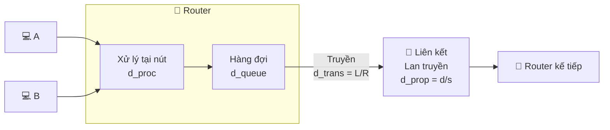
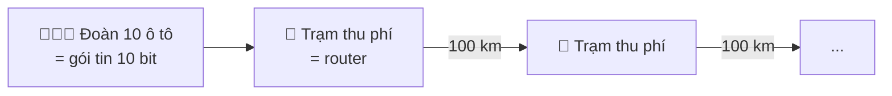
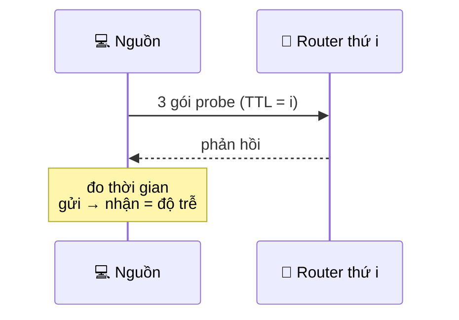
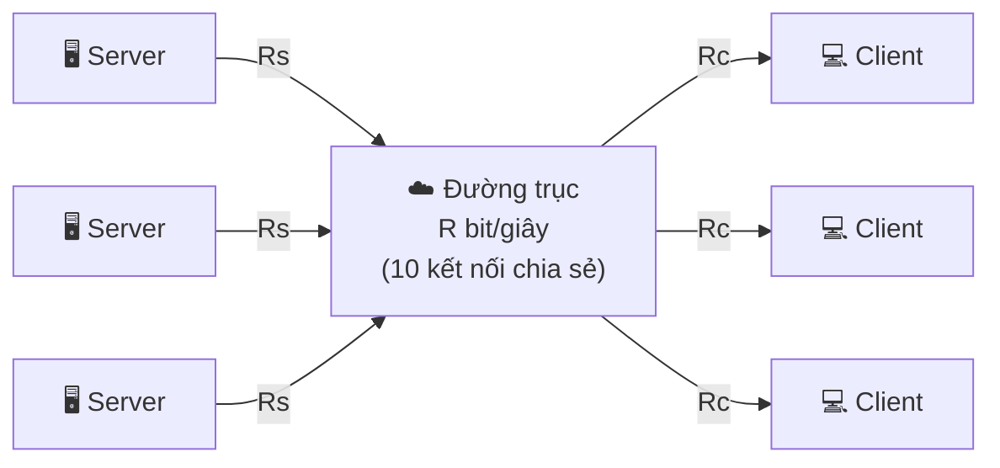
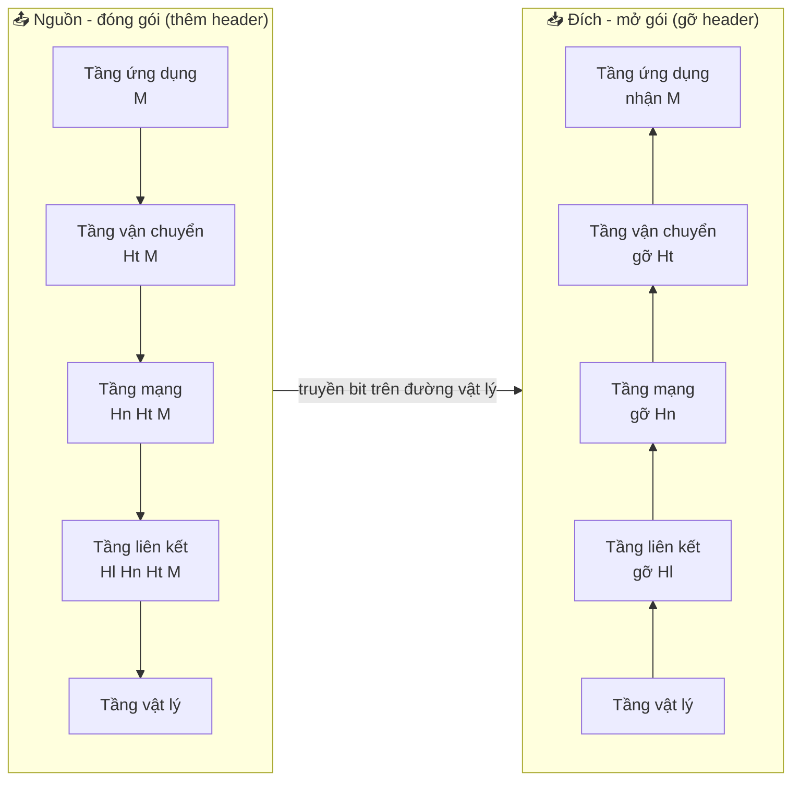

# Buổi 2 - Ôn lại chương 1 và Wireshark

- **Ngày**: 08/11/2026
- **Môn**: Nhập môn mạng máy tính (IT005.G13.CN2.TTNT)
- **Giảng viên**: Đỗ Thị Hương Lan
- **Lịch học**: Chủ nhật, 8h00 - 11h45
- **Nội dung**: Ôn lại chương 1 + hướng dẫn sử dụng Wireshark

## Nội dung buổi học

1. Ôn lại chương 1: trễ và mất gói (4 nguyên nhân trễ, tương tự trạm thu phí, bài tập), traceroute, thông lượng và nút thắt cổ chai
2. Các lớp giao thức, các mô hình dịch vụ: tại sao phân tầng, chồng Internet 5 tầng, so sánh Internet Stack / TCP/IP / OSI, đóng gói và mở gói
3. Thực hành: hướng dẫn sử dụng Wireshark

## Ôn lại chương 1

### Tại sao gói tin bị trễ và bị mất?

- Các gói tin **xếp hàng trong bộ đệm** (buffer) của bộ định tuyến và đợi đến khi được truyền.
  - **Chiều dài hàng đợi tăng** lên khi tốc độ gói tin đi đến **vượt quá khả năng** của liên kết đầu ra.
- **Mất gói** (packet loss) xảy ra khi **bộ nhớ của hàng đợi bị đầy**: gói tin đến sẽ bị **hủy** (loss) nếu không còn chỗ trống trong bộ đệm.
- Tương ứng 2 thành phần trễ trong công thức $d_{nodal}$: gói tin **nằm trong bộ đệm** = trễ hàng đợi ($d_{queue}$), gói tin **được truyền** lên liên kết = trễ truyền ($d_{trans}$).

### Bốn nguyên nhân gây chậm trễ gói tin

Tổng trễ tại một nút mạng:

$$d_{nodal} = d_{proc} + d_{queue} + d_{trans} + d_{prop}$$

| Ký hiệu | Tên | Ý nghĩa |
|---|---|---|
| $d_{proc}$ | Trễ xử lý tại nút | Xử lý gói tin tại nút (kiểm tra lỗi, xác định đầu ra) |
| $d_{queue}$ | Trễ hàng đợi | Gói tin chờ trong hàng đợi đầu ra |
| $d_{trans}$ | Trễ truyền | $d_{trans} = L/R$ - $L$: độ dài gói tin (bit), $R$: tốc độ truyền của liên kết (bps) |
| $d_{prop}$ | Trễ lan truyền | $d_{prop} = d/s$ - $d$: độ dài của kết nối vật lý, $s$: tốc độ lan truyền ($\approx 2 \times 10^8$ m/giây) |



> [!WARNING]
> **$d_{trans}$ và $d_{prop}$ rất khác biệt**: $d_{trans}$ là thời gian **đẩy gói tin vào** đường truyền (phụ thuộc $L$ và $R$); $d_{prop}$ là thời gian bit **lan truyền trên** đường truyền (phụ thuộc khoảng cách $d$, không phụ thuộc $L$, $R$).

> [!TIP]
> **Cường độ lưu lượng** (traffic intensity) $La/R$ - với $a$: tốc độ gói đến trung bình (gói/giây), $L$: độ dài gói, $R$: tốc độ phục vụ của liên kết - quyết định độ lớn của $d_{queue}$: $La/R \approx 0$ → trễ hàng đợi nhỏ; $La/R$ dần tới $1$ → trễ tăng vọt; $La/R > 1$ → hàng đợi vô hạn và **mất gói**. Đây là cầu nối giữa $d_{queue}$ và packet loss.

#### Phép tương tự: đoàn xe và trạm thu phí (caravan analogy)



Giả sử:

- Ô tô di chuyển (**lan truyền**) với tốc độ 100 km/giờ.
- Trạm thu phí mất 12 s để phục vụ mỗi ô tô.

**Câu hỏi**: mất bao lâu thì đoàn xe đến trạm thu phí thứ 2?

**Trả lời: 62 phút = 2 phút + 60 phút**

- **2 phút - trễ truyền** ($d_{trans}$): trạm phục vụ hết 10 ô tô mất $10 \times 12 = 120$ s $= 2$ phút.
- **60 phút - trễ lan truyền** ($d_{prop}$): ô tô cuối cùng di chuyển hết 100 km đến trạm 2 mất $100 \text{ km} / 100 \text{ km/h} = 1$ giờ.

> [!NOTE]
> Tương tự cho thấy trễ truyền và trễ lan truyền **cộng lại** trong tổng trễ đầu-cuối: phải phục vụ xong ô tô cuối cùng ở trạm 1, xe đó mới bắt đầu "lan truyền" đến trạm 2.

#### Bài tập: sắp xếp các thành phần trễ

**Câu 3**: Một gói tin có kích thước $L = 1000$ bytes được truyền giữa 2 Router A và B trên liên kết có tốc độ truyền $R = 2$ Mbps, tốc độ lan truyền là $2{,}5 \times 10^8$ m/s và khoảng cách giữa 2 Router là 500 km. Giả sử độ trễ xử lý tại Router A là 3 ms. Hãy sắp thời gian trễ do các nguyên nhân theo thứ tự từ lớn đến nhỏ?

| Lựa chọn | Thứ tự |
|---|---|
| A | Trễ lan truyền > Trễ truyền > Trễ xử lý tại nút |
| B | Trễ truyền > Trễ lan truyền > Trễ xử lý tại nút |
| C | Trễ xử lý tại nút > Trễ truyền > Trễ lan truyền |
| **D** | **Trễ truyền > Trễ xử lý tại nút > Trễ lan truyền** ✅ |

**Lời giải**: Tính từng thành phần trễ:

- **Trễ truyền**: $d_{trans} = \dfrac{L}{R} = \dfrac{1000 \times 8 \text{ bit}}{2 \times 10^6 \text{ bit/s}} = 4$ ms (đổi $L$ từ bytes sang bits: $\times 8$).
- **Trễ lan truyền**: $d_{prop} = \dfrac{d}{s} = \dfrac{500 \times 10^3 \text{ m}}{2{,}5 \times 10^8 \text{ m/s}} = 2$ ms.
- **Trễ xử lý**: $d_{proc} = 3$ ms (đề cho).

→ $d_{trans}$ (4 ms) $> d_{proc}$ (3 ms) $> d_{prop}$ (2 ms) → **Đáp án D**.

### Độ trễ và tuyến đường của Internet trong thực tế

- Đặt vấn đề: độ trễ và mất gói trên Internet thực tế sẽ như thế nào?
- **Chương trình traceroute**: hỗ trợ đo lường độ trễ từ **nguồn** đến **từng bộ định tuyến** theo lộ trình từ nguồn tới đích. Đối với mỗi bộ định tuyến thứ $i$:
  1. Gửi **3 gói tin** (probe) đến bộ định tuyến thứ $i$ trên lộ trình từ nguồn tới đích, với giá trị trường **time-to-live = $i$**.
  2. Bộ định tuyến thứ $i$ sẽ **phản hồi** với bên gửi.
  3. Bên gửi **đo thời gian** từ khi gửi gói tin đến khi nhận phản hồi để tính độ trễ.



#### Đọc kết quả traceroute

Ví dụ output `traceroute` từ `gaia.cs.umass.edu` đến `www.eurecom.fr` (Mỹ → Pháp):

```text
1   cs-gw (128.119.240.254)                        1 ms  1 ms  2 ms
2   border1-rt-fa5-1-0.gw.umass.edu (128.119.3.145) 1 ms  1 ms  2 ms
...
7   nycm-wash.ablene.ucaid.edu (198.32.8.46)      22 ms 22 ms 22 ms
8   62.40.103.253 (62.40.103.253)                104 ms 109 ms 106 ms
...
17  * * *
18  * * *
19  fantasia.eurecom.fr (193.55.113.142)         132 ms 128 ms 136 ms
```

Cách đọc:

- Mỗi dòng là **một hop** (một bộ định tuyến) trên lộ trình, được đánh số thứ tự.
- Mỗi dòng gồm: **hostname** (nếu phân giải ngược được) + **địa chỉ IP** + **3 giá trị thời gian** (ms) = độ trễ khứ hồi của **3 gói probe** gửi đến router đó.
  - Ví dụ dòng 1: 3 giá trị thời gian trễ từ `gaia.cs.umass.edu` đến `cs-gw`; dòng 2: 3 giá trị trễ đến `border1-rt-fa5-1-0.gw.umass.edu`.
- **Độ trễ nhảy vọt** giữa 2 hop liên tiếp báo hiệu liên kết đường dài hoặc chậm: hop 7 (~22 ms) → hop 8 (~106 ms) là **liên kết xuyên đại dương** (trans-oceanic link - từ mạng Abilene của Mỹ sang mạng GEANT của châu Âu).
- Dòng `* * *` (hop 17, 18): **không phản hồi** - gói probe bị mất hoặc bộ định tuyến **không phản hồi** (bị chặn/cấu hình không trả lời); traceroute vẫn tiếp tục thử các hop phía sau.
- Hop cuối (19) chính là **đích**: `fantasia.eurecom.fr`.
- Thử traceroute từ các quốc gia khác tại **www.traceroute.org**.

#### Thử traceroute trên máy thật

Chạy `traceroute google.com` trên macOS:

```text
traceroute to google.com (142.251.12.101), 64 hops max, 40 byte packets
 1  192.168.2.1                      2.5 ms  1.4 ms  2.9 ms
 2  125.235.249.188.adsl.viettel.vn  4.5 ms  4.2 ms  4.6 ms
 3  10.255.38.193 / .182 / .191      ~6 ms
 7  74.125.50.74 / 142.251.203.150  ~30 ms
 8  se-in-f101.1e100.net (142.251.12.101)  ~35 ms
```

Quan sát:

- Hop 1 `192.168.2.1` là **router gia đình** (gateway, IP private) - đúng là bước đầu tiên ra khỏi mạng nhà.
- Hop 2-6 đi qua mạng **Viettel** (hostname `.adsl.viettel.vn`, các IP `10.x` là IP private trong lõi ISP).
- Hop 7-8 vào **mạng Google** (`74.125.x`, `142.251.x`); hop 8 chính là đích `142.251.12.101`.
- Một số hop in **nhiều dòng IP** (vd hop 3, 7): 3 probe nhận phản hồi từ **các interface/đường khác nhau** - mạng có nhiều tuyến song song (load balancing).
- `traceroute everwise.study` đi 11 hop: đầu vẫn qua Viettel, các hop cuối vào dải `162.158.x` / `172.69.x` - mạng **Cloudflare** (site dùng CDN Cloudflare làm proxy); đích `104.21.93.161` cũng thuộc dải Cloudflare.

### Thông lượng (throughput)

- **Thông lượng**: số bit được truyền từ nguồn đến đích trong một khoảng thời gian.
  - **Tức thời** (instantaneous): tốc độ tại một thời điểm nhất định.
  - **Trung bình** (average): tốc độ trong một khoảng thời gian.
- **Phép tương tự đường ống**: máy chủ gửi các bit (chất lỏng) vào đường ống; đường ống phía server vận chuyển chất lỏng với tốc độ $R_s$ bit/giây, đường ống phía client với tốc độ $R_c$ bit/giây.


- **Câu hỏi**: thông lượng trung bình giữa hai đầu cuối là gì?
  - $R_s < R_c$: thông lượng = $R_s$ (ống phía server hẹp hơn).
  - $R_s > R_c$: thông lượng = $R_c$ (ống phía client hẹp hơn).
  - Tổng quát: thông lượng = **min($R_s$, $R_c$)**.

> [!WARNING]
> **Liên kết thắt cổ chai** (bottleneck link): thông lượng giữa hai đầu cuối bị **giới hạn bởi các kết nối** trên lộ trình giữa hai đầu cuối - chính là liên kết có tốc độ nhỏ nhất trên lộ trình.

#### Thông lượng trong ngữ cảnh mạng máy tính

Kịch bản: **10 kết nối** (chia sẻ công bằng) cùng đi qua **đường trục thắt cổ chai** có tốc độ $R$ bit/giây; phía server nối tốc độ $R_s$, phía client nối tốc độ $R_c$:



- Thông lượng 2 đầu cuối trên từng kết nối: **min($R_c$, $R_s$, $R/10$)** - mỗi kết nối chỉ được $R/10$ trên đường trục chia sẻ.
- **Trong thực tế**: $R_c$ hoặc $R_s$ (liên kết truy cập hai đầu) thường chính là nút thắt cổ chai, chứ không phải đường trục lõi.
- Xem các bài tập tương tác (interactive) tại: http://gaia.cs.umass.edu/kurose_ross/

### Các lớp giao thức, các mô hình dịch vụ

- Mạng là hệ thống **phức tạp** với nhiều thành phần:
  - hosts
  - bộ định tuyến
  - liên kết với nhiều loại đường dẫn khác nhau
  - ứng dụng
  - giao thức
  - phần cứng, phần mềm
- **Câu hỏi đặt ra**: có giải pháp nào để **tổ chức cấu trúc** của mạng không? Và/hoặc để tổ chức các thảo luận của chúng ta về mạng?

#### Tại sao lại phân chia các tầng?

Phân tầng là hướng tiếp cận để **thiết kế/bàn luận** một hệ thống phức tạp:

- **Cấu trúc rõ ràng** cho phép xác định và liên kết các thành phần trong hệ thống → thảo luận theo **mô hình tham chiếu phân tầng**.
- **Mô-đun hóa** (modularization) giúp **dễ vận hành và cập nhật** hệ thống:
  - Các thay đổi trong **triển khai dịch vụ bên trong mỗi tầng** là **trong suốt** với toàn bộ hệ thống.
  - Ví dụ: thay đổi quy trình tại **cổng an ninh** (sân bay) không ảnh hưởng đến các thành phần khác trong hệ thống vận chuyển hàng không.

#### Chồng giao thức Internet phân tầng (Internet protocol stack)

5 tầng, từ trên xuống:

| Tầng | Nhiệm vụ | Giao thức ví dụ |
|---|---|---|
| **Tầng ứng dụng** (application) | Hỗ trợ các ứng dụng mạng | HTTP, IMAP, SMTP, DNS |
| **Tầng vận chuyển** (transport) | Chuyển tiếp dữ liệu giữa các **tiến trình** | TCP, UDP |
| **Tầng mạng** (network) | **Định tuyến** các gói dữ liệu (datagrams) từ nguồn đến đích | IP, các giao thức định tuyến |
| **Tầng liên kết** (link) | Chuyển tiếp dữ liệu giữa các **phần tử lân cận** trong mạng | Ethernet, 802.11 (WiFi), PPP |
| **Tầng vật lý** (physical) | Chuyển các **bit** trên đường truyền | (cáp, sóng vô tuyến...) |

#### Các mô hình tham chiếu: Internet Stack, TCP/IP, OSI

Ba mô hình phân tầng thường gặp:

| Mô hình | Số tầng | Các tầng (từ trên xuống) |
|---|---|---|
| **Internet Stack** (chồng giao thức Internet) | 5 | application → transport → network → link → physical |
| **TCP/IP Model** | 4 | application → transport → internet → network access (link) |
| **OSI Model** (mô hình tham chiếu OSI của ISO) | 7 | application → presentation → session → transport → network → data link → physical |

So sánh các tầng:

| OSI (7 tầng) | Internet Stack (5 tầng) | TCP/IP (4 tầng) |
|---|---|---|
| Tầng ứng dụng (application) | Tầng ứng dụng | Tầng ứng dụng |
| Tầng trình bày (presentation) | ⬆️ (không có - gộp vào ứng dụng) | ⬆️ |
| Tầng phiên (session) | ⬆️ | ⬆️ |
| Tầng vận chuyển (transport) | Tầng vận chuyển | Tầng vận chuyển |
| Tầng mạng (network) | Tầng mạng | Tầng Internet |
| Tầng liên kết (data link) | Tầng liên kết | Tầng truy cập mạng (network access) |
| Tầng vật lý (physical) | Tầng vật lý | ⬆️ (gộp vào truy cập mạng) |

- **Tầng trình bày** (presentation - OSI): cho phép các ứng dụng diễn giải **ý nghĩa của dữ liệu** trao đổi - ví dụ mã hóa, nén, chuyển đổi định dạng dữ liệu.
- **Tầng phiên** (session - OSI): **đồng bộ hóa** (synchronization), điểm kiểm tra (checkpointing) và **khôi phục** quá trình trao đổi dữ liệu.

> [!NOTE]
> Chồng Internet **không có** tầng trình bày và tầng phiên: nếu ứng dụng cần các dịch vụ đó (mã hóa dữ liệu, đồng bộ phiên...) thì **tự triển khai trong chính ứng dụng**. Mô hình TCP/IP 4 tầng gộp luôn 2 tầng dưới thành "network access"; Internet Stack 5 tầng tách ra thành liên kết + vật lý.

#### Các dịch vụ, phân tầng và quá trình đóng gói (encapsulation)

- **Tầng ứng dụng** trao đổi các **thông điệp** (message $M$) để triển khai các dịch vụ của tầng này, sử dụng các dịch vụ được cung cấp bởi **tầng vận chuyển**.
- **Giao thức tầng vận chuyển** vận chuyển $M$ (ví dụ đảm bảo độ tin cậy) từ tiến trình này đến tiến trình khác, sử dụng các dịch vụ của **tầng mạng**.
- Giao thức tầng vận chuyển **đóng gói** (encapsulate) thông điệp $M$ của tầng ứng dụng bằng **mào đầu** (header) $H_t$ của tầng vận chuyển → tạo ra **phân đoạn** (segment) $[H_t \mid M]$.
  - $H_t$ được tầng vận chuyển sử dụng để triển khai các dịch vụ của tầng này.

**Đóng gói và mở gói từng tầng:**

- Tại **nguồn**, dữ liệu đi **xuống** chồng giao thức; mỗi tầng **thêm header của mình** vào đầu khối dữ liệu nhận từ tầng trên:
  - Tầng vận chuyển: $H_t + M$ → **phân đoạn** (segment)
  - Tầng mạng: $H_n + H_t + M$ → **gói dữ liệu** (datagram)
  - Tầng liên kết: $H_l + H_n + H_t + M$ → **khung** (frame)
  - Tầng vật lý: truyền các bit của frame lên đường truyền vật lý.
- Tại **đích**, dữ liệu đi **lên** chồng giao thức; mỗi tầng **đọc và gỡ header của mình** rồi chuyển phần còn lại cho tầng trên (**mở gói** - decapsulation): gỡ $H_l$ → gỡ $H_n$ → gỡ $H_t$ → tầng ứng dụng nhận đúng $M$ nguyên vẹn.



Tên gọi đơn vị dữ liệu theo tầng:

| Tầng | Đơn vị dữ liệu | Header thêm vào |
|---|---|---|
| Ứng dụng | thông điệp (message) $M$ | - |
| Vận chuyển | phân đoạn (segment) | $H_t$ |
| Mạng | gói dữ liệu (datagram) | $H_n$ |
| Liên kết | khung (frame) | $H_l$ |

**Hành vi của từng giao thức tầng:**

- Giao thức **tầng vận chuyển** vận chuyển thông điệp $M$ (ví dụ đảm bảo độ tin cậy) **từ tiến trình này đến tiến trình khác**, sử dụng các dịch vụ của tầng mạng.
- Giao thức **tầng mạng** vận chuyển phân đoạn $[H_t \mid M]$ **từ host này đến host khác** (đầu-cuối), sử dụng các dịch vụ của tầng liên kết.
- Giao thức **tầng liên kết** vận chuyển gói dữ liệu $[H_n \mid H_t \mid M]$ **từ một host đến host lân cận** (từng hop), sử dụng các dịch vụ của tầng vật lý; đồng thời **đóng gói** gói dữ liệu của tầng mạng bằng header $H_l$ để tạo ra frame.

**Quá trình đóng gói - góc nhìn từ đầu đến cuối:**

- Trên đường từ nguồn đến đích, frame đi qua các **thiết bị trung gian** với độ sâu xử lý khác nhau:
  - **Bộ chuyển mạch** (switch): chỉ xử lý đến tầng **liên kết** + vật lý (đọc $H_l$).
  - **Bộ định tuyến** (router): xử lý đến tầng **mạng** - gỡ $H_l$, đọc $H_n$ để tra đường đi, rồi đóng gói lại thành **frame mới** với header $H_l$ mới trước khi chuyển đi.


> [!NOTE]
> **Datagram đi suốt lộ trình** ($H_t M$ nằm trong payload tầng mạng, router không mở - chỉ host đích mới đọc $H_t$), còn **frame được đóng gói lại ở mỗi hop**: router gỡ header liên kết cũ, gắn header liên kết mới phù hợp với liên kết đầu ra. Điều này cho phép các chặng đường dùng **giao thức liên kết khác nhau** (vào bằng Ethernet, ra bằng WiFi...).

> [!TIP]
> Cách nhớ thứ tự header: **tầng càng thấp, header càng nằm ngoài** - trong frame, $H_l$ (liên kết) luôn ở ngoài cùng, $M$ ở trong cùng. Bên nhận gỡ lần lượt từ ngoài vào trong, đúng thứ tự ngược lại khi đóng gói.

> [!NOTE]
> Mỗi tầng ở bên gửi "nói chuyện" với **tầng đồng cấp** (peer layer) ở bên nhận thông qua header của mình: $H_t$ do 2 tầng vận chuyển hai đầu trao đổi, $H_n$ do 2 tầng mạng trao đổi... Đây là **giao tiếp logic** giữa các tầng cùng cấp; còn giao tiếp **vật lý** thực sự chỉ diễn ra ở tầng vật lý dưới cùng. Cái giá của phân tầng là **header overhead**: mỗi tầng thêm header chiếm một phần băng thông.

#### Tra nhanh: giao thức thuộc tầng nào

| Tầng | Giao thức |
|---|---|
| **Ứng dụng** | HTTP, HTTPS (Web); SMTP, POP3, IMAP (e-mail); DNS (phân giải tên); FTP, SFTP (truyền file); Telnet, SSH (truy cập từ xa); SIP, RTP (VoIP/video); DASH (streaming); BitTorrent (P2P); DHCP (cấp IP) |
| **Vận chuyển** | TCP, UDP |
| **Mạng** | IP (IPv4, IPv6); ICMP (ping, traceroute); RIP, OSPF, BGP (giao thức định tuyến); NAT |
| **Liên kết** | Ethernet (802.3); WiFi (802.11); PPP; ARP |
| **Vật lý** | Không có "giao thức" theo nghĩa phần mềm - là các chuẩn phần cứng/đường truyền: cáp xoắn cặp, cáp đồng trục, cáp quang, sóng vô tuyến |

> [!NOTE]
> - **ARP** nằm giữa tầng mạng và liên kết (ánh xạ IP ↔ MAC) - thường xếp vào tầng liên kết.
> - **ICMP** đi kèm IP nên xếp tầng mạng; `ping` và `traceroute` hoạt động dựa trên ICMP.
> - **TLS/SSL** nằm giữa ứng dụng và vận chuyển - triển khai ở tầng ứng dụng, mã hóa dữ liệu trước khi xuống TCP.
> - **HTTP/3** dùng **QUIC** chạy trên UDP thay vì TCP.

> [!NOTE]
> Chi tiết xem lại [buổi 1](./01-01-11-buoi-1-gioi-thieu-mon-hoc).

## Thực hành: hướng dẫn sử dụng Wireshark

### Wireshark là gì?

- **Wireshark** là công cụ **phân tích gói tin** (packet analyzer / packet sniffer) mã nguồn mở, miễn phí - công cụ chuẩn để xem trực tiếp các gói tin đi qua máy.
- Chức năng chính: **bắt** (capture) các gói trên card mạng và **giải mã** (dissect) chúng theo từng tầng giao thức - đúng với quá trình đóng gói đã học.

### Cài đặt trên macOS

```bash
brew install --cask wireshark
```

> [!NOTE]
> Khi cài, Wireshark cài kèm **ChmodBPF** - tiện ích cấp quyền đọc card mạng (user phải thuộc group `access_bpf`), vì vậy chạy Wireshark **không cần sudo**. Trên máy Apple Silicon chọn file `.dmg` bản **Apple Silicon** nếu cài từ wireshark.org.

### Giao diện chính - 3 khung

| Khung | Nội dung |
|---|---|
| **Packet List** (danh sách gói) | Mỗi dòng một gói: No., Time, Source, Destination, Protocol, Info |
| **Packet Details** (chi tiết gói) | Cây phân cấp các **header theo tầng** của gói được chọn - bấm `>` để mở rộng từng trường |
| **Packet Bytes** (byte thô) | Toàn bộ byte của gói dạng hex + ASCII |

> [!TIP]
> Khung **Packet Details** chính là quá trình đóng gói đã học, đọc từ ngoài vào: `Frame` → `Ethernet II` (liên kết, $H_l$) → `Internet Protocol` (mạng, $H_n$) → `TCP`/`UDP` (vận chuyển, $H_t$) → `HTTP`/`DNS` (ứng dụng, $M$). Wireshark bóc đúng thứ tự header $[H_l \mid H_n \mid H_t \mid M]$ như sơ đồ trên.

### Các bước bắt gói đầu tiên

1. Mở Wireshark → chọn **interface** đang có traffic (Wi-Fi thường là `en0` trên macOS).
2. Nhấn nút **vây cá mập xanh** (Start) để bắt đầu capture.
3. **Sinh traffic**: mở trình duyệt tải một trang web, hoặc chạy `ping google.com` / `traceroute` trong terminal.
4. Nhấn nút **vuông đỏ** (Stop) khi đủ gói.
5. Gõ **display filter** vào thanh filter → Enter để lọc gói.
6. Chọn một gói trong Packet List → đọc chi tiết ở 2 khung dưới.

### Display filter thường dùng

Display filter chỉ **lọc hiển thị** (gói vẫn được bắt đủ); gõ trực tiếp vào thanh filter:

| Filter | Lọc gì |
|---|---|
| `http` | Chỉ gói HTTP |
| `dns` | Chỉ truy vấn/phản hồi DNS |
| `tcp` , `udp` , `icmp` | Theo giao thức vận chuyển |
| `ip.addr == 142.251.12.101` | Gói có IP nguồn hoặc đích là IP này |
| `tcp.port == 80` | Theo cổng |
| `http.request` | Chỉ request (không gồm response) |

> [!TIP]
> Phân biệt **display filter** - lọc *hiển thị* sau khi đã bắt (cú pháp Wireshark: `http`, `tcp.port == 80`) - với **capture filter** - lọc *ngay lúc bắt* (cú pháp BPF: `port 80`, `host 1.2.3.4`). Làm lab chỉ cần display filter.

> [!TIP]
> Chuột phải vào một gói → **Follow → TCP Stream** để xem toàn bộ dữ liệu trao đổi (request + response) của kết nối đó ghép lại thành một luồng - rất tiện khi xem HTTP.

### Thực hành gợi ý

- Bắt một `ping google.com` → filter `icmp` → mở gói Echo request: xem header IP (tầng mạng) chứa TTL - chính trường mà **traceroute** đã dùng.
- Bắt khi mở trang web → filter `dns` xem truy vấn DNS trước, rồi `tcp` xem bắt tay TCP, rồi `http` xem GET/response.
- Bài thực hành 1 của môn (5 tiết) sẽ đi sâu vào các thao tác này - xem thêm lab Wireshark của giáo trình tại http://gaia.cs.umass.edu/kurose_ross/

### Các trang HTTP (không s) để làm lab

Lab của lớp: https://it005-demo.landth.info/lab/lab2/21520000.html *(truy cập bằng `http://` để bắt gói bản rõ)*

Vì hầu hết web hiện nay redirect sang HTTPS (mã hóa - không đọc được nội dung gói trong Wireshark), cần trang **phục vụ HTTP thuần** để quan sát request/response bản rõ:

| Trang | Ghi chú |
|---|---|
| `http://gaia.cs.umass.edu/wireshark-labs/HTTP-wireshark-file1.html` | File lab chính chủ của giáo trình Kurose & Ross - chuẩn cho bài HTTP |
| `http://gaia.cs.umass.edu/wireshark-labs/HTTP-wireshark-file2.html` | File lab thứ 2 (có form nhập user/pass - bắt được dữ liệu POST) |
| `http://httpforever.com` | Giữ nguyên HTTP vĩnh viễn |
| `http://info.cern.ch` | Website đầu tiên trên thế giới (CERN) - chỉ HTTP |
| `http://example.com` , `http://example.org` | Trang mẫu của IANA, nhỏ gọn |
| `http://http.badssl.com` | Endpoint HTTP của badssl.com (dùng test lỗi SSL) |
| `http://detectportal.firefox.com/success.txt` | Trang kiểm tra captive portal của Firefox - trả text đơn giản |
| `http://captive.apple.com/hotspot-detect.html` | Trang kiểm tra kết nối của Apple |

> [!TIP]
> Kiểm tra trang có thật sự phục vụ HTTP không bằng `curl -I http://<trang>`:
> - `HTTP/1.1 200 OK` → được, truy cập bắt gói bình thường.
> - `HTTP/1.1 301 ...` kèm `Location: https://...` → redirect sang HTTPS, **không dùng được** cho lab bản rõ.

> [!WARNING]
> Trình duyệt có thể **tự nâng cấp lên HTTPS** ngay cả khi gõ `http://`: Chrome dùng HSTS/https-upgrades, Firefox có **HTTPS-Only Mode** (tắt trong Settings → Privacy & Security). Cách chắc chắn nhất: request bằng `curl -v http://<trang>` trong terminal trong lúc capture - gói HTTP sẽ hiện đầy đủ trong Wireshark.

### Vì sao vnexpress và web hiện đại "không có HTTP"?

Thực nghiệm:

```text
$ curl -I http://vnexpress.net
HTTP/1.1 301 Moved Permanently
Location: https://vnexpress.net/
```

Server **vẫn mở port 80** nhưng không trả nội dung - chỉ đáp **một gói redirect duy nhất** (`301`) bảo trình duyệt sang HTTPS. Các nguyên nhân:

| Nguyên nhân | Giải thích |
|---|---|
| **HTTP là bản rõ** | Toàn bộ nội dung (URL, cookie, session, mật khẩu, form) truyền không mã hóa → bất kỳ ai capture gói (chính là Wireshark trong lab này!) đọc được hết. Lab bản rõ là minh chứng trực tiếp cho rủi ro này |
| **HTTPS bổ sung 3 dịch vụ bảo mật** | **Mã hóa** (nội dung thành ciphertext - capture chỉ thấy vô nghĩa); **toàn vẹn** (không ai sửa/chèn giữa đường - chặn cảnh ISP chèn quảng cáo, tấn công MITM); **xác thực** (chứng chỉ TLS chứng minh đang nói chuyện đúng vnexpress, không phải server giả mạo) |
| **Áp lực hệ sinh thái** | Chrome/Firefox đánh nhãn **"Not secure"** cho trang HTTP; Google ưu tiên HTTPS trong xếp hạng tìm kiếm; **Let's Encrypt** cấp chứng chỉ TLS **miễn phí** → chi phí làm HTTPS gần bằng 0 |
| **HSTS** (HTTP Strict Transport Security) | Site gửi header `Strict-Transport-Security` trong response HTTPS → trình duyệt ghi nhớ và **tự đổi mọi `http://` thành `https://` ngay bên trong trình duyệt**, trước khi gói tin rời máy → từ lần sau **không có gói HTTP nào đi ra mạng** → Wireshark không bắt được gì |

> [!TIP]
> Bắt được gói `HTTP/1.1 301` **đầu tiên** vẫn khả thi: lần đầu truy cập (trước khi có HSTS), trình duyệt gửi 1 HTTP request thật → server trả 301 → sau đó mới sang HTTPS. Trên trang HTTPS, Wireshark chỉ thấy **TLS handshake** + `Application Data` (ciphertext) - minh họa trực quan vì sao HTTPS bảo vệ được nội dung.

### Phân tích gói tin thực tế theo chồng Internet

Ví dụ gói **#840** trong file capture (khung Packet Details hiển thị đúng thứ tự đóng gói $[H_l \mid H_n \mid H_t \mid M]$):

| Dòng trong Packet Details | Tầng | Header | Thông tin trong gói này |
|---|---|---|---|
| `Frame 840: 96 bytes on wire` | (toàn bộ frame) | $[H_l H_n H_t M]$ | 96 byte (768 bit) bắt được trên dây - phần tầng **vật lý** truyền |
| `Ethernet II` | **Liên kết** | $H_l$ | Src MAC `Intel_ac:69:71` (máy mình) → Dst MAC `SDMCTechnolo_f1:b1:32` (gateway/router nhà mạng) |
| `Internet Protocol Version 4` | **Mạng** | $H_n$ | Src `192.168.1.10` → Dst: DNS server của ISP (`dynamic-ip-adsl...`) |
| `User Datagram Protocol` | **Vận chuyển** | $H_t$ | Src port `53596` (cổng ngẫu nhiên phía client) → Dst port `53` (`domain`) → **DNS chạy trên UDP** |
| `Domain Name System (query)` | **Ứng dụng** | $M$ | Standard query `0xa89e`, loại **PTR** - truy vấn **ngược** (hỏi hostname từ IP) |

Quan sát:

- **DNS dùng UDP, port 53** - đúng như lý thuyết; phía client gắn cổng tạm `53596`, server nghe ở cổng `domain (53)`.
- **Tầng vật lý** không có dòng riêng trong Packet Details: Wireshark bắt ở tầng liên kết, còn "96 bytes on wire" chính là những gì tầng vật lý truyền trên đường.
- Các gói **ARP** ngay trước đó trong danh sách (`Who has 192.168.1.10? Tell 192.168.1.1` → `192.168.1.10 is at f4:26:79:ac:69:71`) là bước **phân giải địa chỉ MAC** để frame Ethernet gửi đến đúng thiết bị - giải thích vì sao header $H_l$ chứa địa chỉ MAC chứ không phải IP.
- Truy vấn **PTR** là phân giải ngược (reverse DNS: IP → tên) - chính cơ chế mà `traceroute` dùng để hiển thị hostname của từng hop; phản hồi `No such name` giải thích vì sao nhiều hop trong output traceroute chỉ hiện IP (ISP không đăng ký bản ghi PTR).

## Quiz ôn tập buổi 2

```quiz
{
  "title": "Quiz ôn tập buổi 2 - Mạng máy tính",
  "mode": "exam",
  "questions": [
    {
      "type": "multiple",
      "question": "Phát biểu nào đúng về trễ hàng đợi và mất gói ở bộ định tuyến?",
      "options": [
        "Chiều dài hàng đợi tăng khi tốc độ gói đến vượt quá khả năng của liên kết đầu ra",
        "Mất gói chỉ xảy ra khi đường truyền vật lý quá dài",
        "Bộ nhớ hàng đợi bị đầy thì gói đến sau bị hủy (drop)",
        "Router luôn truyền lại các gói bị mất cho người gửi"
      ],
      "answer": [0, 2],
      "explanation": "Hàng đợi phình ra khi tốc độ đến > tốc độ phục vụ của liên kết ra; mất gói do buffer đầy chứ không liên quan độ dài đường truyền. Việc truyền lại (nếu có) do giao thức đầu cuối quyết định, không phải router."
    },
    {
      "type": "single",
      "question": "Khác biệt đúng giữa trễ truyền $d_{trans}$ và trễ lan truyền $d_{prop}$:",
      "options": [
        "$d_{trans} = L/R$ phụ thuộc độ dài gói và tốc độ liên kết; $d_{prop} = d/s$ phụ thuộc khoảng cách đường truyền",
        "$d_{trans}$ phụ thuộc khoảng cách đường truyền; $d_{prop}$ phụ thuộc kích thước gói",
        "Cả hai đều phụ thuộc cả $L$, $R$ và khoảng cách $d$",
        "$d_{prop}$ là thời gian đẩy hết gói tin vào đường truyền"
      ],
      "answer": 0,
      "explanation": "Đây là cặp khái niệm dễ nhầm nhất: trễ truyền là thời gian đẩy L bit vào link (phụ thuộc L và R), trễ lan truyền là thời gian bit đi hết đường truyền (phụ thuộc d và s - không liên quan L, R)."
    },
    {
      "type": "single",
      "question": "Gói có $L = 2000$ bytes truyền trên liên kết $R = 1$ Mbps. Trễ truyền $d_{trans}$ là bao nhiêu?",
      "options": [
        "16 ms",
        "1.6 ms",
        "160 ms",
        "2 ms"
      ],
      "answer": 0,
      "explanation": "$d_{trans} = L/R = (2000 × 8) / 10^6 = 16$ ms. Bẫy quen thuộc: $L$ cho theo bytes nên phải nhân 8 để đổi sang bit trước khi chia cho $R$ (bps)."
    },
    {
      "type": "single",
      "question": "traceroute đo độ trễ đến bộ định tuyến thứ $i$ bằng cách nào?",
      "options": [
        "Gửi 3 gói probe với TTL = i → gói hết hạn đúng tại router thứ i → router phản hồi về → nguồn đo thời gian từ gửi đến khi nhận phản hồi",
        "Ping trực tiếp địa chỉ IP của router thứ i trên lộ trình",
        "Hỏi DNS server về danh sách các router trên đường đi",
        "Gửi một gói với TTL = 64 rồi đếm số hop đi qua"
      ],
      "answer": 0,
      "explanation": "Cơ chế cốt lõi là trường TTL trong header IP: router giảm TTL mỗi hop, khi TTL = 0 nó gỡ bỏ gói và gửi thông báo lại cho nguồn - nguồn đo được RTT đến đúng router đó."
    },
    {
      "type": "single",
      "question": "Dòng `* * *` trong output traceroute nghĩa là gì?",
      "options": [
        "Không có phản hồi - gói probe bị mất hoặc router không trả lời",
        "Router ở hop đó đã bị tắt hoàn toàn",
        "Lộ trình kết thúc tại hop đó",
        "Độ trễ đến hop đó bằng 0"
      ],
      "answer": 0,
      "explanation": "`* * *` chỉ nghĩa là không nhận được phản hồi (gói mất, bị firewall chặn, hoặc router cấu hình im lặng) - traceroute vẫn tiếp tục thử các hop phía sau, nên không thể kết luận router 'chết' hay lộ trình kết thúc."
    },
    {
      "type": "single",
      "question": "Server nối với mạng tốc độ $R_s = 100$ Mbps, client nối tốc độ $R_c = 20$ Mbps. Thông lượng đầu-cuối của kết nối truyền file là bao nhiêu?",
      "options": [
        "20 Mbps",
        "100 Mbps",
        "120 Mbps",
        "60 Mbps"
      ],
      "answer": 0,
      "explanation": "Thông lượng đầu-cuối = min($R_s$, $R_c$) = 20 Mbps - giống đường ống, liên kết hẹp nhất (bottleneck) quyết định toàn bộ tốc độ."
    },
    {
      "type": "single",
      "question": "10 kết nối chia sẻ công bằng đường trục $R = 1$ Gbps; phía server $R_s = 100$ Mbps, phía client $R_c = 50$ Mbps. Thông lượng mỗi kết nối?",
      "options": [
        "50 Mbps",
        "100 Mbps",
        "10 Mbps",
        "1 Gbps"
      ],
      "answer": 0,
      "explanation": "Mỗi kết nối được R/10 = 100 Mbps trên đường trục, nên thông lượng = min($R_c$, $R_s$, $R/10$) = min(50, 100, 100) = 50 Mbps - bottleneck nằm ở liên kết truy cập phía client, không phải đường trục."
    },
    {
      "type": "multiple",
      "question": "Những tầng nào có trong mô hình OSI nhưng KHÔNG có trong chồng giao thức Internet?",
      "options": [
        "Tầng ứng dụng (application)",
        "Tầng trình bày (presentation)",
        "Tầng phiên (session)",
        "Tầng vận chuyển (transport)"
      ],
      "answer": [1, 2],
      "explanation": "OSI có thêm presentation (diễn giải ý nghĩa dữ liệu: mã hóa/nén) và session (đồng bộ, checkpoint). Trong Internet stack, ứng dụng cần các dịch vụ này thì tự triển khai ngay trong ứng dụng."
    },
    {
      "type": "single",
      "question": "Trong một frame, header nào nằm NGOÀI CÙNG?",
      "options": [
        "$H_t$ - header tầng vận chuyển",
        "$H_n$ - header tầng mạng",
        "$H_l$ - header tầng liên kết",
        "$M$ - thông điệp ứng dụng"
      ],
      "answer": 2,
      "explanation": "Đóng gói thêm header từ trong ra ngoài: $M$ → $H_t M$ → $H_n H_t M$ → $H_l H_n H_t M$ - tầng càng thấp header càng ngoài; bên nhận gỡ ngược lại từ $H_l$ vào."
    },
    {
      "type": "single",
      "question": "Một bộ định tuyến (router) xử lý gói tin đến tầng cao nhất nào?",
      "options": [
        "Tầng vật lý",
        "Tầng liên kết",
        "Tầng mạng",
        "Tầng vận chuyển"
      ],
      "answer": 2,
      "explanation": "Router gỡ $H_l$, đọc $H_n$ (IP) để tra đường đi rồi gắn $H_l$ mới - không đụng vào $H_t$ và $M$. Switch chỉ đến tầng liên kết; chỉ host đích mới mở hết chồng."
    },
    {
      "type": "true-false",
      "question": "Khi gói đi qua router, header liên kết bị gỡ và thay bằng header liên kết mới cho hop kế tiếp, còn datagram ($H_n H_t M$) giữ nguyên tới đích.",
      "answer": true,
      "explanation": "Frame chỉ sống trong một hop - mỗi hop có thể dùng công nghệ liên kết khác nhau; datagram là đơn vị đầu-cuối nên router chỉ gắn lại $H_l$ mới chứ không sửa $H_n$ (trừ giảm TTL) và payload."
    },
    {
      "type": "self-check",
      "question": "Vì sao trên trang HTTP thuần Wireshark đọc được nội dung request/response, còn trên trang HTTPS (như vnexpress) thì chỉ thấy 'Application Data'?",
      "answer": "**HTTP truyền bản rõ** - request và response nằm nguyên văn trong phần dữ liệu của gói nên khung Packet Details/Bytes đọc được toàn bộ (đây chính là rủi ro các lab HTTP muốn minh họa). **HTTPS = HTTP chạy qua TLS**: sau TLS handshake, mọi dữ liệu đều được mã hóa nên Wireshark chỉ thấy `Application Data` là ciphertext. Ngoài ra **HSTS** khiến trình duyệt tự đổi `http://` thành `https://` ngay bên trong máy trước khi gói ra mạng - về sau thậm chí không có gói HTTP nào để bắt."
    }
  ]
}
```

