# Buổi 3 - Chương 2: Tầng ứng dụng

- **Ngày**: 22/11/2026
- **Môn**: Nhập môn mạng máy tính (IT005.G13.CN2.TTNT)
- **Giảng viên**: Đỗ Thị Hương Lan
- **Lịch học**: Chủ nhật, 8h00 - 11h45
- **Nội dung**: Chương 2 - Tầng ứng dụng (Application Layer)

## Tầng ứng dụng - Tổng quan

1. Nguyên lý của các ứng dụng mạng
2. Web và HTTP
3. E-mail, SMTP, IMAP
4. Hệ thống phân giải tên miền DNS (Domain Name System)
5. Các ứng dụng P2P (Peer-to-Peer)
6. Lập trình socket với UDP và TCP

### Mục tiêu chương 2

- Nắm **khái niệm** và khía cạnh **triển khai** của các giao thức tầng ứng dụng:
  - Mô hình dịch vụ tầng vận chuyển (transport-layer service models)
  - Mô hình máy khách - máy chủ (client-server)
  - Mô hình ngang hàng (peer-to-peer)
- Tìm hiểu về các giao thức thông qua việc xem xét các giao thức phổ biến của tầng ứng dụng:
  - HTTP
  - SMTP, IMAP
  - DNS
- Lập trình ứng dụng mạng (network application programming):
  - Socket API

## Nguyên lý của các ứng dụng mạng

### Tạo một ứng dụng mạng

**Viết chương trình** sao cho:

- Chạy trên các **hệ thống đầu cuối** (end systems) - có thể khác nhau (điện thoại, laptop, server...).
- Giao tiếp với nhau qua mạng.
- Ví dụ: phần mềm máy chủ web (web server) giao tiếp với phần mềm duyệt web (browser).

**Không cần viết phần mềm cho các thiết bị trong mạng lõi** (network core):

- Các thiết bị trong mạng lõi (router, switch) **không chạy ứng dụng của người dùng**.
- Ứng dụng chỉ nằm trên hệ thống đầu cuối → cho phép **phát triển ứng dụng và quảng bá nhanh chóng**.

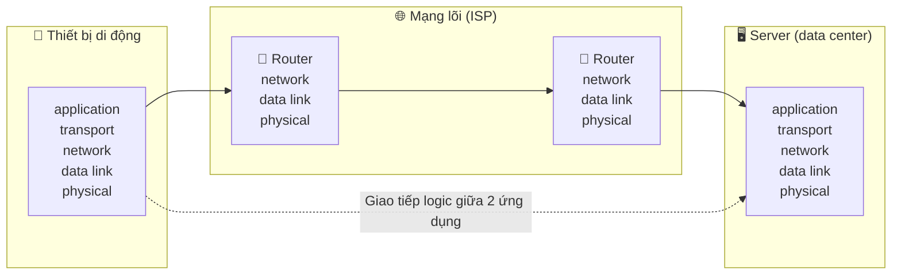

> [!NOTE]
> Chỉ hệ thống đầu cuối mới có đủ 5 tầng (gồm tầng **ứng dụng**); router trong mạng lõi chỉ xử lý đến tầng **mạng** (như đã học ở buổi 2). Vì vậy lập trình viên chỉ cần viết phần mềm cho đầu cuối, không phải chờ thay đổi hạ tầng mạng - đây là lý do Internet có thể ra đời ứng dụng mới rất nhanh.

### Mô hình máy khách - máy chủ (Client-Server)

| Máy chủ (Server) | Máy khách (Client) |
|---|---|
| **Luôn luôn hoạt động** (always-on) | Liên lạc, giao tiếp với máy chủ |
| **Địa chỉ IP cố định** | Có thể **kết nối không liên tục** |
| Thường tổ chức thành các **trung tâm dữ liệu** (data center) để mở rộng quy mô | Có thể **thay đổi địa chỉ IP** |
| | **Không giao tiếp trực tiếp** với các máy khách khác |

**Ví dụ**: HTTP, IMAP, FTP.

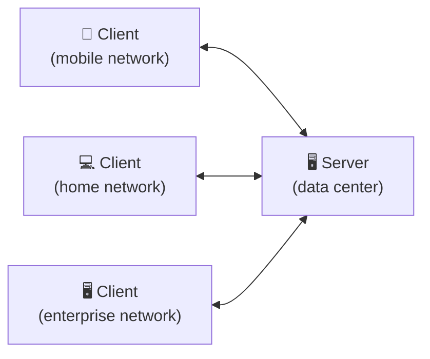

> [!NOTE]
> Server cần IP cố định và luôn bật để client **biết tìm ở đâu và lúc nào cũng liên hệ được**. Client thì ngược lại: chỉ chủ động kết nối khi cần, nên IP thay đổi (vd: điện thoại chuyển từ Wi-Fi sang 4G) cũng không sao. Mọi trao đổi giữa các client đều đi **qua server**.

### Kiến trúc mạng ngang hàng (Peer-to-Peer, P2P)

- ***Không có*** máy chủ luôn hoạt động.
- Các hệ thống đầu cuối bất kỳ **giao tiếp trực tiếp** với nhau.
- Các peer **yêu cầu dịch vụ** từ các peer khác và **cung cấp dịch vụ** ngược lại cho các peer khác.
- ***Khả năng tự mở rộng*** (self-scalability): các peer mới cung cấp thêm dịch vụ mới, cũng như có thêm nhu cầu mới về dịch vụ.
- Các peer có thể **kết nối không liên tục** và **thay đổi địa chỉ IP**:
  - → Quản lý phức tạp.
- **Ví dụ**: chia sẻ tập tin P2P (BitTorrent).

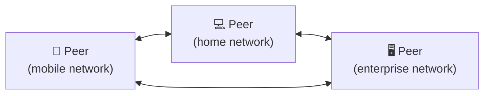

#### So sánh Client-Server và P2P

| Tiêu chí | Client-Server | P2P |
|---|---|---|
| Máy chủ luôn hoạt động | Có | Không |
| Giao tiếp | Client ↔ Server (client không nói chuyện trực tiếp với nhau) | Peer ↔ Peer trực tiếp |
| Vai trò | Tách biệt: server phục vụ, client yêu cầu | Mỗi peer vừa là client vừa là server |
| Mở rộng quy mô | Phải tăng năng lực server (data center) | Tự mở rộng: thêm peer = thêm cả nhu cầu lẫn năng lực phục vụ |
| Địa chỉ IP | Server cố định | Peer có thể thay đổi |
| Quản lý | Đơn giản hơn (tập trung) | Phức tạp (phân tán, peer ra vào liên tục) |
| Ví dụ | HTTP, IMAP, FTP | BitTorrent |

### Socket

- **Tiến trình** (process) **gửi/nhận** thông điệp **đến/từ** socket của nó.
- Socket hoạt động **tương tự như cánh cửa**:
  - Tiến trình gửi **đẩy thông điệp ra khỏi cửa**.
  - Tiến trình gửi dựa trên **hạ tầng vận chuyển** bên kia cánh cửa để phân phối thông điệp đến socket tại tiến trình nhận.
- **Hai socket** có liên quan: **một socket ở mỗi bên**.

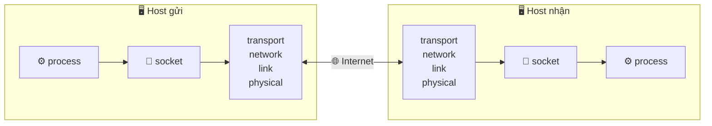

| Phần | Nằm ở | Điều khiển bởi |
|---|---|---|
| Tiến trình (process) | Tầng ứng dụng | **Nhà phát triển ứng dụng** |
| Socket | Ranh giới giữa tầng ứng dụng và tầng vận chuyển | Giao diện (API) giữa hai bên |
| Transport, network, link, physical | Các tầng bên dưới | **Hệ điều hành** (OS) |

> [!NOTE]
> Socket là **giao diện lập trình** (API) giữa ứng dụng và mạng: lập trình viên chỉ quyết định được phía trên socket (logic ứng dụng, chọn giao thức vận chuyển TCP hay UDP, một vài tham số), còn mọi thứ phía dưới do hệ điều hành lo.

> [!TIP]
> Để gửi thông điệp đến **đúng tiến trình** bên kia cần 2 thông tin: **địa chỉ IP** xác định máy chủ (host) và **số cổng** (port number) xác định tiến trình nhận trên máy đó - vd: web server = port 80, mail server = port 25. Khi lập trình socket, ứng dụng cũng chỉ chọn được **giao thức tầng vận chuyển**: **TCP** (tin cậy, đúng thứ tự, có kiểm soát tắc nghẽn - dùng cho Web, email, FTP) hoặc **UDP** (không tin cậy nhưng nhẹ, không cần thiết lập kết nối - dùng cho DNS, streaming). Cổng và lựa chọn TCP/UDP của từng giao thức được ôn lại ở Câu 10 phần bài tập.

## Web và HTTP

### Ôn tập: trang web và đối tượng

- Trang web bao gồm các ***đối tượng*** (objects), có thể được lưu trữ ở **các máy chủ Web khác nhau**.
- Đối tượng có thể là tập tin HTML, hình ảnh JPEG, tập tin audio...
- Trang web bao gồm **tập tin HTML cơ bản** (base HTML file) chứa **tham chiếu** đến nhiều đối tượng, **mỗi đối tượng được đánh địa chỉ bởi một URL** (Uniform Resource Locator).

Cấu trúc URL:

```text
www.someschool.edu/someDept/pic.gif
└───────┬────────┘└──────┬────────┘
     Tên máy          Đường dẫn
    (host name)      (path name)
```

| Phần | Giá trị ví dụ | Ý nghĩa |
|---|---|---|
| Tên máy (host name) | `www.someschool.edu` | Máy chủ Web lưu đối tượng (được DNS phân giải ra địa chỉ IP) |
| Đường dẫn (path name) | `/someDept/pic.gif` | Vị trí của đối tượng trên máy chủ đó |

> [!TIP]
> Một trang web có 1 file HTML cơ bản và 10 ảnh JPEG thì gồm **11 đối tượng** - trình duyệt phải lấy về cả 11 (mỗi đối tượng có URL riêng, có thể nằm ở server khác nhau). Đây là tiền đề cho phần so sánh HTTP bền vững/không bền vững sau này.

### Tổng quan HTTP

HTTP (HyperText Transfer Protocol) hoạt động theo mô hình client-server: **máy khách** (port X - cổng tạm bất kỳ) gửi **HTTP request**, **máy chủ** (port **80**) trả về **HTTP response**.

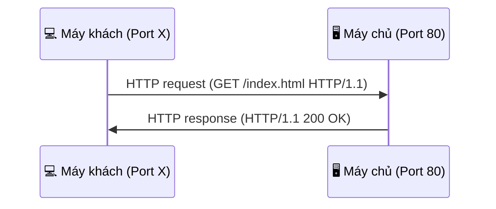

#### Cấu trúc HTTP request

```text
GET /index.html HTTP/1.1\r\n                 ← Dòng yêu cầu (Request Line)
Host: abc.edu\r\n                            ┐
User-Agent: Firefox/3.6.10\r\n               │
...                                          │ Các dòng header
If-modified-since: <date>\r\n                │ (Header Lines)
Cookie: mssv=aXtdl+ab\r\n                    │
...                                          ┘
\r\n
data data data                               ← Dữ liệu (Data) - tùy chọn
data data data
```

**Dòng yêu cầu** gồm 3 phần:

| Thành phần | Ví dụ | Giá trị khác |
|---|---|---|
| **Method** | `GET` | `POST`, `HEAD`... |
| **URI** | `/index.html` | Đường dẫn đối tượng trên server |
| **Version** | `HTTP/1.1` | `HTTP/1.0`, `HTTP/2.x`, `HTTP/3.x` |

Các method phổ biến:

| Method | Tác dụng |
|---|---|
| `GET` | Yêu cầu đối tượng - entity body **rỗng** |
| `POST` | Gửi dữ liệu lên server trong entity body (vd: nội dung form, chuỗi nhập vào ô tìm kiếm) |
| `HEAD` | Chỉ yêu cầu **header** - server trả response không kèm đối tượng, thường dùng để debug |
| `PUT` | (HTTP/1.1) Upload đối tượng lên một đường dẫn trên server |
| `DELETE` | (HTTP/1.1) Xóa đối tượng trên server |

#### Cấu trúc HTTP response

```text
HTTP/1.1 200 OK\r\n                          ← Dòng trạng thái (Status Line)
Server: Apache\r\n                           ┐
Content-Length: 2652\r\n                     │ Các dòng header
...                                          │ (Header Lines)
Set-cookie: mssv=aXtdl+ab\r\n                │
...                                          ┘
\r\n
data data data                               ← Dữ liệu (Data)
data data data
```

**Dòng trạng thái** gồm 3 phần:

| Thành phần | Ví dụ | Giá trị khác |
|---|---|---|
| **Version** | `HTTP/1.1` | `HTTP/1.0`, `HTTP/2.x`... |
| **Status Code** | `200` | `304`, `404`... |
| **Phrase** | `OK` | `Not Modified`, `Not Found`... |

#### Các header đáng chú ý

| Header | Nằm trong | Vai trò |
|---|---|---|
| `Host` | Request | Tên máy chủ cần truy cập |
| `User-Agent` | Request | Loại trình duyệt/phần mềm client |
| `If-modified-since` | Request | **GET có điều kiện**: chỉ gửi đối tượng nếu bị sửa sau `<date>` - nếu không, server trả `304 Not Modified` (không kèm dữ liệu) |
| `Cookie` | Request | Client gửi lại cookie đã được cấp |
| `Server` | Response | Phần mềm máy chủ (vd: Apache) |
| `Content-Length` | Response | Độ dài phần dữ liệu (byte) |
| `Set-cookie` | Response | Server cấp cookie cho client (vd: `mssv=aXtdl+ab`) |

> [!NOTE]
> Cặp `Set-cookie` (response) → `Cookie` (request) giúp server **nhận ra client** qua nhiều lần truy cập, dù bản thân HTTP **không lưu trạng thái** (stateless). Cặp `If-modified-since` → `304 Not Modified` là cơ chế dùng lại bản lưu đệm (cache) để tiết kiệm băng thông.

> [!TIP]
> Mỗi dòng kết thúc bằng `\r\n` (CR LF); một **dòng trống** `\r\n` ngăn cách phần header với phần dữ liệu. Đây chính là những gì thấy được khi bắt gói HTTP bằng Wireshark ở buổi 2.

### Thông điệp yêu cầu HTTP (HTTP request message)

- Hai loại thông điệp HTTP: **yêu cầu** (request) và **phản hồi** (response).
- Thông điệp yêu cầu HTTP ở dạng **ASCII** - định dạng con người có thể đọc được (human-readable).

Ví dụ một request thực tế:

```text
GET /index.html HTTP/1.1\r\n
Host: www-net.cs.umass.edu\r\n
User-Agent: Mozilla/5.0 (Macintosh; Intel Mac OS X 10.15; rv:80.0) Gecko/20100101 Firefox/80.0 \r\n
Accept: text/html,application/xhtml+xml\r\n
Accept-Language: en-us,en;q=0.5\r\n
Accept-Encoding: gzip,deflate\r\n
Connection: keep-alive\r\n
\r\n
```

| Phần | Nội dung |
|---|---|
| **Dòng yêu cầu** (request line) | `GET /index.html HTTP/1.1` - các lệnh `GET`, `POST`, `HEAD` |
| **Các dòng header** (header lines) | Từ `Host:` đến `Connection:` |
| **Dòng trống** `\r\n` ở cuối | Một `\r\n` đứng riêng thành một dòng trống - đánh dấu **hết phần header** (với `GET` không có body nên cũng là hết toàn bộ thông điệp) |

- `\r` = **ký tự về đầu dòng** (carriage return, CR); `\n` = **ký tự xuống dòng** (line feed, LF).

| Header | Ý nghĩa |
|---|---|
| `Host` | Tên máy chủ (`www-net.cs.umass.edu`) - bắt buộc từ HTTP/1.1 vì một IP có thể chứa nhiều website |
| `User-Agent` | Trình duyệt và hệ điều hành của client (Firefox 80 trên macOS) |
| `Accept` | Loại nội dung client chấp nhận (`text/html`, `application/xhtml+xml`) |
| `Accept-Language` | Ngôn ngữ ưu tiên (`en-us`, rồi `en` với trọng số `q=0.5`) |
| `Accept-Encoding` | Kiểu nén client giải được (`gzip`, `deflate`) |
| `Connection: keep-alive` | Giữ kết nối TCP mở để dùng lại cho các request sau (**HTTP bền vững**) |

> [!TIP]
> Bài tập tương tác thêm: http://gaia.cs.umass.edu/kurose_ross/interactive/

#### Định dạng chung của thông điệp yêu cầu HTTP

```text
┌────────┬────┬─────┬────┬─────────┬────┬────┐
│ method │ sp │ URL │ sp │ version │ cr │ lf │   ← Dòng yêu cầu
├────────┴────┴─────┼────┼─────────┼────┼────┤
│ header field name │ sp │  value  │ cr │ lf │   ┐
├───────────────────┴────┴─────────┴────┴────┤   │
≈                    ...                     ≈   │ Các dòng header
├───────────────────┬────┬─────────┬────┬────┤   │
│ header field name │ sp │  value  │ cr │ lf │   ┘
├────┬────┬─────────┴────┴─────────┴────┴────┘
│ cr │ lf │                                       ← Dòng trống: hết phần header
├────┴────┴──────────────────────────────────┐
≈                entity body                 ≈   ← Thân (body)
└────────────────────────────────────────────┘
```

| Ký hiệu | Ý nghĩa |
|---|---|
| `sp` | Khoảng trắng (space) - ngăn cách các trường trong dòng yêu cầu |
| `cr lf` | `\r\n` - kết thúc một dòng |
| `cr lf` đứng riêng | Dòng trống - kết thúc phần header |
| **entity body** | Thân thông điệp - **rỗng với GET**, chứa dữ liệu (vd: nội dung form) với **POST** |

> [!NOTE]
> Khớp định dạng chung với ví dụ trước: `GET` = method, `/index.html` = URL, `HTTP/1.1` = version; mỗi header có dạng `Tên: giá trị`. Request GET ở ví dụ trước kết thúc ngay sau dòng trống vì không có entity body.

### Các mã trạng thái phản hồi HTTP (HTTP status codes)

**Mã trạng thái** xuất hiện ở **dòng 1** (dòng trạng thái) trong thông điệp phản hồi từ máy chủ đến máy khách.

Một số mã trạng thái:

| Mã | Ý nghĩa |
|---|---|
| `200 OK` | Yêu cầu thành công, đối tượng được yêu cầu **kèm sau** trong thông điệp này |
| `301 Moved Permanently` | Đối tượng được yêu cầu đã di chuyển **vĩnh viễn**, vị trí mới được xác định sau trong thông điệp này (trong trường `Location`) |
| `302 Found` | Chuyển hướng **tạm thời** - đối tượng tạm thời nằm ở URL khác (trong `Location`), vd: ép chuyển HTTP → HTTPS |
| `400 Bad Request` | Máy chủ không hiểu thông điệp yêu cầu |
| `404 Not Found` | Tài liệu được yêu cầu không tìm thấy trên máy chủ này |
| `503 Service Unavailable` | Máy chủ tạm thời không phục vụ được (quá tải, đang bảo trì) - client có thể thử lại sau |
| `505 HTTP Version Not Supported` | Máy chủ không hỗ trợ phiên bản HTTP mà request sử dụng |

> [!TIP]
> Chữ số đầu cho biết **nhóm** mã: `2xx` thành công, `3xx` chuyển hướng (gồm `301`, `304 Not Modified`), `4xx` lỗi phía client (`400`, `404`), `5xx` lỗi phía server (`505`).

> [!NOTE]
> `301` chính là gói đã quan sát ở buổi 2: `curl -I http://vnexpress.net` trả `HTTP/1.1 301 Moved Permanently` kèm `Location: https://vnexpress.net/` để chuyển trình duyệt sang HTTPS.

### Thử nghiệm HTTP (phía máy khách)

**Bước 1. Kết nối đến máy chủ Web yêu thích:**

```bash
nc -c -v gaia.cs.umass.edu 80
telnet gaia.cs.umass.edu 80    # hoặc
```

- Mở **kết nối TCP đến cổng 80** (cổng máy chủ HTTP mặc định) tại trang web đó.
- Bất cứ thứ gì được nhập sẽ được gửi đến cổng 80 tại tên miền đã gõ.

**Bước 2. Nhập yêu cầu GET HTTP:**

```text
GET /kurose_ross/interactive/index.php HTTP/1.1
Host: gaia.cs.umass.edu
```

- Gõ những dòng này rồi **Enter 2 lần** (tạo dòng trống `\r\n` kết thúc header) → đã gửi một yêu cầu GET **tối thiểu nhưng đầy đủ** đến máy chủ.

**Bước 3. Xem thông điệp phản hồi** được gửi bởi máy chủ HTTP (hoặc dùng Wireshark để xem các thông điệp đã gửi/nhận).

> [!NOTE]
> Cờ `-c` của `nc` trên macOS nghĩa là **gửi CRLF** (`\r\n`) làm ký tự kết thúc dòng - đúng chuẩn HTTP. Trên Linux (OpenBSD netcat) cờ tương đương là `-C`.

> [!TIP]
> Cách nhanh hơn để xem cả request lẫn response mà không phải gõ tay: `curl -v http://uit.edu.vn/` - cờ `-v` in ra các dòng `>` (request) và `<` (response). `curl -I` còn gọn hơn nữa vì chỉ gửi `HEAD` (đã dùng ở buổi 2 với vnexpress).

#### Kết quả thử thực tế (22/11/2026)

```text
$ nc -c -v gaia.cs.umass.edu 80
Connection to gaia.cs.umass.edu port 80 [tcp/http] succeeded!
GET /kurose_ross/interactive/index.php HTTP/1.1
Host: gaia.cs.umass.edu

HTTP/1.1 301 Moved Permanently
Date: Sun, 22 Nov 2026 02:26:23 GMT
Server: Apache/2.4.62 (AlmaLinux) OpenSSL/3.5.9 mod_fcgid/2.3.9 mod_perl/2.0.12 Perl/v5.32.1
Location: https://gaia.cs.umass.edu//kurose_ross/interactive/index.php
Content-Length: 268
Content-Type: text/html; charset=iso-8859-1

<!DOCTYPE HTML PUBLIC "-//IETF//DTD HTML 2.0//EN">
<html><head>
<title>301 Moved Permanently</title>
...
```

Đọc kết quả theo cấu trúc response đã học:

- **Dòng trạng thái**: `HTTP/1.1` (version) `301` (status code) `Moved Permanently` (phrase).
- **Header** `Location`: trang đã chuyển sang **HTTPS** - giống trường hợp vnexpress ở buổi 2.
- **Header** `Server: Apache/...`, `Content-Length: 268` → phần **entity body** (trang HTML báo lỗi 301) dài đúng 268 byte.

> [!TIP]
> Để thấy response `200 OK` qua HTTP thuần, thử với file lab: `GET /wireshark-labs/HTTP-wireshark-file1.html HTTP/1.1` + `Host: gaia.cs.umass.edu`.

#### Demo trên lớp: truy cập uit.edu.vn

```text
telnet uit.edu.vn 80

GET / HTTP/1.1
Host: uit.edu.vn
```

- URI `/` = trang gốc (trang chủ) của website.

Kết quả thử thực tế (22/11/2026, dùng `nc -c -v uit.edu.vn 80` thay cho `telnet`):

```text
HTTP/1.1 302 Found
content-length: 0
location: https://uit.edu.vn/
cache-control: no-cache
connection: close
```

- Server trả `302 Found` - **chuyển hướng tạm thời** (khác `301` là chuyển hướng vĩnh viễn) sang `https://uit.edu.vn/`.
- `content-length: 0` → response **không có entity body**, chỉ có dòng trạng thái và header.

> [!WARNING]
> macOS từ bản High Sierra (10.13) **không còn cài sẵn `telnet`** - dùng `nc` thay thế, hoặc cài bằng `brew install telnet`. Windows phải bật tính năng **Telnet Client** trong "Turn Windows features on or off".

#### Lỗi thường gặp: `408 Request Time-out`

```text
$ telnet uit.edu.vn 80
Connected to uit.edu.vn.
GET / HTTP/1.1
Host: uit.edu.vn
HTTP/1.1 408 Request Time-out
...
Your browser didn't send a complete request in time.
```

- **Nguyên nhân**: server uit.edu.vn chỉ chờ khoảng **10 giây** (đo thực tế) kể từ lúc kết nối để nhận **trọn vẹn** phần header - tức là đến **dòng trống** cuối cùng. Gõ tay chậm, hoặc quên Enter lần 2, thì server hết kiên nhẫn và đóng kết nối.
- **Cách chạy đúng**:
  1. Soạn sẵn 2 dòng request trong một trình soạn thảo rồi copy.
  2. Chạy `telnet uit.edu.vn 80`, thấy `Connected` thì **dán ngay**.
  3. Nhấn **Enter 2 lần** (dòng trống kết thúc header) - tất cả trong vòng ~10 giây.
- **Lỗi khác dễ gặp**: dán cả 2 dòng dính liền `GET / HTTP/1.1Host: uit.edu.vn` (mất ký tự xuống dòng giữa request line và header) → server trả `400 Bad Request` vì request sai cú pháp.
- **Cách chắc chắn nhất**: gửi request bằng một lệnh duy nhất, không phụ thuộc tốc độ gõ:

```bash
printf 'GET / HTTP/1.1\r\nHost: uit.edu.vn\r\n\r\n' | nc uit.edu.vn 80
```

> [!NOTE]
> `408` là mã nhóm `4xx` (lỗi phía client): server cho rằng **client** gửi request không đủ trong thời gian cho phép. Đây là cơ chế chống tấn công kiểu **Slowloris** (mở nhiều kết nối rồi gửi header thật chậm để chiếm hết tài nguyên server).

### Các kết nối HTTP: 2 loại

| HTTP không bền vững (non-persistent) - HTTP/1.0 | HTTP bền vững (persistent) - HTTP/1.1 |
|---|---|
| 1. Kết nối TCP được mở | Kết nối TCP được mở đến một máy chủ (server) |
| 2. **Chỉ tối đa một đối tượng** được gửi qua kết nối TCP | **Nhiều đối tượng** có thể được gửi thông qua ***duy nhất*** một kết nối TCP giữa máy khách (client) và máy chủ đó |
| 3. Kết nối TCP đóng lại | Kết nối TCP đóng lại |
| → Tải nhiều đối tượng **yêu cầu nhiều kết nối** | → Một kết nối dùng cho nhiều đối tượng |

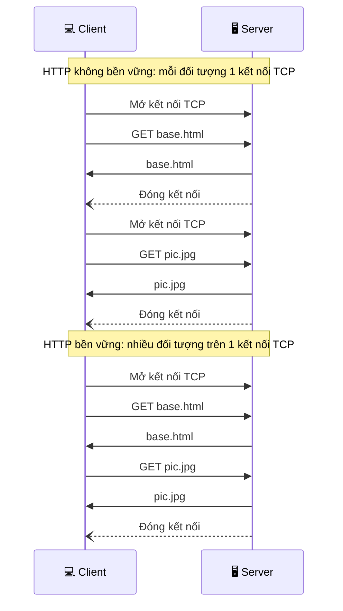

> [!NOTE]
> Header `Connection: keep-alive` trong ví dụ request trước chính là yêu cầu **giữ kết nối bền vững**. Ngược lại, `Connection: close` báo server đóng kết nối ngay sau response - thực nghiệm với uit.edu.vn ở trên đều kết thúc bằng `Connection closed by foreign host.`.

#### HTTP không bền vững: ví dụ

Giả sử người dùng vào URL: `www.someSchool.edu/someDepartment/home.index` (trang chứa text và **tham chiếu đến 10 hình JPEG**).

| Bước | Bên | Hành động |
|---|---|---|
| **1a** | 💻 HTTP client | Khởi tạo **kết nối TCP** với HTTP server tại `www.someSchool.edu` trên **cổng 80** |
| **1b** | 🖥️ HTTP server | Tại host `www.someSchool.edu`, đang chờ kết nối TCP ở cổng 80, **"chấp nhận"** kết nối và thông báo cho client |
| **2** | 💻 HTTP client | Gửi **thông điệp yêu cầu** HTTP (chứa URL) vào socket kết nối TCP. Thông điệp chỉ ra rằng client muốn đối tượng `someDepartment/home.index` |
| **3** | 🖥️ HTTP server | Nhận thông điệp yêu cầu, tạo **thông điệp phản hồi** chứa đối tượng được yêu cầu, và gửi thông điệp vào socket của nó |

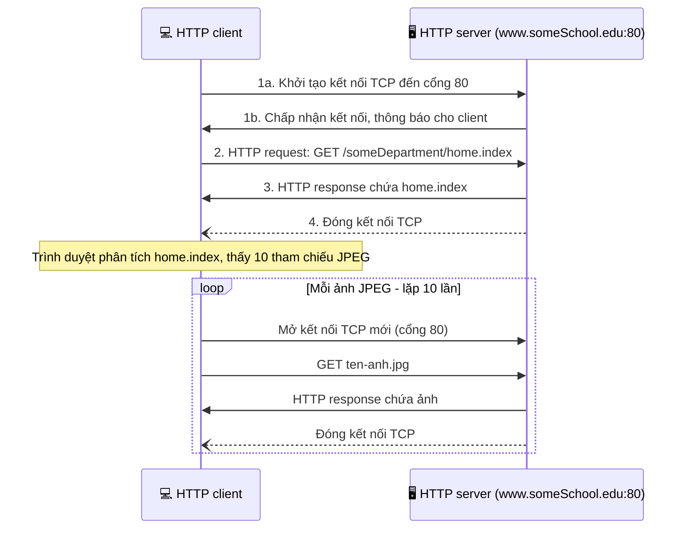

> [!NOTE]
> 11 đối tượng (1 HTML + 10 JPEG) cần tới **11 kết nối TCP** với HTTP không bền vững - mỗi đối tượng mở rồi đóng một kết nối riêng. **RTT** (Round-Trip Time) là thời gian một gói tin nhỏ đi từ client đến server rồi quay lại; mỗi đối tượng tốn khoảng **2 RTT** (1 RTT mở TCP + 1 RTT request/response) cộng thêm **thời gian truyền file**. Đây là nền cho các công thức ở mục [Ước lượng độ trễ HTTP](#uoc-luong-do-tre-http-animation-tuong-tac) phía dưới.

### Bài tập ôn tập: tầng ứng dụng và HTTP

*Các câu giữ nguyên số thứ tự như bài tập trên lớp - vì vậy có câu nhảy số.*

**Câu hỏi 1**: Alice dùng **HTTP Persistent without pipelining** truy cập vào một trang web gồm **1 file HTML và 5 ảnh**. Biết thời gian truyền file của mỗi đối tượng là **0.5 RTT**. Hỏi tổng thời gian để xem được website trên?

| Lựa chọn | Đáp án |
|---|---|
| A | 5 RTT |
| B | 6 RTT |
| **C** | **10 RTT** ✅ |
| D | 15 RTT |

**Lời giải**:

- **RTT** (Round-Trip Time): thời gian một gói nhỏ đi từ client đến server rồi quay về.
- Tổng số đối tượng: 1 HTML + 5 ảnh = **6 đối tượng**.
- **Bền vững** → chỉ mở kết nối TCP **một lần**: mất **1 RTT**.
- **Không pipelining** → phải nhận xong đối tượng này mới gửi request tiếp theo. Mỗi đối tượng tốn: 1 RTT (gửi request, nhận byte đầu của response) + 0.5 RTT (truyền file) = **1.5 RTT**.

$$T = \underbrace{1}_{\text{mở TCP}} + 6 \times (\underbrace{1}_{\text{request}} + \underbrace{0.5}_{\text{truyền file}}) = 1 + 9 = 10 \text{ RTT}$$

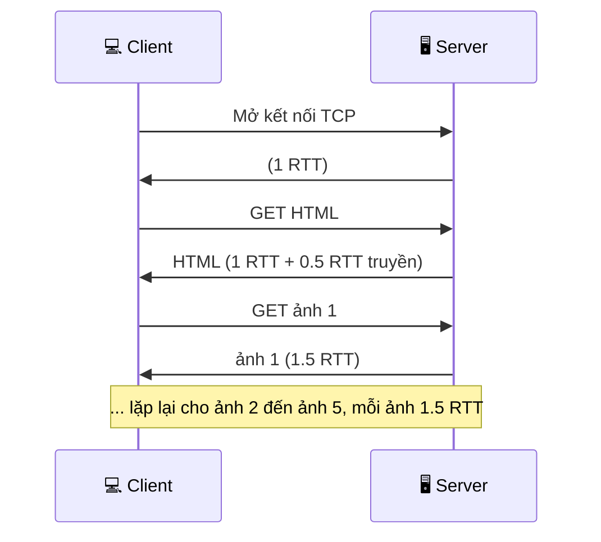

> [!TIP]
> So sánh các trường hợp cho cùng đề bài (6 đối tượng, mỗi đối tượng truyền 0.5 RTT):
>
> | Kiểu kết nối | Công thức | Kết quả |
> |---|---|---|
> | Không bền vững (mỗi đối tượng mở TCP riêng) | $6 \times (1 + 1 + 0.5)$ | 15 RTT |
> | Bền vững, không pipelining | $1 + 6 \times (1 + 0.5)$ | 10 RTT |
> | Bền vững, có pipelining (gửi request 5 ảnh cùng lúc sau khi nhận HTML) | $1 + (1 + 0.5) + (1 + 5 \times 0.5)$ | 6 RTT |
>
> Các đáp án nhiễu D (15 RTT) và B (6 RTT) chính là kết quả của hai kiểu kết nối còn lại.

**Câu hỏi 2**: Alice truy cập một trang web gồm **1 trang HTML và 4 ảnh**. Mỗi lần **thiết lập kết nối TCP mất 200 ms** và mỗi tài nguyên mất **200 ms để yêu cầu** và tốn **100 ms để nhận dữ liệu**. Biết trình duyệt dùng **HTTP persistent**, tổng thời gian để tải xong toàn bộ trang là bao nhiêu?

| Lựa chọn | Đáp án |
|---|---|
| A | 1300 ms |
| B | 1500 ms |
| **C** | **1700 ms** ✅ |
| D | 1900 ms |
| E | Khác |

**Lời giải** (persistent mặc định là **không pipelining**):

- Tổng số tài nguyên: 1 HTML + 4 ảnh = **5**.
- Bền vững → mở TCP **một lần**: 200 ms.
- Mỗi tài nguyên: 200 ms yêu cầu + 100 ms nhận dữ liệu = **300 ms**, lấy lần lượt từng cái.

$$T = 200 + 5 \times (200 + 100) = 200 + 1500 = 1700 \text{ ms}$$

> [!TIP]
> Đây chính là Câu hỏi 1 đổi đơn vị: 1 RTT = 200 ms, $d$ = 100 ms = 0.5 RTT, $N = 4$ ảnh → công thức animation $2 + d + N(1 + d) = 2.5 + 4 \times 1.5 = 8.5$ RTT $= 1700$ ms. Các đáp án nhiễu:
>
> | Cách tính | Kết quả |
> |---|---|
> | Không bền vững: $5 \times (200 + 200 + 100)$ | 2500 ms (E) |
> | Quên thời gian mở TCP: $5 \times 300$ | 1500 ms (B) |
> | Bền vững + pipelining, truyền nối đuôi: $200 + 300 + 200 + 4 \times 100$ | 1100 ms (E) |

**Câu hỏi 3**: Chọn câu phát biểu **ĐÚNG**?

| Lựa chọn | Phát biểu |
|---|---|
| A | Thông điệp HTTP Request được gửi từ Server đến trình duyệt người dùng |
| **B** | **Server sẽ không gửi kèm tài nguyên được yêu cầu với các mã 304, 404, 503** ✅ |
| C | HTTP1.1 là phiên bản đầu tiên của giao thức HTTP |
| D | A, B, C đều SAI |

**Lời giải**:

- **A sai**: Request đi từ **client (trình duyệt) → server**; chiều server → client là **Response**.
- **B đúng**: chỉ khi thành công (`200 OK`) server mới gửi kèm tài nguyên được yêu cầu:
  - `304 Not Modified`: tài nguyên không đổi → client dùng bản trong cache, response **không có body**.
  - `404 Not Found`: không tìm thấy tài nguyên → không có gì để gửi (có thể kèm trang báo lỗi, nhưng **không phải** tài nguyên được yêu cầu).
  - `503 Service Unavailable`: server tạm thời quá tải/bảo trì → không phục vụ được.
- **C sai**: trước HTTP/1.1 (1997) đã có **HTTP/0.9** (1991) và **HTTP/1.0** (1996).
- **D sai** vì B đúng.

**Câu 6**: Alice thực hiện truy cập vào một trang web **4 lần** và các mã trạng thái lần lượt nhận được là **200, 304, 404, 502**. Số lần Alice **xem được nội dung** trang web thành công?

| Lựa chọn | Đáp án |
|---|---|
| A | 1 lần |
| **B** | **2 lần** ✅ |
| C | 3 lần |
| D | 4 lần |

**Lời giải**:

| Mã | Ý nghĩa | Xem được nội dung? |
|---|---|---|
| `200 OK` | Thành công, response kèm nội dung trang | ✅ Có |
| `304 Not Modified` | Trang không đổi kể từ lần tải trước → trình duyệt hiển thị **bản trong cache** | ✅ Có |
| `404 Not Found` | Không tìm thấy trang trên server | ❌ Không |
| `502 Bad Gateway` | Server trung gian (gateway/proxy) nhận phản hồi không hợp lệ từ server phía sau | ❌ Không |

→ **2 lần** (200 và 304).

> [!WARNING]
> Bẫy dễ mắc: nghĩ `304` là lỗi vì response **không có body** (như Câu hỏi 3). Thực ra 304 thuộc nhóm `3xx`, không phải lỗi: server chỉ báo "bản bạn đang có vẫn mới", nên người dùng **vẫn xem được** nội dung từ cache.

**Câu 9**: Phát biểu nào sau đây là **SAI** về kiến trúc Client - Server (Máy khách - Máy chủ)?

| Lựa chọn | Phát biểu |
|---|---|
| A | Server luôn hoạt động, có địa chỉ IP cố định |
| B | Client có thể thay đổi địa chỉ IP |
| **C** | **Client có thể kết nối trực tiếp với nhau** ✅ (phát biểu SAI) |
| D | Client có thể kết nối với Server không liên tục |

**Lời giải**: A, B, D đúng theo đặc điểm của [mô hình Client-Server](#mo-hinh-may-khach-may-chu-client-server). **C sai**: trong Client-Server, client **không giao tiếp trực tiếp** với nhau, mọi trao đổi đều đi qua server. Giao tiếp trực tiếp giữa các đầu cuối là đặc điểm của **P2P**.

**Câu 10**: Với các giao thức sau đây: HTTP, SMTP, DNS, POP, FTP. Phát biểu nào sau đây **ĐÚNG**?

| Lựa chọn | Phát biểu |
|---|---|
| **A** | **Chỉ có DNS có thể dùng UDP, các giao thức còn lại dùng TCP** ✅ |
| B | Chỉ có HTTP dùng TCP, các giao thức còn lại dùng UDP |
| C | SMTP dùng dịch vụ ở tầng vận chuyển khác so với FTP |
| D | POP dùng dịch vụ ở tầng vận chuyển khác so với HTTP |

**Lời giải**:

| Giao thức | Tầng vận chuyển | Port mặc định |
|---|---|---|
| HTTP | TCP | 80 |
| SMTP | TCP | 25 |
| DNS | **UDP** (TCP khi phản hồi lớn/zone transfer) | 53 |
| POP3 | TCP | 110 |
| FTP | TCP | 20, 21 |

- **A đúng**: DNS cần truy vấn nhanh, gọn (1 request - 1 response) nên dùng UDP; các giao thức còn lại cần truyền **tin cậy** (email, file, trang web không được mất dữ liệu) nên dùng TCP. Khớp với gói DNS bắt bằng Wireshark ở buổi 2 (UDP, port 53).
- **B sai**: SMTP, POP, FTP cũng dùng TCP.
- **C, D sai**: SMTP, FTP, POP, HTTP đều dùng **cùng** dịch vụ TCP.

**Câu 11**: Phân tích một phần gói tin HTTP request từ trình duyệt gửi lên Web server như sau:

```text
GET /images/logo.png HTTP/1.1\r\n
Host: cdn.website.com\r\n
Connection: Keep-alive\r\n
```

Ta biết **có thể kết luận** điều gì?

| Lựa chọn | Phát biểu |
|---|---|
| A | Trình duyệt đang yêu cầu một ảnh động |
| **B** | **Trình duyệt sẽ giữ kết nối sau khi nhận phản hồi** ✅ |
| C | Trình duyệt sẽ đóng kết nối sau khi nhận phản hồi |
| D | URL yêu cầu là: `website.com/images/logo.png` |

**Lời giải**:

- **B đúng**: `Connection: Keep-alive` yêu cầu giữ kết nối TCP mở để dùng lại cho các request sau (**HTTP bền vững**).
- **C sai**: đóng kết nối ứng với `Connection: close`.
- **A sai**: `.png` là ảnh **tĩnh**; request không có thông tin gì cho thấy đây là ảnh động (ảnh động thường là `.gif`).
- **D sai**: URL = **Host** + **URI** = `cdn.website.com/images/logo.png` - đáp án D bỏ mất tên miền con `cdn`.

### Ước lượng độ trễ HTTP (animation tương tác)

Link: https://it005.landth.info/lecture/c2/http-delay-estimation/

Animation minh họa trực quan **độ trễ HTTP** khi truy cập một trang web gồm **một trang HTML cơ bản** và **một vài đối tượng được tham chiếu** (hình ảnh, audio, video...). Giả định tất cả các đối tượng (kể cả HTML) có **cùng kích thước** và cùng thời gian truyền.

**Các tham số chọn được:**

| Tham số | Giá trị |
|---|---|
| Kiểu kết nối | Không bền vững; Không bền vững + kết nối song song; Bền vững (không pipelining); Bền vững + pipelining |
| Số lượng kết nối song song $P$ | 1 - 4 (chỉ áp dụng cho "Không bền vững + kết nối song song") |
| Số lượng đối tượng tham chiếu $N$ | 1 - 4 (không tính file HTML) |
| Thời gian truyền mỗi đối tượng $d$ | 0; 0.25; 0.5; 1; 2 RTT |

**4 thành phần trễ** được tô màu trong sơ đồ:

1. Trễ vì quá trình **thiết lập kết nối TCP**: 1 RTT mỗi lần mở kết nối.
2. Trễ do **yêu cầu đối tượng HTML** (HTML): 1 RTT.
3. Trễ do **yêu cầu các đối tượng khác** (OR - Object Request): 1 RTT mỗi lượt yêu cầu.
4. Trễ do **thời gian truyền** (TD - Transmission Delay): $d$ mỗi lượt.

**Công thức** (rút ra từ mã nguồn của animation):

$$T = \underbrace{(1 + 1 + d)}_{\text{TCP + HTML}} + k \times (c + d)$$

- $c$ = số RTT "chi phí" mỗi lượt lấy đối tượng: **không bền vững** $c = 2$ (mở TCP mới + request), **bền vững** $c = 1$ (chỉ request).
- $k$ = số lượt lấy đối tượng:

| Kiểu kết nối | $c$ | $k$ | Công thức |
|---|---|---|---|
| Không bền vững | 2 | $N$ | $2 + d + N(2 + d)$ |
| Không bền vững + $P$ kết nối song song | 2 | $\lceil N/P \rceil$ | $2 + d + \lceil N/P \rceil (2 + d)$ |
| Bền vững (không pipelining) | 1 | $N$ | $2 + d + N(1 + d)$ |
| Bền vững + pipelining | 1 | 1 | $2 + d + (1 + d)$ |

**Ví dụ**: $N = 4$ đối tượng, $d = 0.5$ RTT:

| Kiểu kết nối | Tính | Tổng trễ |
|---|---|---|
| Không bền vững | $2.5 + 4 \times 2.5$ | 12.5 RTT |
| Không bền vững + 2 kết nối song song | $2.5 + 2 \times 2.5$ | 7.5 RTT |
| Không bền vững + 4 kết nối song song | $2.5 + 1 \times 2.5$ | 5 RTT |
| Bền vững | $2.5 + 4 \times 1.5$ | 8.5 RTT |
| Bền vững + pipelining | $2.5 + 1.5$ | 4 RTT |

> [!NOTE]
> Kiểm tra lại **Câu hỏi 1** ở trên bằng công thức: bền vững, $N = 5$ ảnh, $d = 0.5$ → $2 + 0.5 + 5 \times 1.5 = 10$ RTT, khớp đáp án C.

> [!WARNING]
> Với **pipelining**, animation **đơn giản hóa**: tính thời gian truyền của tất cả đối tượng chỉ là **một** $d$ (như thể truyền song song cùng lúc). Thực tế các đối tượng đi nối đuôi trên cùng một kết nối nên phần truyền là $N \times d$ - đó là cách tính $1 + (1 + 0.5) + (1 + 5 \times 0.5) = 6$ RTT ở bảng so sánh của Câu hỏi 1. Khi làm bài cần đọc kỹ đề bài/giảng viên dùng mô hình nào.

### HTTP/2: giảm thiểu HOL blocking

**Chặn đầu hàng** (Head-of-Line blocking, HOL blocking): đối tượng đứng đầu hàng đợi quá lớn làm **chặn** các đối tượng phía sau, dù chúng nhỏ và có thể gửi rất nhanh.

#### Vấn đề với HTTP/1.1

Máy khách yêu cầu **1 đối tượng lớn** (ví dụ: tập tin video) và **3 đối tượng nhỏ hơn**: gửi `GET O1`, `GET O2`, `GET O3`, `GET O4` trên cùng một kết nối TCP.

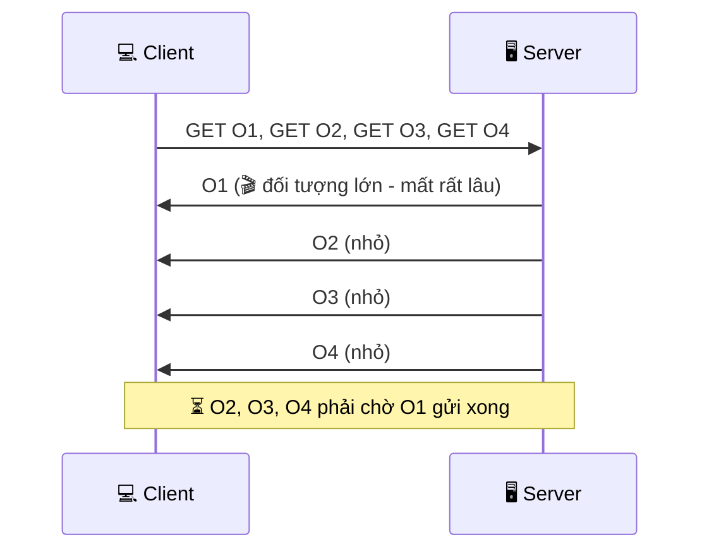

- HTTP/1.1 chuyển các đối tượng **theo đúng thứ tự yêu cầu** (FCFS - First-Come-First-Served).
- → **O2, O3, O4 chờ phía sau O1**: client phải đợi cả video tải xong mới nhận được các đối tượng nhỏ.

#### Giải pháp của HTTP/2: chia frame, truyền xen kẽ

HTTP/2: các đối tượng được **chia thành các frame** (khung nhỏ), và server **truyền frame xen kẽ** (interleaving) giữa các đối tượng.

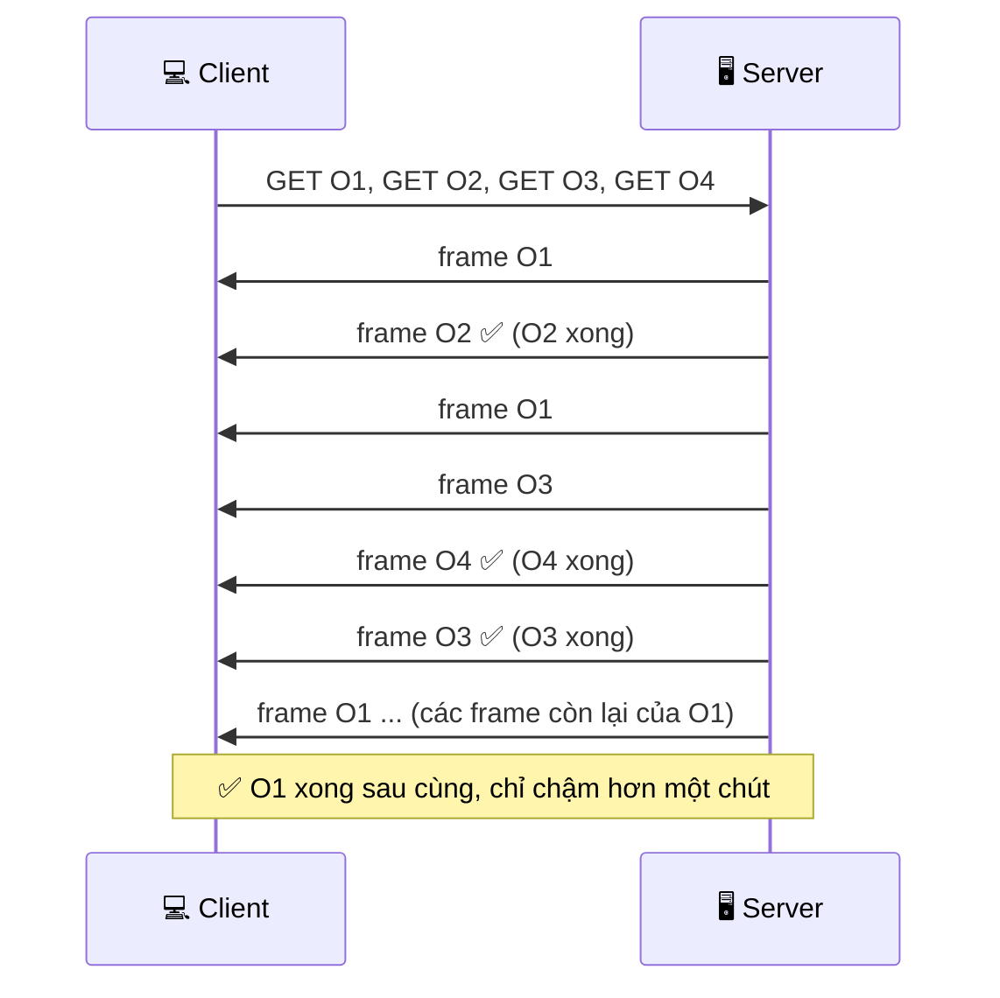

- Kết quả: **O2, O3, O4 được phân phối nhanh**, **O1 hơi chậm trễ** một chút.
- Thứ tự client nhận xong trong ví dụ: O2 → O4 → O3 → O1 (không còn bắt buộc theo thứ tự yêu cầu).

| | HTTP/1.1 | HTTP/2 |
|---|---|---|
| Đơn vị truyền | Cả đối tượng | Các **frame** của đối tượng |
| Thứ tự gửi | Theo thứ tự yêu cầu (FCFS) | **Xen kẽ** frame giữa các đối tượng |
| Đối tượng nhỏ sau đối tượng lớn | Phải chờ đối tượng lớn xong (**HOL blocking**) | Được gửi xong sớm |
| Đối tượng lớn | Xong sớm nhất | Hơi chậm hơn |

> [!TIP]
> Trải nghiệm người dùng: trang web hiện **ngay** các thành phần nhỏ (CSS, icon, ảnh nhỏ) thay vì đứng chờ một video lớn - đổi lại video chỉ chậm hơn rất ít. Đây là mục tiêu chính của HTTP/2: giảm độ trễ khi một kết nối phải chở nhiều đối tượng.

### Duy trì trạng thái người dùng/máy chủ: cookie

#### Nhắc lại: HTTP không lưu trữ trạng thái (stateless)

- **Không có khái niệm trao đổi nhiều bước** của thông điệp HTTP để hoàn thành một **"giao dịch" (transaction)** Web:
  - Không cần máy khách/máy chủ theo dõi **"trạng thái"** của quá trình trao đổi nhiều bước.
  - Tất cả các yêu cầu HTTP **độc lập với nhau**.
  - Máy khách/máy chủ **không cần phải khôi phục** những giao dịch chưa hoàn thành.

#### So sánh: giao thức lưu trạng thái (stateful)

Ví dụ: máy khách thực hiện **hai thay đổi** đối với bản ghi X, **hoặc không có thay đổi nào cả** (tất cả hoặc không có gì).

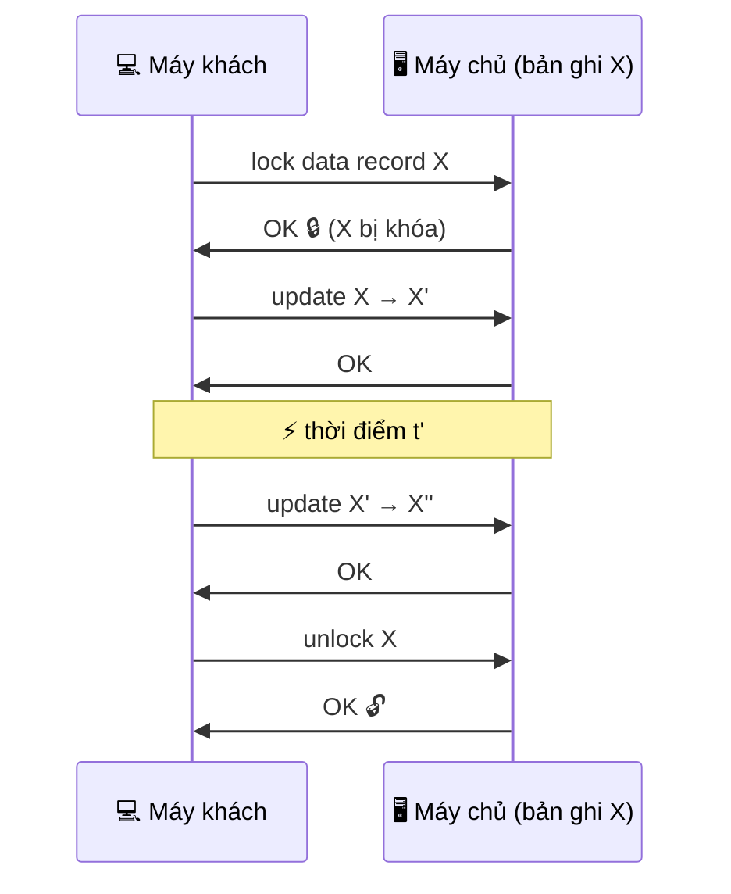

> [!WARNING]
> **Câu hỏi**: điều gì xảy ra nếu kết nối mạng hoặc máy khách **gặp sự cố tại thời điểm t'**?
>
> Bản ghi X đang **bị khóa** và ở trạng thái **dở dang** (đã đổi thành X' nhưng chưa thành X''). Máy chủ phải **nhớ trạng thái** của từng client để quyết định: chờ client quay lại, hay **hủy** thay đổi để khôi phục về X ban đầu và mở khóa. Việc theo dõi và khôi phục này rất phức tạp - đó là lý do HTTP được thiết kế **stateless**: mỗi request độc lập, server không phải giữ gì, sự cố giữa chừng không để lại trạng thái dở dang.

#### Cookie: khái niệm và 4 thành phần

Các trang web và trình duyệt của người dùng sử dụng ***cookie*** để **duy trì một số trạng thái giữa các phiên làm việc** (session).

**Bốn thành phần:**

1. Dòng **header cookie** của thông điệp **phản hồi** HTTP (`Set-cookie:`).
2. Dòng **header cookie** trong thông điệp **yêu cầu** HTTP tiếp theo (`Cookie:`).
3. **Tập tin cookie** được lưu giữ trên máy của người dùng, được quản lý bởi **trình duyệt** của người dùng.
4. **Cơ sở dữ liệu** tại Web site (back-end database).

Cookie được dùng để:

- **Xác thực** phiên đăng nhập (server nhận ra người dùng đã đăng nhập).
- Duy trì **giỏ hàng** thương mại điện tử.
- **Gợi ý** sản phẩm/nội dung dựa trên lịch sử truy cập.
- Giữ **trạng thái phiên** của người dùng (vd: webmail).

**Ví dụ:**

- Susan sử dụng trình duyệt trên máy tính xách tay, **lần đầu tiên** truy cập một trang web thương mại điện tử cụ thể.
- Khi yêu cầu HTTP ban đầu đến trang web, trang web sẽ tạo:
  - **ID duy nhất** (còn gọi là "cookie").
  - Một **bản ghi trong cơ sở dữ liệu** cho ID đó.
- Các yêu cầu HTTP tiếp theo từ Susan đến trang web này sẽ **chứa giá trị ID cookie**, cho phép trang web **"xác định"** Susan.

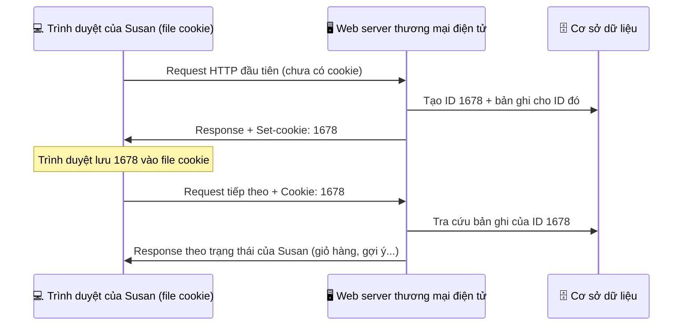

> [!NOTE]
> Ánh xạ 4 thành phần vào sơ đồ: (1) `Set-cookie: 1678` trong response; (2) `Cookie: 1678` trong các request sau; (3) file cookie trong trình duyệt của Susan; (4) cơ sở dữ liệu lưu bản ghi cho ID 1678. ID `1678` chỉ là giá trị minh họa - cùng cơ chế với `Set-cookie: mssv=aXtdl+ab` ở phần Tổng quan HTTP.

#### Cookie: ví dụ với máy chủ Amazon

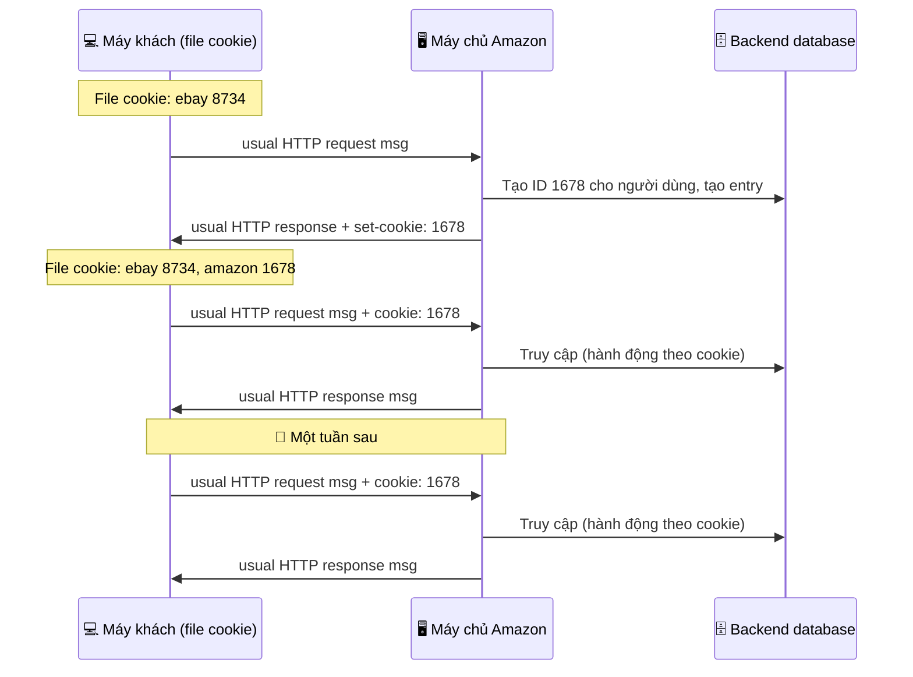

Diễn giải:

1. **Ban đầu** file cookie của máy khách chỉ có `ebay 8734` (cookie do eBay cấp trước đó) - chưa có gì cho Amazon nên request đầu tiên **không kèm cookie**.
2. Máy chủ Amazon **tạo ID 1678** cho người dùng, **tạo entry** trong backend database, và trả response kèm `set-cookie: 1678`.
3. Trình duyệt **thêm** `amazon 1678` vào file cookie → file giờ chứa cả `ebay 8734` và `amazon 1678`.
4. Các request tiếp theo đến Amazon kèm `cookie: 1678` → máy chủ **truy cập** database và thực hiện **hành động theo cookie** (cookie-specific action): hiển thị giỏ hàng, gợi ý sản phẩm...
5. **Một tuần sau**, người dùng quay lại: trình duyệt vẫn gửi `cookie: 1678` → Amazon vẫn nhận ra người dùng, dù đã qua nhiều phiên làm việc.

> [!TIP]
> Trình duyệt chỉ gửi cookie **cho đúng trang đã cấp nó**: request đến Amazon kèm `1678`, request đến eBay kèm `8734` - Amazon không thấy cookie của eBay và ngược lại.

> [!WARNING]
> Cookie cũng là công cụ **theo dõi người dùng** (tracking): **cookie bên thứ ba** (third-party cookie) nhúng trong quảng cáo cho phép đối tác quảng cáo nhận ra bạn trên nhiều trang khác nhau và xây hồ sơ duyệt web. Vì lý do riêng tư, các trình duyệt hiện nay chặn dần third-party cookie và trang web thường phải xin sự đồng ý trước khi đặt cookie.

> [!NOTE]
> Ghi chú buổi 3 kết thúc tại phần Cookie. Các nội dung còn lại của chương 2 - E-mail (SMTP, POP3, IMAP), DNS, P2P và lập trình socket - sẽ được bổ sung ở các buổi tiếp theo.
